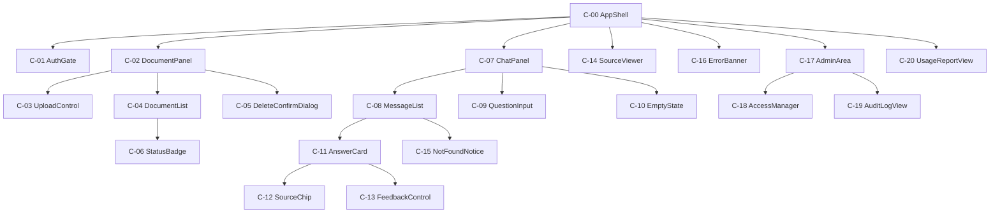
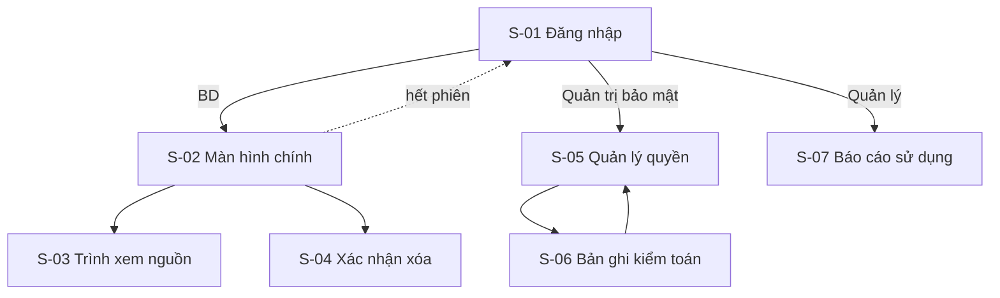
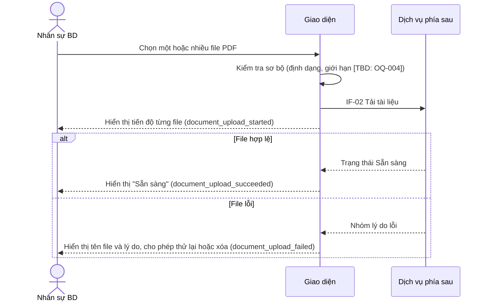
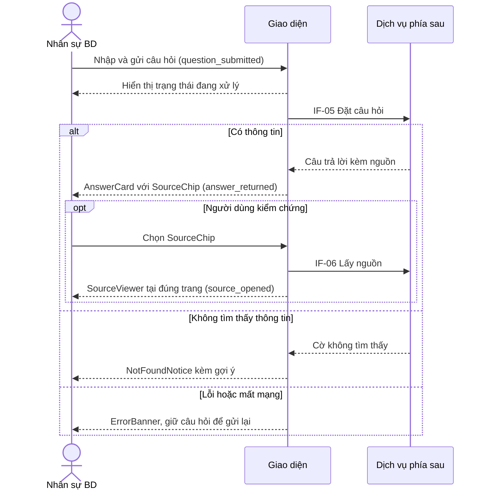
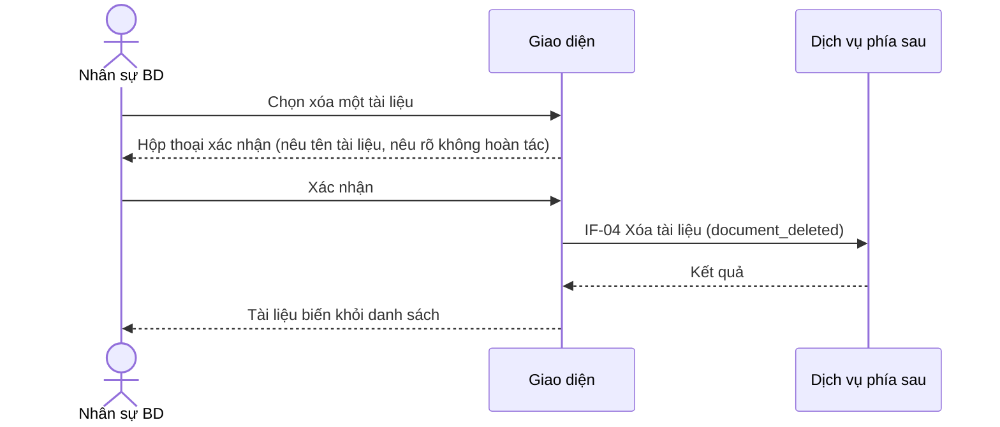
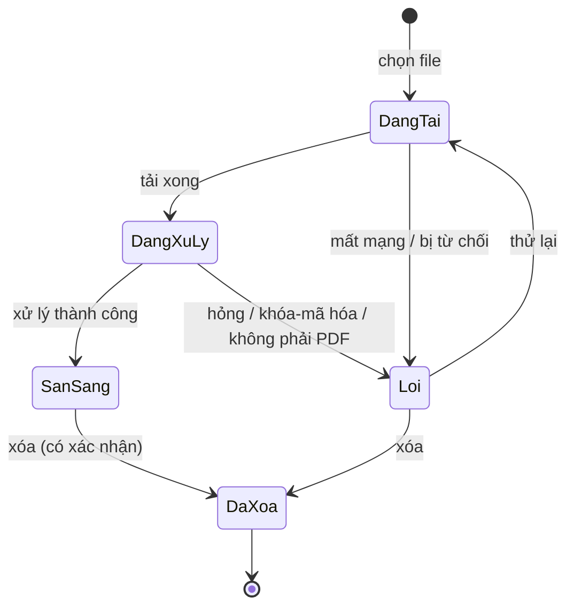
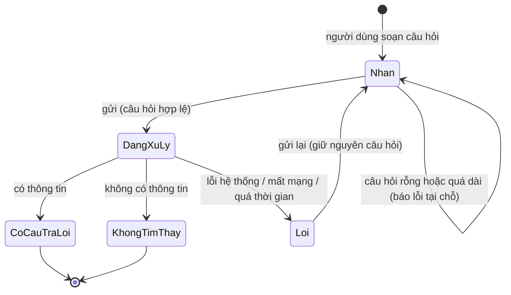
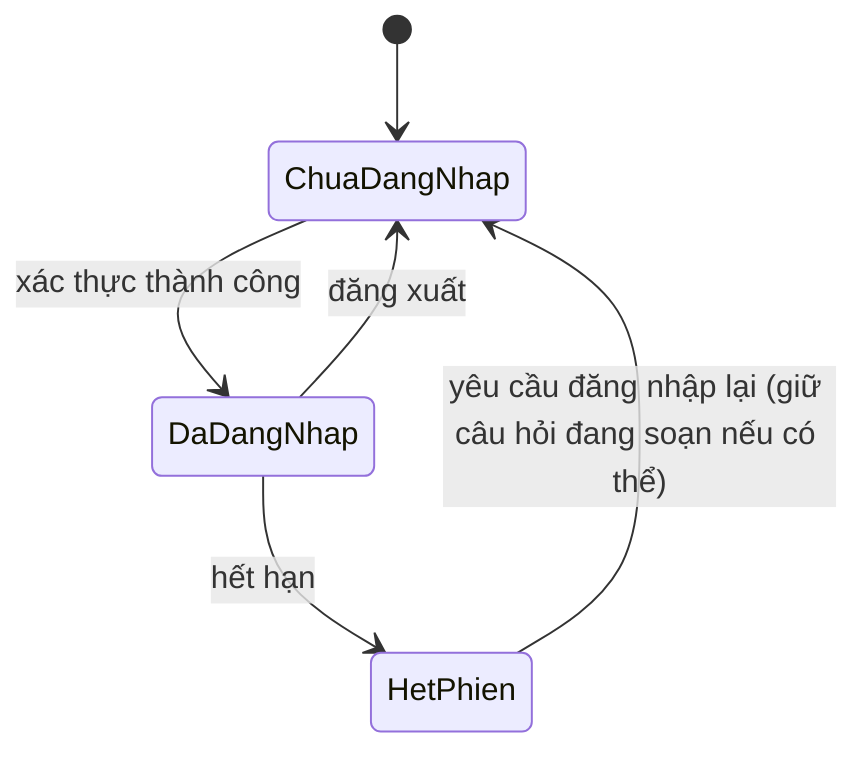

# BẢN THIẾT KẾ BLUEPRINT UI/UX — "CHAT VỚI TÀI LIỆU" (MVP)

> Chuẩn áp dụng: IEEE 1016-2009 (Software Design Descriptions). Nội dung theo `docs/design/bluePrint_design_prompt.md`.
> Đầu vào: `docs/requirements/PRD.md` (v0.1), `docs/requirements/BRD.md` (v0.2), `docs/requirements/UseCase_Diagram.drawio`.
> Quy ước: `[TBD: OQ-xxx]` = chưa có thông tin (OQ trong BRD mục 12, PQ trong PRD mục 7); `[Đề xuất]` = người soạn đề xuất, chưa được xác nhận.

**Phạm vi và các điểm cần lưu ý về đầu vào**
- Prompt chỉ mô tả chi tiết Composition View nhưng yêu cầu **tám view**. Tôi chọn tám view phù hợp nhất với blueprint UI/UX: Composition, Logical, Dependency, Information, Interface, Interaction, State Dynamics, Resource (mục 3.1 đến 3.8). Chọn này cần người phê duyệt xác nhận (xem DQ-001).
- Tài liệu này là blueprint ở **mức thiết kế giao diện**: không chọn framework, thư viện UI hay nhà cung cấp AI. Các lựa chọn đó thuộc tài liệu kiến trúc (SAD).
- Trụ cột UX trong PRD mục 4.0 vẫn là đề xuất (PQ-001). Blueprint này dựa trên các trụ cột đó và sẽ đổi theo khi PQ-001 được chốt.

---

## 1. Bối cảnh và đối tượng thiết kế

### 1.1 Định danh hệ thống

| Thuộc tính | Giá trị |
|---|---|
| Tên hệ thống | Chat với tài liệu (MVP) |
| Phiên bản SDD | v0.1 (Draft) |
| Ngày tài liệu | 2026-10-20 |
| Chủ sở hữu tài liệu | [TBD: OQ-008] |
| Lịch sử sửa đổi | v0.1 — 2026-10-20 — [TBD: OQ-008] — Bản nháp đầu tiên từ PRD v0.1 |

### 1.2 Phạm vi hệ thống và ranh giới bên ngoài

| Loại ranh giới | Mô tả |
|---|---|
| Mục đích hệ thống | Ứng dụng web cho phép nhân sự BD tải PDF lên và hỏi đáp với AI trên toàn bộ tài liệu đã tải, nhận câu trả lời kèm nguồn (BRD mục 2) |
| Hệ thống bên ngoài | Dịch vụ AI ngoài tổ chức (tác nhân phụ trong sơ đồ use case, có hay không còn chờ OQ-006). Không có tích hợp CRM/DMS/email (BRD mục 5.2) |
| Loại người dùng | Nhân sự BD, Quản trị bảo mật, Quản lý (cùng kế thừa "Người dùng đã đăng nhập") |
| Giao diện bên ngoài | Giao diện web cho người dùng; giao diện giữa giao diện và dịch vụ phía sau mô tả ở mức thao tác tại mục 3.5; chi tiết API thuộc tài liệu thiết kế API |
| Ranh giới tin cậy | (1) Trình duyệt người dùng; (2) Dịch vụ phía sau do tổ chức vận hành; (3) Dịch vụ AI bên ngoài. Dữ liệu tài liệu qua ranh giới (3) bị chi phối bởi OQ-005, OQ-006 và BRU-003 |
| Môi trường triển khai | [TBD: OQ-006, DEP-003] — thuộc SAD |

### 1.3 Giả định và ràng buộc

| Loại | Mô tả | Nguồn |
|---|---|---|
| Ràng buộc kỹ thuật | Ứng dụng web; đầu vào chỉ là PDF; chưa hỗ trợ ảnh scan | CON-001, CON-002, BRD mục 5.3 |
| Ràng buộc kinh doanh | Ngân sách và thời hạn [TBD: OQ-009]; phạm vi MVP | CON-003, CON-004 |
| Giả định môi trường | Người dùng dùng trình duyệt hiện đại trên máy tính; kết nối mạng ổn định [Đề xuất]. Danh sách trình duyệt hỗ trợ [TBD: PQ-001] | PRD mục 4.0 |
| Giả định dữ liệu | Số lượng và dung lượng PDF [TBD: OQ-004]; ngôn ngữ [TBD: OQ-007]; lưu giữ và xóa dữ liệu [TBD: OQ-012]; lịch sử hội thoại có lưu giữa các phiên không [TBD: PQ-004] | BRD, PRD |

---

## 2. Stakeholder và mối quan tâm

### 2.1 Stakeholder

| ID | Stakeholder | Vai trò | Mối quan tâm chính | Nguồn |
|---|---|---|---|---|
| SH-01 | Nhân sự BD | Người dùng chính (STK-001, P1) | Dùng dễ, nhanh, kiểm chứng được câu trả lời | BRD mục 6 |
| SH-02 | Người dùng hoài nghi | Nhân sự BD không tin AI (STK-006, P2) | Thấy rõ nguồn, biết khi AI không có thông tin | BRD mục 6 |
| SH-03 | Quản lý | Đánh giá MVP (STK-002, P3) | Số liệu sử dụng, tỷ lệ chấp nhận | BRD mục 6 |
| SH-04 | Quản trị bảo mật | CNTT/bảo mật/pháp chế (STK-004, P4) | Kiểm soát truy cập, kiểm toán, xóa dữ liệu | BRD mục 6 |
| SH-05 | Nhà thiết kế UI/UX | Thiết kế giao diện chi tiết | Tính nhất quán, cơ sở thiết kế rõ ràng | [Unverified] |
| SH-06 | Lập trình viên | Xây dựng giao diện | Thành phần rõ ràng, trạng thái và lỗi được định nghĩa | [Unverified] |
| SH-07 | QA | Kiểm thử | Tiêu chí kiểm tra được | [Unverified] |
| SH-08 | Chủ sản phẩm | Business owner/PM | Đúng phạm vi MVP, đo được hiệu quả | BRD mục 14 |

### 2.2 Mối quan tâm (Concerns)

| ID | Stakeholder | Mối quan tâm | Ưu tiên | Tiêu chí chấp nhận | Nguồn |
|---|---|---|---|---|---|
| CN-01 | SH-01 | Từ lúc đăng nhập đến câu trả lời đầu tiên chỉ cần ít bước | Cao | Người dùng lần đầu hoàn thành "tải 1 PDF rồi hỏi" trong tối đa [Đề xuất: 3 bước chính]; thời gian mục tiêu [TBD: OQ-002] | PRD 4.0, KR1.1 |
| CN-02 | SH-01, SH-02 | Mỗi câu trả lời cho thấy nguồn và mở được tới đúng trang | Cao | 100% câu trả lời có nội dung hiển thị nguồn (tài liệu và trang); chọn nguồn mở đúng trang | BR-012, BR-019 |
| CN-03 | SH-02 | Biết rõ khi tài liệu không có thông tin | Cao | Câu hỏi ngoài phạm vi nhận thông báo không tìm thấy, không có câu trả lời bịa | BR-009 |
| CN-04 | SH-01 | Biết trạng thái từng tài liệu và lý do khi lỗi | Cao | Mỗi file hiển thị đúng một trạng thái; lỗi nêu tên file và nhóm lý do | BR-003, BR-018 |
| CN-05 | SH-01 | Hỏi tiếp mà không nhắc lại ngữ cảnh | Trung bình | Câu hỏi tiếp theo dùng đúng ngữ cảnh trước đó | BR-008 |
| CN-06 | SH-04 | Chỉ người được phép mới vào và thấy tài liệu của mình | Cao | Người chưa có quyền không vào được; người dùng chỉ thấy tài liệu thuộc phạm vi | BR-014, BR-020 |
| CN-07 | SH-04 | Xóa tài liệu rõ ràng và có xác nhận | Cao | Xóa cần bước xác nhận; sau xóa tài liệu biến khỏi danh sách và câu trả lời | BR-005, BR-024 |
| CN-08 | SH-03 | Có số liệu sử dụng và phản hồi | Trung bình | Báo cáo hằng tuần có số người dùng hoạt động và số câu hỏi | BR-016, BR-021 |
| CN-09 | SH-01 | Phản hồi nhanh, người dùng luôn biết hệ thống đang làm gì | Cao | Hiển thị trạng thái đang xử lý trong [Đề xuất: ≤ 300 ms] sau khi gửi; thời gian trả lời [TBD: OQ-002] | BR-011 |
| CN-10 | SH-01 | Giao diện dùng được bằng bàn phím và đọc được | Trung bình | Đáp ứng WCAG 2.1 AA [Đề xuất] | [Unverified] |
| CN-11 | SH-06, SH-07 | Mọi trạng thái, lỗi và trường hợp biên được định nghĩa | Cao | 100% tình huống ở PRD mục 4.2 có hành vi giao diện được mô tả | PRD 4.2 |

### 2.3 Kịch bản thuộc tính chất lượng (sáu thành phần)

Mỗi dòng gồm Source / Stimulus / Artifact / Environment / Response / Response Measure. Các giá trị chưa có trong PRD là `[Đề xuất]` hoặc `[TBD]`.

| Thuộc tính | Source | Stimulus | Artifact | Environment | Response | Response Measure |
|---|---|---|---|---|---|---|
| Hiệu năng | Nhân sự BD | Gửi câu hỏi | Giao diện hội thoại | Tải bình thường | Hiển thị trạng thái đang xử lý, rồi câu trả lời | Trạng thái xuất hiện ≤ [Đề xuất: 300 ms]; câu trả lời ≤ [TBD: OQ-002] giây ở ≥ [TBD: OQ-002]% câu (BR-011) |
| Bảo mật | Người chưa được cấp quyền | Mở địa chỉ ứng dụng | Màn hình đăng nhập | Bình thường | Từ chối và không tiết lộ tài liệu | 0 tài liệu hiển thị; kiểm thử LG-07 |
| Khả dụng | Nhân sự BD | Mất kết nối khi đang hỏi | Hội thoại | Mạng gián đoạn | Báo lỗi, giữ lại câu hỏi để gửi lại | Không mất câu hỏi đang soạn; không hiển thị câu trả lời dở dang như hoàn chỉnh |
| Khả năng bảo trì | Lập trình viên | Thêm một loại trạng thái lỗi mới | Thành phần thông báo lỗi | Phát triển | Thêm trong một thành phần dùng chung | Ảnh hưởng ≤ [Đề xuất: 2] màn hình |
| Khả năng kiểm thử | QA | Kiểm tra trạng thái lỗi | Toàn bộ giao diện | Kiểm thử | Mọi trạng thái ở mục 3.7 đạt được bằng dữ liệu kiểm thử | 100% trạng thái có ca kiểm thử |

### 2.4 Kịch bản thuộc tính chất lượng UX/UI

| Thuộc tính | Kịch bản UX/UI | Trạng thái |
|---|---|---|
| Tính dễ dùng | Người dùng lần đầu tải 1 PDF rồi nhận câu trả lời đầu tiên mà không cần hướng dẫn ngoài giao diện | Thời gian mục tiêu [TBD: OQ-002] |
| Khả năng tiếp cận | Mọi điều khiển dùng được bằng bàn phím và đọc được bằng trình đọc màn hình | WCAG 2.1 AA [Đề xuất] |
| Hiệu năng giao diện | Màn hình chính hiển thị nội dung đầu tiên nhanh | FCP < [Đề xuất: 1,5 s], LCP < [Đề xuất: 2,5 s] trên kết nối 4G |
| Đáp ứng kích thước | Giao diện dùng được từ 1024 px đến 2560 px chiều rộng không cuộn ngang; dưới 1024 px chỉ yêu cầu hiển thị được (di động bản địa ngoài phạm vi, BRD 5.2) | [Đề xuất], chờ PQ-001 |
| Nhất quán hình ảnh | Màu, kiểu chữ, khoảng cách, thành phần theo một bộ quy chuẩn chung | 100% màn hình theo quy chuẩn [Đề xuất] |
| Phục hồi lỗi | Lỗi tải lên và lỗi hỏi đáp được hiển thị ngay tại chỗ và người dùng khắc phục không cần tải lại trang | Theo PRD 4.2 |
| Phản hồi và gợi ý thao tác | Mọi phần tử bấm được có trạng thái hover/focus/active; thao tác bất đồng bộ có trạng thái chờ | ≤ [Đề xuất: 300 ms] |
| Kiến trúc thông tin | Người dùng thực hiện chức năng chính từ màn hình chính; chức năng phụ trong tối đa 2 lần bấm | [Đề xuất] |
| Quốc tế hóa | Giao diện tiếng Việt; hỗ trợ tài liệu và câu hỏi bằng các ngôn ngữ [TBD: OQ-007]; định dạng ngày giờ theo địa phương | Chờ OQ-007 |
| Trải nghiệm di động | Không thuộc MVP; nếu mở rộng, mục tiêu cảm ứng tối thiểu 44 px | Chờ PQ-001 |

### 2.5 Ma trận ràng buộc UX/UI

| Ràng buộc | Yêu cầu | Chuẩn/công cụ | Cách xác minh |
|---|---|---|---|
| Tương phản màu | Tối thiểu 4,5:1 cho chữ thường | WCAG 2.1 AA [Đề xuất] | Kiểm tra tự động và thủ công |
| Kiểu chữ | Chữ nội dung ≥ 16 px, co giãn được | Quy chuẩn thiết kế [TBD] | Rà soát thiết kế |
| Vùng bấm | ≥ 44×44 px nếu hỗ trợ cảm ứng | Apple HIG / Material [Đề xuất] | Kiểm thử giao diện |
| Trạng thái chờ | Hiển thị chỉ báo trong ≤ 300 ms | Thực hành UX | Giám sát hiệu năng |
| Thông báo lỗi | Rõ ràng, nêu cách khắc phục, không dùng thuật ngữ kỹ thuật | Hướng dẫn viết UX | Rà soát nội dung |
| Trạng thái trống | Mọi trạng thái trống chỉ ra bước tiếp theo | Thực hành UX | Kiểm kê giao diện |
| Thông báo | Không gây gián đoạn; ưu tiên hiển thị tại chỗ | Thực hành UX | Kiểm thử người dùng |
| Trợ giúp và hướng dẫn | Gợi ý theo ngữ cảnh ở trạng thái trống và khi lỗi | Thực hành UX | Chỉ số hoàn thành tác vụ |
| Bảo vệ dữ liệu trên giao diện | Không hiển thị tài liệu của người khác; che địa chỉ nội bộ trong thông báo lỗi | BR-020, BRU-004 | Kiểm thử bảo mật |

---

## 3. Các view thiết kế

Mỗi view ghi rõ mối quan tâm (CN-xx) mà nó giải quyết.

### 3.1 Composition View — phân rã thành phần giao diện

**Mục đích:** mô tả giao diện được ghép từ những đơn vị nhỏ hơn nào.
**Mối quan tâm giải quyết:** CN-10, CN-11; tính dễ hiểu và tính mô-đun.

| ID | Thành phần | Loại | Cha | Trách nhiệm | Phụ thuộc |
|---|---|---|---|---|---|
| C-00 | AppShell | Khung | Gốc | Bố cục chung, điều hướng, vùng thông báo | C-01 |
| C-01 | AuthGate | Mô-đun | C-00 | Đăng nhập, xử lý hết phiên | — |
| C-02 | DocumentPanel | Mô-đun | C-00 | Vùng tài liệu: tải lên, danh sách, xóa | C-03, C-04, C-05 |
| C-03 | UploadControl | Thành phần | C-02 | Chọn nhiều file, hiển thị tiến độ từng file | — |
| C-04 | DocumentList | Thành phần | C-02 | Danh sách tài liệu và trạng thái (đang xử lý, sẵn sàng, lỗi) | C-06 |
| C-05 | DeleteConfirmDialog | Hộp thoại | C-02 | Xác nhận xóa tài liệu | — |
| C-06 | StatusBadge | Thành phần dùng chung | C-04 | Hiển thị trạng thái và lý do lỗi | — |
| C-07 | ChatPanel | Mô-đun | C-00 | Vùng hội thoại | C-08, C-09, C-10 |
| C-08 | MessageList | Thành phần | C-07 | Hiển thị lịch sử câu hỏi và câu trả lời | C-11, C-12 |
| C-09 | QuestionInput | Thành phần | C-07 | Nhập và gửi câu hỏi, giới hạn độ dài [TBD: PQ-002] | — |
| C-10 | EmptyState | Thành phần dùng chung | C-07, C-02 | Hướng dẫn khi chưa có tài liệu hoặc chưa có hội thoại | — |
| C-11 | AnswerCard | Thành phần | C-08 | Nội dung câu trả lời, nguồn, nút đánh giá | C-12, C-13 |
| C-12 | SourceChip | Thành phần | C-11 | Hiển thị "tên tài liệu, trang" và mở trình xem nguồn | C-14 |
| C-13 | FeedbackControl | Thành phần | C-11 | Đánh giá hữu ích hoặc không (P2) | — |
| C-14 | SourceViewer | Hộp thoại/vùng | C-00 | Mở tài liệu tại đúng trang để đối chiếu | — |
| C-15 | NotFoundNotice | Thành phần dùng chung | C-08 | Thông báo không tìm thấy thông tin kèm gợi ý | — |
| C-16 | ErrorBanner | Thành phần dùng chung | C-00 | Lỗi mạng, lỗi hệ thống, hết phiên | — |
| C-17 | AdminArea | Mô-đun | C-00 | Quản lý quyền và bản ghi kiểm toán (chỉ quản trị bảo mật) | C-18, C-19 |
| C-18 | AccessManager | Thành phần | C-17 | Cấp và thu hồi quyền sử dụng (UC-15) | — |
| C-19 | AuditLogView | Thành phần | C-17 | Xem bản ghi truy vấn (UC-16) | — |
| C-20 | UsageReportView | Mô-đun | C-00 | Báo cáo mức sử dụng (UC-17, chỉ quản lý) | — |

**Sơ đồ:**



### 3.2 Logical View — kiến trúc thông tin và màn hình

**Mục đích:** mô tả các màn hình, vùng và cách chuyển giữa chúng.
**Mối quan tâm giải quyết:** CN-01, CN-11; kiến trúc thông tin.

**Danh mục màn hình**

| ID | Màn hình | Người dùng | Mục đích | Story PRD |
|---|---|---|---|---|
| S-01 | Đăng nhập | Mọi người dùng | Xác thực; thông báo khi không có quyền hoặc hết phiên | US-017 |
| S-02 | Màn hình chính (tài liệu + hội thoại) | Nhân sự BD | Tải lên, quản lý tài liệu, hỏi đáp | US-001..016 |
| S-03 | Trình xem nguồn | Nhân sự BD | Mở tài liệu tại trang nguồn để đối chiếu | US-014, US-015 |
| S-04 | Xác nhận xóa | Nhân sự BD | Xác nhận trước khi xóa | US-006, US-007 |
| S-05 | Quản lý quyền | Quản trị bảo mật | Cấp, thu hồi quyền | US-017, US-018 |
| S-06 | Bản ghi kiểm toán | Quản trị bảo mật | Xem ai hỏi tài liệu nào, khi nào | US-020 |
| S-07 | Báo cáo mức sử dụng | Quản lý | Số người dùng hoạt động, số câu hỏi | US-022, US-023 |

**Sơ đồ điều hướng**



Ghi chú về người dùng nhiều vai trò: việc một người đồng thời có vai trò Quản trị bảo mật hoặc Quản lý và cần chuyển giữa các khu vực chưa được xác định, xem DQ-002.

**Bố cục màn hình chính S-02 (wireframe mức thấp, không phải thiết kế hình ảnh cuối cùng)**

```
+------------------------------------------------------------------------------+
| [Logo]  Chat với tài liệu                          [Tên người dùng] [Đăng xuất]|
+----------------------------+-------------------------------------------------+
| TÀI LIỆU CỦA TÔI           | HỘI THOẠI                                       |
| [ + Tải PDF lên ]          |                                                 |
|                            |  Bạn: Điều khoản thanh toán của hợp đồng A?     |
| [v] HopDong_A.pdf   Sẵn sàng|  AI : ... câu trả lời ...                       |
| [~] BaoGia_B.pdf  Đang xử lý|       Nguồn: [HopDong_A.pdf, tr.5] [BaoGia_B.pdf, tr.2]|
| [!] TaiLieu_C.pdf   Lỗi: bị khóa|     [Hữu ích] [Không hữu ích]                 |
|     (Thử lại / Xóa)        |                                                 |
|                            |  Bạn: Còn điều khoản phạt?                      |
|                            |  AI : Không tìm thấy thông tin trong tài liệu.  |
|                            |       Hãy thêm tài liệu hoặc đổi câu hỏi.       |
|                            +-------------------------------------------------+
|                            | [ Nhập câu hỏi...                    ] [ Gửi ]  |
+----------------------------+-------------------------------------------------+
```

### 3.3 Dependency View — phụ thuộc giữa các thành phần

**Mục đích:** chỉ ra thành phần nào cần thành phần nào, để biết thứ tự xây dựng và tác động khi thay đổi.
**Mối quan tâm giải quyết:** CN-11; khả năng bảo trì.

| Thành phần | Phụ thuộc vào | Lý do |
|---|---|---|
| C-02 DocumentPanel | C-06 StatusBadge, C-10 EmptyState, C-16 ErrorBanner | Hiển thị trạng thái, trạng thái trống và lỗi |
| C-07 ChatPanel | C-02 (danh sách tài liệu sẵn sàng), C-10, C-15, C-16 | Chỉ hỏi khi có tài liệu sẵn sàng; hiển thị trạng thái |
| C-11 AnswerCard | C-12 SourceChip → C-14 SourceViewer | Nguồn mở được tới đúng trang |
| C-17 AdminArea | C-01 AuthGate (vai trò) | Chỉ quản trị bảo mật vào được |
| C-20 UsageReportView | C-01 AuthGate (vai trò) | Chỉ quản lý vào được |
| Toàn bộ giao diện | Dịch vụ phía sau (mục 3.5), mô-đun xác thực | Dữ liệu và quyền |

Thứ tự xây dựng đề xuất: C-16, C-10, C-06 (thành phần dùng chung) → C-01 → C-02/C-03/C-04 → C-07/C-09/C-11/C-12 → C-14 → C-05 → C-13 → C-17..C-20. Thứ tự này phục vụ ưu tiên P0 trước P1/P2 (PRD mục 3).

### 3.4 Information View — dữ liệu hiển thị trên giao diện

**Mục đích:** mô tả dữ liệu mà giao diện hiển thị hoặc thu thập (không phải lược đồ cơ sở dữ liệu).
**Mối quan tâm giải quyết:** CN-02, CN-04, CN-08.

| Thực thể | Thuộc tính hiển thị | Ghi chú |
|---|---|---|
| Document | id, tên, dung lượng, số trang, trạng thái, thời điểm tải, lý do lỗi | Trạng thái: Đang tải, Đang xử lý, Sẵn sàng, Lỗi. Lý do lỗi thuộc nhóm: hỏng, bị khóa/mã hóa, không phải PDF, vượt giới hạn, lỗi mạng (BR-018) |
| Message | id, vai trò (người dùng / AI), nội dung, thời điểm | Lưu giữa các phiên [TBD: PQ-004] |
| Answer | nội dung, danh sách nguồn, cờ "không tìm thấy", thời gian phản hồi | Cờ này quyết định hiển thị C-15 |
| Source | id tài liệu, tên tài liệu, số trang | Mỗi nguồn mở được tại đúng trang (BR-019) |
| Feedback | id câu trả lời, hữu ích / không hữu ích | P2 (BR-017) |
| UsageSummary | số người dùng hoạt động theo tuần, số câu hỏi theo tuần | BR-016, BR-021 |
| AuditRecord | người dùng, tài liệu liên quan, thời điểm | Lưu tối thiểu [TBD: OQ-012] ngày (BR-023) |
| AccessGrant | người dùng, quyền, phạm vi chia sẻ | Phạm vi [TBD: OQ-003] |

Không đưa nội dung tài liệu và nội dung câu hỏi vào kênh phân tích trừ khi chính sách cho phép (PRD 5.2, PQ-003).

### 3.5 Interface View — giao diện giữa UI và dịch vụ phía sau

**Mục đích:** nêu các thao tác giao diện cần từ dịch vụ phía sau, ở mức logic. Chi tiết API (đường dẫn, mã lỗi, lược đồ) thuộc tài liệu thiết kế API.
**Mối quan tâm giải quyết:** CN-02, CN-04, CN-06, CN-07, CN-11.

| ID | Thao tác | Đầu vào | Đầu ra | Lỗi cần xử lý trên UI | Story |
|---|---|---|---|---|---|
| IF-01 | Đăng nhập | thông tin xác thực | phiên làm việc, vai trò | Sai thông tin; không có quyền; hết phiên | US-017 |
| IF-02 | Tải tài liệu | một hoặc nhiều file PDF | trạng thái từng file | File hỏng/khóa/không phải PDF; vượt giới hạn; mất mạng | US-001..004 |
| IF-03 | Lấy danh sách tài liệu | — | danh sách Document | Mất mạng; không có quyền | US-005 |
| IF-04 | Xóa tài liệu | id tài liệu | kết quả | Không tìm thấy; không có quyền | US-006, US-007 |
| IF-05 | Đặt câu hỏi | nội dung câu hỏi, ngữ cảnh hội thoại | Answer (nội dung, nguồn, cờ không tìm thấy) | Quá thời gian [TBD: OQ-002]; lỗi hệ thống; mất mạng | US-008..013 |
| IF-06 | Lấy nguồn để xem | id tài liệu, số trang | nội dung trang | Tài liệu đã bị xóa | US-014, US-015 |
| IF-07 | Gửi đánh giá | id câu trả lời, giá trị | xác nhận | Mất mạng | US-024 |
| IF-08 | Quản lý quyền | người dùng, quyền | kết quả | Không có quyền | US-017, US-018 |
| IF-09 | Lấy bản ghi kiểm toán | khoảng thời gian | danh sách AuditRecord | Không có quyền | US-020 |
| IF-10 | Lấy báo cáo sử dụng | khoảng thời gian | UsageSummary | Không có quyền | US-022, US-023 |

Giao diện còn phát sinh sự kiện phân tích ở PRD mục 5.2 (ví dụ `question_submitted`, `answer_returned`, `source_opened`). Điểm phát sinh từng sự kiện trong giao diện được ghi ở mục 3.6.

### 3.6 Interaction View — luồng tương tác

**Mục đích:** mô tả các tương tác giữa người dùng, giao diện và dịch vụ phía sau theo thời gian.
**Mối quan tâm giải quyết:** CN-01, CN-02, CN-03, CN-04, CN-09.

**Luồng 1 — Tải PDF lên (US-001..004)**



**Luồng 2 — Đặt câu hỏi và nhận câu trả lời (US-008..015)**



**Luồng 3 — Xóa tài liệu (US-006, US-007)**



### 3.7 State Dynamics View — trạng thái

**Mục đích:** mô tả các trạng thái của thành phần chính và điều kiện chuyển trạng thái.
**Mối quan tâm giải quyết:** CN-04, CN-09, CN-11.

**Trạng thái tài liệu (C-04, C-06)**



**Trạng thái một lượt hỏi đáp (C-07, C-11)**



**Trạng thái phiên (C-01)**



**Trạng thái giao diện theo điều kiện (xử lý trường hợp biên, PRD 4.2)**

| Điều kiện | Thành phần | Hành vi giao diện |
|---|---|---|
| Chưa có tài liệu | C-02, C-07, C-10 | Hiển thị trạng thái trống hướng dẫn tải PDF; ô nhập câu hỏi bị vô hiệu kèm lời giải thích |
| Có tài liệu đang xử lý | C-04, C-07 | Hiển thị "Đang xử lý"; câu trả lời cảnh báo chưa dùng tài liệu đó |
| Có tài liệu lỗi | C-04, C-06 | Hiển thị lý do lỗi và thao tác thử lại / xóa |
| PDF scan (không có văn bản) | C-04 | Thông báo chưa hỗ trợ trong MVP [TBD: OQ-007] |
| Vượt giới hạn dung lượng/số lượng | C-03 | Từ chối file, nêu giới hạn [TBD: OQ-004] |
| Mất kết nối khi tải lên | C-03, C-16 | Báo lỗi theo từng file chưa xong, cho phép tải lại; không hiện trạng thái "đã vào" |
| Mất kết nối khi hỏi | C-07, C-16 | Giữ câu hỏi, cho phép gửi lại; không hiện câu trả lời dở dang như hoàn chỉnh |
| Câu hỏi rỗng / quá dài | C-09 | Chặn gửi, nêu giới hạn [TBD: PQ-002] |
| Câu trả lời quá [TBD: OQ-002] giây | C-07 | Hiển thị thông báo đang chờ, cho phép hủy hoặc thử lại |
| Hết phiên | C-01 | Yêu cầu đăng nhập lại |
| Không có quyền với tài liệu | C-04, C-07 | Không hiển thị và không dùng tài liệu đó |

### 3.8 Resource View — ngân sách hiệu năng và tiếp cận

**Mục đích:** nêu các mức giới hạn tài nguyên giao diện phải tôn trọng. Mọi con số là đề xuất cho tới khi có OQ-002.
**Mối quan tâm giải quyết:** CN-09, CN-10.

| Tài nguyên | Ngân sách | Cách đo |
|---|---|---|
| Trạng thái chờ sau thao tác bất đồng bộ | ≤ [Đề xuất: 300 ms] | Giám sát hiệu năng |
| Thời gian câu trả lời | ≤ [TBD: OQ-002] giây ở ≥ [TBD: OQ-002]% câu | Bộ câu hỏi chuẩn (LG-05) |
| FCP / LCP màn hình chính | < [Đề xuất: 1,5 s] / < [Đề xuất: 2,5 s] trên 4G | Công cụ đo hiệu năng |
| Tải nhiều file | Giao diện không bị khóa khi đang tải; người dùng vẫn đọc được hội thoại | Kiểm thử giao diện |
| Tiếp cận | WCAG 2.1 AA [Đề xuất] | Kiểm tra tự động và thủ công |
| Số lượng thành phần hiển thị | Danh sách tài liệu hỗ trợ tối thiểu [TBD: OQ-004] mục mà không giảm khả năng dùng | Kiểm thử với dữ liệu tối đa |

---

## 4. Truy vết

| Mối quan tâm | View | Thành phần/màn hình | Story PRD | BR (BRD) |
|---|---|---|---|---|
| CN-01 | 3.2, 3.6 | S-02, C-02, C-07 | US-001, US-008 | BR-001, BR-006 |
| CN-02 | 3.1, 3.4, 3.5, 3.6 | C-11, C-12, C-14 | US-014, US-015 | BR-012, BR-019 |
| CN-03 | 3.1, 3.6, 3.7 | C-15 | US-011 | BR-009 |
| CN-04 | 3.1, 3.4, 3.7 | C-04, C-06 | US-003, US-004, US-005 | BR-003, BR-004, BR-018 |
| CN-05 | 3.6, 3.7 | C-07, C-09 | US-010 | BR-008 |
| CN-06 | 3.2, 3.5 | C-01, C-17, S-05 | US-017, US-018 | BR-014, BR-020 |
| CN-07 | 3.1, 3.6 | C-05, S-04 | US-006, US-007 | BR-005, BR-024 |
| CN-08 | 3.2, 3.4 | C-20, S-07 | US-022, US-023 | BR-016, BR-021 |
| CN-09 | 3.7, 3.8 | C-07, C-16 | US-013 | BR-011 |
| CN-10 | 2.4, 3.8 | Toàn bộ giao diện | — | [Unverified] |
| CN-11 | 3.1, 3.3, 3.5, 3.7 | Toàn bộ giao diện | — | PRD 4.2 |

**Độ phủ story PRD:** 19 trong 24 story có thành phần hoặc màn hình giao diện. Ngoài các story trong bảng trên còn có US-002 (C-03 UploadControl), US-020 (C-19, S-06) và US-024 (C-13 FeedbackControl). Năm story không có thành phần giao diện riêng: US-009 (tổng hợp nhiều tài liệu), US-012 (ngôn ngữ), US-016 (chất lượng câu trả lời), US-019 (chính sách dữ liệu), US-021 (mức sẵn sàng). Đây là hành vi nội dung hoặc phi chức năng, nên thuộc kiểm thử hệ thống hoặc SAD, nằm ngoài blueprint giao diện.

---

## 5. Câu hỏi thiết kế mở

| ID | Câu hỏi | Vì sao quan trọng | Chủ sở hữu | Cần trước ngày | Trạng thái |
|---|---|---|---|---|---|
| DQ-001 | Tám view được chọn ở đầu tài liệu có được chấp nhận không? | Prompt chỉ mô tả một view | Chủ sản phẩm [TBD: OQ-008] | [TBD] | Open |
| DQ-002 | Một người dùng có nhiều vai trò (BD kiêm quản lý) thì điều hướng ra sao? | Ảnh hưởng S-01 và AppShell | Business owner [TBD: OQ-008] | [TBD] | Open |
| DQ-003 | Phương thức đăng nhập (tài khoản nội bộ, đăng nhập một lần) là gì? | Ảnh hưởng S-01 | CNTT/bảo mật [TBD] | [TBD] | Open |
| DQ-004 | Có bộ quy chuẩn thiết kế (màu, chữ, thành phần) sẵn có của tổ chức không? | Ảnh hưởng ràng buộc ở mục 2.5 | Nhà thiết kế [TBD] | [TBD] | Open |
| DQ-005 | Trình xem nguồn có hiển thị trong giao diện hay mở tab mới? | Ảnh hưởng C-14 và luồng 2 | Nhà thiết kế [TBD] | [TBD] | Open |

Các câu hỏi OQ-001 đến OQ-012 (BRD) và PQ-001 đến PQ-004 (PRD) vẫn là điều kiện cho blueprint này.

---

## 6. Kết quả kiểm tra và tuyên bố sẵn sàng

| Hạng mục | Kết quả |
|---|---|
| Mỗi view liên kết với mối quan tâm ở mục 2 | Đạt |
| Mỗi mối quan tâm có view và truy vết tới story/BR | Đạt (CN-10, CN-11 truy vết tới chuẩn/ PRD 4.2) |
| Mọi tình huống ở PRD 4.2 có hành vi giao diện | Đạt (mục 3.7) |
| Không có công nghệ/framework/nhà cung cấp | Đạt |
| Ngưỡng định lượng được xác nhận | **Chưa đạt** — OQ-002, OQ-004, PQ-002 |
| Trụ cột UX được xác nhận | **Chưa đạt** — PQ-001 |
| Bộ quy chuẩn thiết kế và wireframe chi tiết | **Chưa có** — DQ-004; mục 3.2 chỉ là wireframe mức thấp |
| Tám view được chấp nhận | **Chưa xác nhận** — DQ-001 |

**Kết luận: Ready with conditions** cho việc nhà thiết kế bắt đầu thiết kế chi tiết và dựng thành phần P0. **Not ready** để chốt phiên bản.

Điều kiện: chốt PQ-001 (trụ cột UX), OQ-002 và OQ-004 (ngưỡng), DQ-001..DQ-005 trước khi baseline.
