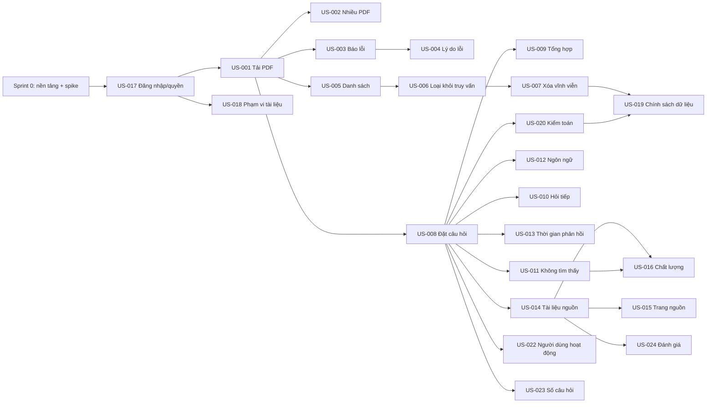

# KẾ HOẠCH TRIỂN KHAI CHI TIẾT — "CHAT VỚI TÀI LIỆU" (MVP)

> Đầu vào: `docs/requirements/UserStories.md`, `docs/requirements/SADD.md` (v0.1), kèm `BRD.md` (v0.2), `PRD.md` (v0.1), `docs/design/UIUX_Blueprint.md` và giao diện mẫu `docs/design/html_design/`.
> Đối tượng: lập trình viên backend, frontend, QA, DevOps của đội MVP.
> Quy ước: `[TBD: OQ/PQ/DQ/AQ-xxx]` = chờ quyết định (xem mục 13); `[Đề xuất]` = giá trị khởi điểm do người soạn đề xuất, được phép chỉnh khi có số liệu.

| Mục | Nội dung |
|---|---|
| Số tài liệu | IMP-CWD-001 |
| Phiên bản | 0.1 (Draft) |
| Ngày | 2026-10-21 |
| Chủ sở hữu | [TBD: OQ-008] |

---

## 0. Đọc trước khi bắt đầu

**SADD để mở các lựa chọn công nghệ, nhưng lập trình viên cần một bộ công nghệ cụ thể để bắt đầu.** Kế hoạch này vì vậy đưa ra một **bộ công nghệ tham chiếu** (mục 1). Bộ này:
- là **đề xuất**, phải được chốt ở Sprint 0 (cổng quyết định G0, mục 7.1);
- được chọn sao cho đúng với các ADR của SADD (modular monolith, RAG, worker bất đồng bộ, cổng trừu tượng cho AI/xác thực/lưu trữ);
- thay được từng phần mà không đổi phần lõi, nhờ các cổng P-01..P-03 của SADD.

**Hai quyết định có thể đổi kế hoạch:**
1. **OQ-006 — có được gửi nội dung tài liệu ra dịch vụ AI bên ngoài không.** Kế hoạch dùng Kịch bản A của SADD (dịch vụ AI bên ngoài, ví dụ Claude API) làm đường chính, vì cần ít hạ tầng nhất. Nếu OQ-006 là "không", chỉ adapter sinh câu trả lời (mục 6.4) thay đổi; mô hình embedding đề xuất đã chạy nội bộ ở cả hai kịch bản.
2. **DQ-003 — phương thức đăng nhập.** Kế hoạch có cả hai đường: OIDC nếu tổ chức có IdP, tài khoản nội bộ nếu không (mục 6.1).

**Những gì kế hoạch này KHÔNG làm:** không đặt số liệu thay cho các ngưỡng còn `[TBD]` trong BRD/PRD. Mọi ngưỡng trong mã phải đọc từ cấu hình (mục 10.3) để chỉnh khi stakeholder chốt.

---

## 1. Bộ công nghệ tham chiếu [Đề xuất — chốt ở G0]

| Hạng mục | Lựa chọn đề xuất | Phương án thay | Lý do | Liên quan SADD |
|---|---|---|---|---|
| Ngôn ngữ backend | Python 3.12 | TypeScript/Node, Java | Hệ sinh thái tốt cho xử lý PDF, embedding và gọi mô hình AI | ADR-002 |
| Khung API | FastAPI + Pydantic v2 | Django, Flask | Kiểu dữ liệu rõ ràng, sinh OpenAPI tự động | M-02 |
| ORM / migration | SQLAlchemy 2 + Alembic | — | Phổ biến, migration có phiên bản | R-05 |
| Cơ sở dữ liệu | PostgreSQL 16 + tiện ích `pgvector` | Kho vector riêng | Một kho cho metadata và vector, ít thành phần vận hành; hợp quy mô MVP | ADR-006 (phương án a) |
| Hàng đợi việc | Bảng `jobs` trong PostgreSQL, worker lấy việc bằng `SELECT … FOR UPDATE SKIP LOCKED` | Redis + Celery/RQ | Không thêm thành phần mới; đủ cho quy mô MVP | ADR-003, R-04 |
| Lưu tệp | Kho đối tượng tương thích S3 (môi trường phát triển: MinIO) | Ổ đĩa mạng | Tách tệp khỏi cơ sở dữ liệu; dễ xóa theo khóa | R-06 |
| Trích xuất PDF | `pypdf` (giấy phép BSD) để lấy văn bản theo trang; `pdfplumber` (MIT) cho trang có bảng nếu cần | PyMuPDF (giấy phép AGPL — chỉ dùng nếu pháp chế chấp nhận) | Giữ được số trang; giấy phép an toàn | ADR-010 |
| Embedding | Mô hình mã nguồn mở đa ngôn ngữ chạy nội bộ, ví dụ `BAAI/bge-m3` (1024 chiều) qua `sentence-transformers` | Dịch vụ embedding thương mại | Hỗ trợ tiếng Việt [cần xác nhận bằng spike, OQ-007]; dữ liệu không rời hạ tầng ở bước embedding; dùng được cả Kịch bản A và B. Anthropic không cung cấp API embedding nên không thể dùng chung nhà cung cấp với Claude | P-01 |
| Sinh câu trả lời (Kịch bản A) | Claude API, mô hình `claude-opus-5-5`, SDK chính thức `anthropic` cho Python | Mô hình khác qua cùng cổng | Hỗ trợ trích dẫn nguồn (citations) gắn với từng đoạn văn | P-01, ADR-005 |
| Sinh câu trả lời (Kịch bản B) | Mô hình tự vận hành qua máy chủ suy luận nội bộ [TBD: AQ-001] | — | Khi OQ-006 = không | P-01 |
| Frontend | React 18 + TypeScript + Vite; React Router; TanStack Query | Vue, Svelte | Phổ biến; dựng lại được bố cục và trạng thái của giao diện mẫu HTML | M-01 |
| Kiểm thử | pytest + testcontainers (PostgreSQL thật); Vitest + Testing Library; Playwright cho kiểm thử đầu-cuối | — | Kiểm thử với cơ sở dữ liệu thật, tránh sai khác do giả lập | LG-01, LG-09 |
| Log và số liệu | `structlog` (JSON) + OpenTelemetry; số liệu dạng Prometheus | Theo hệ thống của tổ chức [TBD: AQ-005] | Chuẩn mở, đổi được nơi nhận | M-13 |
| Đóng gói, chạy cục bộ | Docker + Docker Compose | — | Môi trường giống nhau giữa các lập trình viên | 3.4 SADD |
| CI | GitHub Actions hoặc hệ thống CI của tổ chức [TBD: AQ-004] | — | — | — |

**Kiểm tra giấy phép:** trước khi chốt G0, pháp chế cần duyệt giấy phép của các thư viện và mô hình (đặc biệt mô hình embedding và PyMuPDF nếu dùng).

---

## 2. Cấu trúc mã nguồn

Một kho mã (monorepo), tên thư mục bám theo mô-đun M-xx của SADD.

```
chat-with-docs/
├── backend/
│   ├── pyproject.toml
│   ├── alembic/                      # migration cơ sở dữ liệu
│   ├── app/
│   │   ├── main.py                   # khởi tạo FastAPI, đăng ký router
│   │   ├── config.py                 # đọc cấu hình, mọi ngưỡng [TBD] nằm ở đây
│   │   ├── api/                      # M-02: router, schema vào/ra, xử lý lỗi chung
│   │   │   ├── auth.py  documents.py  conversations.py  sources.py
│   │   │   ├── feedback.py  admin_access.py  admin_audit.py  reports.py
│   │   │   └── errors.py
│   │   ├── modules/
│   │   │   ├── access/               # M-03: xác thực, vai trò, ACL
│   │   │   ├── documents/            # M-04: tải lên, danh sách, xóa
│   │   │   ├── ingestion/            # M-05: kiểm tra, trích xuất, chunk, embedding
│   │   │   ├── retrieval/            # M-07: truy xuất theo quyền
│   │   │   ├── qa/                   # M-06: điều phối hỏi đáp, citation, từ chối
│   │   │   ├── conversation/         # M-08: ngữ cảnh hội thoại
│   │   │   ├── sources/              # M-09: trang nguồn
│   │   │   ├── usage/                # M-10: đánh giá, số liệu sử dụng
│   │   │   └── audit/                # M-11: bản ghi kiểm toán
│   │   ├── ports/                    # P-01..P-03: giao diện trừu tượng
│   │   │   ├── ai.py  identity.py  storage.py
│   │   ├── adapters/                 # cài đặt cụ thể của cổng
│   │   │   ├── claude_llm.py  local_embedding.py  oidc_identity.py
│   │   │   ├── local_identity.py  s3_file_store.py  pg_vector_store.py
│   │   ├── worker/                   # R-03: tiến trình nền
│   │   │   └── run.py
│   │   └── observability/            # M-13: log che nội dung, số liệu, health
│   └── tests/
│       ├── unit/  integration/  security/
├── frontend/
│   ├── package.json  vite.config.ts
│   └── src/
│       ├── app/            # AppShell (C-00), router, AuthGate (C-01)
│       ├── features/
│       │   ├── documents/  # C-02..C-06
│       │   ├── chat/       # C-07..C-13, C-15
│       │   ├── sources/    # C-14
│       │   ├── admin/      # C-17..C-19
│       │   └── reports/    # C-20
│       ├── components/     # EmptyState (C-10), ErrorBanner (C-16), StatusBadge (C-06)
│       ├── api/            # client gọi backend, kiểu dữ liệu sinh từ OpenAPI
│       └── styles/         # token màu/kiểu chữ lấy từ docs/design/html_design/styles.css
├── evaluation/             # M-12: bộ đánh giá chất lượng
│   ├── datasets/           # bộ câu hỏi chuẩn (không commit tài liệu thật nếu nhạy cảm)
│   ├── run_eval.py
│   └── README.md
├── e2e/                    # kiểm thử Playwright theo AC
├── deploy/
│   ├── docker-compose.yml  # postgres+pgvector, minio, backend, worker, frontend
│   └── env.example
└── docs/                   # trỏ tới tài liệu đặc tả hiện có
```

**Quy tắc phụ thuộc (kiểm bằng công cụ lint import, ví dụ `import-linter`):**
- `modules/*` chỉ được import `ports/*`, không import `adapters/*`.
- `qa` không đọc trực tiếp kho tệp (SADD 3.1).
- `api/*` không chứa logic nghiệp vụ, chỉ gọi `modules/*`.

---

## 3. Mô hình dữ liệu cụ thể

Chuyển mô hình logic ở SADD 3.5 thành bảng PostgreSQL. Tên cột có thể chỉnh khi thiết kế chi tiết, nhưng các ràng buộc gạch đầu dòng bên dưới là bắt buộc.

```sql
CREATE EXTENSION IF NOT EXISTS vector;

CREATE TABLE users (
  id            UUID PRIMARY KEY,
  login         TEXT UNIQUE NOT NULL,
  display_name  TEXT,
  password_hash TEXT,                     -- chỉ dùng khi không có IdP (DQ-003)
  created_at    TIMESTAMPTZ NOT NULL DEFAULT now()
);

CREATE TABLE access_grants (              -- UC-15, BR-014
  user_id     UUID PRIMARY KEY REFERENCES users(id),
  role        TEXT NOT NULL CHECK (role IN ('bd','manager','security_admin')),
  status      TEXT NOT NULL CHECK (status IN ('active','revoked')),
  granted_by  UUID REFERENCES users(id),
  granted_at  TIMESTAMPTZ NOT NULL DEFAULT now(),
  revoked_at  TIMESTAMPTZ
);
-- Người dùng nhiều vai trò: DQ-002. Nếu cần, đổi khóa chính thành (user_id, role).

CREATE TABLE documents (                  -- BR-001..005, BR-018, BR-024
  id              UUID PRIMARY KEY,
  owner_id        UUID NOT NULL REFERENCES users(id),
  file_name       TEXT NOT NULL,
  size_bytes      BIGINT NOT NULL,
  page_count      INT,
  storage_key     TEXT NOT NULL,
  status          TEXT NOT NULL CHECK (status IN
                    ('uploading','processing','ready','failed','deleting','deleted')),
  failure_reason  TEXT CHECK (failure_reason IN
                    ('corrupted','encrypted','not_pdf','too_large','no_text','network','internal')),
  uploaded_at     TIMESTAMPTZ NOT NULL DEFAULT now(),
  deleted_at      TIMESTAMPTZ,
  purged_at       TIMESTAMPTZ             -- thời điểm xóa vĩnh viễn hoàn tất (AC-024)
);
CREATE INDEX ON documents (owner_id, status);

CREATE TABLE document_acl (               -- BR-020; phạm vi chia sẻ chờ OQ-003
  document_id UUID REFERENCES documents(id),
  user_id     UUID REFERENCES users(id),
  PRIMARY KEY (document_id, user_id)
);

CREATE TABLE chunks (                     -- M-05, M-07
  id           UUID PRIMARY KEY,
  document_id  UUID NOT NULL REFERENCES documents(id) ON DELETE CASCADE,
  page         INT NOT NULL,              -- bắt buộc: dùng cho citation (BR-019)
  ordinal      INT NOT NULL,
  text         TEXT NOT NULL,
  embedding    vector(1024) NOT NULL      -- số chiều theo mô hình embedding được chốt
);
CREATE INDEX ON chunks USING hnsw (embedding vector_cosine_ops);
CREATE INDEX ON chunks (document_id);

CREATE TABLE jobs (                       -- hàng đợi việc (ADR-003)
  id           BIGSERIAL PRIMARY KEY,
  kind         TEXT NOT NULL CHECK (kind IN ('ingest','purge')),
  payload      JSONB NOT NULL,
  status       TEXT NOT NULL DEFAULT 'queued' CHECK (status IN ('queued','running','done','failed')),
  attempts     INT NOT NULL DEFAULT 0,
  run_after    TIMESTAMPTZ NOT NULL DEFAULT now(),
  last_error   TEXT,
  created_at   TIMESTAMPTZ NOT NULL DEFAULT now()
);
CREATE INDEX ON jobs (status, run_after);

CREATE TABLE conversations (
  id          UUID PRIMARY KEY,
  user_id     UUID NOT NULL REFERENCES users(id),
  created_at  TIMESTAMPTZ NOT NULL DEFAULT now()
);

CREATE TABLE messages (
  id               UUID PRIMARY KEY,
  conversation_id  UUID NOT NULL REFERENCES conversations(id) ON DELETE CASCADE,
  role             TEXT NOT NULL CHECK (role IN ('user','assistant')),
  content          TEXT NOT NULL,
  not_found        BOOLEAN NOT NULL DEFAULT false,   -- BR-009
  latency_ms       INT,
  created_at       TIMESTAMPTZ NOT NULL DEFAULT now()
);

CREATE TABLE citations (                  -- BR-012, BR-019
  message_id     UUID NOT NULL REFERENCES messages(id) ON DELETE CASCADE,
  chunk_id       UUID REFERENCES chunks(id) ON DELETE SET NULL,
  document_id    UUID NOT NULL,
  document_name  TEXT NOT NULL,
  page           INT NOT NULL,
  cited_text     TEXT
);

CREATE TABLE feedback (                   -- BR-017
  message_id  UUID PRIMARY KEY REFERENCES messages(id) ON DELETE CASCADE,
  user_id     UUID NOT NULL REFERENCES users(id),
  value       TEXT NOT NULL CHECK (value IN ('helpful','not_helpful')),
  created_at  TIMESTAMPTZ NOT NULL DEFAULT now()
);

CREATE TABLE audit_records (              -- BR-023: KHÔNG lưu nội dung câu hỏi
  id            BIGSERIAL PRIMARY KEY,
  user_id       UUID NOT NULL,
  document_ids  UUID[] NOT NULL,
  at            TIMESTAMPTZ NOT NULL DEFAULT now()
);
CREATE INDEX ON audit_records (at);

CREATE TABLE usage_events (               -- BR-016, BR-021 (không có nội dung)
  id       BIGSERIAL PRIMARY KEY,
  user_id  UUID NOT NULL,
  kind     TEXT NOT NULL,                 -- 'session_started', 'question_submitted', ...
  at       TIMESTAMPTZ NOT NULL DEFAULT now()
);
CREATE INDEX ON usage_events (kind, at);
```

**Ràng buộc bắt buộc**
- Mọi chunk phải có `page` (không cho phép NULL) — nền tảng của BR-019.
- Truy vấn chunk luôn nối với `documents` để chỉ lấy tài liệu `status = 'ready'` (BR-005: tài liệu đang xóa không bao giờ được truy xuất).
- `audit_records` và `usage_events` không có cột nội dung câu hỏi hay tài liệu (ADR-009).
- Bảng `messages` lưu nội dung câu hỏi để giữ ngữ cảnh hội thoại; thời gian lưu và việc lưu giữa các phiên chờ PQ-004. Cho tới khi có quyết định: chỉ giữ trong phiên hiện tại [Đề xuất], xóa theo lịch.

---

## 4. Hợp đồng API

Tiền tố `/api/v1`. Định dạng JSON. Xác thực bằng cookie phiên `HttpOnly; Secure; SameSite=Lax` [Đề xuất]. FastAPI sinh tài liệu OpenAPI; frontend sinh kiểu dữ liệu từ đó.

**Định dạng lỗi chung**

```json
{ "error": { "code": "document_not_found", "message": "Thông điệp cho người dùng, không chứa chi tiết kỹ thuật" } }
```

| Mã HTTP | Khi nào |
|---|---|
| 400 | Dữ liệu vào sai (câu hỏi rỗng, quá dài) |
| 401 | Chưa đăng nhập hoặc hết phiên |
| 403 | Đã đăng nhập nhưng không có quyền (vai trò hoặc tài liệu) |
| 404 | Không tìm thấy, hoặc tài liệu không thuộc phạm vi người dùng (không tiết lộ sự tồn tại) |
| 413 | Tệp vượt giới hạn [TBD: OQ-004] |
| 415 | Không phải PDF |
| 504 | Quá thời gian chờ câu trả lời [TBD: OQ-002] |

**Danh sách endpoint**

| IF (SADD) | Phương thức và đường dẫn | Vai trò | Vào | Ra | Story |
|---|---|---|---|---|---|
| IF-01 | `POST /auth/login` (tài khoản nội bộ) hoặc `GET /auth/oidc/login` + `GET /auth/oidc/callback` | Mọi người | login, password | `{user, role}` + cookie | US-017 |
| IF-01 | `POST /auth/logout`, `GET /auth/me` | Đã đăng nhập | — | `{user, role}` | US-017 |
| IF-02 | `POST /documents` (multipart, nhiều tệp) | bd | `files[]` | `[{id, file_name, status, failure_reason?}]` — mỗi tệp một kết quả | US-001..004 |
| IF-03 | `GET /documents` | bd | — | `[{id, file_name, size_bytes, page_count, status, failure_reason, uploaded_at}]` | US-005 |
| IF-03 | `GET /documents/{id}` | bd (chủ sở hữu/ACL) | — | Một tài liệu (UI hỏi định kỳ trạng thái) | US-001 |
| IF-02 | `POST /documents/{id}/retry` | bd | — | Tài liệu, status `processing` | US-003 |
| IF-04 | `DELETE /documents/{id}` | bd (chủ sở hữu) hoặc security_admin | — | 202 + status `deleting` | US-006, US-007 |
| IF-05 | `POST /conversations` | bd | — | `{id}` | US-008 |
| IF-05 | `POST /conversations/{id}/messages` | bd | `{question}` | `{message_id, answer, not_found, citations:[{document_id, document_name, page, cited_text}], latency_ms}` | US-008..015 |
| IF-05 | `POST /conversations/{id}/messages:stream` (SSE) | bd | `{question}` | Luồng sự kiện `delta`, `citations`, `done` — **chỉ làm nếu AQ-006 chọn hiển thị theo luồng** | US-013 |
| IF-05 | `GET /conversations/{id}/messages` | bd | — | Lịch sử hội thoại | US-010 |
| IF-06 | `GET /documents/{id}/pages/{page}` | bd (có quyền với tài liệu) | — | `{page, page_count, text}`; 404 nếu tài liệu đã xóa | US-014, US-015 |
| IF-06 | `GET /documents/{id}/file` | bd (có quyền) | — | Tệp PDF gốc để trình xem hiển thị đúng trang (DQ-005) | US-015 |
| IF-07 | `PUT /messages/{id}/feedback` | bd | `{value}` | 204 | US-024 |
| IF-08 | `GET /admin/access`, `POST /admin/access`, `DELETE /admin/access/{user_id}` | security_admin | `{login, role}` | Danh sách / 201 / 204 | US-017, US-018 |
| IF-09 | `GET /admin/audit?from&to&user&document&cursor` | security_admin | bộ lọc | `{items:[{at, user, documents}], next_cursor}` | US-020 |
| IF-10 | `GET /reports/usage?weeks=4` | manager | — | `{weeks:[{week, active_users, questions, helpful_ratio}]}` | US-022, US-023 |
| — | `GET /health/live`, `GET /health/ready` | Hệ thống | — | Tình trạng các thành phần | US-021 |

---

## 5. Luồng xử lý chính (đặc tả cho lập trình viên)

### 5.1 Nạp tài liệu (US-001..004; SADD 3.6 luồng 1)

**Trong `POST /documents` (đồng bộ, nhanh):**
1. Kiểm tra vai trò `bd` và quyền đang hoạt động.
2. Với **từng** tệp (một tệp lỗi không làm hỏng các tệp khác):
   - kích thước ≤ `MAX_FILE_BYTES` [TBD: OQ-004] → nếu không: `failure_reason = too_large`;
   - 5 byte đầu là `%PDF-` → nếu không: `not_pdf` (không tin vào tên đuôi hay `Content-Type`);
   - tổng số tài liệu của người dùng ≤ `MAX_DOCS_PER_USER` [TBD: OQ-004].
3. Tệp hợp lệ: ghi lên kho tệp với khóa `documents/{owner_id}/{document_id}.pdf`; tạo bản ghi `documents` status `processing`; thêm việc `jobs(kind='ingest')` **trong cùng giao dịch** với bản ghi tài liệu.
4. Trả danh sách kết quả từng tệp.

**Trong worker (`kind = ingest`):**
1. Đọc tệp từ kho.
2. Mở bằng `pypdf`. Tài liệu mã hóa → `encrypted`; lỗi đọc → `corrupted`.
3. Trích xuất văn bản **theo từng trang** (giữ số trang bắt đầu từ 1). Chuẩn hóa khoảng trắng và Unicode (NFC — quan trọng với tiếng Việt).
4. Nếu toàn bộ tài liệu không có văn bản (tổng ký tự dưới `MIN_TEXT_CHARS` [Đề xuất: 20]) → `no_text` (PDF dạng ảnh scan, chưa hỗ trợ — ADR-010).
5. Cắt chunk **không vượt qua ranh giới trang**: kích thước `CHUNK_TOKENS` [Đề xuất: khoảng 500 token], chồng lấp `CHUNK_OVERLAP` [Đề xuất: khoảng 80 token]. Mỗi chunk mang `page` và `ordinal`. Giá trị cuối cùng chốt bằng bộ đánh giá (mục 9.4).
6. Tạo embedding theo lô `EMBED_BATCH` [Đề xuất: 32] qua cổng `EmbeddingProvider`.
7. Ghi toàn bộ chunk và cập nhật `status = ready`, `page_count` trong **một giao dịch**. Nếu tài liệu đã chuyển sang `deleting` trong lúc xử lý, bỏ kết quả.
8. Lỗi tạm thời (mất kết nối kho, hết bộ nhớ): thử lại tối đa `JOB_MAX_ATTEMPTS` [Đề xuất: 3] với thời gian chờ tăng dần; hết lượt → `failed` + `internal`.

**Worker lấy việc:**

```sql
UPDATE jobs SET status = 'running', attempts = attempts + 1
WHERE id = (
  SELECT id FROM jobs
  WHERE status = 'queued' AND run_after <= now()
  ORDER BY id
  FOR UPDATE SKIP LOCKED
  LIMIT 1
)
RETURNING *;
```

### 5.2 Truy xuất theo quyền (US-008, US-018; ADR-004)

```sql
SELECT c.id, c.document_id, d.file_name, c.page, c.text,
       1 - (c.embedding <=> :query_embedding) AS score
FROM chunks c
JOIN documents d ON d.id = c.document_id
WHERE d.status = 'ready'
  AND d.id = ANY(:allowed_document_ids)      -- tính ở M-03 trước khi truy vấn
ORDER BY c.embedding <=> :query_embedding
LIMIT :top_k;                                -- TOP_K [Đề xuất: 8]
```

- `allowed_document_ids` = tài liệu do người dùng sở hữu ∪ tài liệu trong `document_acl` của người dùng. Cách tính đầy đủ chờ OQ-003; cho tới khi chốt, **chỉ tài liệu do chính người dùng tải lên** [Đề xuất, an toàn nhất].
- Bộ lọc quyền nằm **trong** câu truy vấn, không lọc sau khi lấy kết quả.
- Lưu ý hiệu năng: khi danh sách tài liệu được phép lớn, chỉ mục HNSW kết hợp bộ lọc có thể trả thiếu kết quả; bật `hnsw.iterative_scan` của pgvector (từ phiên bản 0.8) hoặc tăng `ef_search`. Kiểm bằng kiểm thử độ phủ ở mục 9.

### 5.3 Hỏi đáp có nguồn và cơ chế từ chối (US-008..015; ADR-002, ADR-011)

1. Kiểm tra câu hỏi: không rỗng, ≤ `MAX_QUESTION_CHARS` [TBD: PQ-002].
2. Ghi `audit_records` (người dùng, danh sách tài liệu được phép, thời điểm) và `usage_events(question_submitted)`.
3. Lấy ngữ cảnh hội thoại: `HISTORY_TURNS` lượt gần nhất [Đề xuất: 4].
4. Tạo truy vấn truy xuất: câu hỏi hiện tại ghép với câu hỏi người dùng ở lượt trước (đơn giản, đủ cho câu hỏi tiếp theo dùng đại từ — US-010). Nếu bộ đánh giá cho thấy chưa đủ, thêm bước viết lại câu hỏi bằng mô hình ở sau MVP.
5. Truy xuất (5.2). Nếu không có chunk nào hoặc điểm cao nhất < `MIN_RELEVANCE_SCORE` [TBD: AQ-002] → trả `not_found = true`, **không gọi mô hình sinh**.
6. Gọi mô hình sinh qua cổng `AnswerGenerator` (6.4), truyền mỗi chunk như một tài liệu riêng có bật trích dẫn.
7. Nhận câu trả lời và danh sách trích dẫn. Ánh xạ mỗi trích dẫn về chunk (theo chỉ số tài liệu) → `document_id`, `document_name`, `page`.
8. **Câu trả lời có nội dung nhưng không có trích dẫn hợp lệ nào → đổi thành `not_found`** (ADR-011; BR-012: 100% câu trả lời có nội dung phải có nguồn).
9. Lưu `messages` + `citations`; ghi `latency_ms`; trả kết quả.
10. Hết `ANSWER_TIMEOUT_S` [TBD: OQ-002] → 504, câu hỏi không bị mất phía giao diện.

**Chỉ dẫn hệ thống cho mô hình (bản khởi điểm, chỉnh bằng bộ đánh giá):**

```
Bạn trả lời câu hỏi của nhân sự phát triển kinh doanh chỉ dựa trên các tài liệu được cung cấp trong yêu cầu này.
Mỗi tài liệu là một đoạn trích có tiêu đề gồm tên tệp và số trang.
Chỉ dùng thông tin có trong các đoạn trích đó và trích dẫn đoạn đã dùng cho mỗi ý.
Nếu các đoạn trích không chứa thông tin để trả lời, hãy trả lời đúng một câu: "Không tìm thấy thông tin này trong các tài liệu đã tải lên."
Không dùng kiến thức bên ngoài tài liệu. Trả lời bằng ngôn ngữ của câu hỏi.
```

Câu từ chối cố định giúp backend nhận diện và đặt `not_found = true` (so khớp chính xác chuỗi sau khi chuẩn hóa).

### 5.4 Xóa tài liệu (US-006, US-007; ADR-008)

1. `DELETE /documents/{id}`: kiểm quyền (chủ sở hữu hoặc security_admin). Trong một giao dịch: `status = 'deleting'`, `deleted_at = now()`, thêm `jobs(kind='purge')`. Trả 202.
   - Từ lúc này tài liệu **không còn được truy xuất** (truy vấn ở 5.2 chỉ lấy `ready`) → đáp ứng AC-005 ngay, không chờ worker.
2. Worker `purge`: xóa `chunks` của tài liệu → xóa tệp trên kho → `status = 'deleted'`, `purged_at = now()`. Mỗi bước làm lại được nhiều lần không gây lỗi; lỗi thì thử lại.
3. Theo dõi: cảnh báo nếu có tài liệu `deleting` quá `PURGE_SLA_HOURS` [Đề xuất: 24]; giới hạn cứng theo OQ-012.
4. Bản sao lưu cơ sở dữ liệu và kho tệp: cách xử lý dữ liệu đã xóa trong bản sao lưu chờ AQ-003 — **phải ghi rõ trong tài liệu vận hành trước launch**.

### 5.5 Trang nguồn (US-014, US-015)

- `GET /documents/{id}/pages/{page}` kiểm tra tài liệu thuộc `allowed_document_ids` và `status = ready`; nếu không → 404 (giao diện hiển thị trạng thái "tài liệu đã bị xóa" của S-03).
- Văn bản trang lấy bằng cách đọc lại tệp gốc và trích trang đó (không cần lưu bảng trang riêng ở MVP).
- Đoạn tô sáng trên S-03 dùng `cited_text` của citation, tìm vị trí trong văn bản trang ở phía giao diện.

---

## 6. Hướng dẫn cài đặt các cổng và adapter

### 6.1 Cổng xác thực (`ports/identity.py`)

```python
class IdentityProvider(Protocol):
    async def authenticate(self, request: Request) -> AuthenticatedUser | None: ...
```

- **Có IdP (DQ-003 = OIDC):** dùng Authorization Code + PKCE; ánh xạ `sub`/email của IdP sang `users.login`. Vai trò **luôn lấy từ `access_grants`** của hệ thống, không lấy từ IdP, để quản trị bảo mật cấp/thu hồi trên S-05.
- **Không có IdP:** tài khoản nội bộ, băm mật khẩu bằng Argon2id; giới hạn số lần đăng nhập sai [Đề xuất: 5 lần/15 phút]; phiên lưu phía máy chủ.
- Cả hai: người đăng nhập đúng nhưng không có `access_grants.status = 'active'` → 403 với mã `no_access` (màn hình S-01 trạng thái "không có quyền").
- Thời hạn phiên [Đề xuất: 8 giờ không hoạt động]; hết hạn → 401 `session_expired`.

### 6.2 Cổng lưu trữ (`ports/storage.py`)

```python
class FileStore(Protocol):
    def put(self, key: str, data: BinaryIO) -> None: ...
    def get(self, key: str) -> BinaryIO: ...
    def delete(self, key: str) -> None: ...      # không lỗi nếu khóa không còn
```

Bật mã hóa phía máy chủ của kho đối tượng [Đề xuất, theo OQ-005]. Không bao giờ trả đường dẫn trực tiếp tới kho cho trình duyệt; tệp đi qua `GET /documents/{id}/file` để luôn kiểm quyền.

### 6.3 Cổng embedding (`ports/ai.py`)

```python
class EmbeddingProvider(Protocol):
    dimension: int
    def embed(self, texts: list[str]) -> list[list[float]]: ...
```

Adapter `local_embedding.py` nạp mô hình một lần khi khởi động worker và tiến trình ứng dụng (cả hai cần: worker cho chunk, ứng dụng cho câu hỏi). Chuẩn hóa vector (độ dài 1) trước khi lưu để dùng khoảng cách cosine.

### 6.4 Cổng sinh câu trả lời và adapter Claude (Kịch bản A)

```python
@dataclass
class SourceChunk:
    chunk_id: str
    document_name: str
    page: int
    text: str

@dataclass
class GeneratedAnswer:
    text: str
    citations: list[tuple[int, str]]   # (chỉ số chunk trong danh sách đầu vào, cited_text)
    refused: bool                      # mô hình từ chối vì lý do an toàn

class AnswerGenerator(Protocol):
    def generate(self, question: str, history: list[dict], chunks: list[SourceChunk]) -> GeneratedAnswer: ...
```

**Adapter `claude_llm.py` — điểm chính:**
- SDK chính thức `anthropic` cho Python; khóa API đọc từ biến môi trường hoặc kho bí mật, không ghi vào mã.
- Mô hình `claude-opus-5-5`. Đặt `effort` tường minh (mặc định của mô hình này là `medium`); bắt đầu với `medium` và so sánh `low` bằng bộ đánh giá (mục 9.4) vì hỏi đáp thường không cần mức cao.
- Không đặt tham số `thinking` (mô hình chạy chế độ suy nghĩ thích ứng; tắt suy nghĩ sẽ bị lỗi 400).
- Mỗi chunk là một khối `document` dạng văn bản có bật `citations`; tiêu đề tài liệu gồm tên tệp và số trang. Câu trả lời trả về các khối `text`, khối có trích dẫn mang `citations` với `document_index` → ánh xạ về chunk.
- Tính năng citations **không dùng chung được** với structured outputs (`output_config.format`), nên không dùng structured outputs ở lời gọi này.
- Không dùng assistant prefill (mô hình này trả lỗi 400).
- Luôn kiểm tra `stop_reason` trước khi đọc nội dung: `"refusal"` → `refused = True` (giao diện hiển thị thông báo lỗi chung); `"max_tokens"` → ghi log và coi là lỗi.
- Bật cơ chế chuyển mô hình dự phòng phía máy chủ khi bị từ chối (beta `server-side-fallback-2026-07-01`, tham số `fallbacks: "default"`) — kiểm tra cách truyền tham số này trong phiên bản SDK được cài khi làm adapter.
- Chỉ dẫn hệ thống (5.3) cố định và đứng đầu yêu cầu, bật prompt caching cho phần này; kiểm tra `usage.cache_read_input_tokens` > 0 ở các lượt sau (lưu ý: phần chỉ dẫn ngắn hơn ngưỡng tối thiểu của bộ nhớ đệm thì không được lưu — không phải lỗi).
- Thời gian chờ và thử lại: dùng `timeout` và `max_retries` của SDK; bắt lỗi theo thứ tự từ cụ thể tới chung (`RateLimitError` → `APIStatusError` → `APIConnectionError`).
- Nếu chọn hiển thị theo luồng (AQ-006): dùng `client.messages.stream(...)`; nếu không, gọi `client.messages.create(...)` với `max_tokens` khoảng 16000.

Phác thảo (lập trình viên xác nhận tên tham số với tài liệu SDK khi cài đặt):

```python
import anthropic

client = anthropic.Anthropic()   # đọc ANTHROPIC_API_KEY

def generate(question, history, chunks):
    documents = [
        {
            "type": "document",
            "source": {"type": "text", "media_type": "text/plain", "data": c.text},
            "title": f"{c.document_name} — trang {c.page}",
            "citations": {"enabled": True},
        }
        for c in chunks
    ]
    response = client.messages.create(
        model="claude-opus-5-5",
        max_tokens=16000,
        output_config={"effort": settings.ANSWER_EFFORT},   # khởi điểm "medium"
        system=[{"type": "text", "text": SYSTEM_PROMPT, "cache_control": {"type": "ephemeral"}}],
        messages=[*history, {"role": "user", "content": [*documents, {"type": "text", "text": question}]}],
    )
    if response.stop_reason == "refusal":
        return GeneratedAnswer(text="", citations=[], refused=True)
    text_parts, citations = [], []
    for block in response.content:
        if block.type == "text":
            text_parts.append(block.text)
            for cit in (block.citations or []):
                citations.append((cit.document_index, cit.cited_text))
    return GeneratedAnswer(text="".join(text_parts), citations=citations, refused=False)
```

**Kịch bản B:** cài adapter khác cùng giao diện `AnswerGenerator`, gọi máy chủ suy luận nội bộ. Mô hình tự vận hành có thể không có tính năng trích dẫn có sẵn; khi đó yêu cầu mô hình ghi mã đoạn (ví dụ `[S3]`) sau mỗi ý và backend phân tích các mã đó. Bộ đánh giá phải chạy lại đầy đủ khi đổi adapter (ADR-012).

**Dữ liệu ra khỏi hạ tầng ở Kịch bản A:** các chunk được truy xuất, câu hỏi và ngữ cảnh hội thoại. Tài liệu đầy đủ, embedding, bản ghi kiểm toán thì không. Thông tin này cần đưa vào hồ sơ rà soát bảo mật (US-019).

---

## 7. Kế hoạch theo sprint

Giả định: sprint 2 tuần [Đề xuất]; đội gồm backend, frontend, QA, DevOps (số người chưa biết — OQ-009). Kích cỡ công việc ghi theo thang tương đối **S / M / L** (S ≈ vài ngày-người, M ≈ một tuần-người, L ≈ hơn một tuần-người) để đội tự quy đổi khi lập kế hoạch thật.

### 7.1 Cổng quyết định

| Cổng | Thời điểm | Cần có | Nếu chưa có |
|---|---|---|---|
| G0 | Cuối Sprint 0 | Chốt bộ công nghệ (mục 1), DQ-003, kết quả spike (mục 7.2) | Bắt đầu Sprint 1 với tài khoản nội bộ và adapter AI giả lập |
| G1 | Trước Sprint 2 | OQ-006 (Kịch bản A/B), OQ-005 sơ bộ, OQ-007 (ngôn ngữ) | Sprint 2 dùng Kịch bản A trên **dữ liệu mẫu không nhạy cảm** |
| G2 | Trước Sprint 3 | OQ-003 (phạm vi chia sẻ), OQ-012 (thời hạn xóa, lưu bản ghi) | Dùng giá trị an toàn: chỉ tài liệu của chính mình; xóa ngay khi worker chạy |
| G3 | Trước Sprint 4 | OQ-002 (ngưỡng), bộ câu hỏi chuẩn (DEP-001, ASM-005) | Không qua được cổng launch LG-02..LG-05 |
| G4 | Cuối Sprint 4 | Tiêu chí launch LG-01..LG-11 (PRD 5.1) | Không phát hành |

### 7.2 Sprint 0 — Nền tảng và spike

| Việc | Mô tả | Kích cỡ | Kết quả |
|---|---|---|---|
| S0-1 | Tạo kho mã theo mục 2, Docker Compose (PostgreSQL + pgvector, MinIO, backend, worker, frontend) | M | `docker compose up` chạy được ứng dụng rỗng |
| S0-2 | CI: lint, kiểm tra kiểu (mypy, tsc), kiểm thử, kiểm quy tắc import | M | Pipeline xanh trên nhánh chính |
| S0-3 | Khung backend: cấu hình, log JSON che nội dung, xử lý lỗi chung, health check | M | — |
| S0-4 | Khung frontend: AppShell, router, token giao diện từ `html_design/styles.css`, ErrorBanner, EmptyState, StatusBadge | M | — |
| S0-5 | **Spike trích xuất PDF**: chạy `pypdf`/`pdfplumber` trên tập PDF mẫu thật (DEP-001), đo tỷ lệ trang có văn bản, kiểm tra bảng và tiếng Việt | M | Báo cáo ngắn; xác nhận hoặc điều chỉnh ADR-010 |
| S0-6 | **Spike embedding và truy xuất tiếng Việt**: so sánh 1–2 mô hình embedding trên 20–30 câu hỏi mẫu | M | Chọn mô hình; chốt số chiều vector |
| S0-7 | **Spike sinh câu trả lời có trích dẫn** với adapter Claude trên dữ liệu không nhạy cảm | S | Xác nhận ánh xạ trích dẫn → trang |
| S0-8 | Định dạng bộ câu hỏi chuẩn và khung `evaluation/run_eval.py` (mục 9.4) | S | Chạy được với vài câu mẫu |

### 7.3 Sprint 1 — Truy cập và nạp tài liệu

Story: US-017, US-001, US-002, US-003, US-004, US-005.
Mục tiêu demo: đăng nhập, tải nhiều PDF, thấy trạng thái Đang xử lý → Sẵn sàng/Lỗi kèm lý do.

### 7.4 Sprint 2 — Hỏi đáp có nguồn

Story: US-008, US-009, US-011, US-012, US-014, US-015.
Mục tiêu demo: hỏi trên nhiều tài liệu, nhận câu trả lời kèm nguồn và trang, mở trình xem nguồn; câu hỏi ngoài phạm vi nhận "không tìm thấy".

### 7.5 Sprint 3 — Xóa, phạm vi quyền, kiểm toán, hội thoại

Story: US-006, US-007, US-018, US-020, US-010, US-013.
Mục tiêu demo: xóa tài liệu và chứng minh không còn được dùng; quản trị bảo mật cấp/thu hồi quyền, xem bản ghi kiểm toán; hỏi tiếp theo ngữ cảnh.

### 7.6 Sprint 4 — Chất lượng, đo lường, sẵn sàng phát hành

Story: US-016, US-019, US-022, US-023, US-024, US-021.
Mục tiêu: chạy bộ đánh giá đạt ngưỡng, báo cáo sử dụng, rà soát bảo mật, kiểm thử cổng launch.

### 7.7 Biểu đồ phụ thuộc giữa các story



---

## 8. Đặc tả công việc theo từng user story

Mỗi story: phụ thuộc, việc backend (BE), việc frontend (FE), kiểm thử (QA), định nghĩa hoàn thành riêng. Tiêu chí chấp nhận gốc ở `UserStories.md`. Định nghĩa hoàn thành chung ở mục 11.

### E1 — Nạp và quản lý tài liệu

#### US-001 — Tải một PDF lên (P0) · Sprint 1 · L
- **Phụ thuộc:** US-017, S0-1..S0-4.
- **BE:**
  - Migration bảng `documents`, `jobs`.
  - `POST /documents` theo 5.1 (một tệp và nhiều tệp dùng chung đường xử lý).
  - Worker `ingest`: trích xuất theo trang, chunk, embedding, ghi `chunks`, cập nhật trạng thái.
  - `GET /documents/{id}` để giao diện hỏi trạng thái.
  - Sự kiện `document_upload_started`, `document_upload_succeeded`.
- **FE:**
  - UploadControl (C-03): nút "Tải PDF lên", chọn nhiều tệp, kéo thả.
  - DocumentList (C-04) với StatusBadge (C-06); hỏi trạng thái mỗi `POLL_INTERVAL_S` [Đề xuất: 3 giây] khi còn tài liệu `processing`.
  - Trạng thái trống (C-10) như `s02-empty`.
- **QA:**
  - Tích hợp: tải PDF hợp lệ → `ready`, có chunk, mỗi chunk có `page`.
  - E2E (AC-001): tải tệp → xuất hiện "Sẵn sàng" → hỏi được.
- **Xong khi:** giao diện khớp ảnh `s02-default`/`s02-empty`; tài liệu `ready` có chunk.

#### US-002 — Tải nhiều PDF (P0) · Sprint 1 · S
- **Phụ thuộc:** US-001.
- **BE:** xử lý từng tệp độc lập trong một yêu cầu; giới hạn `MAX_FILE_BYTES`, `MAX_DOCS_PER_USER` từ cấu hình [TBD: OQ-004]; worker xử lý song song `WORKER_CONCURRENCY` [Đề xuất: 2].
- **FE:** tiến độ và kết quả từng tệp; không khóa vùng hội thoại khi đang tải (SADD/blueprint 3.8).
- **QA:** tải đồng thời N tệp (N = giới hạn đã chốt; tạm thời 10) → tất cả `ready`; một tệp lỗi không ảnh hưởng tệp khác (AC-002).

#### US-003 — Biết tệp nào thất bại (P0) · Sprint 1 · M
- **Phụ thuộc:** US-001.
- **BE:** kiểm tra `%PDF-`, kích thước, mã hóa, hỏng; lưu `failure_reason`; `POST /documents/{id}/retry`. Sự kiện `document_upload_failed` kèm nhóm lý do (không kèm nội dung).
- **FE:** dòng tệp lỗi với nhãn "Lỗi", nút Thử lại và Xóa; trạng thái mất kết nối khi tải (`s02-offline-upload`): tệp chưa tải xong không bao giờ hiển thị "Sẵn sàng".
- **QA:**
  - Bộ tệp kiểm thử: tệp `.txt` đổi đuôi `.pdf`, PDF hỏng, PDF có mật khẩu, PDF chỉ có ảnh.
  - Mỗi tệp → đúng `failure_reason`, không có trong danh sách truy vấn (AC-003).
  - E2E mất mạng giữa chừng (Playwright chặn yêu cầu).

#### US-004 — Lý do thất bại (P1) · Sprint 1 · S
- **Phụ thuộc:** US-003.
- **BE:** ánh xạ `failure_reason` → mã lỗi ổn định cho giao diện.
- **FE:** bảng câu thông báo tiếng Việt theo mã, nêu cách khắc phục (ví dụ "tài liệu bị khóa hoặc mã hóa. Hãy mở khóa rồi tải lại."). Thêm thông báo cho `too_large`, `no_text`, `network` (chờ thống nhất danh sách cuối với BR-018 — ghi chú ở US-004).
- **QA:** mỗi loại lỗi → đúng câu thông báo (AC-018).

#### US-005 — Xem danh sách tài liệu (P1) · Sprint 1 · S
- **Phụ thuộc:** US-001.
- **BE:** `GET /documents` chỉ trả tài liệu thuộc `allowed_document_ids`, không trả `deleting`/`deleted`.
- **FE:** danh sách có tên, số trang, dung lượng, trạng thái; số tệp ở đầu vùng. Hiệu năng với số mục tối đa [TBD: OQ-004] (ảo hóa danh sách nếu vượt 200 mục [Đề xuất]).
- **QA:** người dùng A không thấy tài liệu của B (AC-004 + kiểm thử bảo mật).

#### US-006 — Loại tài liệu khỏi truy vấn (P1) · Sprint 3 · M
- **Phụ thuộc:** US-005, US-008.
- **BE:** `DELETE /documents/{id}` theo 5.4 bước 1; sự kiện `document_deleted`.
- **FE:** DeleteConfirmDialog (C-05) như `s04-default`: tiêu điểm mặc định ở "Hủy", nêu tên tài liệu và "không thể hoàn tác"; xóa thất bại hiển thị lỗi trong hộp thoại (`s04-failed`); thành công → tài liệu biến khỏi danh sách.
- **QA:** sau khi xóa X, câu hỏi chỉ có đáp án trong X → "không tìm thấy" **ngay lập tức** (AC-005), kể cả khi worker `purge` chưa chạy.

#### US-007 — Xóa vĩnh viễn (P0) · Sprint 3 · M
- **Phụ thuộc:** US-006.
- **BE:** worker `purge` theo 5.4 bước 2–3; cảnh báo tài liệu `deleting` quá hạn; tài liệu vận hành về bản sao lưu (AQ-003).
- **FE:** câu trong hộp thoại nêu thời hạn xóa vĩnh viễn [TBD: OQ-012] (đọc từ cấu hình qua `/auth/me` hoặc endpoint cấu hình công khai).
- **QA:** sau khi worker chạy: không còn chunk, không còn tệp trên kho, `purged_at` có giá trị (AC-024). Kiểm thử lỗi giữa chừng (kho tệp lỗi) → thử lại và hoàn tất.

### E2 — Hỏi đáp

#### US-008 — Đặt câu hỏi (P0) · Sprint 2 · L
- **Phụ thuộc:** US-001, S0-6, S0-7.
- **BE:**
  - Migration `conversations`, `messages`, `citations`, `audit_records`, `usage_events`.
  - `POST /conversations`, `POST /conversations/{id}/messages` theo 5.3.
  - Mô-đun `retrieval` (5.2), `qa`, adapter embedding và adapter sinh câu trả lời (6.3, 6.4).
  - Kiểm tra độ dài câu hỏi [TBD: PQ-002].
  - Sự kiện `question_submitted`, `answer_returned` (thời gian phản hồi, số nguồn, cờ not_found).
- **FE:**
  - ChatPanel (C-07), MessageList (C-08), QuestionInput (C-09), AnswerCard (C-11).
  - Ô nhập bị vô hiệu kèm giải thích khi chưa có tài liệu sẵn sàng.
  - Mất kết nối khi hỏi (`s02-offline-ask`): giữ câu hỏi, nút "Gửi lại", không hiển thị câu trả lời dở dang.
- **QA:**
  - Tích hợp với adapter AI giả lập: luồng đủ, lưu message và citation.
  - E2E (AC-006) trên dữ liệu mẫu với adapter thật ở môi trường kiểm thử.

#### US-009 — Tổng hợp từ nhiều tài liệu (P0) · Sprint 2 · S
- **Phụ thuộc:** US-008.
- **BE:** không có mã riêng ngoài 5.3; bảo đảm `TOP_K` đủ để lấy chunk từ nhiều tài liệu. Nếu bộ đánh giá cho thấy kết quả bị một tài liệu chiếm hết, thêm giới hạn số chunk mỗi tài liệu `MAX_CHUNKS_PER_DOC` [Đề xuất: 4].
- **QA:** nhóm câu hỏi trong bộ đánh giá có đáp án ở ≥ 2 tài liệu; câu trả lời có citation từ tất cả tài liệu liên quan (AC-007).

#### US-010 — Hỏi tiếp trong hội thoại (P1) · Sprint 3 · M
- **Phụ thuộc:** US-008.
- **BE:** `HISTORY_TURNS` lượt gần nhất đưa vào `messages` của lời gọi mô hình; truy vấn truy xuất ghép câu hỏi trước (5.3 bước 4). `GET /conversations/{id}/messages`.
- **FE:** hiển thị chuỗi hỏi đáp; nút "Hội thoại mới" [Đề xuất].
- **QA:** nhóm câu hỏi tiếp theo dùng đại từ trong bộ đánh giá (AC-008).
- **Ghi chú:** lưu hội thoại giữa các phiên chờ PQ-004.

#### US-011 — Báo khi không có thông tin (P0) · Sprint 2 · M
- **Phụ thuộc:** US-008.
- **BE:** ba lớp từ chối theo 5.3: (1) điểm truy xuất dưới ngưỡng, (2) mô hình trả câu từ chối cố định, (3) có nội dung nhưng không có citation hợp lệ. Mọi trường hợp đặt `not_found = true`.
- **FE:** NotFoundNotice (C-15) như `s02-default`, kèm gợi ý bổ sung tài liệu hoặc đổi câu hỏi.
- **QA:** nhóm câu hỏi ngoài phạm vi trong bộ đánh giá; tỷ lệ trả lời bịa ≤ ngưỡng [TBD: OQ-002] (AC-009, LG-03).

#### US-012 — Ngôn ngữ [TBD: OQ-007] (P0) · Sprint 2 · S
- **Phụ thuộc:** US-008, S0-6.
- **BE:** chuẩn hóa Unicode NFC ở trích xuất và câu hỏi; chỉ dẫn hệ thống yêu cầu trả lời bằng ngôn ngữ của câu hỏi; mô hình embedding đã kiểm ở spike.
- **QA:** bộ câu hỏi chuẩn chia theo ngôn ngữ đã chốt; mỗi ngôn ngữ đạt ngưỡng US-016 (AC-010).

#### US-013 — Thời gian phản hồi (P1) · Sprint 3 · M
- **Phụ thuộc:** US-008.
- **BE:** đo thời gian từng bước (embedding câu hỏi, truy xuất, sinh) bằng span OpenTelemetry; `ANSWER_TIMEOUT_S`; nếu AQ-006 chọn hiển thị theo luồng thì làm endpoint SSE.
- **FE:** chỉ báo "Đang xử lý câu hỏi…" xuất hiện ngay khi gửi (≤ 300 ms [Đề xuất]); nút Hủy (hủy yêu cầu phía trình duyệt); thông báo khi quá thời gian.
- **QA:** đo phân vị thời gian phản hồi trên bộ câu hỏi chuẩn (AC-011, LG-05).

### E3 — Nguồn và độ tin cậy

#### US-014 — Biết tài liệu nguồn (P0) · Sprint 2 · M
- **Phụ thuộc:** US-008.
- **BE:** ánh xạ citation → chunk → tài liệu (5.3 bước 7); lưu `citations`; gộp các citation trùng (cùng tài liệu và trang) trước khi trả.
- **FE:** SourceChip (C-12) "tên tài liệu, tr.N"; chọn chip mở S-03. Sự kiện `source_opened`.
- **QA:** 100% câu trả lời có nội dung có ít nhất một nguồn, và nội dung trích có trong tài liệu nguồn (AC-012, LG-04).

#### US-015 — Biết số trang (P0) · Sprint 2 · M
- **Phụ thuộc:** US-014.
- **BE:** `GET /documents/{id}/pages/{page}`, `GET /documents/{id}/file` (5.5).
- **FE:** SourceViewer (C-14) như `s03-default`: thanh công cụ "Trang N / M", chuyển trang, tô sáng `cited_text`; trạng thái tài liệu đã xóa (`s03-deleted`). Cách hiển thị PDF (thư viện xem PDF trong trình duyệt hay hiển thị văn bản trang) chờ DQ-005; mặc định hiển thị văn bản trang [Đề xuất] vì đơn giản và tô sáng dễ.
- **QA:** với 100% câu trả lời có nội dung trong bộ kiểm thử, trang được nêu chứa `cited_text` (AC-019).

#### US-016 — Chất lượng đạt ngưỡng (P0) · Sprint 4 · L
- **Phụ thuộc:** US-009, US-011, US-014, bộ câu hỏi chuẩn (DEP-001).
- **Việc:** hoàn thiện bộ đánh giá (mục 9.4); hiệu chỉnh `CHUNK_TOKENS`, `TOP_K`, `MIN_RELEVANCE_SCORE`, `ANSWER_EFFORT`, chỉ dẫn hệ thống; ghi lại cấu hình đạt ngưỡng.
- **QA:** báo cáo đánh giá đạt ngưỡng [TBD: OQ-002] (AC-013, LG-02); lưu báo cáo cùng phiên bản mã.

### E4 — Truy cập, bảo mật, vận hành

#### US-017 — Chỉ người được cấp quyền (P0) · Sprint 1 · L
- **Phụ thuộc:** S0-1..S0-4, G0 (DQ-003).
- **BE:**
  - Migration `users`, `access_grants`.
  - Cổng xác thực và adapter (6.1); phụ thuộc FastAPI `current_user` và `require_role(...)` dùng cho mọi router.
  - `POST/DELETE/GET /admin/access`.
  - Tài khoản quản trị bảo mật đầu tiên tạo bằng lệnh quản trị (không có màn hình tự đăng ký).
- **FE:**
  - S-01 với bốn trạng thái (`s01-default`, `s01-wrong`, `s01-noaccess`, `s01-expired`).
  - AuthGate (C-01): 401 → về S-01 giữ câu hỏi đang soạn (lưu tạm trong `sessionStorage`).
  - S-05 (AccessManager, C-18) với xác nhận thu hồi (`s05-confirm`) và trạng thái trống.
  - Điều hướng sau đăng nhập theo vai trò: bd → S-02, security_admin → S-05, manager → S-07.
- **QA:**
  - Kiểm thử bảo mật: mọi endpoint (trừ đăng nhập và health) trả 401 khi không có phiên.
  - Mỗi endpoint quản trị trả 403 với vai trò khác.
  - Người bị thu hồi quyền mất truy cập ở yêu cầu kế tiếp (AC-014, LG-07).

#### US-018 — Chỉ thấy tài liệu trong phạm vi (P0) · Sprint 3 · M
- **Phụ thuộc:** US-017, US-008, G2 (OQ-003).
- **BE:** hàm duy nhất `allowed_document_ids(user)` trong `modules/access`, dùng ở **mọi** nơi đọc tài liệu: danh sách, truy xuất, trang nguồn, tệp gốc, xóa. Bảng `document_acl` nếu OQ-003 cho phép chia sẻ.
- **FE:** cột "Phạm vi tài liệu" ở S-05 khi OQ-003 có quyết định.
- **QA:** bộ kiểm thử cô lập: người dùng A và B mỗi người một tài liệu có nội dung đặc trưng; A hỏi nội dung của B → "không tìm thấy"; A gọi trực tiếp trang/tệp của B → 404 (AC-020, LG-07).

#### US-019 — Tuân thủ chính sách dữ liệu (P0) · Sprint 4 · M
- **Phụ thuộc:** US-007, US-020, G1 (OQ-005, OQ-006).
- **Việc:**
  - Lập hồ sơ xử lý dữ liệu: dữ liệu nào đi đâu (mục 6.4), nơi lưu, mã hóa, thời gian lưu, xóa, sao lưu.
  - Kiểm tra log không chứa nội dung (kiểm thử tự động ở mục 9.3).
  - Rà soát bảo mật và nhận xác nhận bằng văn bản (AC-015, LG-06).

#### US-020 — Bản ghi kiểm toán (P1) · Sprint 3 · M
- **Phụ thuộc:** US-008.
- **BE:**
  - Ghi `audit_records` ở bước 2 của 5.3.
  - `GET /admin/audit` lọc theo ngày, người dùng, tài liệu, phân trang con trỏ.
  - Việc dọn bản ghi quá `AUDIT_RETENTION_DAYS` [TBD: OQ-012].
- **FE:** S-06 (AuditLogView, C-19) như `s06-default`/`s06-empty`/`s06-error`; không hiển thị nội dung câu hỏi.
- **QA:** mỗi câu hỏi sinh đúng một bản ghi; bản ghi không có nội dung câu hỏi (AC-023).

#### US-021 — Mức sẵn sàng (P2) · Sprint 4 · S
- **Phụ thuộc:** S0-3.
- **Việc:** `/health/ready` kiểm tra cơ sở dữ liệu, kho tệp, hàng đợi; cấu hình giám sát và cảnh báo [TBD: AQ-005, OQ-011].
- **QA:** dừng một thành phần → health báo lỗi, cảnh báo phát (AC-022).

### E5 — Đo lường

#### US-022 — Người dùng hoạt động hằng tuần (P1) · Sprint 4 · S
- **BE:** ghi `usage_events(session_started)` khi đăng nhập hoặc khi phiên hoạt động lần đầu trong ngày; `GET /reports/usage` đếm người dùng khác nhau theo tuần.
- **FE:** S-07 (C-20) với thẻ số liệu, biểu đồ kèm bảng số liệu (như `s07-default`), trạng thái trống và lỗi.
- **QA:** dữ liệu hạt giống → số liệu đúng (AC-016).

#### US-023 — Số câu hỏi hằng tuần (P1) · Sprint 4 · S
- **BE:** đếm `usage_events(question_submitted)` theo tuần trong cùng endpoint.
- **QA:** dữ liệu hạt giống → số liệu đúng (AC-021).

#### US-024 — Đánh giá câu trả lời (P2) · Sprint 4 · S
- **BE:** `PUT /messages/{id}/feedback` (chỉ chủ hội thoại; ghi đè được); tỷ lệ "hữu ích" trong báo cáo.
- **FE:** FeedbackControl (C-13), trạng thái đã chọn (`aria-pressed`).
- **QA:** đánh giá được lưu và hiện trong tổng hợp (AC-017).

---

## 9. Chiến lược kiểm thử

### 9.1 Các tầng kiểm thử

| Tầng | Công cụ | Phạm vi | Chạy khi |
|---|---|---|---|
| Unit | pytest, Vitest | Chunk theo trang, ánh xạ citation, ba lớp từ chối, tính `allowed_document_ids`, thông báo lỗi | Mỗi commit |
| Tích hợp | pytest + testcontainers (PostgreSQL + pgvector, MinIO); adapter AI **giả lập** trả citation định sẵn | Endpoint, worker, giao dịch, xóa | Mỗi pull request |
| Bảo mật | pytest | 401/403/404 mọi endpoint, cô lập A/B, log không chứa nội dung | Mỗi pull request |
| E2E | Playwright | Kịch bản theo AC P0 trên giao diện thật | Hằng đêm và trước phát hành |
| Đánh giá chất lượng | `evaluation/run_eval.py` với adapter AI thật | MET-002, tỷ lệ bịa, độ trễ | Khi đổi chỉ dẫn, tham số, mô hình; trước phát hành |

### 9.2 Dữ liệu kiểm thử
- **PDF kiểm thử tổng hợp** (commit vào kho): PDF văn bản nhiều trang, có tiếng Việt; PDF mã hóa; PDF hỏng; tệp không phải PDF; PDF chỉ có ảnh.
- **PDF thật của đội BD** (DEP-001): **không commit** nếu nhạy cảm; lưu ở nơi được phép theo OQ-005, đường dẫn cấu hình qua biến môi trường.

### 9.3 Kiểm thử "log không chứa nội dung" (ADR-009)
Chạy luồng hỏi đáp với câu hỏi và tài liệu chứa chuỗi đánh dấu duy nhất (ví dụ `CANARY-7f3a`); gom toàn bộ log và sự kiện phân tích; khẳng định chuỗi đánh dấu không xuất hiện.

### 9.4 Bộ đánh giá chất lượng (M-12, US-016)

**Định dạng bộ câu hỏi** (`evaluation/datasets/*.jsonl`, mỗi dòng một câu):

```json
{"id": "q001", "lang": "vi", "type": "in_scope", "question": "...", "expected_answer": "...", "expected_sources": [{"document": "HopDong_A.pdf", "page": 5}]}
{"id": "q101", "lang": "vi", "type": "out_of_scope", "question": "..."}
{"id": "q201", "lang": "vi", "type": "multi_doc", "question": "...", "expected_sources": [{"document": "A.pdf", "page": 5}, {"document": "B.pdf", "page": 2}]}
{"id": "q301", "lang": "vi", "type": "follow_up", "history": ["..."], "question": "...", "expected_answer": "..."}
```

**Chỉ số tính ra**

| Chỉ số | Cách tính | Tiêu chí |
|---|---|---|
| Đúng và có nguồn (MET-002) | Câu `in_scope` có câu trả lời đúng **và** ít nhất một nguồn khớp `expected_sources` ÷ tổng câu `in_scope` | ≥ [TBD: OQ-002] (LG-02) |
| Tỷ lệ bịa | Câu `out_of_scope` nhận câu trả lời có nội dung (không phải "không tìm thấy") ÷ tổng câu `out_of_scope` | ≤ [TBD: OQ-002] (LG-03) |
| Độ phủ nguồn | Câu `multi_doc` có nguồn từ tất cả tài liệu mong đợi ÷ tổng câu `multi_doc` | Báo cáo (AC-007) |
| Đúng trang | Citation có `cited_text` nằm trong trang được nêu ÷ tổng citation | 100% (LG-04) |
| Độ trễ | Phân vị thời gian phản hồi | ≤ [TBD: OQ-002] (LG-05) |

**Chấm "đúng":** business owner xác nhận đáp án mẫu. Có thể dùng mô hình làm giám khảo để chấm tự động, nhưng phải đối chiếu với chấm tay trên một mẫu ngẫu nhiên [Đề xuất: 20%] trước khi dùng kết quả cho cổng launch.

**Chi phí:** mỗi lần chạy bộ đánh giá với adapter thật tốn phí gọi dịch vụ AI; ghi lại chi phí mỗi lần chạy để theo dõi RSK-005.

---

## 10. Hạ tầng, cấu hình và triển khai

### 10.1 Môi trường

| Môi trường | Mục đích | Dữ liệu | Adapter AI |
|---|---|---|---|
| Local | Phát triển | Tổng hợp | Giả lập hoặc thật với khóa riêng |
| Test/Staging | Kiểm thử tích hợp, E2E, đánh giá | Tổng hợp + mẫu thật được phép | Thật |
| Production | Thử nghiệm với người dùng BD | Thật | Thật theo kịch bản đã chốt |

Số môi trường và quy trình phát hành chính thức: [TBD: AQ-004].

### 10.2 Docker Compose (local)
Dịch vụ: `postgres` (ảnh có pgvector), `minio`, `backend` (uvicorn), `worker` (`python -m app.worker.run`), `frontend` (Vite dev server, proxy `/api` sang backend). Mô hình embedding tải một lần vào volume dùng chung.

### 10.3 Biến cấu hình

Mọi ngưỡng `[TBD]` là biến cấu hình, có giá trị mặc định tạm thời để phát triển.

| Biến | Mặc định tạm thời | Nguồn quyết định |
|---|---|---|
| `MAX_FILE_BYTES` | 20 MB | OQ-004 |
| `MAX_DOCS_PER_USER` | 50 | OQ-004 |
| `MAX_QUESTION_CHARS` | 2000 | PQ-002 |
| `CHUNK_TOKENS` / `CHUNK_OVERLAP` | 500 / 80 | Bộ đánh giá |
| `TOP_K` / `MAX_CHUNKS_PER_DOC` | 8 / 4 | Bộ đánh giá |
| `MIN_RELEVANCE_SCORE` | Hiệu chỉnh ở Sprint 2 | AQ-002 |
| `ANSWER_MODEL` | `claude-opus-5-5` | G1 |
| `ANSWER_EFFORT` | `medium` | Bộ đánh giá |
| `ANSWER_TIMEOUT_S` | 60 | OQ-002 |
| `HISTORY_TURNS` | 4 | Bộ đánh giá |
| `EMBEDDING_MODEL` / `EMBEDDING_DIM` | Theo spike S0-6 | G0 |
| `SESSION_IDLE_HOURS` | 8 | DQ-003 |
| `PURGE_SLA_HOURS` | 24 | OQ-012 |
| `AUDIT_RETENTION_DAYS` | 365 | OQ-012 |
| `JOB_MAX_ATTEMPTS` / `WORKER_CONCURRENCY` | 3 / 2 | — |
| `ANTHROPIC_API_KEY`, chuỗi kết nối cơ sở dữ liệu, khóa kho tệp | Từ kho bí mật | — |

Các giá trị mặc định tạm thời **chỉ để phát triển**; trước launch, mỗi biến có nguồn quyết định phải được chốt và ghi vào tài liệu vận hành.

### 10.4 Pipeline CI/CD
1. Lint (ruff, eslint), kiểm tra kiểu (mypy, tsc), quy tắc import.
2. Unit và tích hợp (testcontainers), bảo mật.
3. Build ảnh Docker cho backend, worker, frontend.
4. Triển khai lên Test/Staging; chạy migration (Alembic) trước khi khởi động phiên bản mới.
5. E2E hằng đêm; bộ đánh giá khi có thay đổi ở `modules/qa`, `modules/retrieval`, `modules/ingestion` hoặc cấu hình mô hình.
6. Triển khai Production thủ công có phê duyệt [Đề xuất].

### 10.5 Bảo mật vận hành
- TLS ở mọi kết nối từ trình duyệt; cookie `Secure`.
- Bảo vệ CSRF cho các yêu cầu thay đổi dữ liệu (token CSRF hoặc kiểm tra header `Origin`).
- Content-Security-Policy cho frontend.
- Không ghi log thân yêu cầu ở `POST /documents` và `POST /conversations/*/messages`.
- Quét lỗ hổng phụ thuộc trong CI.

---

## 11. Định nghĩa hoàn thành (Definition of Done)

Một story chỉ được coi là xong khi:
1. Mọi tiêu chí chấp nhận trong `UserStories.md` có kiểm thử tự động tương ứng (unit, tích hợp hoặc E2E) và đều đạt.
2. Giao diện khớp bố cục và trạng thái của ảnh màn hình tương ứng trong `docs/design/html_design/screenshots/`.
3. Dùng được bằng bàn phím; có nhãn cho trình đọc màn hình; tương phản đạt WCAG 2.1 AA [Đề xuất] (kiểm bằng axe trong Playwright).
4. Không có ngưỡng nào bị viết cứng trong mã; tất cả đọc từ cấu hình (10.3).
5. Không có nội dung tài liệu hay câu hỏi trong log và sự kiện phân tích.
6. Sự kiện phân tích của story (PRD 5.2) được phát.
7. Mã đã được rà soát bởi ít nhất một người khác; CI xanh.
8. Tài liệu API (OpenAPI) cập nhật.

---

## 12. Sự kiện phân tích cần cài đặt

| Sự kiện (PRD 5.2) | Nơi phát | Story |
|---|---|---|
| `session_started` | Backend, khi đăng nhập/phiên đầu ngày | US-022 |
| `document_upload_started` / `_succeeded` / `_failed` | Backend (`POST /documents`, worker) | US-001..004 |
| `document_deleted` | Backend (`DELETE /documents/{id}`) | US-006 |
| `question_submitted` | Backend (5.3 bước 2) | US-023 |
| `answer_returned` | Backend (5.3 bước 9) | US-008, US-013 |
| `source_opened` | Frontend (chọn SourceChip) → endpoint ghi sự kiện | US-014 |
| `answer_feedback_submitted` | Backend (`PUT /messages/{id}/feedback`) | US-024 |
| `access_denied` | Backend (phụ thuộc `require_role`) | US-017 |
| `query_audit_record` | Bảng `audit_records` (không gửi ra hệ thống phân tích) | US-020 |

Nơi nhận sự kiện ngoài cơ sở dữ liệu: [TBD: AQ-005].

---

## 13. Câu hỏi mở chặn theo sprint

| Câu hỏi | Chặn | Cổng | Giá trị tạm thời nếu chưa có |
|---|---|---|---|
| DQ-003 Phương thức đăng nhập | US-017 | G0 | Tài khoản nội bộ |
| OQ-006 Gửi tài liệu ra AI bên ngoài | US-008 trên dữ liệu thật | G1 | Kịch bản A chỉ với dữ liệu mẫu không nhạy cảm |
| OQ-005 Quy định dữ liệu | US-019, phát hành | G1 / G4 | Không dùng tài liệu thật |
| OQ-007 Ngôn ngữ, PDF scan | US-012, ADR-010 | G1 | Tiếng Việt; PDF scan báo chưa hỗ trợ |
| OQ-003 Phạm vi chia sẻ | US-018 | G2 | Chỉ tài liệu của chính mình |
| OQ-012 Thời hạn xóa, lưu bản ghi | US-007, US-020 | G2 | Xóa ngay khi worker chạy; lưu bản ghi 365 ngày |
| AQ-003 Sao lưu và xóa | US-007, phát hành | G4 | Ghi rõ là rủi ro đang mở |
| AQ-006 Hiển thị theo luồng | US-013 | Sprint 3 | Không làm luồng; trả khi hoàn tất |
| PQ-002 Giới hạn câu hỏi | US-008 | Sprint 2 | 2000 ký tự |
| PQ-004 Lưu hội thoại giữa các phiên | US-010 | Sprint 3 | Chỉ trong phiên |
| DQ-005 Cách hiển thị nguồn | US-015 | Sprint 2 | Hiển thị văn bản trang trong ứng dụng |
| OQ-002 Các ngưỡng | US-011, US-013, US-016 | G3 | Không qua được cổng launch |
| AQ-005 Hệ thống giám sát | US-021 | Sprint 4 | Số liệu Prometheus cục bộ |
| OQ-009 Ngân sách, đội | Toàn bộ lịch | — | Kế hoạch dùng kích cỡ tương đối |

---

## 14. Truy vết

| Story | Ưu tiên | Sprint | Endpoint | Bảng | Màn hình / thành phần | Kiểm thử chính |
|---|---|---|---|---|---|---|
| US-001 | P0 | 1 | `POST /documents`, `GET /documents/{id}` | documents, jobs, chunks | S-02 · C-03, C-04, C-06, C-10 | AC-001 |
| US-002 | P0 | 1 | `POST /documents` | documents, jobs | S-02 · C-03 | AC-002 |
| US-003 | P0 | 1 | `POST /documents`, `/retry` | documents | S-02 · C-04, C-16 | AC-003 |
| US-004 | P1 | 1 | — | documents | S-02 · C-06 | AC-018 |
| US-005 | P1 | 1 | `GET /documents` | documents | S-02 · C-04 | AC-004 |
| US-006 | P1 | 3 | `DELETE /documents/{id}` | documents, jobs | S-04 · C-05 | AC-005 |
| US-007 | P0 | 3 | (worker purge) | chunks, documents | S-04 · C-05 | AC-024 |
| US-008 | P0 | 2 | `POST /conversations/*/messages` | conversations, messages, audit_records | S-02 · C-07..C-09, C-11 | AC-006 |
| US-009 | P0 | 2 | như US-008 | citations | S-02 · C-11 | AC-007 |
| US-010 | P1 | 3 | `GET /conversations/{id}/messages` | messages | S-02 · C-08 | AC-008 |
| US-011 | P0 | 2 | như US-008 | messages.not_found | S-02 · C-15 | AC-009 |
| US-012 | P0 | 2 | như US-008 | — | — | AC-010 |
| US-013 | P1 | 3 | như US-008 (+ SSE nếu AQ-006) | messages.latency_ms | S-02 · C-07 | AC-011 |
| US-014 | P0 | 2 | như US-008 | citations | S-02, S-03 · C-12, C-14 | AC-012 |
| US-015 | P0 | 2 | `GET /documents/{id}/pages/{page}`, `/file` | — | S-03 · C-14 | AC-019 |
| US-016 | P0 | 4 | — | — | — | AC-013 (bộ đánh giá) |
| US-017 | P0 | 1 | `/auth/*`, `/admin/access` | users, access_grants | S-01, S-05 · C-01, C-18 | AC-014 |
| US-018 | P0 | 3 | mọi endpoint tài liệu | document_acl | S-05 | AC-020 |
| US-019 | P0 | 4 | — | — | — | AC-015 (rà soát) |
| US-020 | P1 | 3 | `GET /admin/audit` | audit_records | S-06 · C-19 | AC-023 |
| US-021 | P2 | 4 | `/health/*` | — | — | AC-022 |
| US-022 | P1 | 4 | `GET /reports/usage` | usage_events | S-07 · C-20 | AC-016 |
| US-023 | P1 | 4 | `GET /reports/usage` | usage_events | S-07 · C-20 | AC-021 |
| US-024 | P2 | 4 | `PUT /messages/{id}/feedback` | feedback | S-02 · C-13 | AC-017 |

**Độ phủ:** cả 24 story có sprint, endpoint hoặc lý do không có endpoint, và kiểm thử ứng với AC.
