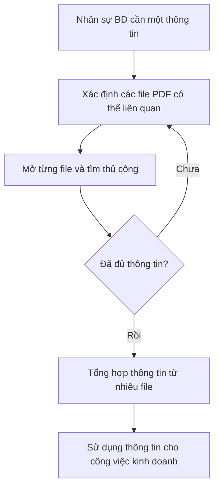
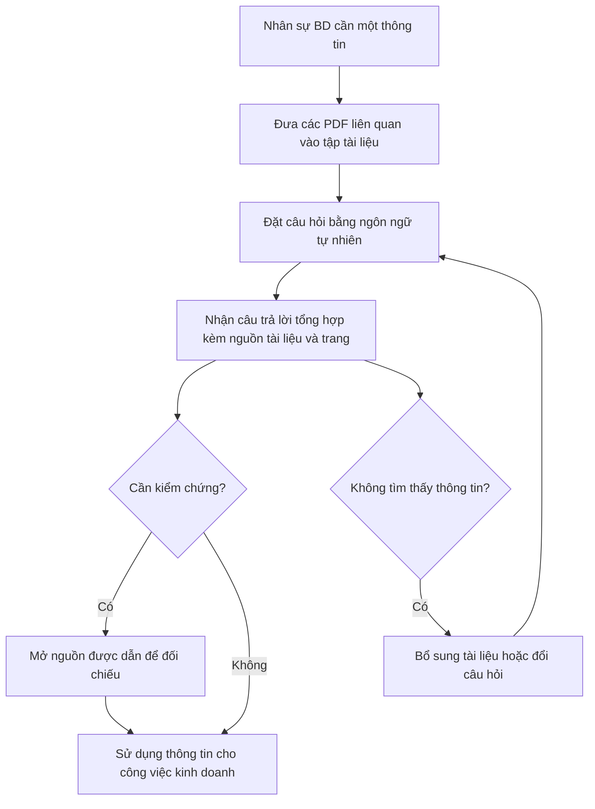

# TÀI LIỆU YÊU CẦU NGHIỆP VỤ (BRD) — CÔNG CỤ "CHAT VỚI TÀI LIỆU" (MVP)

> Chuẩn áp dụng: IEEE 29148-2018. Nội dung tuân theo `analysis/BRD_Prompt_IEEE_standard.md`.
> Quy ước: `[TBD: OQ-xxx]` = thông tin chưa có, đang chờ xác nhận; `[Unverified]` = chưa có nguồn chứng minh.

---

## 0. Tóm tắt kiểm tra đầu vào (Validation Summary)

**Đầu vào đã nhận**
- Bối cảnh và mục tiêu do quản lý giao (mục 2.1 của prompt) → ghi nhận là `SRC-001`.
- Cấu trúc và quy tắc chất lượng của prompt (IEEE 29148-2018) và mẫu `requirements/BRD-Template.md`.

**Thông tin còn thiếu**
- Tên tổ chức, sponsor, business owner, ngân sách, thời hạn MVP.
- Số liệu nền (baseline): thời gian tìm thông tin hiện nay, số lượng/dung lượng/ngôn ngữ tài liệu PDF, số người dùng.
- Phân loại độ nhạy cảm của tài liệu, yêu cầu pháp lý/bảo mật dữ liệu, chính sách dùng dịch vụ AI bên ngoài.
- Phạm vi tài liệu: dùng cá nhân hay chia sẻ cả đội; phân quyền.
- Chưa có phỏng vấn stakeholder hay tài liệu hiện trạng. Mọi nội dung đều dựa trên một bản brief ngắn.

**Ba rủi ro hàng đầu đối với chất lượng yêu cầu**
1. Không có baseline và chỉ số thành công → mục tiêu chưa đo được (OQ-001, OQ-002).
2. Chưa rõ độ nhạy cảm dữ liệu và chính sách dùng AI bên ngoài → có thể làm thay đổi phạm vi và ràng buộc (OQ-005, OQ-006).
3. Phạm vi MVP (đối tượng người dùng, giới hạn tài liệu, kiểu PDF như bản scan) chưa chốt → dễ phình phạm vi (OQ-003, OQ-004, OQ-007).

---

## 1. Kiểm soát tài liệu (Document control)

| Mục | Nội dung |
|---|---|
| Tiêu đề | BRD — Công cụ "Chat với tài liệu" (MVP) |
| Số tài liệu | BRD-CWD-001 |
| Phiên bản | 0.2 |
| Trạng thái | Draft |
| Tác giả | [TBD: OQ-008] |
| Người đóng góp | [TBD: OQ-008] |
| Người rà soát | [TBD: OQ-008] |
| Người phê duyệt | Quản lý đã giao yêu cầu (sponsor) — [TBD: OQ-008] |
| Phân loại bảo mật | Nội bộ [TBD: OQ-008] |
| Danh sách phân phối | Quản lý, đội phát triển kinh doanh, đội dự án MVP |

**Lịch sử phiên bản**

| Phiên bản | Ngày | Tác giả | Tóm tắt thay đổi |
|---|---|---|---|
| 0.1 | 2026-10-19 | [TBD: OQ-008] | Bản nháp đầu tiên từ brief của quản lý |
| 0.2 | 2026-10-20 | [TBD: OQ-008] | Sửa theo kết quả review checklist: thêm tầm nhìn, quy trình To-Be, kịch bản, hồ sơ người dùng; tách BR-003/012/014/016; thêm BR-018..BR-024; làm rõ BO-001, nguồn BR-013, AC-009; bổ sung giả định, phụ thuộc, rủi ro; thêm OQ-011, OQ-012 |

---

## 2. Tóm tắt điều hành (Executive summary)

**Tầm nhìn.** Nhân sự phát triển kinh doanh lấy được thông tin cần thiết từ kho tài liệu PDF của mình bằng một câu hỏi, kèm nguồn dẫn để kiểm chứng, thay vì mở và đọc từng file (mức rút ngắn thời gian: [TBD: OQ-002]). Sự gắn kết với chiến lược của tổ chức: [TBD: OQ-009].

**Vấn đề.** Đội phát triển kinh doanh (BD) phải làm việc với nhiều tài liệu PDF và khó nắm bắt đầy đủ nội dung. Mỗi lần cần một thông tin, họ mất thời gian tổng hợp từ nhiều file PDF (SRC-001). Tác động định lượng: [TBD: OQ-001] (chưa có số liệu hiện trạng).

**Thay đổi nghiệp vụ đề xuất.** Xây dựng một MVP "Chat với tài liệu": ứng dụng web cho phép người dùng tải lên các file PDF và đặt câu hỏi bằng ngôn ngữ tự nhiên cho AI để lấy thông tin từ nội dung của toàn bộ tài liệu đã tải lên. Câu trả lời cần chỉ rõ nguồn trong tài liệu để người dùng kiểm chứng.

**Lợi ích kỳ vọng và chỉ số.** Rút ngắn thời gian tìm thông tin (MET-001), tăng độ chính xác và khả năng kiểm chứng của câu trả lời (MET-002), và có người dùng sử dụng thực tế (MET-003). Baseline và mục tiêu: [TBD: OQ-001, OQ-002].

**Đầu tư, tiến độ, rủi ro chính.** Ngân sách và thời hạn: [TBD: OQ-009]. Rủi ro chính: AI trả lời sai hoặc bịa (RSK-001), lộ tài liệu nhạy cảm (RSK-002), người dùng không áp dụng (RSK-004).

**Quyết định cần từ người phê duyệt.** Phê duyệt phạm vi MVP và các mục tiêu ở mục 4, đồng thời chốt các câu hỏi mở chặn (OQ-001 đến OQ-007) trước khi chuyển sang PRD/SRS.

---

## 3. Bối cảnh nghiệp vụ và phát biểu vấn đề

### 3.1 Quy trình hiện tại (Current state)

Theo brief (SRC-001), khi cần một thông tin, nhân sự BD phải tìm và tổng hợp thủ công từ nhiều file PDF. Các bước chi tiết dưới đây là **suy luận từ brief** và cần xác nhận qua phỏng vấn (OQ-010).

### 3.2 Ai bị ảnh hưởng

| Nhóm | Ảnh hưởng | Bằng chứng |
|---|---|---|
| Đội phát triển kinh doanh | Mất thời gian tìm và tổng hợp; khó nắm đầy đủ nội dung tài liệu | SRC-001 |
| Quản lý | Quyết định và phản hồi khách hàng có thể chậm nếu thông tin chậm | [Unverified] |

### 3.3 Chi phí của việc không hành động

- Thời gian làm việc của đội BD bị tiêu tốn cho việc tìm kiếm: định lượng [TBD: OQ-001].
- Rủi ro bỏ sót thông tin quan trọng trong tài liệu khi tổng hợp thủ công: [Unverified].

### 3.4 Nguyên nhân gốc và triệu chứng

| Triệu chứng | Nguyên nhân gốc (giả thuyết cần xác nhận) |
|---|---|
| Tốn thời gian tìm một thông tin | Thông tin phân tán trong nhiều file PDF, không có điểm truy vấn chung (SRC-001) |
| Khó nắm đầy đủ nội dung | Khối lượng tài liệu lớn, không có cách hỏi đáp nhanh trên toàn bộ tập tài liệu (SRC-001) |

### 3.5 Vì sao bây giờ

Quản lý yêu cầu phát triển MVP (SRC-001). Lý do cụ thể và mức độ khẩn cấp: [TBD: OQ-009].

### 3.6 Quy trình đề xuất (To-Be)

Các bước dưới đây mô tả thay đổi nghiệp vụ ở mức cao, độc lập với giải pháp kỹ thuật, và cần xác nhận cùng OQ-010.

Thay đổi chính so với hiện tại: người dùng không còn xác định và mở từng file; việc tổng hợp nhiều tài liệu được thực hiện trong câu trả lời; mỗi câu trả lời có nguồn để kiểm chứng.

### 3.7 Kịch bản nghiệp vụ

Các kịch bản là đề xuất từ brief, cần xác nhận qua phỏng vấn đội BD (OQ-010).

| ID | Kịch bản | Người dùng | Kết quả mong đợi | Yêu cầu liên quan |
|---|---|---|---|---|
| SC-001 | Tìm một thông tin cụ thể trong tập tài liệu (ví dụ một điều khoản, một con số) | Nhân sự BD | Nhận câu trả lời kèm tài liệu và trang nguồn | BR-006, BR-012, BR-019 |
| SC-002 | Tổng hợp thông tin nằm rải rác ở nhiều tài liệu | Nhân sự BD | Một câu trả lời duy nhất nêu thông tin từ từng tài liệu liên quan | BR-007, BR-012 |
| SC-003 | Hỏi nội dung không có trong tài liệu | Nhân sự BD | Nhận thông báo không tìm thấy thông tin, không có câu trả lời bịa | BR-009 |
| SC-004 | Gỡ một tài liệu đã lỗi thời | Nhân sự BD | Tài liệu không còn xuất hiện trong câu trả lời sau đó | BR-005, BR-024 |
| SC-005 | Hỏi tiếp một câu có tham chiếu đến câu trước | Nhân sự BD | Câu trả lời hiểu đúng ngữ cảnh | BR-008 |

---

## 4. Động lực và mục tiêu nghiệp vụ

| ID | Động lực | Mục tiêu (kết quả) | Metric | Baseline | Target | Thời hạn | Nguồn |
|---|---|---|---|---|---|---|---|
| BO-001 | Giảm thời gian tìm thông tin trong nhiều PDF | Người dùng BD lấy được thông tin cần tìm từ tập PDF với thời gian trung bình giảm [TBD: OQ-002]% so với baseline của cách làm thủ công | MET-001 | [TBD: OQ-001] | [TBD: OQ-002] | [TBD: OQ-009] | SRC-001 |
| BO-002 | Nắm bắt đầy đủ nội dung tài liệu | Người dùng có thể truy vấn nội dung trên toàn bộ tập tài liệu đã tải lên và nhận câu trả lời có thể kiểm chứng | MET-002 | [TBD: OQ-001] | [TBD: OQ-002] | [TBD: OQ-009] | SRC-001 |
| BO-003 | Kiểm chứng giá trị của ý tưởng bằng MVP | Có bằng chứng sử dụng thực tế để quản lý quyết định đầu tư tiếp | MET-003 | 0 (chưa có công cụ) | [TBD: OQ-002] | [TBD: OQ-009] | SRC-001 |

**Định nghĩa metric**

| Metric | Định nghĩa | Công thức | Nguồn dữ liệu | Chủ sở hữu | Tần suất | Ngày baseline |
|---|---|---|---|---|---|---|
| MET-001 Thời gian trung bình để có câu trả lời | Thời gian từ lúc người dùng bắt đầu tìm đến lúc có câu trả lời mà họ chấp nhận | Trung bình (thời điểm có câu trả lời − thời điểm bắt đầu) trên mẫu tác vụ chuẩn | Đo thời gian trên bộ tác vụ chuẩn, so sánh cách thủ công và cách dùng công cụ | [TBD: OQ-008] | Mỗi đợt thử nghiệm | [TBD: OQ-001] |
| MET-002 Tỷ lệ câu trả lời đúng và có nguồn | Tỷ lệ câu hỏi trong bộ câu hỏi chuẩn được trả lời đúng và dẫn đúng nguồn | Số câu đúng có nguồn ÷ tổng số câu hỏi chuẩn | Bộ câu hỏi chuẩn do business owner xác nhận kèm đáp án | [TBD: OQ-008] | Mỗi đợt thử nghiệm | [TBD: OQ-001] |
| MET-003 Mức độ sử dụng | Số người dùng hoạt động trong một kỳ | Số người dùng có ít nhất một phiên hỏi đáp trong kỳ | Ghi nhận sử dụng | [TBD: OQ-008] | Hằng tuần | Ngày bắt đầu pilot |

> Các mục tiêu chưa hợp lệ hoàn toàn cho đến khi OQ-001 và OQ-002 được giải quyết (mục tiêu cần có baseline, target và phương pháp đo).

---

## 5. Phạm vi

### 5.1 Trong phạm vi (In scope)

- Tải lên tài liệu PDF vào ứng dụng web.
- Quản lý tập tài liệu đã tải lên (xem danh sách, xóa).
- Hỏi đáp bằng ngôn ngữ tự nhiên với AI về nội dung của **toàn bộ** tài liệu đã tải lên.
- Chỉ ra nguồn (tài liệu, vị trí) của thông tin trong câu trả lời.
- Đối tượng người dùng: nhân sự phát triển kinh doanh (xác nhận tại OQ-003).

### 5.2 Ngoài phạm vi (Out of scope)

| Hạng mục | Lý do |
|---|---|
| Định dạng khác PDF (Word, Excel, hình ảnh, web) | Brief chỉ nêu PDF (SRC-001) |
| Tích hợp với hệ thống CRM/DMS/email hiện có | Không nằm trong brief; MVP |
| Ứng dụng di động bản địa | Brief nêu ứng dụng web |
| Chỉnh sửa nội dung PDF hoặc tạo tài liệu mới | Không thuộc mục tiêu truy vấn |

### 5.3 Hoãn lại (Deferred)

| Hạng mục | Ghi chú |
|---|---|
| Phân quyền chi tiết theo nhóm/tài liệu | Phụ thuộc OQ-003, OQ-005 |
| PDF dạng ảnh scan (cần nhận dạng ký tự) | Phụ thuộc OQ-007 |
| Xuất kết quả hỏi đáp ra báo cáo | Có thể xem xét sau MVP |

### 5.4 Ranh giới

Sáng kiến bắt đầu khi người dùng tải PDF lên và kết thúc khi người dùng nhận được câu trả lời kèm nguồn. Việc thu thập, tạo lập và quản trị tài liệu gốc ở các hệ thống khác không thuộc sáng kiến này.

---

## 6. Stakeholder và nhu cầu

| ID | Nhóm | Vai trò | Quan tâm | Ảnh hưởng | Nhu cầu | Nguồn |
|---|---|---|---|---|---|---|
| STK-001 | Nhân sự phát triển kinh doanh (BD) | Người dùng chính | Tìm thông tin nhanh, chính xác | Cao | SN-001, SN-002, SN-003, SN-004 | SRC-001 |
| STK-002 | Quản lý (sponsor, người giao yêu cầu) | Người phê duyệt và đánh giá MVP | Giá trị mang lại, chi phí, tiến độ | Cao | SN-005 | SRC-001 |
| STK-003 | Đội phát triển MVP | Xây dựng và vận hành | Yêu cầu rõ ràng, khả thi | Trung bình | SN-006 | [Unverified] |
| STK-004 | Bộ phận CNTT / bảo mật / pháp chế | Kiểm soát rủi ro dữ liệu, tuân thủ | An toàn dữ liệu tài liệu kinh doanh | Cao (có thể chặn triển khai) | SN-007 | [Unverified] — OQ-005 |
| STK-005 | Chủ sở hữu tài liệu / đối tác có tài liệu bị đưa vào hệ thống | Bên có thể bị ảnh hưởng nếu tài liệu bị lộ | Bảo mật tài liệu | Trung bình | SN-007 | [Unverified] — OQ-005 |
| STK-006 | Nhân sự BD không chấp nhận công cụ (stakeholder tiêu cực) | Có thể từ chối dùng, tiếp tục làm thủ công | Tin cậy vào kết quả AI | Trung bình | SN-003 | [Unverified] |

**Nhu cầu stakeholder**

| ID | Stakeholder | Phát biểu nhu cầu | Nỗi đau hiện tại | Bằng chứng | Ưu tiên |
|---|---|---|---|---|---|
| SN-001 | STK-001 | Tôi muốn đưa các tài liệu PDF của mình vào một nơi để có thể hỏi về chúng | Thông tin nằm rải rác trong nhiều file | SRC-001 | Must |
| SN-002 | STK-001 | Tôi muốn hỏi bằng câu tự nhiên và nhận câu trả lời tổng hợp từ nhiều tài liệu | Phải tổng hợp thủ công từ nhiều PDF, tốn thời gian | SRC-001 | Must |
| SN-003 | STK-001, STK-006 | Tôi muốn biết câu trả lời lấy từ đâu để tin và kiểm chứng được | Không thể tin kết quả nếu không có nguồn | [Unverified] | Must |
| SN-004 | STK-001 | Tôi muốn quản lý các tài liệu đã tải lên (xem, xóa) | Tài liệu cũ hoặc sai gây trả lời sai | [Unverified] | Should |
| SN-005 | STK-002 | Tôi muốn có bằng chứng về hiệu quả sử dụng của MVP | Chưa có dữ liệu để quyết định đầu tư | SRC-001 | Must |
| SN-006 | STK-003 | Tôi muốn yêu cầu rõ ràng, có tiêu chí chấp nhận | Yêu cầu mơ hồ gây làm lại | [Unverified] | Should |
| SN-007 | STK-004, STK-005 | Tôi muốn tài liệu chỉ được truy cập bởi người được phép | Rủi ro lộ tài liệu kinh doanh | [Unverified] — OQ-005 | Must |

**Hồ sơ người dùng (đề xuất, cần xác nhận)**

| Thuộc tính | Người dùng chính (STK-001) |
|---|---|
| Vai trò | Nhân sự phát triển kinh doanh |
| Số lượng | [TBD: OQ-003] |
| Bối cảnh sử dụng | Cần tra cứu thông tin trong tài liệu PDF khi chuẩn bị hoặc xử lý công việc kinh doanh |
| Loại và khối lượng tài liệu | [TBD: OQ-004, OQ-007] |
| Tần suất tra cứu | [TBD: OQ-001] |
| Mức quen thuộc với công cụ AI | [TBD: OQ-010] |

Ghi chú: SN-006 là nhu cầu của đội dự án và được đáp ứng bằng chính tài liệu này (mỗi BR có tiêu chí chấp nhận), nên không có BR riêng.

---

## 7. Yêu cầu nghiệp vụ

Thang ưu tiên: **Must / Should / Could / Won't** (quy đổi sang thang 1–5 của template: Must = 1–2, Should = 3, Could = 4, Won't = 5).

Ghi chú: các giá trị định lượng chưa được xác nhận được để dưới dạng `[TBD: OQ-xxx]`. Nội dung tiêu chí chấp nhận có phần cần cập nhật khi OQ được giải quyết.

### 7.1 Nhóm A — Nạp và quản lý tài liệu

| ID | Yêu cầu | Lý do | Nguồn | Ưu tiên | Tiêu chí chấp nhận | Phương pháp xác minh | Trạng thái |
|---|---|---|---|---|---|---|---|
| BR-001 | Khi người dùng được phép cung cấp một tài liệu PDF, tổ chức **shall** cho phép người dùng đưa tài liệu đó vào tập tài liệu có thể truy vấn. | Là điều kiện để truy vấn nội dung | BO-002 / SN-001 | Must | AC-001 | Demonstration | Draft |
| BR-002 | Tổ chức **shall** cho phép người dùng đưa vào nhiều tài liệu PDF, tối thiểu [TBD: OQ-004] tài liệu và [TBD: OQ-004] dung lượng mỗi tài liệu. | Người dùng làm việc với nhiều PDF | BO-002 / SN-001 | Must | AC-002 | Test | Draft |
| BR-003 | Khi một tài liệu không thể đưa vào tập truy vấn, tổ chức **shall** thông báo cho người dùng tên tài liệu thất bại. | Tránh người dùng tin rằng tài liệu đã được đưa vào | SN-001 | Must | AC-003 | Test | Draft |
| BR-004 | Tổ chức **shall** cho phép người dùng xem danh sách các tài liệu đã đưa vào tập truy vấn của mình. | Người dùng cần biết phạm vi truy vấn | SN-004 | Should | AC-004 | Demonstration | Draft |
| BR-005 | Khi người dùng yêu cầu xóa một tài liệu, tổ chức **shall** loại tài liệu đó khỏi tập truy vấn để nó không còn xuất hiện trong câu trả lời sau đó. | Tránh trả lời từ tài liệu cũ hoặc sai; liên quan bảo mật | SN-004 / SN-007 | Should | AC-005 | Test | Draft |

| BR-018 | Khi một tài liệu không thể đưa vào tập truy vấn, tổ chức **shall** nêu lý do thất bại thuộc một trong các nhóm: tài liệu hỏng, tài liệu bị khóa hoặc mã hóa, tài liệu không phải PDF. | Người dùng biết cách khắc phục | SN-001 | Should | AC-018 | Test | Draft |
| BR-024 | Khi người dùng yêu cầu xóa một tài liệu, tổ chức **shall** xóa vĩnh viễn nội dung tài liệu đó khỏi nơi lưu trữ trong vòng [TBD: OQ-012] ngày. | Bảo mật và tuân thủ lưu trữ dữ liệu | SN-007 | Must | AC-024 | Inspection | Draft |

### 7.2 Nhóm B — Hỏi đáp trên nội dung tài liệu

| ID | Yêu cầu | Lý do | Nguồn | Ưu tiên | Tiêu chí chấp nhận | Phương pháp xác minh | Trạng thái |
|---|---|---|---|---|---|---|---|
| BR-006 | Khi người dùng đặt câu hỏi bằng ngôn ngữ tự nhiên, tổ chức **shall** cung cấp câu trả lời dựa trên nội dung của các tài liệu đã đưa vào. | Cốt lõi của sản phẩm | BO-001 / SN-002 | Must | AC-006 | Test | Draft |
| BR-007 | Khi câu trả lời cần thông tin từ nhiều tài liệu, tổ chức **shall** tổng hợp thông tin từ tất cả tài liệu liên quan trong cùng một câu trả lời. | Giảm công tổng hợp thủ công | BO-002 / SN-002 | Must | AC-007 | Test | Draft |
| BR-008 | Tổ chức **shall** hỗ trợ người dùng đặt câu hỏi tiếp theo trong cùng một cuộc hội thoại mà không phải nhắc lại ngữ cảnh đã nêu. | Hỏi đáp tự nhiên theo chuỗi | SN-002 | Should | AC-008 | Demonstration | Draft |
| BR-009 | Khi tài liệu đã đưa vào không chứa thông tin để trả lời câu hỏi, tổ chức **shall** thông báo rõ rằng không tìm thấy thông tin trong các tài liệu, thay vì đưa ra câu trả lời không có căn cứ. | Giảm rủi ro thông tin sai | SN-003 | Must | AC-009 | Test | Draft |
| BR-010 | Tổ chức **shall** hỗ trợ câu hỏi và nội dung tài liệu bằng các ngôn ngữ [TBD: OQ-007]. | Phạm vi ngôn ngữ chưa rõ | SN-002 | Must | AC-010 | Test | Draft |
| BR-011 | Tổ chức **shall** cung cấp câu trả lời cho câu hỏi trong thời gian không quá [TBD: OQ-002] giây ở điều kiện tải bình thường. | Giảm thời gian tìm thông tin | BO-001 | Should | AC-011 | Test | Draft |

### 7.3 Nhóm C — Độ tin cậy và khả năng kiểm chứng

| ID | Yêu cầu | Lý do | Nguồn | Ưu tiên | Tiêu chí chấp nhận | Phương pháp xác minh | Trạng thái |
|---|---|---|---|---|---|---|---|
| BR-012 | Với mỗi câu trả lời có nội dung, tổ chức **shall** chỉ rõ tài liệu nguồn của thông tin được sử dụng. | Người dùng kiểm chứng được | BO-002 / SN-003 | Must | AC-012 | Test | Draft |
| BR-013 | Tổ chức **shall** đạt tỷ lệ câu trả lời đúng và có nguồn tối thiểu [TBD: OQ-002] trên bộ câu hỏi chuẩn do business owner xác nhận. | Đảm bảo chất lượng chấp nhận được (đo bằng MET-002) | BO-002 / SN-003 | Must | AC-013 | Test | Draft |

| BR-019 | Với mỗi câu trả lời có nội dung, tổ chức **shall** chỉ rõ số trang của thông tin trong tài liệu nguồn. | Người dùng tìm đúng vị trí để kiểm chứng | BO-002 / SN-003 | Must | AC-019 | Test | Draft |

### 7.4 Nhóm D — Bảo mật và truy cập

| ID | Yêu cầu | Lý do | Nguồn | Ưu tiên | Tiêu chí chấp nhận | Phương pháp xác minh | Trạng thái |
|---|---|---|---|---|---|---|---|
| BR-014 | Tổ chức **shall** chỉ cho phép người dùng được cấp quyền sử dụng ứng dụng. | Bảo vệ tài liệu kinh doanh | SN-007 | Must | AC-014 | Test | Draft |
| BR-015 | Tổ chức **shall** xử lý và lưu trữ tài liệu theo chính sách dữ liệu của tổ chức [TBD: OQ-005, OQ-006]. | Tuân thủ và an toàn dữ liệu | SN-007 | Must | AC-015 | Review | Draft |

| BR-020 | Tổ chức **shall** chỉ cho phép người dùng truy vấn trên các tài liệu thuộc phạm vi chia sẻ được quy định tại [TBD: OQ-003]. | Bảo vệ tài liệu kinh doanh | SN-007 | Must | AC-020 | Test | Draft |
| BR-022 | Tổ chức **shall** duy trì khả năng sử dụng ứng dụng trong khung giờ [TBD: OQ-011] với mức sẵn sàng tối thiểu [TBD: OQ-011]%. | Giới hạn gián đoạn chấp nhận được cho MVP | BO-003 | Could | AC-022 | Inspection | Draft |
| BR-023 | Tổ chức **shall** ghi lại người dùng nào đã đặt câu hỏi về tài liệu nào và vào thời điểm nào, và lưu bản ghi tối thiểu [TBD: OQ-012] ngày. | Khả năng kiểm toán | SN-007 | Should | AC-023 | Inspection | Draft |

### 7.5 Nhóm E — Đo lường hiệu quả

| ID | Yêu cầu | Lý do | Nguồn | Ưu tiên | Tiêu chí chấp nhận | Phương pháp xác minh | Trạng thái |
|---|---|---|---|---|---|---|---|
| BR-016 | Tổ chức **shall** ghi nhận số người dùng hoạt động mỗi tuần trong thời gian thử nghiệm. | Đo MET-003 | BO-003 / SN-005 | Should | AC-016 | Inspection | Draft |
| BR-017 | Tổ chức **shall** thu thập đánh giá của người dùng về từng câu trả lời (hữu ích / không hữu ích). | Đo chất lượng cảm nhận để cải tiến | BO-003 / SN-005 | Could | AC-017 | Demonstration | Draft |

| BR-021 | Tổ chức **shall** ghi nhận số câu hỏi mỗi tuần trong thời gian thử nghiệm. | Đo MET-003 | BO-003 / SN-005 | Should | AC-021 | Inspection | Draft |

**Tiêu chí chấp nhận**

| ID | Tiêu chí (có thể quyết định khách quan) | Yêu cầu |
|---|---|---|
| AC-001 | Cho một file PDF hợp lệ, sau khi tải lên, file xuất hiện trong tập tài liệu và có thể được truy vấn | BR-001 |
| AC-002 | Tải lên số lượng và dung lượng tài liệu bằng giới hạn tối thiểu đã chốt tại OQ-004, tất cả được xử lý thành công | BR-002 |
| AC-003 | Cho một file hỏng/không phải PDF, người dùng nhận thông báo nêu tên file, và file không xuất hiện trong danh sách truy vấn | BR-003 |
| AC-004 | Người dùng thấy danh sách đầy đủ các tài liệu đã tải lên của mình | BR-004 |
| AC-005 | Sau khi xóa tài liệu X, các câu hỏi chỉ có đáp án trong X nhận phản hồi "không tìm thấy thông tin" | BR-005 |
| AC-006 | Trên bộ câu hỏi chuẩn, các câu hỏi có đáp án nằm trong tài liệu nhận câu trả lời khớp với đáp án chuẩn (ngưỡng theo AC-013) | BR-006 |
| AC-007 | Cho câu hỏi có đáp án rải ở ≥ 2 tài liệu, câu trả lời chứa thông tin từ cả các tài liệu đó | BR-007 |
| AC-008 | Cho câu hỏi tiếp theo dùng đại từ tham chiếu câu trước, câu trả lời hiểu đúng đối tượng được nhắc | BR-008 |
| AC-009 | Cho câu hỏi ngoài nội dung tài liệu, câu trả lời nêu rõ không tìm thấy thông tin; trong bộ câu hỏi ngoài phạm vi, tỷ lệ câu hỏi nhận câu trả lời có nội dung không có căn cứ trong tài liệu ≤ [TBD: OQ-002]% (tính trên số câu hỏi ngoài phạm vi) | BR-009 |
| AC-010 | Bộ câu hỏi chuẩn theo từng ngôn ngữ đã chốt đạt ngưỡng của AC-013 | BR-010 |
| AC-011 | Thời gian phản hồi đo trên bộ câu hỏi chuẩn ≤ ngưỡng [TBD: OQ-002] ở tối thiểu [TBD: OQ-002]% số câu | BR-011 |
| AC-012 | 100% câu trả lời có nội dung nêu tên tài liệu nguồn, và thông tin trong câu trả lời có trong tài liệu đó | BR-012 |
| AC-013 | Tỷ lệ câu đúng và có nguồn ≥ ngưỡng [TBD: OQ-002] trên bộ câu hỏi chuẩn | BR-013 |
| AC-014 | Người dùng không được cấp quyền không truy cập được ứng dụng | BR-014 |
| AC-015 | Bộ phận bảo mật xác nhận bằng văn bản việc xử lý và lưu trữ dữ liệu đáp ứng chính sách | BR-015 |
| AC-016 | Báo cáo hằng tuần hiển thị số người dùng hoạt động | BR-016 |
| AC-017 | Người dùng đánh giá được từng câu trả lời và tổng hợp đánh giá xem được | BR-017 |
| AC-018 | Cho mỗi loại lỗi (hỏng, bị khóa/mã hóa, không phải PDF), thông báo nêu đúng nhóm lý do | BR-018 |
| AC-019 | Với 100% câu trả lời có nội dung, số trang nêu ra trỏ đúng trang chứa thông tin tương ứng | BR-019 |
| AC-020 | Người dùng chỉ truy vấn được các tài liệu thuộc phạm vi chia sẻ đã chốt tại OQ-003 | BR-020 |
| AC-021 | Báo cáo hằng tuần hiển thị số câu hỏi | BR-021 |
| AC-022 | Số liệu giám sát cho thấy mức sẵn sàng trong khung giờ đã chốt đạt ngưỡng tại OQ-011 | BR-022 |
| AC-023 | Với một câu hỏi bất kỳ, bản ghi cho biết người dùng, tài liệu liên quan và thời điểm; bản ghi còn tồn tại đủ số ngày đã chốt | BR-023 |
| AC-024 | Sau thời hạn đã chốt tại OQ-012, nội dung tài liệu đã xóa không còn trong nơi lưu trữ (xác nhận bằng kiểm tra) | BR-024 |

---

## 8. Quy tắc nghiệp vụ

| ID | Quy tắc | Loại | Phạm vi | Chủ sở hữu thực thi | Nguồn |
|---|---|---|---|---|---|
| BRU-001 | Câu trả lời chỉ được dựa trên nội dung của các tài liệu người dùng đã đưa vào, không dựa trên nguồn ngoài | Chính sách | Hỏi đáp | Business owner [TBD: OQ-008] | SRC-001 |
| BRU-002 | Mỗi câu trả lời có nội dung phải kèm nguồn | Chính sách | Hỏi đáp | Business owner [TBD: OQ-008] | SN-003 |
| BRU-003 | Tài liệu thuộc phân loại bảo mật cấm sử dụng dịch vụ AI bên ngoài không được đưa vào công cụ | Chính sách | Nạp tài liệu | CNTT/bảo mật [TBD: OQ-005, OQ-006] | [Unverified] |
| BRU-004 | Người dùng chỉ truy vấn trên tài liệu mà họ có quyền truy cập | Chính sách | Truy cập | CNTT/bảo mật [TBD: OQ-003] | SN-007 |
| BRU-005 | Chỉ người đã tải lên tài liệu hoặc quản trị viên được xóa tài liệu đó (đề xuất, cần xác nhận) | Chính sách | Quản lý tài liệu | CNTT/bảo mật [TBD: OQ-003] | [Unverified] |

---

## 9. Ràng buộc

| ID | Ràng buộc | Loại | Bên áp đặt | Tác động | Nguồn |
|---|---|---|---|---|---|
| CON-001 | Sản phẩm là ứng dụng web | Kỹ thuật/Tổ chức | Quản lý | Giới hạn kênh phân phối | SRC-001 |
| CON-002 | Chỉ hỗ trợ định dạng PDF cho đầu vào | Phạm vi | Quản lý | Loại trừ định dạng khác | SRC-001 |
| CON-003 | Phát triển ở mức MVP | Tổ chức | Quản lý | Giới hạn phạm vi tính năng | SRC-001 |
| CON-004 | Ngân sách, thời hạn | Ngân sách/Thời gian | [TBD: OQ-009] | [TBD: OQ-009] | [TBD: OQ-009] |
| CON-005 | Quy định bảo mật/dữ liệu của tổ chức và pháp luật; cần xác định việc áp dụng Nghị định 13/2023/NĐ-CP về bảo vệ dữ liệu cá nhân nếu PDF chứa dữ liệu cá nhân, và các điều khoản bảo mật (NDA) hoặc bản quyền của tài liệu đối tác [Unverified] | Pháp lý | [TBD: OQ-005] | Có thể hạn chế việc dùng dịch vụ AI bên ngoài | [TBD: OQ-005] |

---

## 10. Giả định, phụ thuộc và rủi ro

Xác suất và tác động của rủi ro là đánh giá ban đầu của người soạn (Cao / Trung bình / Thấp), cần chủ sở hữu rủi ro xác nhận (OQ-008).

| ID | Hạng mục | Loại | Mô tả | Tác động nếu sai | Chủ sở hữu | Xác thực / giảm thiểu | Hạn |
|---|---|---|---|---|---|---|---|
| ASM-001 | PDF có lớp văn bản (không phải ảnh scan) | Giả định | Phần lớn PDF của đội BD chứa văn bản có thể trích xuất | Cần thêm khả năng nhận dạng ký tự, tăng chi phí/phạm vi | [TBD: OQ-008] | Khảo sát mẫu PDF (OQ-007) | [TBD: OQ-009] |
| ASM-002 | Người dùng chính là đội BD, số lượng nhỏ trong giai đoạn MVP | Giả định | Quy mô người dùng nhỏ | Ảnh hưởng quy mô, phân quyền | [TBD: OQ-008] | Xác nhận với quản lý (OQ-003) | [TBD: OQ-009] |
| ASM-003 | Tài liệu cho phép được xử lý bằng AI theo chính sách của tổ chức | Giả định | Không bị cấm bởi chính sách dữ liệu | Có thể phải thay đổi phạm vi hoặc cách triển khai | [TBD: OQ-008] | Xác nhận với CNTT/bảo mật (OQ-005, OQ-006) | [TBD: OQ-009] |
| ASM-004 | Người dùng BD sẵn sàng đổi thói quen từ tìm thủ công sang hỏi đáp nếu câu trả lời có nguồn kiểm chứng | Giả định | Công cụ được dùng thật | Không đạt MET-003, BO-003 | [TBD: OQ-008] | Thử nghiệm sớm với người dùng thật, đo bằng BR-016/BR-021 | [TBD: OQ-009] |
| ASM-005 | Business owner cung cấp được bộ câu hỏi chuẩn có đáp án đúng | Giả định | Đủ để đo MET-002 | Không xác nhận được BR-013 | [TBD: OQ-008] | Xác nhận với business owner | [TBD: OQ-009] |
| DEP-001 | Có tập PDF mẫu thật và bộ câu hỏi chuẩn do business owner cung cấp | Phụ thuộc | Cần để đo MET-002 | Không đo được chất lượng | [TBD: OQ-008] | Business owner chuẩn bị | [TBD: OQ-009] |
| DEP-002 | Quyết định của CNTT/bảo mật về dịch vụ AI | Phụ thuộc | Điều kiện để triển khai | Trì hoãn MVP | [TBD: OQ-008] | Theo dõi OQ-006 | [TBD: OQ-009] |
| DEP-003 | Nhà cung cấp dịch vụ AI và hạ tầng chạy ứng dụng được chọn và phê duyệt | Phụ thuộc | Cần để vận hành MVP (lựa chọn cụ thể thuộc SAD, không thuộc BRD) | Không triển khai được | [TBD: OQ-008] | Theo dõi cùng DEP-002 | [TBD: OQ-009] |
| DEP-004 | Ngân sách và nhân sự cho MVP được phê duyệt | Phụ thuộc | Điều kiện bắt đầu | Trì hoãn hoặc giảm phạm vi MVP | [TBD: OQ-008] | Theo dõi OQ-009 | [TBD: OQ-009] |
| DEP-005 | Nhân sự BD tham gia thử nghiệm và phỏng vấn | Phụ thuộc | Cần để xác nhận quy trình và đo kết quả | Không có baseline và đánh giá | [TBD: OQ-008] | Quản lý sắp xếp thời gian cho nhóm | [TBD: OQ-009] |

| ID | Rủi ro | Mô tả (nguyên nhân → sự kiện → hệ quả) | Xác suất | Tác động | Chủ sở hữu | Giảm thiểu | Dự phòng | Hạn |
|---|---|---|---|---|---|---|---|---|
| RSK-001 | AI trả lời sai hoặc bịa thông tin | Mô hình AI sinh câu trả lời không có căn cứ → người dùng tin → quyết định kinh doanh sai | Trung bình | Cao | [TBD: OQ-008] | BR-009, BR-012, BR-019; kiểm thử bằng bộ câu hỏi chuẩn (BR-013); thông báo giới hạn cho người dùng | Tạm dừng hoặc thu hẹp phạm vi nếu không đạt ngưỡng BR-013 | [TBD: OQ-009] |
| RSK-002 | Lộ tài liệu nhạy cảm | Tài liệu bị xử lý/lưu ở nơi không được phép → lộ thông tin | [TBD: OQ-005] | Cao | [TBD: OQ-008] | BR-014, BR-015, BR-020, BR-024; BRU-003 | Quy trình xử lý sự cố và gỡ dữ liệu theo chính sách tổ chức | [TBD: OQ-009] |
| RSK-003 | Chất lượng kém với PDF phức tạp (bảng, scan, nhiều cột) | Trích xuất sai → trả lời sai | Trung bình | Trung bình | [TBD: OQ-008] | Khảo sát mẫu PDF; công bố giới hạn MVP | Hoãn nhóm PDF phức tạp sang giai đoạn sau (xem 5.3) | [TBD: OQ-009] |
| RSK-004 | Người dùng không áp dụng công cụ | Mất niềm tin hoặc không thay đổi thói quen → không đạt MET-003 | Trung bình | Trung bình | [TBD: OQ-008] | Thử nghiệm sớm với người dùng thật; BR-012, BR-019 | Thu thập phản hồi (BR-017), điều chỉnh yêu cầu hoặc dừng MVP | [TBD: OQ-009] |
| RSK-005 | Chi phí vận hành vượt dự kiến | Chi phí dùng dịch vụ AI tăng theo mức dùng → vượt ngân sách | Trung bình | Trung bình | [TBD: OQ-008] | Xác định ngân sách (OQ-009); theo dõi mức sử dụng qua BR-021 | Giới hạn mức sử dụng hoặc dừng MVP khi vượt ngân sách | [TBD: OQ-009] |

---

## 11. Truy vết (Traceability)

Một BR hợp lệ nếu truy được đến BO hoặc SN (mục 3.1). Ký hiệu "—" ở cột Mục tiêu nghĩa là yêu cầu chỉ truy được đến nhu cầu stakeholder.

| Mục tiêu | Nhu cầu | Yêu cầu | Tiêu chí chấp nhận | ID PRD/SRS hạ nguồn |
|---|---|---|---|---|
| BO-001 | SN-002 | BR-006, BR-011 | AC-006, AC-011 | [TBD] |
| BO-002 | SN-001 | BR-001, BR-002 | AC-001, AC-002 | [TBD] |
| — | SN-001 | BR-003, BR-018 | AC-003, AC-018 | [TBD] |
| BO-002 | SN-002 | BR-007, BR-008, BR-010 | AC-007, AC-008, AC-010 | [TBD] |
| BO-002 | SN-003 | BR-012, BR-013, BR-019 | AC-012, AC-013, AC-019 | [TBD] |
| — | SN-003 | BR-009 | AC-009 | [TBD] |
| — | SN-004 | BR-004, BR-005 | AC-004, AC-005 | [TBD] |
| — | SN-007 | BR-005, BR-014, BR-015, BR-020, BR-023, BR-024 | AC-005, AC-014, AC-015, AC-020, AC-023, AC-024 | [TBD] |
| BO-003 | SN-005 | BR-016, BR-017, BR-021, BR-022 | AC-016, AC-017, AC-021, AC-022 | [TBD] |
| — | SN-006 | Đáp ứng bằng tiêu chí chấp nhận của toàn bộ BR | — | — |

**Báo cáo độ phủ**
- Mục tiêu chưa có yêu cầu: không có.
- Yêu cầu không có mục tiêu và không có nhu cầu (mồ côi): không có. Các yêu cầu chỉ truy được đến nhu cầu (BR-003, BR-004, BR-005, BR-009, BR-014, BR-015, BR-018, BR-020, BR-023, BR-024) hợp lệ theo mục 3.1.
- Nhu cầu chưa có yêu cầu: SN-006 (xem ghi chú ở mục 6; được đáp ứng bởi tiêu chí chấp nhận).
- Yêu cầu chưa có tiêu chí chấp nhận hoặc phương pháp xác minh: không có.
- Lưu ý: nhiều tiêu chí chấp nhận phụ thuộc ngưỡng chưa chốt (OQ-002, OQ-004, OQ-011, OQ-012).
- Một số bằng chứng cho nhu cầu (SN-003, SN-004, SN-006, SN-007) vẫn là [Unverified].

---

## 12. Câu hỏi mở và quyết định

| ID | Câu hỏi / quyết định cần có | Vì sao quan trọng | Chủ sở hữu | Cần trước ngày | Trạng thái | Giải quyết |
|---|---|---|---|---|---|---|
| OQ-001 | Baseline hiện tại: đội BD tốn bao lâu mỗi lần tìm thông tin, bao nhiêu lần mỗi tuần, bao nhiêu người? | Không có baseline thì MET-001/002 không hợp lệ | Quản lý [TBD] | [TBD] | Open | — |
| OQ-002 | Mục tiêu định lượng (thời gian giảm, độ chính xác tối thiểu, thời gian phản hồi, mức sử dụng)? | Cần cho BO-001..003, BR-011, BR-013, AC-009, AC-011, AC-013 | Quản lý [TBD] | [TBD] | Open | — |
| OQ-003 | Ai là người dùng MVP, bao nhiêu người, tài liệu dùng riêng hay chia sẻ cả đội? | Quyết định phạm vi truy cập (BR-014) | Quản lý [TBD] | [TBD] | Open | — |
| OQ-004 | Số lượng và dung lượng PDF tối thiểu cần hỗ trợ mỗi tài liệu và tổng cộng? | Cần cho BR-002 | Business owner [TBD] | [TBD] | Open | — |
| OQ-005 | Tài liệu có nhạy cảm không; có quy định bảo mật/pháp lý nào áp dụng? | Ảnh hưởng BR-015, CON-005 | CNTT/bảo mật/pháp chế [TBD] | [TBD] | Open | — |
| OQ-006 | Có được phép gửi nội dung tài liệu tới dịch vụ AI bên ngoài tổ chức không? | Có thể thay đổi giả định và phạm vi | CNTT/bảo mật [TBD] | [TBD] | Open | — |
| OQ-007 | Ngôn ngữ của tài liệu và câu hỏi (Việt, Anh, khác)? Có PDF scan không? | Cần cho BR-010, ASM-001 | Business owner [TBD] | [TBD] | Open | — |
| OQ-008 | Ai là sponsor, business owner, tác giả, người rà soát, chủ sở hữu metric, rủi ro? | Cần cho kiểm soát tài liệu và phê duyệt | Quản lý [TBD] | [TBD] | Open | — |
| OQ-009 | Ngân sách, thời hạn MVP, lý do "vì sao bây giờ"? | Cần cho tóm tắt điều hành, CON-004 | Quản lý [TBD] | [TBD] | Open | — |
| OQ-010 | Quy trình tìm thông tin hiện tại thực tế (xác nhận bản vẽ ở mục 3.1) và các kịch bản ở mục 3.7? | Bản vẽ và kịch bản hiện chỉ là suy luận từ brief | Đội BD [TBD] | [TBD] | Open | — |
| OQ-011 | MVP cần mức sẵn sàng và khung giờ sử dụng nào? Có cần khôi phục sau sự cố không? | Cần cho BR-022 | Quản lý [TBD] | [TBD] | Open | — |
| OQ-012 | Thời gian lưu bản ghi truy vấn (BR-023) và thời hạn xóa vĩnh viễn tài liệu (BR-024)? | Cần cho BR-023, BR-024 | CNTT/bảo mật [TBD] | [TBD] | Open | — |

---

## 13. Bảng thuật ngữ và tài liệu tham chiếu

### 13.1 Thuật ngữ

| Thuật ngữ | Giải thích |
|---|---|
| BRD | Business Requirements Document — tài liệu yêu cầu nghiệp vụ |
| BD | Business Development — phát triển kinh doanh |
| MVP | Minimum Viable Product — sản phẩm khả dụng tối thiểu để kiểm chứng giá trị |
| PDF | Portable Document Format — định dạng tài liệu đầu vào của công cụ |
| AI | Trí tuệ nhân tạo; trong tài liệu này là thành phần trả lời câu hỏi bằng ngôn ngữ tự nhiên |
| Chat với tài liệu | Hình thức người dùng hỏi đáp bằng ngôn ngữ tự nhiên về nội dung tài liệu đã tải lên |
| Tập tài liệu | Tập hợp các tài liệu PDF mà người dùng đã đưa vào và có thể truy vấn |
| Nguồn (của câu trả lời) | Tài liệu và số trang chứa thông tin mà câu trả lời dựa vào |
| Bộ câu hỏi chuẩn | Tập câu hỏi kèm đáp án đúng do business owner xác nhận, dùng để đo độ chính xác |
| Bịa đặt (hallucination) | Câu trả lời có vẻ hợp lý nhưng không có căn cứ trong tài liệu |
| IEEE 29148-2018 | Chuẩn kỹ thuật yêu cầu hệ thống và phần mềm |

### 13.2 Tài liệu tham chiếu

| ID | Tên | Phiên bản | Vị trí | Ngày truy cập |
|---|---|---|---|---|
| SRC-001 | Brief của quản lý: bối cảnh và mục tiêu "Chat với tài liệu" | — | `analysis/BRD_Prompt_IEEE_standard.md`, mục 2.1 | 2026-10-19 |
| REF-001 | IEEE 29148-2018 | 2018 | Chuẩn IEEE | — |
| REF-002 | BRD Template | — | `requirements/BRD-Template.md` | 2026-10-19 |

---

## 14. Phê duyệt

| Vai trò | Tên | Quyết định | Chữ ký / ngày |
|---|---|---|---|
| Executive sponsor | [TBD: OQ-008] | [Approve / Approve with conditions / Reject] | |
| Business owner | [TBD: OQ-008] | [Approve / Reject] | |
| Product manager / product owner | [TBD: OQ-008] | [Approve / Reject] | |
| Compliance / legal | [TBD: OQ-008] | [Approve / Reject] | |

Điều kiện phê duyệt: giải quyết các OQ chặn (OQ-001 đến OQ-007). Phiên bản được phê duyệt: chưa có (bản hiện tại 0.2 Draft).

---

## 15. Phụ lục

Chưa có. Phụ lục dự kiến: ghi chép phỏng vấn đội BD, mẫu PDF thực tế, bộ câu hỏi chuẩn, số liệu baseline.

---

## 16. Kết quả kiểm tra (Checklist mục 5 của prompt)

| Hạng mục | Kết quả |
|---|---|
| Mỗi yêu cầu dùng `shall`, một nghĩa vụ | Đạt (đã tách BR-003, BR-012, BR-014, BR-016) |
| Không có ngôn ngữ giải pháp/thiết kế | Đạt |
| Định lượng khi cần | **Chưa đạt** — BR-002, BR-011, BR-013, BR-022, BR-023, BR-024 chờ OQ-002/004/011/012 |
| Không còn từ mơ hồ | Đạt (đã sửa BO-001, AC-009) |
| Mỗi mục tiêu có yêu cầu; mỗi yêu cầu có nguồn, AC, phương pháp xác minh | Đạt |
| Mỗi nhóm stakeholder có nhu cầu | Đạt |
| Câu hỏi mở có chủ sở hữu và hạn | **Chưa đạt** — tên và ngày chưa có (OQ-008, OQ-009) |
| Vấn đề được chứng minh bằng bằng chứng | **Chưa đạt** — chỉ có brief (OQ-001, OQ-010) |
| Baseline và target có nguồn, đo được | **Chưa đạt** — OQ-001, OQ-002 |
| Sponsor xác nhận | Chưa thực hiện |

### Tuyên bố sẵn sàng

**Not ready** (chưa sẵn sàng để phê duyệt). Đủ để rà soát nội bộ như bản nháp.

Các mục chặn:
- Các yêu cầu Must thiếu giá trị định lượng: BR-002 (OQ-004), BR-013 (OQ-002), BR-024 (OQ-012).
- Mục tiêu BO-001, BO-002, BO-003 thiếu baseline/target: OQ-001, OQ-002.
- Ràng buộc bảo mật chưa rõ ảnh hưởng BR-014, BR-015: OQ-003, OQ-005, OQ-006.
- Chưa có người phê duyệt và tác giả: OQ-008.
