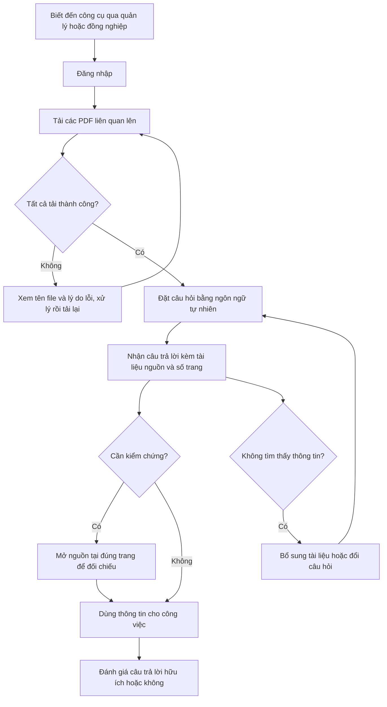

# TÀI LIỆU YÊU CẦU SẢN PHẨM (PRD) — "CHAT VỚI TÀI LIỆU" (MVP)

> Chuẩn áp dụng: IEEE 29148-2018. Nội dung tuân theo `docs/requirements/PRD_Prompt_IEEE_standard.md`.
> Đầu vào: `docs/requirements/BRD.md` (v0.2). Chưa có SRS riêng, nên BRD là nguồn yêu cầu duy nhất.
> Quy ước: `[TBD: OQ-xxx]` = chưa có thông tin, đang chờ xác nhận (câu hỏi mở nằm ở BRD mục 12 và mục 7 của PRD này); `[Đề xuất]` = người soạn đề xuất, chưa được xác nhận.

| Mục | Nội dung |
|---|---|
| Số tài liệu | PRD-CWD-001 |
| Phiên bản | 0.1 |
| Trạng thái | Draft |
| Ngày | 2026-10-20 |
| Tác giả / người rà soát / người phê duyệt | [TBD: OQ-008] |
| Tài liệu gốc | BRD-CWD-001 v0.2 |

---

## 0. Kiểm tra nền tảng sản phẩm (Validation of Product Pillars)

Prompt yêu cầu năm thành phần nền tảng. Bảng dưới cho thấy mỗi thành phần được lấy từ đâu và mức tin cậy.

| Thành phần | Nội dung dùng trong PRD | Nguồn | Đánh giá |
|---|---|---|---|
| Tên sản phẩm | "Chat với tài liệu" (MVP) | BRD, SRC-001 | Đã có |
| Người dùng mục tiêu | Nhân sự phát triển kinh doanh (BD) | BRD STK-001 | Đã có, nhưng số lượng và hồ sơ chi tiết chưa rõ (OQ-003, OQ-010) |
| Vấn đề | Thông tin nằm rải rác trong nhiều PDF, mỗi lần tìm phải tổng hợp thủ công | BRD mục 3 | Có, nhưng chưa định lượng (OQ-001) |
| Giải pháp cốt lõi | Ứng dụng web cho phép tải PDF lên và hỏi đáp với AI trên toàn bộ tài liệu đã tải, trả lời kèm nguồn | BRD mục 2, BR-006 đến BR-012 | Đã có |
| Trụ cột UX | Brief **không nêu**. PRD đề xuất 4 trụ cột ở mục 4.0 và đánh dấu [Đề xuất] | — | **Thiếu**, cần business owner và đội thiết kế xác nhận |

**Ba điểm yếu cần xử lý trước khi chốt PRD**
1. Các mục tiêu OKR chưa có baseline và target (OQ-001, OQ-002), nên mọi con số trong OKR đều [TBD].
2. Chưa rõ độ nhạy cảm dữ liệu và việc dùng dịch vụ AI bên ngoài (OQ-005, OQ-006), nên có thể làm thay đổi phạm vi.
3. Chưa có trụ cột UX và chưa có người dùng thật xác nhận hành trình (OQ-010).

Phạm vi PRD này **chỉ gồm** sản phẩm theo BRD. Kiến trúc, công nghệ và nhà cung cấp AI thuộc tài liệu thiết kế (SAD), không thuộc PRD.

---

## 1. Tóm tắt điều hành và chiến lược

### 1.1 Tầm nhìn sản phẩm

Nhân sự phát triển kinh doanh lấy được thông tin cần thiết từ kho tài liệu PDF của mình bằng một câu hỏi, kèm nguồn dẫn để kiểm chứng, thay vì mở và đọc từng file. (Nguồn: BRD mục 2; mức rút ngắn thời gian [TBD: OQ-002].)

### 1.2 Mục tiêu và kết quả chính (OKR)

| Objective | Key Result | Metric (BRD) | Baseline | Target | Nguồn |
|---|---|---|---|---|---|
| O1. Giảm thời gian tìm thông tin trong nhiều PDF (BO-001) | KR1.1: Thời gian trung bình để có câu trả lời mà người dùng chấp nhận giảm [TBD: OQ-002]% so với cách làm thủ công, đo trên bộ tác vụ chuẩn | MET-001 | [TBD: OQ-001] | [TBD: OQ-002] | BO-001 |
| O1 | KR1.2: Thời gian phản hồi mỗi câu hỏi ≤ [TBD: OQ-002] giây ở ít nhất [TBD: OQ-002]% số câu | — | — | [TBD: OQ-002] | BR-011 |
| O2. Người dùng truy vấn được toàn bộ nội dung tài liệu và tin vào câu trả lời (BO-002) | KR2.1: Tỷ lệ câu trả lời đúng và có nguồn ≥ [TBD: OQ-002]% trên bộ câu hỏi chuẩn | MET-002 | [TBD: OQ-001] | [TBD: OQ-002] | BR-013 |
| O2 | KR2.2: 100% câu trả lời có nội dung nêu tài liệu nguồn và số trang | — | — | 100% | BR-012, BR-019 |
| O2 | KR2.3: Tỷ lệ câu hỏi ngoài phạm vi nhận câu trả lời không có căn cứ ≤ [TBD: OQ-002]% | — | — | [TBD: OQ-002] | BR-009 |
| O3. Chứng minh giá trị của MVP bằng việc dùng thực tế (BO-003) | KR3.1: Số người dùng hoạt động mỗi tuần ≥ [TBD: OQ-002] trong giai đoạn thử nghiệm | MET-003 | 0 (chưa có công cụ) | [TBD: OQ-002] | BR-016 |

Chủ sở hữu OKR và thời hạn: [TBD: OQ-008, OQ-009].

---

## 2. Persona và hành trình người dùng

### 2.1 Persona

| Persona | Mô tả | Mục tiêu | Nỗi đau | Nguồn |
|---|---|---|---|---|
| **P1. Nhân sự BD (chính)** — STK-001 | Làm việc với nhiều PDF để phục vụ công việc kinh doanh. Số lượng [TBD: OQ-003]; mức quen thuộc với AI [TBD: OQ-010] | Lấy nhanh một thông tin đúng; tổng hợp thông tin từ nhiều tài liệu | Phải mở và tìm thủ công từng file; khó nắm đủ nội dung | BRD mục 3, 6 |
| **P2. Người dùng hoài nghi (phụ)** — STK-006 | Nhân sự BD không tin kết quả AI, có thể quay lại cách làm thủ công | Kiểm chứng được câu trả lời trước khi dùng | Sợ AI trả lời sai | BRD STK-006, SN-003 |
| **P3. Quản lý / người đánh giá MVP (phụ)** — STK-002 | Quyết định có đầu tư tiếp hay không | Có số liệu sử dụng và chất lượng | Chưa có dữ liệu | BRD SN-005 |
| **P4. Quản trị bảo mật (phụ)** — STK-004 | Đại diện CNTT/bảo mật/pháp chế; không trực tiếp dùng chức năng chat | Bảo đảm tài liệu chỉ truy cập bởi người được phép | Rủi ro lộ tài liệu | BRD SN-007 |

### 2.2 Hành trình người dùng mức cao (P1)

Mục tiêu thành công của hành trình: người dùng nhận được câu trả lời mình chấp nhận mà không phải mở từng PDF. Hành trình cần xác nhận với đội BD (OQ-010).

---

## 3. Yêu cầu chức năng và User Story

Ưu tiên: **P0** = bắt buộc cho launch (tương ứng Must của BRD), **P1** = nên có (Should), **P2** = có thì tốt (Could). Mọi story P0 có tiêu chí chấp nhận dạng Given-When-Then. Các ngưỡng chưa chốt giữ dạng `[TBD]`.

### 3.1 Ma trận Epic

| Epic | Mô tả | Story | Yêu cầu BRD |
|---|---|---|---|
| E1. Nạp và quản lý tài liệu | Đưa PDF vào, xem, xóa | US-001 đến US-007 | BR-001 đến 005, 018, 024 |
| E2. Hỏi đáp trên tài liệu | Hỏi bằng ngôn ngữ tự nhiên, nhận câu trả lời | US-008 đến US-013 | BR-006 đến 011 |
| E3. Nguồn và độ tin cậy | Nguồn dẫn, chất lượng câu trả lời | US-014 đến US-016 | BR-012, 013, 019 |
| E4. Truy cập, bảo mật, vận hành | Ai được dùng, ai thấy tài liệu nào, dữ liệu | US-017 đến US-021 | BR-014, 015, 020, 022, 023 |
| E5. Đo lường hiệu quả | Số liệu sử dụng và phản hồi | US-022 đến US-024 | BR-016, 017, 021 |

### 3.2 E1. Nạp và quản lý tài liệu

**US-001 (P0) — BR-001.** As a nhân sự BD, I want to tải một file PDF lên, so that tôi có thể hỏi về nội dung của nó.
- **AC:** Given tôi đã đăng nhập và có một file PDF hợp lệ, When tôi tải file lên, Then file xuất hiện trong danh sách tài liệu của tôi và có thể được dùng để đặt câu hỏi.

**US-002 (P0) — BR-002.** As a nhân sự BD, I want to tải nhiều PDF vào cùng một tập tài liệu, so that tôi hỏi được trên toàn bộ tài liệu cùng lúc.
- **AC:** Given tôi có [TBD: OQ-004] file PDF, mỗi file có dung lượng không quá [TBD: OQ-004], When tôi tải tất cả lên, Then tất cả được xử lý thành công và nằm trong cùng tập tài liệu.

**US-003 (P0) — BR-003.** As a nhân sự BD, I want to biết file nào tải thất bại, so that tôi không tin nhầm file đã được đưa vào.
- **AC:** Given tôi tải một file hỏng hoặc không phải PDF, When hệ thống không thể đưa file vào, Then tôi thấy thông báo nêu tên file và file không xuất hiện trong danh sách tài liệu có thể truy vấn.

**US-004 (P1) — BR-018.** As a nhân sự BD, I want to biết lý do file thất bại, so that tôi biết cách xử lý.
- Lý do thuộc một trong ba nhóm: tài liệu hỏng, bị khóa hoặc mã hóa, không phải PDF.

**US-005 (P1) — BR-004.** As a nhân sự BD, I want to xem danh sách tài liệu đã tải, so that tôi biết phạm vi mình đang hỏi.

**US-006 (P1) — BR-005.** As a nhân sự BD, I want to xóa một tài liệu khỏi tập truy vấn, so that câu trả lời không còn dựa trên tài liệu cũ hoặc sai.

**US-007 (P0) — BR-024.** As a nhân sự BD, I want to tài liệu đã xóa bị xóa vĩnh viễn, so that nội dung không còn bị lưu giữ.
- **AC:** Given tôi đã xóa tài liệu X, When thời hạn xóa [TBD: OQ-012] ngày trôi qua, Then nội dung của X không còn trong nơi lưu trữ (xác nhận bằng kiểm tra). Given tôi đã xóa X, When tôi hỏi một câu chỉ có đáp án trong X, Then hệ thống trả lời không tìm thấy thông tin.

### 3.3 E2. Hỏi đáp trên tài liệu

**US-008 (P0) — BR-006.** As a nhân sự BD, I want to đặt câu hỏi bằng ngôn ngữ tự nhiên, so that tôi nhận câu trả lời từ nội dung tài liệu thay vì tự tìm.
- **AC:** Given tập tài liệu của tôi chứa thông tin liên quan, When tôi đặt câu hỏi, Then tôi nhận câu trả lời dựa trên nội dung các tài liệu đó. Chất lượng được đo trên bộ câu hỏi chuẩn theo ngưỡng của US-016.

**US-009 (P0) — BR-007.** As a nhân sự BD, I want to nhận câu trả lời tổng hợp từ nhiều tài liệu, so that tôi không phải tự gộp thông tin.
- **AC:** Given đáp án của một câu hỏi nằm rải ở ít nhất hai tài liệu, When tôi đặt câu hỏi đó, Then câu trả lời chứa thông tin từ tất cả các tài liệu liên quan.

**US-010 (P1) — BR-008.** As a nhân sự BD, I want to hỏi tiếp mà không nhắc lại ngữ cảnh, so that tôi hỏi tự nhiên theo chuỗi.

**US-011 (P0) — BR-009.** As a nhân sự BD, I want to được báo rõ khi tài liệu không có thông tin, so that tôi không bị đưa thông tin bịa đặt.
- **AC:** Given câu hỏi nằm ngoài nội dung các tài liệu đã tải, When tôi đặt câu hỏi, Then hệ thống nêu rõ không tìm thấy thông tin trong tài liệu và không đưa ra câu trả lời không có căn cứ. Trong bộ câu hỏi ngoài phạm vi, tỷ lệ vi phạm ≤ [TBD: OQ-002]%.

**US-012 (P0) — BR-010.** As a nhân sự BD, I want to hỏi và nhận câu trả lời bằng ngôn ngữ [TBD: OQ-007], so that tôi dùng được với tài liệu thực tế của mình.
- **AC:** Given bộ câu hỏi chuẩn theo từng ngôn ngữ đã chốt, When chạy bộ câu hỏi, Then kết quả đạt ngưỡng của US-016 cho từng ngôn ngữ.

**US-013 (P1) — BR-011.** As a nhân sự BD, I want to nhận câu trả lời trong thời gian không quá [TBD: OQ-002] giây, so that việc tìm kiếm nhanh hơn làm thủ công.

### 3.4 E3. Nguồn và độ tin cậy

**US-014 (P0) — BR-012.** As a nhân sự BD, I want to biết câu trả lời lấy từ tài liệu nào, so that tôi kiểm chứng được.
- **AC:** Given hệ thống trả lời có nội dung, When tôi xem câu trả lời, Then câu trả lời nêu tên tài liệu nguồn và thông tin có trong tài liệu đó (100% câu trả lời có nội dung).

**US-015 (P0) — BR-019.** As a nhân sự BD, I want to biết số trang của thông tin, so that tôi tìm đúng vị trí để đối chiếu.
- **AC:** Given câu trả lời nêu tài liệu nguồn, When tôi xem số trang được nêu, Then trang đó chứa thông tin tương ứng (100% câu trả lời có nội dung).

**US-016 (P0) — BR-013.** As a quản lý, I want to chất lượng câu trả lời đạt ngưỡng đã thống nhất, so that tôi tin cho dùng MVP.
- **AC:** Given bộ câu hỏi chuẩn do business owner xác nhận, When chạy bộ câu hỏi, Then tỷ lệ câu trả lời đúng và có nguồn ≥ [TBD: OQ-002]%.

### 3.5 E4. Truy cập, bảo mật, vận hành

**US-017 (P0) — BR-014.** As a quản trị bảo mật, I want to chỉ người được cấp quyền mới dùng được ứng dụng, so that tài liệu kinh doanh không bị truy cập trái phép.
- **AC:** Given một người chưa được cấp quyền, When họ truy cập ứng dụng, Then họ không vào được. Given người được cấp quyền, When họ đăng nhập, Then họ vào được.

**US-018 (P0) — BR-020.** As a quản trị bảo mật, I want to người dùng chỉ truy vấn trên tài liệu thuộc phạm vi chia sẻ đã quy định, so that tài liệu không lộ cho người không được phép.
- **AC:** Given phạm vi chia sẻ đã chốt tại OQ-003, When một người dùng đặt câu hỏi, Then câu trả lời chỉ dựa trên tài liệu họ có quyền truy cập.

**US-019 (P0) — BR-015.** As a quản trị bảo mật, I want to tài liệu được xử lý và lưu theo chính sách dữ liệu của tổ chức, so that sản phẩm tuân thủ.
- **AC:** Given chính sách dữ liệu đã chốt (OQ-005, OQ-006), When rà soát trước launch, Then bộ phận bảo mật xác nhận bằng văn bản việc xử lý và lưu trữ đáp ứng chính sách.

**US-020 (P1) — BR-023.** As a quản trị bảo mật, I want to có bản ghi ai hỏi về tài liệu nào và khi nào, so that có thể kiểm toán. Bản ghi lưu tối thiểu [TBD: OQ-012] ngày.

**US-021 (P2) — BR-022.** As a nhân sự BD, I want to ứng dụng sẵn sàng trong khung giờ làm việc [TBD: OQ-011] với mức sẵn sàng ≥ [TBD: OQ-011]%, so that tôi dùng được khi cần.

### 3.6 E5. Đo lường hiệu quả

**US-022 (P1) — BR-016.** As a quản lý, I want to xem số người dùng hoạt động mỗi tuần, so that tôi đo mức dùng thực tế.

**US-023 (P1) — BR-021.** As a quản lý, I want to xem số câu hỏi mỗi tuần, so that tôi đo mức độ sử dụng.

**US-024 (P2) — BR-017.** As a nhân sự BD, I want to đánh giá câu trả lời hữu ích hoặc không hữu ích, so that sản phẩm được cải thiện.

---

## 4. Yêu cầu UX và UI

### 4.0 Trụ cột UX [Đề xuất — cần xác nhận]

| Trụ cột | Ý nghĩa |
|---|---|
| Web trên máy tính là chính | BRD nêu ứng dụng web (CON-001). Giao diện di động chưa thuộc MVP (BRD mục 5.2 loại ứng dụng di động bản địa) |
| Tối thiểu bước thao tác | Từ lúc đăng nhập đến câu trả lời đầu tiên chỉ cần: tải file, hỏi |
| Tin cậy qua nguồn dẫn | Mỗi câu trả lời có nguồn mở được tới đúng trang |
| Giao diện tiếng Việt | Phụ thuộc OQ-007 về ngôn ngữ |

### 4.1 Bố cục và luồng chính

- **Bố cục hai vùng:**
  - Vùng tài liệu: nút tải lên, danh sách tài liệu kèm trạng thái xử lý (đang xử lý, sẵn sàng, lỗi), thao tác xóa.
  - Vùng hội thoại: lịch sử hỏi đáp, ô nhập câu hỏi.
- **Câu trả lời:** hiển thị nội dung, kèm danh sách nguồn (tên tài liệu và số trang). Chọn một nguồn mở tài liệu tại đúng trang để đối chiếu.
- **Tải lên:** hỗ trợ chọn nhiều file; hiển thị tiến độ và kết quả từng file.
- **Trạng thái đang trả lời:** cho thấy hệ thống đang xử lý; người dùng không bị khóa ở các thao tác khác.
- **Phản hồi:** mỗi câu trả lời có điều khiển hữu ích / không hữu ích (P2).
- Thiết kế hình ảnh chi tiết thuộc tài liệu thiết kế UI/UX, không thuộc PRD.

### 4.2 Trường hợp biên và trạng thái lỗi

| Tình huống | Hành vi yêu cầu | Story / BR |
|---|---|---|
| Chưa có tài liệu nào | Hiển thị trạng thái trống hướng dẫn tải PDF; không cho gửi câu hỏi hoặc báo rõ cần tài liệu trước | US-001 |
| Tài liệu đang xử lý | Nêu rõ tài liệu chưa sẵn sàng; câu trả lời không dựa trên tài liệu chưa xử lý, hoặc cảnh báo người dùng | US-001, US-008 |
| File không phải PDF, hỏng, bị khóa/mã hóa | Thông báo tên file và lý do; file không vào danh sách truy vấn | US-003, US-004 |
| File vượt giới hạn dung lượng hoặc số lượng | Thông báo giới hạn [TBD: OQ-004] và file bị từ chối | US-002 |
| PDF là ảnh scan, không có văn bản | Chưa hỗ trợ trong MVP (BRD mục 5.3, ASM-001); thông báo rõ nếu phát hiện. Cần xác nhận OQ-007 | US-003 |
| Mất kết nối khi tải lên | Báo lỗi cho từng file chưa hoàn tất, cho phép tải lại; không để file ở trạng thái "đã vào" khi chưa xong | US-003 |
| Mất kết nối khi đang hỏi | Báo lỗi, giữ lại câu hỏi để gửi lại, không hiển thị câu trả lời dở dang như câu trả lời hoàn chỉnh | US-008 |
| Câu hỏi rỗng hoặc quá dài | Không gửi, nêu giới hạn [TBD: OQ-002] | US-008 |
| Không có thông tin trong tài liệu | Nêu rõ không tìm thấy thông tin; gợi ý bổ sung tài liệu hoặc đổi câu hỏi | US-011 |
| Hết phiên đăng nhập | Yêu cầu đăng nhập lại, giữ nguyên câu hỏi đang soạn nếu có thể | US-017 |
| Người dùng không có quyền với tài liệu | Không hiển thị và không dùng tài liệu đó trong câu trả lời | US-018 |
| Câu trả lời mất quá [TBD: OQ-002] giây | Hiển thị thông báo đang chờ và cho phép hủy hoặc thử lại | US-013 |

---

## 5. Tiêu chí phát hành và chỉ số sau launch

### 5.1 Tiêu chí cổng launch (Launch Gate)

Mọi mục dưới đây phải đạt trước khi đưa vào dùng thực tế. Ngưỡng cụ thể chờ OQ-002, OQ-004 và OQ-011.

| # | Tiêu chí | Cách xác minh | Nguồn |
|---|---|---|---|
| LG-01 | 100% AC của story P0 đạt | Kiểm thử chấp nhận | US-001..003, 007..009, 011, 012, 014..019 |
| LG-02 | Tỷ lệ câu trả lời đúng và có nguồn ≥ [TBD: OQ-002]% trên bộ câu hỏi chuẩn | Chạy bộ câu hỏi chuẩn (MET-002) | BR-013 |
| LG-03 | Tỷ lệ câu trả lời không có căn cứ trên câu hỏi ngoài phạm vi ≤ [TBD: OQ-002]% | Chạy bộ câu hỏi ngoài phạm vi | BR-009 |
| LG-04 | 100% câu trả lời có nội dung nêu đúng tài liệu và số trang | Kiểm tra mẫu trên bộ câu hỏi chuẩn | BR-012, BR-019 |
| LG-05 | Thời gian phản hồi ≤ [TBD: OQ-002] giây ở ít nhất [TBD: OQ-002]% số câu | Đo trên bộ câu hỏi chuẩn | BR-011 |
| LG-06 | Bộ phận bảo mật xác nhận bằng văn bản việc xử lý và lưu trữ dữ liệu | Rà soát bảo mật | BR-015, AC-015 |
| LG-07 | Kiểm tra quyền: người không được cấp quyền không vào được; người dùng chỉ thấy tài liệu theo phạm vi | Kiểm thử bảo mật | BR-014, BR-020 |
| LG-08 | Xóa tài liệu được xác nhận đúng cả ở truy vấn và nơi lưu trữ | Kiểm tra | BR-005, BR-024 |
| LG-09 | Không còn lỗi mức nghiêm trọng hoặc cao đang mở; độ phủ kiểm thử đạt [TBD: OQ-002] | Báo cáo QA | — |
| LG-10 | Đã có bộ câu hỏi chuẩn và tập PDF mẫu thật từ business owner | Xác nhận của business owner | DEP-001, ASM-005 |
| LG-11 | Sponsor xác nhận đã chốt các câu hỏi mở chặn (OQ-001 đến OQ-007) | Xác nhận bằng văn bản | BRD mục 14 |

### 5.2 Phân tích và theo dõi (Analytics)

Nguyên tắc: không ghi nội dung tài liệu hay nội dung câu hỏi vào hệ thống phân tích trừ khi chính sách dữ liệu cho phép (OQ-005, OQ-006). Sự kiện dùng định danh người dùng đã được xác thực.

| Sự kiện | Thuộc tính chính | Dùng để đo | Nguồn |
|---|---|---|---|
| `session_started` | user_id, thời điểm | Người dùng hoạt động hằng tuần (MET-003) | BR-016 |
| `document_upload_started` | user_id, số file, tổng dung lượng | Phễu tải lên | BR-001, BR-002 |
| `document_upload_succeeded` | document_id, dung lượng, số trang | Tỷ lệ tải thành công | BR-001 |
| `document_upload_failed` | tên file, nhóm lý do (hỏng / khóa-mã hóa / không phải PDF / vượt giới hạn / mạng) | Nguyên nhân lỗi | BR-003, BR-018 |
| `document_deleted` | document_id | Quản lý tài liệu | BR-005, BR-024 |
| `question_submitted` | user_id, số tài liệu trong tập, thứ tự trong hội thoại | Số câu hỏi (BR-021), mức dùng | BR-021 |
| `answer_returned` | thời gian phản hồi, số nguồn, cờ "không tìm thấy thông tin", mã lỗi nếu có | Thời gian phản hồi (BR-011), tỷ lệ không tìm thấy, độ phủ nguồn | BR-011, BR-012 |
| `source_opened` | số nguồn mở, vị trí nguồn | Mức người dùng kiểm chứng | BR-012, BR-019 |
| `answer_feedback_submitted` | hữu ích / không hữu ích | Chất lượng cảm nhận | BR-017 |
| `access_denied` | user_id, lý do | Kiểm tra quyền | BR-014, BR-020 |
| `query_audit_record` | user_id, tài liệu liên quan, thời điểm | Kiểm toán | BR-023 |

**Phễu và chỉ số cần báo cáo hằng tuần**
- Phễu kích hoạt: `session_started` → `document_upload_succeeded` → `question_submitted` → `answer_returned` → `source_opened`. Báo cáo tỷ lệ rơi ở từng bước.
- Mức tương tác: số người dùng hoạt động (BR-016), số câu hỏi (BR-021), số câu hỏi trên mỗi người dùng.
- Chất lượng: tỷ lệ câu trả lời có nguồn, tỷ lệ "không tìm thấy thông tin", tỷ lệ đánh giá hữu ích, phân bố thời gian phản hồi.
- Chi phí sử dụng: số câu hỏi theo thời gian, để theo dõi RSK-005.

---

## 6. Truy vết

| Epic | Story | BR | Mục tiêu BRD | AC (BRD) |
|---|---|---|---|---|
| E1 | US-001 | BR-001 | BO-002 | AC-001 |
| E1 | US-002 | BR-002 | BO-002 | AC-002 |
| E1 | US-003 | BR-003 | (SN-001) | AC-003 |
| E1 | US-004 | BR-018 | (SN-001) | AC-018 |
| E1 | US-005 | BR-004 | (SN-004) | AC-004 |
| E1 | US-006 | BR-005 | (SN-004, SN-007) | AC-005 |
| E1 | US-007 | BR-024 | (SN-007) | AC-024 |
| E2 | US-008 | BR-006 | BO-001 | AC-006 |
| E2 | US-009 | BR-007 | BO-002 | AC-007 |
| E2 | US-010 | BR-008 | BO-002 | AC-008 |
| E2 | US-011 | BR-009 | (SN-003) | AC-009 |
| E2 | US-012 | BR-010 | BO-002 | AC-010 |
| E2 | US-013 | BR-011 | BO-001 | AC-011 |
| E3 | US-014 | BR-012 | BO-002 | AC-012 |
| E3 | US-015 | BR-019 | BO-002 | AC-019 |
| E3 | US-016 | BR-013 | BO-002 | AC-013 |
| E4 | US-017 | BR-014 | (SN-007) | AC-014 |
| E4 | US-018 | BR-020 | (SN-007) | AC-020 |
| E4 | US-019 | BR-015 | (SN-007) | AC-015 |
| E4 | US-020 | BR-023 | (SN-007) | AC-023 |
| E4 | US-021 | BR-022 | BO-003 | AC-022 |
| E5 | US-022 | BR-016 | BO-003 | AC-016 |
| E5 | US-023 | BR-021 | BO-003 | AC-021 |
| E5 | US-024 | BR-017 | BO-003 | AC-017 |

Độ phủ: cả 24 BR của BRD v0.2 đều có đúng một story; có 24 story và không có story mồ côi. Số hiệu US và BR không trùng nhau (ví dụ US-007 ↔ BR-024), nên cần tra bảng trên. BR-005 và BR-024 cùng liên quan đến việc xóa tài liệu và được tách thành US-006 (loại khỏi truy vấn) và US-007 (xóa vĩnh viễn).

---

## 7. Giả định, rủi ro và câu hỏi mở

**Giả định và rủi ro** lấy nguyên từ BRD mục 10: ASM-001..005, DEP-001..005, RSK-001..005. Hai rủi ro ảnh hưởng nhiều nhất đến PRD là RSK-001 (AI trả lời sai) và RSK-002 (lộ tài liệu nhạy cảm).

**Câu hỏi mở riêng của PRD**

| ID | Câu hỏi | Vì sao quan trọng | Chủ sở hữu | Cần trước ngày | Trạng thái |
|---|---|---|---|---|---|
| PQ-001 | Trụ cột UX ở mục 4.0 có được chấp nhận không? Có cần hỗ trợ di động? | Quyết định bố cục và phạm vi thiết kế | Business owner [TBD: OQ-008] | [TBD] | Open |
| PQ-002 | Giới hạn độ dài câu hỏi và số câu hỏi mỗi phiên? | Cần cho trạng thái biên ở mục 4.2 | Business owner [TBD: OQ-008] | [TBD] | Open |
| PQ-003 | Có cho phép ghi nội dung câu hỏi vào hệ thống phân tích không? | Cần cho mục 5.2, liên quan OQ-005, OQ-006 | CNTT/bảo mật [TBD] | [TBD] | Open |
| PQ-004 | Lịch sử hội thoại có được lưu giữa các phiên không, lưu bao lâu? | BRD chưa có yêu cầu; ảnh hưởng quyền riêng tư | Business owner [TBD: OQ-008] | [TBD] | Open |

Các câu hỏi OQ-001 đến OQ-012 của BRD mục 12 vẫn là điều kiện cho PRD này.

---

## 8. Kết quả kiểm tra và tuyên bố sẵn sàng

| Hạng mục | Kết quả |
|---|---|
| Mỗi story có định dạng "As a / I want / so that" và nhãn P0/P1/P2 | Đạt |
| Mọi story P0 có AC dạng Given-When-Then | Đạt |
| Mỗi story truy được đến BR của BRD | Đạt |
| Không có kiến trúc/công nghệ/nhà cung cấp trong PRD | Đạt |
| OKR có baseline, target, thời hạn | **Chưa đạt** — OQ-001, OQ-002, OQ-009 |
| Ngưỡng định lượng cho cổng launch | **Chưa đạt** — OQ-002, OQ-004, OQ-011, OQ-012 |
| Trụ cột UX được xác nhận | **Chưa đạt** — mới là đề xuất (PQ-001) |
| Persona và hành trình được người dùng thật xác nhận | **Chưa đạt** — OQ-010 |

**Kết luận: Not ready** (chưa sẵn sàng để phê duyệt). Đủ để rà soát nội bộ như bản nháp và để đội thiết kế bắt đầu ở mức phác thảo.

Các mục chặn:
- OKR chưa có baseline, target và thời hạn: OQ-001, OQ-002, OQ-009.
- Cổng launch LG-02, LG-03, LG-05, LG-09 chưa có ngưỡng: OQ-002.
- Giới hạn tải lên cho US-002 chưa có: OQ-004.
- Chưa rõ chính sách dữ liệu và việc dùng AI bên ngoài ảnh hưởng US-019: OQ-005, OQ-006.
- Chưa có người phê duyệt: OQ-008.
