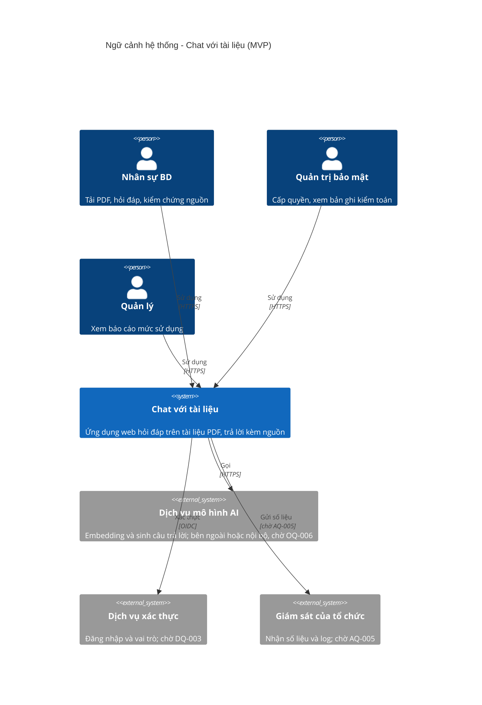
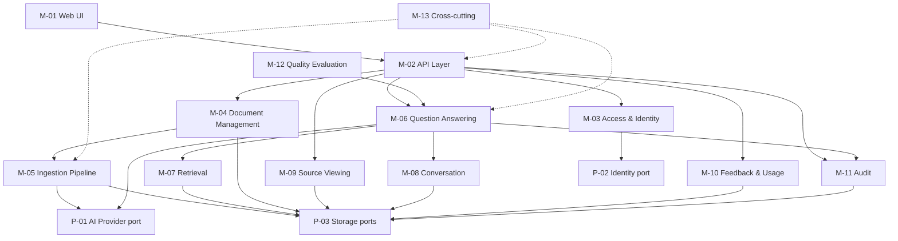
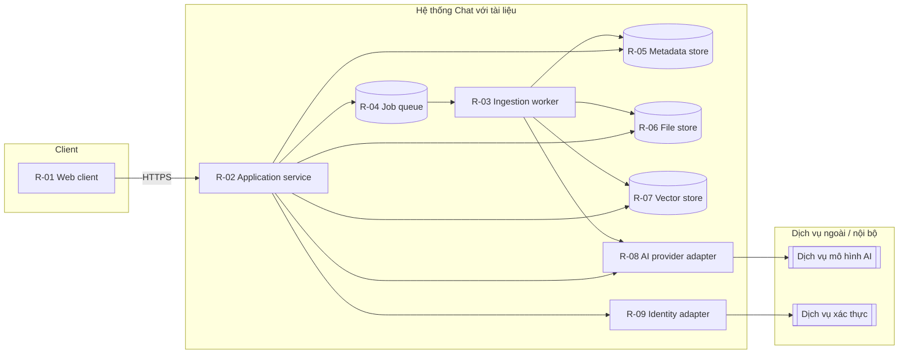
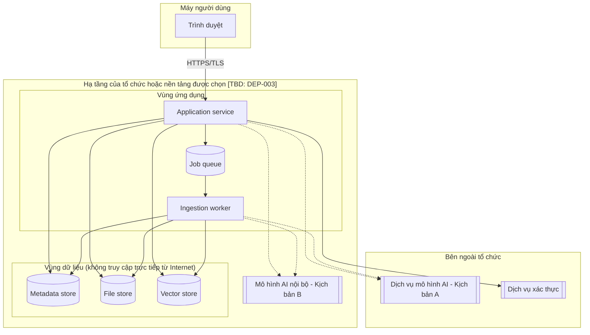
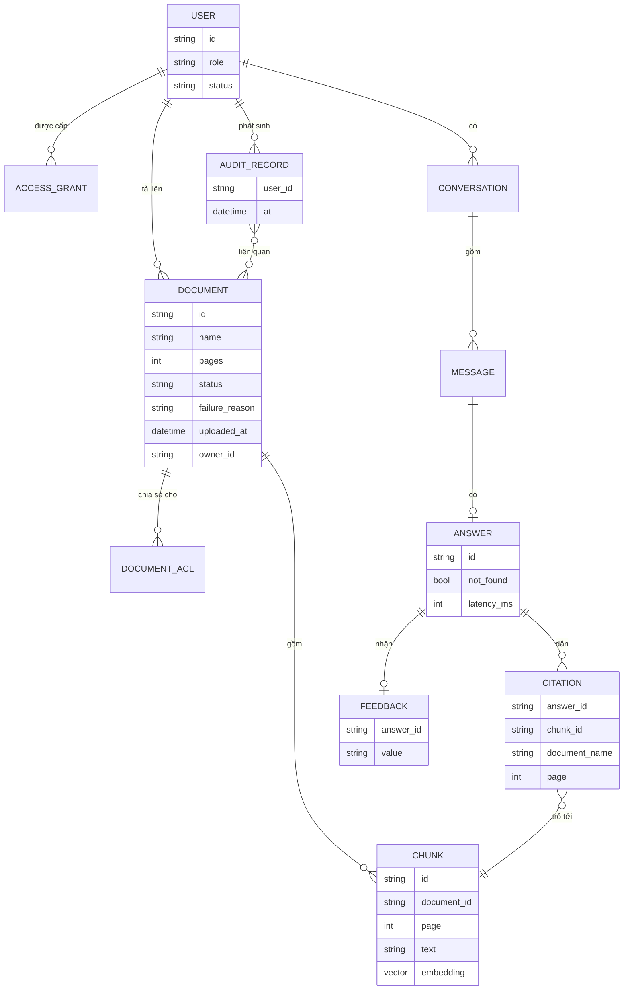
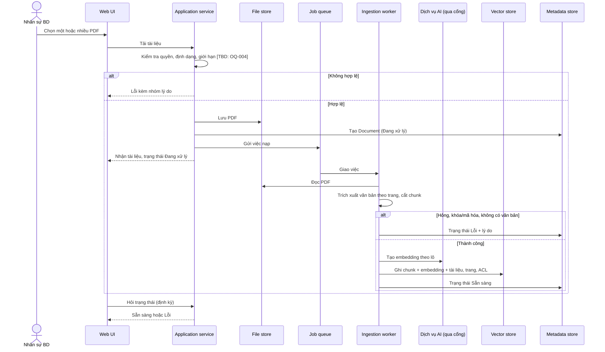
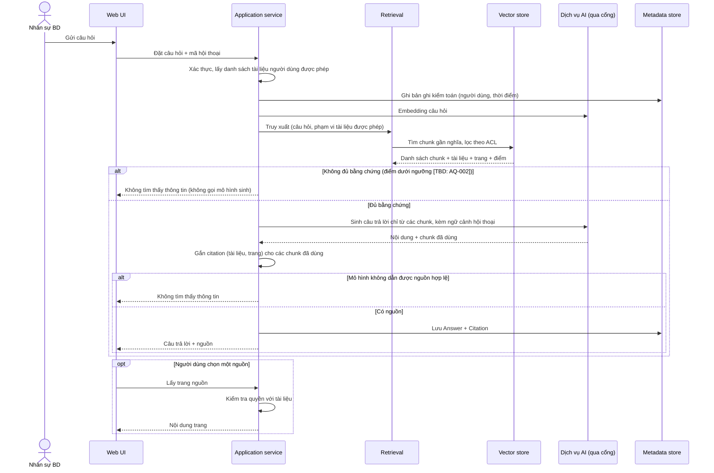
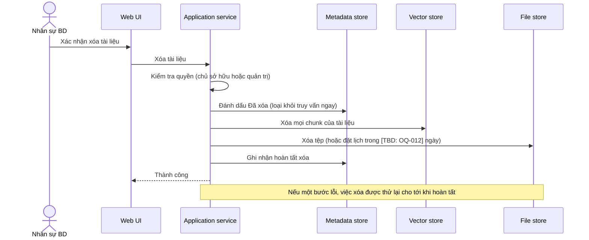
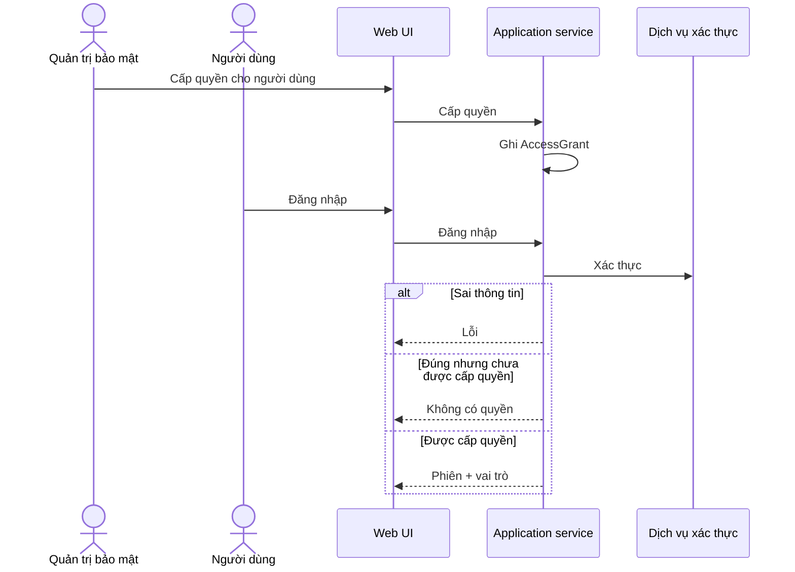

# MÔ TẢ KIẾN TRÚC PHẦN MỀM (SAD) — "CHAT VỚI TÀI LIỆU" (MVP)

> Chuẩn áp dụng: IEEE 1016-2009. Nội dung theo `design/SAD_prompt.md`.
> Đầu vào: `docs/requirements/PRD.md` (v0.1), `docs/requirements/BRD.md` (v0.2), `docs/requirements/UserStories.md`, `docs/design/UIUX_Blueprint.md` (v0.1), `docs/requirements/UseCase_Diagram.drawio`.
> Quy ước: `[TBD: OQ-xxx / PQ-xxx / DQ-xxx / AQ-xxx]` = chưa có thông tin, đang chờ xác nhận; `[Đề xuất]` = người soạn đề xuất, chưa được xác nhận. Tên tài liệu theo yêu cầu là "SADD.md"; nội dung là SAD theo prompt.

| Mục | Nội dung |
|---|---|
| Số tài liệu | SAD-CWD-001 |
| Phiên bản | 0.1 |
| Trạng thái | Draft |
| Ngày | 2026-10-21 |
| Tác giả / người rà soát / người phê duyệt | [TBD: OQ-008] |

---

## 0. Kiểm tra đầu vào (Validation Summary)

**Đầu vào đã có:** BRD, PRD, bộ User Story, blueprint UI/UX, sơ đồ use case. Các tài liệu này mô tả **sản phẩm**; chúng **không** có ràng buộc công nghệ, hạ tầng, ngân sách hay quy định pháp lý cụ thể.

**Đầu vào prompt yêu cầu nhưng chưa có:** Business Vision riêng, biên bản phỏng vấn stakeholder, tài liệu ràng buộc kỹ thuật, hệ thống hiện có (BRD xác nhận không có tích hợp CRM/DMS/email), tài liệu quy định pháp lý.

**Cách xử lý điều đó trong SAD này**
- Các ví dụ trong prompt (PostgreSQL, React, Java/Spring Boot, AWS, Kafka, GDPR, 10.000 người dùng đồng thời…) là **chỗ điền mẫu**, không phải ràng buộc của dự án này, nên **không được áp dụng**.
- Kiến trúc được thiết kế **trung lập về nhà cung cấp**: mọi lựa chọn công nghệ cụ thể được ghi là quyết định ở trạng thái **Proposed**, kèm các phương án và điều kiện để chốt (mục 4).
- Hai quyết định ngoài tầm của kiến trúc sư quyết định hình dạng triển khai: **có được gửi nội dung tài liệu tới dịch vụ AI bên ngoài hay không** (OQ-006) và **nơi chạy hệ thống** (DEP-003). SAD này đưa ra hai kịch bản triển khai (mục 3.4) thay vì chọn một cách âm thầm.

**Ba rủi ro hàng đầu đối với kiến trúc**
1. OQ-005, OQ-006 chưa có: có thể buộc đổi nhà cung cấp mô hình AI hoặc chuyển sang chạy trong nội bộ, ảnh hưởng chi phí và chất lượng.
2. Ngưỡng hiệu năng, độ chính xác, quy mô (OQ-002, OQ-004) chưa có nên chưa đo được kiến trúc có đạt hay không.
3. Chất lượng trích xuất PDF (bảng, nhiều cột, ảnh scan; OQ-007, ASM-001) quyết định chất lượng câu trả lời nhiều hơn lựa chọn mô hình.

---

## 1. Giới thiệu (IEEE 1016-2009, Clause 5.1)

### 1.1 Mục đích
- Xác định kiến trúc phần mềm của "Chat với tài liệu" (MVP).
- Tạo hiểu biết chung giữa các stakeholder về kiến trúc.
- Làm cơ sở cho thiết kế chi tiết, kiểm thử, triển khai.
- Truy vết từ mối quan tâm của stakeholder tới thành phần kiến trúc.
- Ghi lại các quyết định, phương án đã cân nhắc và đánh đổi.

### 1.2 Phạm vi tài liệu
**Trong phạm vi:** các view kiến trúc (Module, Component-and-Connector, Allocation, Deployment, Information, Interaction), thành phần và quan hệ, lý do thiết kế, tài nguyên, truy vết.

**Ngoài phạm vi:** triển khai chi tiết (thiết kế chi tiết, thiết kế API, thiết kế cơ sở dữ liệu), thiết kế UI/UX (xem `UIUX_Blueprint.md`), kế hoạch kiểm thử.

### 1.3 Đối tượng đọc

| Đối tượng | Mục đích | Phần chính |
|---|---|---|
| Chủ sản phẩm | Hiểu ảnh hưởng của kiến trúc tới tính năng và chi phí | Toàn bộ |
| Stakeholder (quản lý, bảo mật) | Kiểm tra kiến trúc đáp ứng mối quan tâm | 3, 4, 6 |
| Đội phát triển | Định hướng cài đặt | 3, 5 |
| QA | Hỗ trợ lập kế hoạch kiểm thử | 3, 5, 6 |
| DevOps | Lập kế hoạch triển khai | 3.4, 5 |
| Bảo mật | Rà soát tuân thủ | 3, 4 |
| Người bảo trì sau này | Hiểu lý do thiết kế | 4, 7 |

### 1.4 Thuật ngữ

| Thuật ngữ | Giải thích |
|---|---|
| SAD | Software Architecture Description |
| RAG | Retrieval-Augmented Generation: tìm đoạn liên quan trong tài liệu rồi để mô hình sinh câu trả lời dựa trên các đoạn đó |
| LLM | Large Language Model, mô hình ngôn ngữ lớn |
| Embedding | Biểu diễn dạng vector của một đoạn văn để tìm đoạn gần nghĩa |
| Chunk | Đoạn văn bản được cắt ra từ tài liệu, mang theo tài liệu gốc và số trang |
| Vector index | Chỉ mục để tìm các chunk gần nghĩa với câu hỏi |
| Citation | Nguồn dẫn của câu trả lời: tài liệu và trang |
| ACL | Access Control List: quyền truy cập của từng người dùng với từng tài liệu |
| IdP | Identity Provider: dịch vụ xác thực |
| OIDC | OpenID Connect |
| ADR | Architecture Decision Record |
| NFR | Non-Functional Requirement |
| PII | Personally Identifiable Information |
| MVP, BRD, PRD, BD | Xem BRD mục 13 |

### 1.5 Tài liệu tham chiếu

| Tài liệu | Mã | Phiên bản |
|---|---|---|
| BRD "Chat với tài liệu" | BRD-CWD-001 | v0.2 |
| PRD | PRD-CWD-001 | v0.1 |
| User Story | `UserStories.md` | — |
| Blueprint UI/UX | `docs/design/UIUX_Blueprint.md` | v0.1 |
| Sơ đồ use case | `UseCase_Diagram.drawio` | — |
| IEEE 1016-2009; IEEE 29148-2018 | — | 2009; 2018 |

### 1.6 Tóm tắt đầu vào (theo mục 2 của prompt)

| Loại | Tài liệu | Thông tin chính |
|---|---|---|
| PRD | PRD v0.1 | 24 user story, 11 tiêu chí launch, 11 sự kiện phân tích |
| Business Vision | Chưa có riêng | Tầm nhìn nêu ở BRD mục 2 và PRD 1.1 |
| Phỏng vấn stakeholder | Chưa có | OQ-010 |
| Ràng buộc kỹ thuật | Chưa có | Ràng buộc có: ứng dụng web, chỉ PDF, MVP (CON-001..003) |
| Hệ thống hiện có | Không có | BRD 5.2: không tích hợp CRM/DMS/email |
| Quy định pháp lý | Chưa xác định | CON-005 và OQ-005 |

---

## 2. Tổng quan thiết kế (Clause 5.2)

### 2.1 Mối quan tâm của stakeholder (mục 2.2 của prompt)

Ký hiệu SHC dùng để không trùng với `C-xx` của thành phần UI trong blueprint. Cột "Blueprint" cho biết mối quan tâm tương ứng ở `UIUX_Blueprint.md`.

| ID | Stakeholder | Mối quan tâm | Ưu tiên | Yêu cầu liên quan | Blueprint |
|---|---|---|---|---|---|
| SHC-001 | Nhân sự BD | Câu trả lời đủ nhanh và người dùng luôn biết hệ thống đang làm gì | Cao | BR-011 | CN-09 |
| SHC-002 | Nhân sự BD, người hoài nghi | Câu trả lời có nguồn kiểm chứng, không bịa | Cao | BR-009, BR-012, BR-013, BR-019 | CN-02, CN-03 |
| SHC-003 | Nhân sự BD | Tải được nhiều PDF và biết trạng thái từng file | Cao | BR-001..004, BR-018 | CN-04 |
| SHC-004 | Quản trị bảo mật | Chỉ người được phép truy cập; tài liệu không lộ giữa người dùng | Cao | BR-014, BR-020 | CN-06 |
| SHC-005 | Quản trị bảo mật | Dữ liệu được xử lý và lưu theo chính sách; xóa là xóa thật | Cao | BR-015, BR-024, BR-005 | CN-07 |
| SHC-006 | Quản trị bảo mật | Kiểm toán được: ai hỏi tài liệu nào, khi nào | Trung bình | BR-023 | — |
| SHC-007 | Quản lý | Có số liệu sử dụng và phản hồi | Trung bình | BR-016, BR-017, BR-021 | CN-08 |
| SHC-008 | Quản lý, business owner | Đo được chất lượng bằng bộ câu hỏi chuẩn trước khi ra mắt | Cao | BR-013, LG-02, LG-03 | — |
| SHC-009 | Đội phát triển | Dễ bảo trì và kiểm thử; đổi nhà cung cấp AI không phải viết lại | Trung bình | — | CN-11 |
| SHC-010 | DevOps / vận hành | Triển khai lặp lại được, theo dõi được | Trung bình | BR-022 | — |
| SHC-011 | Chủ sản phẩm | Chi phí vận hành kiểm soát được (RSK-005) | Trung bình | CON-004 | — |
| SHC-012 | Chủ sản phẩm | Mở rộng sau MVP (định dạng khác, phân quyền chi tiết) | Thấp | BRD 5.3 | — |

### 2.2 Thuộc tính chất lượng (mục 2.3 của prompt)

Ngưỡng định lượng chưa có trong BRD/PRD nên để `[TBD]`. "Hiện trạng" là N/A vì chưa có hệ thống.

| Thuộc tính | Mục tiêu | Hiện trạng | Nguồn | Ưu tiên |
|---|---|---|---|---|
| Hiệu năng | Phản hồi ≤ [TBD: OQ-002] giây ở ≥ [TBD: OQ-002]% câu hỏi | N/A | BR-011, LG-05 | Cao |
| Độ chính xác (đặc thù sản phẩm) | Đúng và có nguồn ≥ [TBD: OQ-002]%; câu hỏi ngoài phạm vi bị trả lời bịa ≤ [TBD: OQ-002]% | N/A | BR-013, BR-009, LG-02, LG-03 | Cao |
| Khả năng mở rộng | Số tài liệu/dung lượng/số người dùng theo [TBD: OQ-003, OQ-004]; MVP quy mô nhỏ (ASM-002) | N/A | BR-002 | Trung bình |
| Khả dụng | Khung giờ và mức sẵn sàng [TBD: OQ-011] (BR-022, ưu tiên Could) | N/A | BR-022 | Thấp |
| Bảo mật | Chỉ người có quyền; cô lập tài liệu giữa người dùng; xóa vĩnh viễn trong [TBD: OQ-012] ngày | N/A | BR-014, BR-020, BR-024 | Cao |
| Tuân thủ | Theo chính sách dữ liệu của tổ chức, quy định áp dụng [TBD: OQ-005] | N/A | BR-015 | Cao |
| Kiểm toán | Lưu bản ghi tối thiểu [TBD: OQ-012] ngày | N/A | BR-023 | Trung bình |
| Khả năng bảo trì/kiểm thử | Thành phần có thể kiểm thử độc lập; bộ đánh giá chất lượng chạy được trước launch | N/A | LG-09 | Trung bình |
| Khả năng triển khai | Triển khai lặp lại được [Đề xuất] | N/A | — | Trung bình |
| Khả năng quan sát | Đo được thời gian phản hồi, lỗi, tỷ lệ "không tìm thấy" | N/A | PRD 5.2 | Trung bình |
| Khả năng mở rộng chức năng | Thêm định dạng tài liệu hoặc nhà cung cấp AI mà không đổi lõi | N/A | BRD 5.3 | Thấp |

### 2.3 Yêu cầu chức năng chủ đạo kiến trúc (mục 2.4 của prompt)

Các yêu cầu BR-001 đến BR-024 trong BRD. Nhóm có ảnh hưởng kiến trúc lớn nhất:

| Nhóm | Yêu cầu | Tác động kiến trúc |
|---|---|---|
| Nạp tài liệu | BR-001..003, BR-018 | Cần luồng xử lý bất đồng bộ, có trạng thái và lý do lỗi |
| Hỏi đáp | BR-006..010 | Cần truy xuất theo ngữ nghĩa trên toàn bộ tập tài liệu, sinh câu trả lời có căn cứ |
| Nguồn dẫn | BR-012, BR-019 | Mỗi đoạn văn phải giữ tài liệu và số trang gốc |
| Tránh bịa | BR-009 | Cần cơ chế từ chối khi không đủ bằng chứng |
| Cô lập quyền | BR-014, BR-020 | Quyền phải được áp dụng **trước** khi dữ liệu tới mô hình |
| Xóa | BR-005, BR-024 | Xóa phải lan tới mọi nơi lưu trữ, gồm cả chỉ mục vector |
| Kiểm toán, đo lường | BR-016, BR-017, BR-021, BR-023 | Cần ghi sự kiện không chứa nội dung nhạy cảm |

### 2.4 Giao diện bên ngoài (mục 2.5 của prompt)

| ID | Hệ thống ngoài | Loại | Giao thức | Dữ liệu | Tần suất | Trạng thái |
|---|---|---|---|---|---|---|
| I-001 | Dịch vụ mô hình ngôn ngữ và embedding (có thể bên ngoài hoặc nội bộ) | Gọi dịch vụ | HTTPS [Đề xuất] | Đoạn văn, câu hỏi, câu trả lời | Mỗi lần nạp tài liệu và mỗi câu hỏi | Phụ thuộc OQ-005, OQ-006, DEP-003 |
| I-002 | Dịch vụ xác thực (IdP) hoặc tài khoản nội bộ | Xác thực | OIDC [Đề xuất] | Token, vai trò | Mỗi lần đăng nhập | Phụ thuộc DQ-003 |
| I-003 | Hệ thống giám sát/ghi log của tổ chức | Xuất số liệu | [TBD: AQ-005] | Số liệu, log không chứa nội dung | Liên tục | Chờ AQ-005 |
| — | CRM/DMS/email | Không có | — | — | — | Ngoài phạm vi (BRD 5.2) |

### 2.5 Ràng buộc thiết kế (mục 2.6 của prompt)

| ID | Ràng buộc | Nguồn | Tác động |
|---|---|---|---|
| DC-001 | Ứng dụng web | CON-001 | Giao diện chạy trên trình duyệt |
| DC-002 | Đầu vào chỉ PDF; ảnh scan hoãn | CON-002, BRD 5.3 | Chỉ cần trích xuất văn bản; OCR không nằm trong MVP |
| DC-003 | Mức MVP | CON-003 | Ưu tiên đơn giản, tránh kiến trúc phân tán sớm |
| DC-004 | Ngân sách, thời hạn | CON-004 | [TBD: OQ-009] |
| DC-005 | Quy định dữ liệu và bảo mật | CON-005 | Có thể cấm gửi tài liệu ra ngoài [TBD: OQ-005, OQ-006] |
| DC-006 | Công nghệ nền, nền tảng đám mây/nội bộ | Chưa có | Chưa bị khóa; xem mục 4 |

### 2.6 Tầm nhìn kiến trúc

**Phong cách kiến trúc:** Modular monolith (khối thống nhất chia mô-đun rõ ràng) cho phần ứng dụng, kèm một **bộ xử lý nền bất đồng bộ** cho việc nạp tài liệu; mẫu RAG cho hỏi đáp (xem ADR-001, ADR-002).

**Cách tiếp cận thiết kế:** Hexagonal (ports and adapters): lõi nghiệp vụ độc lập với nhà cung cấp mô hình AI, kho lưu trữ và dịch vụ xác thực (ADR-005), để đổi nhà cung cấp theo kết quả OQ-006 mà không viết lại lõi.

**Nguyên tắc dẫn dắt**
1. **Quyền trước, mô hình sau:** lọc theo quyền ở bước truy xuất, trước khi bất kỳ đoạn văn nào đi tới mô hình (BR-020).
2. **Câu trả lời phải có căn cứ:** chỉ trả lời dựa trên các đoạn đã truy xuất; không đủ bằng chứng thì báo không tìm thấy (BR-009).
3. **Mỗi đoạn mang nguồn:** tài liệu và số trang đi theo đoạn văn từ lúc nạp tới lúc trích dẫn (BR-012, BR-019).
4. **Xóa là xóa ở mọi nơi:** lưu trữ tệp, metadata và vector cùng bị xóa (BR-024).
5. **Không để nội dung rò vào log và phân tích** trừ khi chính sách cho phép (PQ-003).

**Ngữ cảnh hệ thống:**

---

## 3. Các view thiết kế (Clause 5.3)

### 3.1 Module View — phân rã mô-đun (Clause 5.3.1)

**Mối quan tâm giải quyết:** SHC-009, SHC-012 (bảo trì, mở rộng).

**Các tầng:** Trình bày (giao diện web) → Ứng dụng (API và các mô-đun nghiệp vụ) → Cổng (ports) → Hạ tầng (adapters) → Dịch vụ ngoài.

| ID | Mô-đun | Tầng | Trách nhiệm | Phụ thuộc |
|---|---|---|---|---|
| M-01 | Web UI | Trình bày | Các màn hình S-01..S-07 theo blueprint (thành phần C-00..C-20) | M-02 |
| M-02 | API Gateway Layer | Ứng dụng | Nhận yêu cầu, kiểm tra phiên và vai trò, định tuyến tới mô-đun | M-03 |
| M-03 | Access & Identity | Ứng dụng | Xác thực, vai trò, cấp/thu hồi quyền, ACL theo tài liệu (UC-14, UC-15) | Cổng IdP |
| M-04 | Document Management | Ứng dụng | Tải lên, danh sách, trạng thái, xóa; điều phối xóa vĩnh viễn (UC-01..06) | M-03, M-05, kho tệp, kho metadata |
| M-05 | Ingestion Pipeline | Ứng dụng (nền) | Kiểm tra PDF, trích xuất văn bản kèm số trang, cắt chunk, tạo embedding, ghi chỉ mục | Cổng AI, kho vector |
| M-06 | Question Answering | Ứng dụng | Điều phối hỏi đáp: truy xuất theo quyền, dựng prompt, sinh câu trả lời, gắn nguồn, phát hiện không đủ bằng chứng (UC-07..13) | M-03, M-07, Cổng AI |
| M-07 | Retrieval | Ứng dụng | Tìm chunk liên quan trong phạm vi tài liệu người dùng được phép | Kho vector |
| M-08 | Conversation | Ứng dụng | Giữ ngữ cảnh hội thoại cho câu hỏi tiếp theo; lưu giữa các phiên [TBD: PQ-004] | Kho metadata |
| M-09 | Source Viewing | Ứng dụng | Cung cấp trang tài liệu gốc cho trình xem nguồn (UC-10) | M-03, kho tệp |
| M-10 | Feedback & Usage | Ứng dụng | Ghi đánh giá, tổng hợp số người dùng hoạt động và số câu hỏi (UC-13, UC-17) | Kho metadata |
| M-11 | Audit | Ứng dụng | Ghi và truy vấn bản ghi kiểm toán (UC-16) | Kho metadata |
| M-12 | Quality Evaluation | Công cụ | Chạy bộ câu hỏi chuẩn đo MET-002, tỷ lệ bịa, thời gian phản hồi (LG-02, LG-03, LG-05) | M-06 |
| M-13 | Cross-cutting | Nền | Cấu hình, log có che nội dung, số liệu quan sát, xử lý lỗi | — |
| P-01 | Cổng: AI Provider | Cổng | Giao diện trừu tượng cho embedding và sinh văn bản | — |
| P-02 | Cổng: Identity | Cổng | Giao diện xác thực | — |
| P-03 | Cổng: File Store, Metadata Store, Vector Store | Cổng | Giao diện lưu trữ | — |

Quy tắc phụ thuộc: các mô-đun nghiệp vụ chỉ phụ thuộc vào **cổng (P-xx)**, không phụ thuộc trực tiếp vào adapter cụ thể. M-06 không đọc trực tiếp kho tệp.

### 3.2 Component-and-Connector View — thành phần lúc chạy (Clause 5.3.2)

**Mối quan tâm giải quyết:** SHC-001, SHC-002, SHC-003, SHC-010.

| ID | Thành phần lúc chạy | Loại | Mô-đun | Ghi chú |
|---|---|---|---|---|
| R-01 | Web client | Trình duyệt | M-01 | Gọi API qua HTTPS |
| R-02 | Application service | Tiến trình đồng bộ | M-02..M-04, M-06..M-11 | Một khối triển khai (ADR-001) |
| R-03 | Ingestion worker | Tiến trình nền | M-05 | Nhận việc từ hàng đợi; có thể chạy nhiều bản |
| R-04 | Job queue | Hàng đợi | — | Giữa R-02 và R-03 (ADR-003) |
| R-05 | Metadata store | Kho dữ liệu quan hệ | — | Người dùng, tài liệu, trạng thái, hội thoại, đánh giá, bản ghi kiểm toán |
| R-06 | File store | Kho đối tượng | — | Tệp PDF gốc |
| R-07 | Vector store | Chỉ mục vector | — | Chunk + embedding + metadata (tài liệu, trang, chủ sở hữu/ACL) |
| R-08 | AI provider adapter | Bộ chuyển đổi | P-01 | Gọi dịch vụ AI |
| R-09 | Identity adapter | Bộ chuyển đổi | P-02 | Gọi IdP hoặc kho tài khoản nội bộ |

**Kết nối**

| Từ | Tới | Kết nối | Đồng bộ | Ghi chú |
|---|---|---|---|---|
| R-01 | R-02 | HTTPS (yêu cầu-phản hồi) | Đồng bộ | Mọi thao tác UI, kể cả hỏi đáp; có thể trả kết quả theo luồng [Đề xuất, AQ-006] |
| R-02 | R-04 | Gửi việc | Bất đồng bộ | Việc nạp tài liệu |
| R-04 | R-03 | Nhận việc | Bất đồng bộ | Có thử lại khi lỗi tạm thời |
| R-03 | R-06 | Đọc tệp | Đồng bộ | — |
| R-03 | R-08 | Gọi embedding | Đồng bộ | Theo lô |
| R-03 | R-07, R-05 | Ghi chunk, cập nhật trạng thái | Đồng bộ | Trạng thái: Đang xử lý → Sẵn sàng/Lỗi |
| R-02 | R-07 | Truy xuất | Đồng bộ | Luôn kèm bộ lọc quyền |
| R-02 | R-08 | Sinh câu trả lời | Đồng bộ | Có hạn thời gian chờ [TBD: OQ-002] |
| R-02 | R-05, R-06 | Đọc/ghi metadata, đọc tệp | Đồng bộ | — |
| R-02 | R-09 | Xác thực | Đồng bộ | — |

### 3.3 Allocation View — ánh xạ phần tử tới tài nguyên (Clause 5.3.3)

**Mối quan tâm giải quyết:** SHC-010, SHC-011.

| Phần tử phần mềm | Phân bổ tới | Loại tài nguyên | Cách mở rộng | Ghi chú |
|---|---|---|---|---|
| R-01 / M-01 | Trình duyệt người dùng; tệp tĩnh phục vụ từ máy chủ ứng dụng hoặc kho tĩnh | Máy khách | Không áp dụng | Danh sách trình duyệt hỗ trợ [TBD: PQ-001] |
| R-02 | Nút ứng dụng | Tính toán | Thêm bản sao khi cần | Không giữ trạng thái phiên trong bộ nhớ để dễ nhân bản [Đề xuất] |
| R-03 | Nút xử lý nền | Tính toán | Tăng số bản theo độ dài hàng đợi | Tách riêng để việc nạp tài liệu không làm chậm hỏi đáp |
| R-04 | Dịch vụ hàng đợi | Hạ tầng | — | — |
| R-05 | Dịch vụ cơ sở dữ liệu quan hệ | Lưu trữ | Sao lưu định kỳ | Chu kỳ sao lưu [TBD: OQ-012] |
| R-06 | Kho đối tượng | Lưu trữ | Theo dung lượng | Dung lượng [TBD: OQ-004] |
| R-07 | Kho vector (dịch vụ riêng hoặc tiện ích của R-05) | Lưu trữ | Theo số chunk | ADR-006 |
| R-08 | Gọi dịch vụ mô hình AI | Dịch vụ ngoài/nội bộ | Giới hạn tốc độ và chi phí | Nguồn chi phí chính (RSK-005) |
| M-12 | Môi trường kiểm thử/CI | Công cụ | — | Chạy trước launch (LG-02, LG-03) |

Phân công đội: chưa có thông tin về cơ cấu đội, nên không phân bổ phần tử theo đội [TBD: OQ-009].

### 3.4 Deployment View — triển khai (Clause 5.3.4)

**Mối quan tâm giải quyết:** SHC-004, SHC-005, SHC-010.

Vì OQ-006 và DEP-003 chưa có, có hai kịch bản triển khai. Cả hai dùng chung các thành phần ở mục 3.2; chỉ khác vị trí của dịch vụ AI và ranh giới dữ liệu.

| Khía cạnh | Kịch bản A: dịch vụ AI bên ngoài | Kịch bản B: mô hình AI trong hạ tầng của tổ chức |
|---|---|---|
| Điều kiện | OQ-006 = được phép gửi nội dung tài liệu ra ngoài | OQ-006 = không được phép |
| Ranh giới dữ liệu | Đoạn văn của tài liệu và câu hỏi rời khỏi hạ tầng tổ chức | Dữ liệu ở lại trong hạ tầng của tổ chức |
| Nhà cung cấp AI | Dịch vụ do nhà cung cấp ngoài vận hành | Mô hình tự vận hành |
| Tài nguyên | Ít hạ tầng tính toán hơn | Cần tài nguyên tính toán cho mô hình, tăng chi phí và công vận hành |
| Chất lượng với tiếng Việt | Theo năng lực nhà cung cấp [TBD: OQ-007] | Theo mô hình tự vận hành, cần đánh giá |
| Rủi ro chính | RSK-002 (lộ dữ liệu), điều khoản xử lý dữ liệu của nhà cung cấp | RSK-005 (chi phí), RSK-001 (chất lượng) |
| Việc cần làm | Rà soát hợp đồng và chính sách dữ liệu (OQ-005) | Dự toán tài nguyên, đánh giá chất lượng |

**Ranh giới tin cậy (theo blueprint 1.2):** (1) trình duyệt; (2) vùng ứng dụng và vùng dữ liệu do tổ chức vận hành; (3) dịch vụ ngoài. Biện pháp bảo vệ dự kiến:
- Mã hóa đường truyền cho mọi kết nối ra vào (TLS) [Đề xuất].
- Mã hóa dữ liệu lưu trữ ở vùng dữ liệu [Đề xuất, theo OQ-005].
- Vùng dữ liệu không mở trực tiếp ra Internet.
- Khóa và bí mật cấu hình nằm ngoài mã nguồn.

Môi trường: phát triển, kiểm thử, vận hành (số môi trường và quy trình phát hành [TBD: AQ-004]). Nơi lưu trữ vật lý, vùng địa lý, nhà cung cấp hạ tầng: [TBD: DEP-003, OQ-005].

### 3.5 Information View — dữ liệu (Clause 5.3.5)

**Mối quan tâm giải quyết:** SHC-002, SHC-004, SHC-005, SHC-006, SHC-007.

Đây là **mô hình dữ liệu mức logic**, không phải lược đồ cơ sở dữ liệu (thuộc tài liệu thiết kế cơ sở dữ liệu).

| Thực thể | Nơi lưu | Dữ liệu nhạy cảm | Lưu giữ / xóa |
|---|---|---|---|
| Tệp PDF gốc | File store | Có (nội dung tài liệu) | Xóa vĩnh viễn trong [TBD: OQ-012] ngày sau khi người dùng xóa (BR-024) |
| Chunk + embedding | Vector store | Có (trích đoạn của tài liệu) | Xóa cùng tài liệu; phải xóa cả chỉ mục (BR-024) |
| Metadata tài liệu, ACL, người dùng | Metadata store | Trung bình | Theo vòng đời tài liệu/người dùng |
| Hội thoại, câu hỏi, câu trả lời | Metadata store | Có thể có | Có lưu giữa các phiên không [TBD: PQ-004]; không dùng cho phân tích [TBD: PQ-003] |
| Bản ghi kiểm toán | Metadata store | Thấp (người dùng, tài liệu, thời điểm; **không** có nội dung câu hỏi) | Tối thiểu [TBD: OQ-012] ngày (BR-023) |
| Sự kiện phân tích | Hệ thống giám sát | Thấp; không có nội dung | Theo chính sách [TBD: AQ-005] |

**Luồng dữ liệu chính**
1. **Nạp:** PDF → File store; văn bản trích xuất theo trang → chunk → embedding (qua cổng AI) → Vector store; trạng thái → Metadata store.
2. **Hỏi:** câu hỏi → embedding (qua cổng AI) → truy xuất trong phạm vi ACL → đoạn liên quan + câu hỏi + ngữ cảnh hội thoại → mô hình sinh → câu trả lời + citation → Metadata store.
3. **Xóa:** yêu cầu xóa → loại khỏi truy vấn ngay → xóa chunk, tệp, metadata → xác nhận (xem 3.6, luồng 3).

Dữ liệu duy nhất rời ranh giới tổ chức ở Kịch bản A là các đoạn văn bản, câu hỏi và ngữ cảnh hội thoại gửi tới dịch vụ AI.

### 3.6 Interaction View — tương tác (Clause 5.3.6)

**Mối quan tâm giải quyết:** SHC-001..005, SHC-006.

**Luồng 1 — Nạp tài liệu (US-001..004, BR-001..003, BR-018)**

**Luồng 2 — Hỏi đáp có nguồn và từ chối khi không đủ bằng chứng (US-008..015, BR-006..012, BR-019)**

**Luồng 3 — Xóa tài liệu (US-006, US-007, BR-005, BR-024)**

**Luồng 4 — Cấp quyền và truy cập (US-017, US-018)**

---

## 4. Lý do thiết kế (Clause 5.4)

Tất cả quyết định dưới đây có trạng thái **Proposed**: chưa có kiến trúc sư hay stakeholder phê duyệt, và nhiều quyết định phụ thuộc OQ chưa trả lời.

### 4.1 Nhật ký quyết định kiến trúc (ADR)

| ADR | Quyết định | Phương án cân nhắc | Lý do | Đánh đổi | Trạng thái | Điều kiện chốt |
|---|---|---|---|---|---|---|
| ADR-001 | Modular monolith cho phần ứng dụng, tách riêng worker nạp tài liệu | (a) Modular monolith; (b) Microservices | MVP, quy mô nhỏ (ASM-002, CON-003); đội và ngân sách chưa rõ; ít thành phần vận hành hơn. Ranh giới mô-đun rõ nên có thể tách sau | Mở rộng theo từng mô-đun kém linh hoạt hơn microservices | Proposed | Quy mô thực tế (OQ-003, OQ-004) |
| ADR-002 | Dùng mẫu RAG: truy xuất đoạn liên quan rồi sinh câu trả lời **chỉ** từ các đoạn đó | (a) RAG; (b) Đưa toàn bộ tài liệu vào ngữ cảnh mô hình; (c) Tìm kiếm từ khóa thuần | Đáp ứng hỏi đáp trên nhiều tài liệu, có nguồn theo trang (BR-007, BR-012, BR-019). (b) không mở rộng được với số lượng PDF; (c) kém ở câu hỏi theo ngữ nghĩa | Chất lượng phụ thuộc truy xuất và cắt đoạn; có thể kết hợp tìm kiếm từ khóa sau | Proposed | Đánh giá bằng bộ câu hỏi chuẩn (DEP-001, ASM-005) |
| ADR-003 | Nạp tài liệu bất đồng bộ qua hàng đợi và worker | (a) Đồng bộ trong yêu cầu tải lên; (b) Bất đồng bộ | Xử lý PDF lớn lâu; cần trạng thái "Đang xử lý" và lý do lỗi (BR-003, BR-018); không làm chậm hỏi đáp | Thêm thành phần hàng đợi và xử lý lỗi/thử lại | Proposed | OQ-004 (kích thước tệp) |
| ADR-004 | Áp dụng ACL ở bước truy xuất, trước khi đoạn văn tới mô hình; metadata ACL đi cùng chunk | (a) Lọc sau khi mô hình sinh; (b) Lọc ở truy xuất | (a) có thể làm lộ nội dung giữa người dùng; (b) đáp ứng BR-020 và RSK-002 | ACL phải đồng bộ giữa metadata và chỉ mục vector | Proposed | OQ-003 (phạm vi chia sẻ) |
| ADR-005 | Cổng trừu tượng cho dịch vụ AI (embedding và sinh văn bản), cho xác thực và cho lưu trữ | (a) Gọi thẳng SDK nhà cung cấp; (b) Cổng + adapter | OQ-006 chưa có nên phải đổi được giữa dịch vụ ngoài và nội bộ; dễ thử nghiệm bằng bản giả lập | Thêm một tầng trừu tượng | Proposed | OQ-006, DQ-003 |
| ADR-006 | Tách ba loại lưu trữ: kho đối tượng (PDF), kho quan hệ (metadata), kho vector (chunk) | (a) Một kho quan hệ có tiện ích vector; (b) Ba kho riêng | Mỗi loại dữ liệu có đặc điểm khác nhau. Nếu số chunk nhỏ, (a) giảm số thành phần vận hành và vẫn hợp lệ; chọn cuối cùng tùy quy mô và công nghệ được phép | (b) thêm vận hành; (a) có thể bị giới hạn ở quy mô lớn | Proposed | OQ-004, DEP-003 |
| ADR-007 | Xác thực qua dịch vụ ngoài (OIDC) nếu tổ chức có; nếu không, kho tài khoản nội bộ đơn giản | (a) IdP của tổ chức; (b) Tài khoản nội bộ | Giảm tự quản lý mật khẩu; chưa rõ tổ chức có IdP (DQ-003) | (b) tăng gánh nặng bảo mật | Proposed | DQ-003 |
| ADR-008 | Xóa vĩnh viễn là thao tác **lan tới mọi kho** và có thể thử lại | (a) Chỉ đánh dấu xóa; (b) Xóa thật ở mọi kho | BR-024, BR-005, AC-005, AC-024 | Cần theo dõi hoàn tất và xử lý bản sao lưu [TBD: OQ-012] | Proposed | OQ-012 |
| ADR-009 | Log và sự kiện phân tích **không** chứa nội dung tài liệu hay câu hỏi | (a) Log đầy đủ; (b) Log che nội dung | PQ-003, RSK-002; bản ghi kiểm toán chỉ gồm người dùng, tài liệu, thời điểm (BR-023) | Khó gỡ lỗi chất lượng hơn; cần cơ chế riêng cho phân tích chất lượng có kiểm soát | Proposed | PQ-003 |
| ADR-010 | Chỉ trích xuất văn bản; chưa dùng nhận dạng ký tự cho PDF dạng ảnh | (a) Chỉ văn bản; (b) Thêm OCR | MVP (CON-003); BRD 5.3 hoãn PDF scan; ASM-001 | PDF scan báo "chưa hỗ trợ" | Proposed | OQ-007 |
| ADR-011 | Từ chối trả lời khi bằng chứng truy xuất không đủ, và khi mô hình không dẫn được nguồn hợp lệ | (a) Luôn để mô hình trả lời; (b) Có cơ chế từ chối | BR-009, SHC-002, RSK-001 | Có thể từ chối nhầm câu hỏi hợp lệ; ngưỡng cần hiệu chỉnh bằng bộ câu hỏi chuẩn | Proposed | AQ-002, OQ-002 |
| ADR-012 | Bộ đánh giá chất lượng tự động (M-12) là một phần của kiến trúc, chạy trước launch và khi đổi mô hình | (a) Chỉ kiểm thử thủ công; (b) Có bộ đánh giá | LG-02, LG-03, LG-05; đổi nhà cung cấp phải đo lại | Cần xây và duy trì bộ câu hỏi chuẩn | Proposed | DEP-001, ASM-005 |

### 4.2 Công nghệ cụ thể: chưa chọn

Prompt yêu cầu quyết định công nghệ; vì ràng buộc kỹ thuật của dự án chưa tồn tại, SAD **không chọn** ngôn ngữ lập trình, khung ứng dụng, cơ sở dữ liệu, hàng đợi, nhà cung cấp mô hình hay nền tảng. Các tiêu chí để chọn:

| Hạng mục | Tiêu chí chọn |
|---|---|
| Mô hình AI và embedding | Hỗ trợ ngôn ngữ của tài liệu [TBD: OQ-007]; chính sách xử lý dữ liệu của nhà cung cấp [TBD: OQ-005, OQ-006]; chi phí theo lượt dùng (RSK-005); đo được bằng bộ câu hỏi chuẩn |
| Kho vector | Hỗ trợ lọc theo metadata (ACL, tài liệu); xóa theo tài liệu; quy mô chunk [TBD: OQ-004] |
| Hàng đợi | Thử lại, theo dõi việc lỗi; mức độ cần thiết ở quy mô MVP |
| Nền tảng triển khai | Quy định dữ liệu [TBD: OQ-005]; kỹ năng đội [TBD: OQ-009]; DEP-003 |
| Xác thực | Có IdP sẵn của tổ chức hay không (DQ-003) |

### 4.3 Câu hỏi kiến trúc mở

| ID | Câu hỏi | Vì sao quan trọng | Chủ sở hữu | Cần trước ngày | Trạng thái |
|---|---|---|---|---|---|
| AQ-001 | Chọn Kịch bản A hay B (phụ thuộc OQ-006)? Nơi chạy hệ thống? | Quyết định mục 3.4 và ADR-005, ADR-006 | CNTT/bảo mật [TBD: OQ-008] | [TBD] | Open |
| AQ-002 | Ngưỡng đủ bằng chứng để trả lời, và cách đo trên bộ câu hỏi chuẩn | Ảnh hưởng ADR-011, BR-009 | Business owner [TBD: OQ-008] | [TBD] | Open |
| AQ-003 | Sao lưu và khôi phục có cần cho MVP không; có xử lý xóa trong bản sao lưu không | Liên quan BR-022, BR-024, OQ-011, OQ-012 | CNTT [TBD] | [TBD] | Open |
| AQ-004 | Số môi trường và quy trình phát hành | Ảnh hưởng 3.4 | DevOps [TBD] | [TBD] | Open |
| AQ-005 | Hệ thống giám sát/log của tổ chức là gì; sự kiện phân tích gửi đi đâu | Ảnh hưởng I-003 | CNTT [TBD] | [TBD] | Open |
| AQ-006 | Câu trả lời có hiển thị theo luồng (từng phần) hay chỉ khi hoàn tất | Ảnh hưởng trải nghiệm chờ (BR-011, PRD 4.2) và R-01..R-02 | Business owner, thiết kế [TBD] | [TBD] | Open |
| AQ-007 | Quy mô dự kiến: số tài liệu, số trang, số người dùng đồng thời | Ảnh hưởng ADR-001, ADR-006, mục 5.2 | Business owner [TBD: OQ-003, OQ-004] | [TBD] | Open |

---

## 5. Phần tử thiết kế và tài nguyên (Clause 5.5)

### 5.1 Danh mục phần tử kiến trúc

| ID | Phần tử | Trách nhiệm chính | Giao diện cung cấp | Giao diện cần | Yêu cầu đáp ứng |
|---|---|---|---|---|---|
| AE-01 | Access & Identity (M-03) | Xác thực, vai trò, cấp/thu hồi quyền, ACL | Đăng nhập; kiểm tra quyền; quản lý quyền (IF-01, IF-08) | P-02, P-03 | BR-014, BR-020 |
| AE-02 | Document Management (M-04) | Tải lên, danh sách, trạng thái, xóa | IF-02, IF-03, IF-04 | AE-03, P-03 | BR-001..005, BR-018, BR-024 |
| AE-03 | Ingestion Pipeline (M-05, R-03) | Kiểm tra, trích xuất văn bản theo trang, chunk, embedding, ghi chỉ mục | Nhận việc nạp | P-01, P-03 | BR-001..003, BR-012, BR-018, BR-019 |
| AE-04 | Retrieval (M-07) | Tìm chunk theo ngữ nghĩa trong phạm vi ACL | Truy xuất | P-03 | BR-006, BR-007, BR-020 |
| AE-05 | Question Answering (M-06) | Hỏi đáp, citation, từ chối khi thiếu bằng chứng | IF-05 | AE-04, AE-06, P-01 | BR-006..010, BR-012, BR-019 |
| AE-06 | Conversation (M-08) | Ngữ cảnh hội thoại | Lấy/ghi ngữ cảnh | P-03 | BR-008 |
| AE-07 | Source Viewing (M-09) | Trang nguồn cho trình xem | IF-06 | AE-01, P-03 | BR-012, BR-019 |
| AE-08 | Feedback & Usage (M-10) | Đánh giá; số người dùng hoạt động; số câu hỏi | IF-07, IF-10 | P-03 | BR-016, BR-017, BR-021 |
| AE-09 | Audit (M-11) | Ghi và truy vấn bản ghi kiểm toán | IF-09 | P-03 | BR-023 |
| AE-10 | Quality Evaluation (M-12) | Chạy bộ câu hỏi chuẩn, đo độ chính xác, bịa, độ trễ | Báo cáo đánh giá | AE-05 | BR-013, BR-009, BR-011 |
| AE-11 | Cross-cutting (M-13) | Cấu hình, log che nội dung, số liệu quan sát, giám sát tình trạng | — | — | BR-015, BR-022 |
| AE-12 | Web UI (M-01) | Giao diện theo blueprint | — | IF-01..IF-10 | Toàn bộ story có giao diện |

### 5.2 Tài nguyên và chi phí

Chưa đủ thông tin để dự toán. Bảng nêu yếu tố quyết định, không nêu con số.

| Tài nguyên | Yếu tố quyết định kích thước | Thông tin cần |
|---|---|---|
| Tính toán ứng dụng | Số người dùng đồng thời, thời gian xử lý mỗi yêu cầu | OQ-003, AQ-007 |
| Tính toán xử lý nền | Số trang cần trích xuất và embedding | OQ-004 |
| Lưu trữ tệp | Tổng dung lượng PDF | OQ-004 |
| Lưu trữ vector | Tổng số chunk (tỷ lệ với số trang) | OQ-004 |
| Gọi dịch vụ AI | Số tài liệu nạp, số câu hỏi, độ dài ngữ cảnh; là nguồn chi phí chính (RSK-005) | OQ-003, OQ-009 |
| Tính toán cho mô hình nội bộ (Kịch bản B) | Kích thước và số lượng yêu cầu của mô hình | OQ-006, OQ-009 |
| Con người | Phát triển, vận hành, quản trị bảo mật | OQ-009 |

### 5.3 Giám sát và vận hành

| Hạng mục | Nội dung | Yêu cầu |
|---|---|---|
| Tình trạng hệ thống | Kiểm tra tình trạng các thành phần R-02..R-09 [Đề xuất] | BR-022 |
| Số liệu | Thời gian phản hồi, tỷ lệ lỗi, tỷ lệ "không tìm thấy", độ dài hàng đợi, thời gian nạp tài liệu | BR-011, PRD 5.2 |
| Sự kiện phân tích | Theo PRD 5.2 (không chứa nội dung) | BR-016, BR-021 |
| Cảnh báo | Ngưỡng cảnh báo [TBD: AQ-004, OQ-011] | BR-022 |

---

## 6. Truy vết thiết kế (Clause 5.6)

### 6.1 Mối quan tâm → quyết định → phần tử → view

| Mối quan tâm | Quyết định (ADR) | Phần tử | View |
|---|---|---|---|
| SHC-001 | ADR-001, ADR-003 | AE-05, AE-03 | 3.2, 3.3, 3.6 |
| SHC-002 | ADR-002, ADR-011 | AE-05, AE-04 | 3.5, 3.6 |
| SHC-003 | ADR-003 | AE-02, AE-03 | 3.2, 3.6 |
| SHC-004 | ADR-004, ADR-007 | AE-01, AE-04 | 3.4, 3.6 |
| SHC-005 | ADR-005, ADR-008, ADR-009 | AE-02, AE-11 | 3.4, 3.5, 3.6 |
| SHC-006 | ADR-009 | AE-09 | 3.5 |
| SHC-007 | ADR-009 | AE-08 | 3.5 |
| SHC-008 | ADR-012, ADR-011 | AE-10 | 3.1 |
| SHC-009 | ADR-001, ADR-005 | Toàn bộ mô-đun, cổng P-01..P-03 | 3.1 |
| SHC-010 | ADR-001, ADR-003 | AE-11, R-03 | 3.3, 3.4 |
| SHC-011 | ADR-005, ADR-006 | AE-03, AE-05 | 3.3, 5.2 |
| SHC-012 | ADR-005, ADR-010 | Cổng P-01..P-03 | 3.1 |

### 6.2 Yêu cầu nghiệp vụ → phần tử kiến trúc

| BR | Phần tử | Ghi chú |
|---|---|---|
| BR-001, BR-002 | AE-02, AE-03 | Giới hạn [TBD: OQ-004] |
| BR-003, BR-018 | AE-02, AE-03 | Trạng thái và nhóm lý do lỗi ở metadata |
| BR-004 | AE-02 | — |
| BR-005 | AE-02, AE-04 | Loại khỏi truy xuất ngay; ADR-008 |
| BR-006, BR-007 | AE-04, AE-05 | RAG, ADR-002 |
| BR-008 | AE-06, AE-05 | — |
| BR-009 | AE-05 | ADR-011 |
| BR-010 | AE-03, AE-05, P-01 | Phụ thuộc năng lực mô hình theo ngôn ngữ [TBD: OQ-007] |
| BR-011 | AE-05 (+ R-02 độ trễ) | [TBD: OQ-002] |
| BR-012, BR-019 | AE-03 (giữ trang), AE-05 (citation), AE-07 | ADR-002 |
| BR-013 | AE-10 | ADR-012 |
| BR-014 | AE-01 | ADR-007 |
| BR-015 | AE-11, AE-02, 3.4 | Theo OQ-005, OQ-006 |
| BR-016, BR-021 | AE-08 | — |
| BR-017 | AE-08 | — |
| BR-020 | AE-01, AE-04 | ADR-004 |
| BR-022 | AE-11 | Could; OQ-011 |
| BR-023 | AE-09 | — |
| BR-024 | AE-02 | ADR-008; OQ-012 |

**Độ phủ:** cả 24 BR có ít nhất một phần tử kiến trúc. Các BR có yếu tố `[TBD]` chỉ có thể xác nhận đầy đủ khi OQ liên quan được giải quyết.

### 6.3 Thuộc tính chất lượng → cách kiến trúc đáp ứng

| Thuộc tính | Cách đáp ứng | Cách đánh giá |
|---|---|---|
| Hiệu năng | Tách nạp tài liệu khỏi hỏi đáp (ADR-003); không gọi mô hình khi không đủ bằng chứng (ADR-011); hạn thời gian chờ | Đo trên bộ câu hỏi chuẩn (LG-05) |
| Độ chính xác | RAG có căn cứ, citation, từ chối khi thiếu bằng chứng | M-12 (LG-02, LG-03) |
| Bảo mật | ACL ở truy xuất (ADR-004), vùng dữ liệu tách biệt, mã hóa [Đề xuất] | Kiểm thử bảo mật (LG-07); rà soát (LG-06) |
| Tuân thủ | Cổng AI cho phép chọn kịch bản; log che nội dung (ADR-009) | Rà soát bảo mật (AC-015) |
| Khả năng bảo trì | Mô-đun, cổng, quy tắc phụ thuộc | Phân tích tác động thay đổi |
| Khả năng kiểm thử | Cổng cho phép giả lập AI, kho, xác thực | Độ phủ kiểm thử [TBD: OQ-002] |
| Khả năng triển khai | Ít thành phần (ADR-001); cấu hình tách khỏi mã | [TBD: AQ-004] |
| Khả năng mở rộng chức năng | Cổng và adapter; pipeline nạp thay được bộ trích xuất | Phân tích điểm mở rộng |
| Khả năng quan sát | Số liệu, sự kiện, health check (mục 5.3) | Kiểm tra bảng số liệu |

---

## 7. Tiến hóa thiết kế (Clause 5.7)

### 7.1 Các điểm mở rộng và việc hoãn lại

| Hạng mục (BRD 5.3, 5.2) | Ảnh hưởng kiến trúc | Điểm mở rộng |
|---|---|---|
| PDF dạng ảnh scan (OCR) | Thêm bước nhận dạng vào Ingestion Pipeline | Bộ trích xuất thay được trong AE-03 (ADR-010) |
| Định dạng khác PDF | Thêm bộ trích xuất theo loại tệp | AE-03 |
| Phân quyền chi tiết theo nhóm/tài liệu | Mở rộng AE-01 và ACL trong chỉ mục | ADR-004 |
| Xuất kết quả hỏi đáp ra báo cáo | Mô-đun mới đọc Answer/Citation | AE-05 |
| Tích hợp CRM/DMS/email | Adapter nguồn tài liệu mới | Cổng lưu trữ P-03 |
| Ứng dụng di động | Dùng lại API; giao diện mới | AE-12 |
| Tách thành dịch vụ riêng khi quy mô tăng | Tách AE-03 và AE-05 trước | Ranh giới mô-đun (3.1) |

### 7.2 Rủi ro kiến trúc

| ID | Rủi ro | Liên quan | Giảm thiểu |
|---|---|---|---|
| AR-01 | Dịch vụ AI không được phép dùng (OQ-006) → đổi sang Kịch bản B, tăng chi phí và có thể giảm chất lượng | RSK-002, RSK-005 | Cổng AI (ADR-005); đo lại bằng M-12 |
| AR-02 | Chất lượng trích xuất PDF kém (bảng, nhiều cột) → câu trả lời sai | RSK-003, RSK-001 | Khảo sát mẫu PDF thật (DEP-001); công bố giới hạn MVP |
| AR-03 | ACL ở metadata và chỉ mục vector không đồng bộ → lộ tài liệu | RSK-002 | Kiểm thử cô lập (LG-07); một nguồn sự thật cho ACL |
| AR-04 | Xóa không lan tới mọi kho (nhất là bản sao lưu) | RSK-002 | ADR-008; OQ-012, AQ-003 |
| AR-05 | Ngưỡng từ chối đặt không phù hợp → từ chối nhầm hoặc bịa | RSK-001, RSK-004 | Hiệu chỉnh bằng M-12 (AQ-002) |
| AR-06 | Chi phí gọi dịch vụ AI vượt dự kiến | RSK-005 | Đo mức dùng (BR-021); giới hạn tốc độ; ngân sách (OQ-009) |

### 7.3 Lịch sử phiên bản và rà soát

| Phiên bản | Ngày | Tác giả | Thay đổi |
|---|---|---|---|
| 0.1 | 2026-10-21 | [TBD: OQ-008] | Bản nháp đầu tiên từ BRD v0.2, PRD v0.1, UIUX_Blueprint v0.1 |

Thời điểm rà soát kiến trúc: sau khi OQ-005, OQ-006, DQ-003 được trả lời, trước khi bắt đầu thiết kế chi tiết [TBD].

---

## 8. Danh mục kiểm tra chất lượng thiết kế (Annex A)

| Hạng mục | Kết quả |
|---|---|
| Có đủ các view theo mục 3.2 của prompt (Module, C&C, Allocation, Deployment, Information, Interaction) | Đạt |
| Mỗi mối quan tâm truy vết tới quyết định, phần tử, view | Đạt (6.1) |
| Mỗi BR có phần tử kiến trúc | Đạt (6.2) |
| Mỗi quyết định có lựa chọn thay thế, lý do, đánh đổi | Đạt (4.1) |
| Ràng buộc kỹ thuật được lấy từ nguồn thật, không dùng ví dụ của prompt | Đạt (mục 0, 2.5) |
| Thuộc tính chất lượng có ngưỡng đo được | **Chưa đạt** — OQ-002, OQ-004, OQ-011 |
| Công nghệ cụ thể được chọn | **Chưa có** — cố ý để mở, xem 4.2 |
| Kịch bản triển khai được chốt | **Chưa đạt** — OQ-006, DEP-003 (AQ-001) |
| Quy định pháp lý và chính sách dữ liệu được xác nhận | **Chưa đạt** — OQ-005 |
| Quyết định được kiến trúc sư/stakeholder phê duyệt | **Chưa đạt** — tất cả ADR là Proposed |
| Xác minh bằng thử nghiệm kỹ thuật (spike) với PDF thật và mô hình AI | **Chưa làm** — cần DEP-001 |

### Tuyên bố sẵn sàng

**Kết luận: Ready with conditions** cho việc đội thiết kế chi tiết bắt đầu các mô-đun không phụ thuộc quyết định chưa chốt (AE-01, AE-02, AE-09, AE-08, giao diện web). **Not ready** để chốt kiến trúc và chọn công nghệ.

Các mục chặn:
- Kịch bản triển khai và nhà cung cấp AI: OQ-006, DEP-003, AQ-001.
- Quy định dữ liệu: OQ-005.
- Phương thức xác thực: DQ-003.
- Ngưỡng chất lượng và quy mô: OQ-002, OQ-004, AQ-007.
- Chưa có người phê duyệt: OQ-008.
