# TÀI LIỆU USER STORY — "CHAT VỚI TÀI LIỆU" (MVP)

> Nguồn: `docs/requirements/PRD.md` (v0.1, mục 3), `docs/requirements/BRD.md` (v0.2), `docs/design/UIUX_Blueprint.md` (v0.1).
> Ảnh màn hình: chụp từ bản dựng giao diện mẫu trong `docs/design/html_design/` (thư mục ảnh: `docs/design/html_design/screenshots/`).
> Quy ước: `[TBD: OQ-xxx / PQ-xxx / DQ-xxx]` = chưa có thông tin, đang chờ xác nhận. Ưu tiên P0 = bắt buộc cho launch, P1 = nên có, P2 = có thì tốt.

**Lưu ý khi đọc tài liệu**
- Ảnh màn hình là **giao diện mẫu tĩnh** với dữ liệu minh họa (tên tệp, nội dung câu trả lời, số liệu), không phải sản phẩm thật. Ảnh dùng để minh họa bố cục và trạng thái, chưa phải thiết kế cuối cùng (bộ quy chuẩn thiết kế chưa chốt, DQ-004).
- Với P0, tiêu chí chấp nhận (AC) lấy nguyên văn từ PRD. Với P1 và P2, PRD chưa có Given-When-Then, nên AC dưới đây được suy ra từ tiêu chí chấp nhận của BRD (ghi rõ mã `AC-xxx`) và cần xác nhận.
- Các ngưỡng định lượng (thời gian phản hồi, độ chính xác, giới hạn tệp…) vẫn là `[TBD]`.

---

## 1. Tổng quan

### 1.1 Persona

| Persona | Mô tả ngắn | Nguồn |
|---|---|---|
| Nhân sự BD (P1, chính) | Tra cứu thông tin trong nhiều PDF để phục vụ công việc kinh doanh | BRD STK-001 |
| Người dùng hoài nghi (P2) | Nhân sự BD cần kiểm chứng trước khi tin câu trả lời của AI | BRD STK-006 |
| Quản lý (P3) | Đánh giá MVP bằng số liệu sử dụng | BRD STK-002 |
| Quản trị bảo mật (P4) | Kiểm soát truy cập, kiểm toán, xóa dữ liệu | BRD STK-004 |

### 1.2 Danh mục story

| Epic | Story | Ưu tiên | Yêu cầu BRD | Màn hình |
|---|---|---|---|---|
| E1. Nạp và quản lý tài liệu | US-001 Tải một PDF | P0 | BR-001 | S-02 |
| | US-002 Tải nhiều PDF | P0 | BR-002 | S-02 |
| | US-003 Biết file nào tải thất bại | P0 | BR-003 | S-02 |
| | US-004 Biết lý do thất bại | P1 | BR-018 | S-02 |
| | US-005 Xem danh sách tài liệu | P1 | BR-004 | S-02 |
| | US-006 Loại tài liệu khỏi truy vấn | P1 | BR-005 | S-02, S-04 |
| | US-007 Xóa vĩnh viễn tài liệu | P0 | BR-024 | S-04 |
| E2. Hỏi đáp | US-008 Đặt câu hỏi | P0 | BR-006 | S-02 |
| | US-009 Tổng hợp từ nhiều tài liệu | P0 | BR-007 | S-02 |
| | US-010 Hỏi tiếp trong hội thoại | P1 | BR-008 | S-02 |
| | US-011 Báo khi không có thông tin | P0 | BR-009 | S-02 |
| | US-012 Hỏi đáp theo ngôn ngữ [TBD: OQ-007] | P0 | BR-010 | — (không có màn hình riêng) |
| | US-013 Thời gian phản hồi | P1 | BR-011 | S-02 |
| E3. Nguồn và độ tin cậy | US-014 Biết tài liệu nguồn | P0 | BR-012 | S-02, S-03 |
| | US-015 Biết số trang nguồn | P0 | BR-019 | S-03 |
| | US-016 Chất lượng đạt ngưỡng | P0 | BR-013 | — (kiểm thử chất lượng) |
| E4. Truy cập, bảo mật, vận hành | US-017 Chỉ người được cấp quyền | P0 | BR-014 | S-01, S-05 |
| | US-018 Chỉ thấy tài liệu trong phạm vi | P0 | BR-020 | S-05 |
| | US-019 Tuân thủ chính sách dữ liệu | P0 | BR-015 | — (rà soát bảo mật) |
| | US-020 Bản ghi kiểm toán | P1 | BR-023 | S-06 |
| | US-021 Mức sẵn sàng | P2 | BR-022 | — (phi chức năng) |
| E5. Đo lường | US-022 Người dùng hoạt động hằng tuần | P1 | BR-016 | S-07 |
| | US-023 Số câu hỏi hằng tuần | P1 | BR-021 | S-07 |
| | US-024 Đánh giá câu trả lời | P2 | BR-017 | S-02 |

### 1.3 Danh mục ảnh màn hình

| Ảnh | Màn hình và trạng thái | Dùng ở |
|---|---|---|
| s01-default | S-01 Đăng nhập, mặc định | US-017 |
| s01-wrong | S-01, sai thông tin | US-017 |
| s01-noaccess | S-01, không có quyền | US-017 |
| s01-expired | S-01, hết phiên | US-017 |
| s02-default | S-02, có tài liệu và hội thoại | US-001..011, 014, 024 |
| s02-empty | S-02, chưa có tài liệu | US-001, US-008 |
| s02-waiting | S-02, đang chờ câu trả lời | US-013 |
| s02-offline-ask | S-02, mất kết nối khi hỏi | US-008 |
| s02-offline-upload | S-02, mất kết nối khi tải lên | US-003 |
| s03-default | S-03 Trình xem nguồn | US-014, US-015 |
| s03-deleted | S-03, tài liệu đã bị xóa | US-015 |
| s04-default / s04-failed | S-04 Xác nhận xóa | US-006, US-007 |
| s05-default / s05-confirm / s05-empty | S-05 Quản lý quyền | US-017, US-018 |
| s06-default / s06-empty / s06-error | S-06 Bản ghi kiểm toán | US-020 |
| s07-default / s07-empty / s07-error | S-07 Báo cáo mức sử dụng | US-022, US-023 |

---

## 2. Epic E1 — Nạp và quản lý tài liệu

### US-001 — Tải một file PDF lên (P0)
**BR-001 · AC-001**

> As a **nhân sự BD**, I want to **tải một file PDF lên**, so that **tôi có thể hỏi về nội dung của nó**.

**Tiêu chí chấp nhận (PRD)**
- **Given** tôi đã đăng nhập và có một file PDF hợp lệ, **When** tôi tải file lên, **Then** file xuất hiện trong danh sách tài liệu của tôi và có thể được dùng để đặt câu hỏi.

**Màn hình**

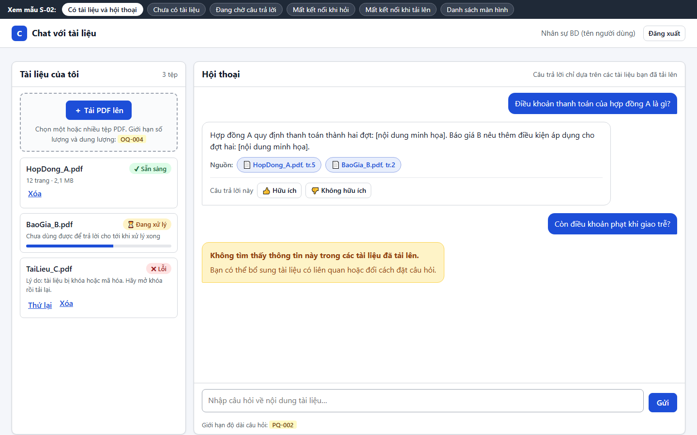
*S-02, trạng thái có tài liệu: nút "Tải PDF lên" ở đầu vùng tài liệu; tệp hợp lệ hiển thị nhãn "Sẵn sàng".*

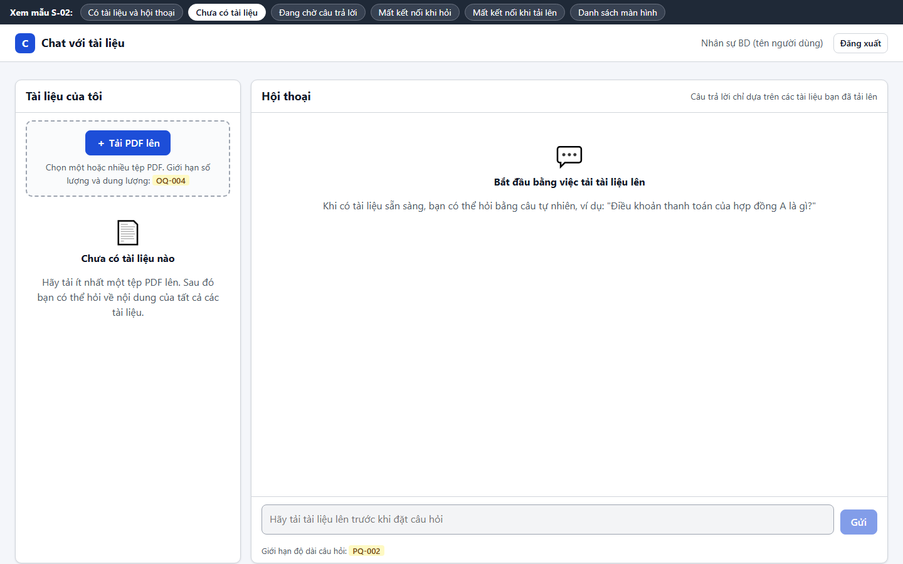
*S-02, chưa có tài liệu: trạng thái trống hướng dẫn tải PDF lên trước khi hỏi.*

**Ghi chú:** giới hạn dung lượng và số lượng tệp `[TBD: OQ-004]`.

### US-002 — Tải nhiều PDF vào cùng một tập tài liệu (P0)
**BR-002 · AC-002**

> As a **nhân sự BD**, I want to **tải nhiều PDF vào cùng một tập tài liệu**, so that **tôi hỏi được trên toàn bộ tài liệu cùng lúc**.

**Tiêu chí chấp nhận (PRD)**
- **Given** tôi có `[TBD: OQ-004]` file PDF, mỗi file có dung lượng không quá `[TBD: OQ-004]`, **When** tôi tải tất cả lên, **Then** tất cả được xử lý thành công và nằm trong cùng tập tài liệu.

**Màn hình**

*S-02: ô tải lên cho phép chọn nhiều tệp; danh sách hiển thị trạng thái từng tệp (Sẵn sàng, Đang xử lý, Lỗi).*

### US-003 — Biết file nào tải thất bại (P0)
**BR-003 · AC-003**

> As a **nhân sự BD**, I want to **biết file nào tải thất bại**, so that **tôi không tin nhầm file đã được đưa vào**.

**Tiêu chí chấp nhận (PRD)**
- **Given** tôi tải một file hỏng hoặc không phải PDF, **When** hệ thống không thể đưa file vào, **Then** tôi thấy thông báo nêu tên file và file không xuất hiện trong danh sách tài liệu có thể truy vấn.

**Màn hình**

*S-02: tệp "TaiLieu_C.pdf" mang nhãn "Lỗi", kèm thao tác Thử lại và Xóa.*

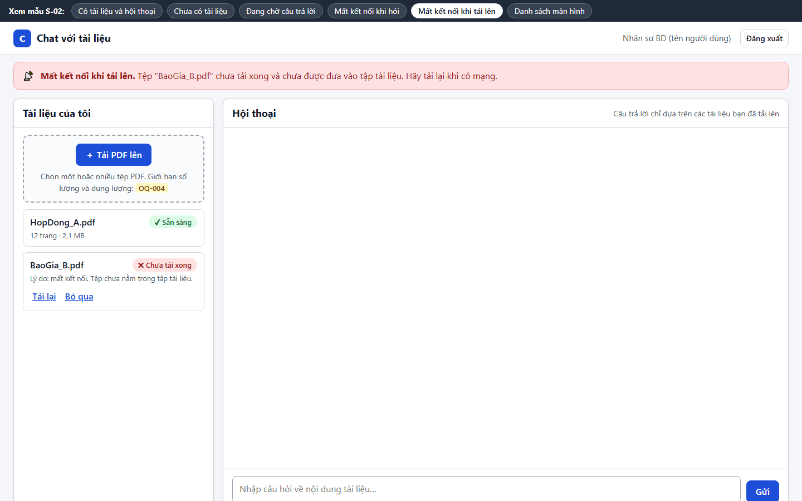
*S-02, mất kết nối khi tải lên: thông báo ở đầu trang; tệp "BaoGia_B.pdf" hiển thị "Chưa tải xong", không được tính là đã vào tập tài liệu.*

### US-004 — Biết lý do tệp thất bại (P1)
**BR-018 · AC-018**

> As a **nhân sự BD**, I want to **biết lý do file thất bại**, so that **tôi biết cách xử lý**.

**Tiêu chí chấp nhận (suy ra từ AC-018 của BRD, cần xác nhận)**
- **Given** một tệp không thể đưa vào tập truy vấn, **When** tôi xem trạng thái tệp, **Then** tôi thấy lý do thuộc một trong các nhóm: tài liệu hỏng, bị khóa hoặc mã hóa, không phải PDF.

**Màn hình**

*S-02: dòng "Lý do: tài liệu bị khóa hoặc mã hóa. Hãy mở khóa rồi tải lại." dưới tệp lỗi.*

**Ghi chú:** giao diện mẫu còn có nhóm "vượt giới hạn" và "mất kết nối" (PRD 4.2); BR-018 mới liệt kê ba nhóm đầu, cần thống nhất danh sách cuối cùng.

### US-005 — Xem danh sách tài liệu đã tải (P1)
**BR-004 · AC-004**

> As a **nhân sự BD**, I want to **xem danh sách tài liệu đã tải**, so that **tôi biết phạm vi mình đang hỏi**.

**Tiêu chí chấp nhận (suy ra từ AC-004, cần xác nhận)**
- **Given** tôi đã tải tài liệu lên, **When** tôi mở màn hình chính, **Then** tôi thấy danh sách đầy đủ các tài liệu của mình cùng trạng thái từng tài liệu.

**Màn hình**

*S-02: vùng "Tài liệu của tôi" hiển thị tên, số trang, dung lượng và trạng thái.*

### US-006 — Loại tài liệu khỏi tập truy vấn (P1)
**BR-005 · AC-005**

> As a **nhân sự BD**, I want to **xóa một tài liệu khỏi tập truy vấn**, so that **câu trả lời không còn dựa trên tài liệu cũ hoặc sai**.

**Tiêu chí chấp nhận (suy ra từ AC-005, cần xác nhận)**
- **Given** tôi chọn xóa một tài liệu và xác nhận, **When** thao tác hoàn tất, **Then** tài liệu biến khỏi danh sách; **And** các câu hỏi chỉ có đáp án trong tài liệu đó nhận phản hồi "không tìm thấy thông tin".

**Màn hình**

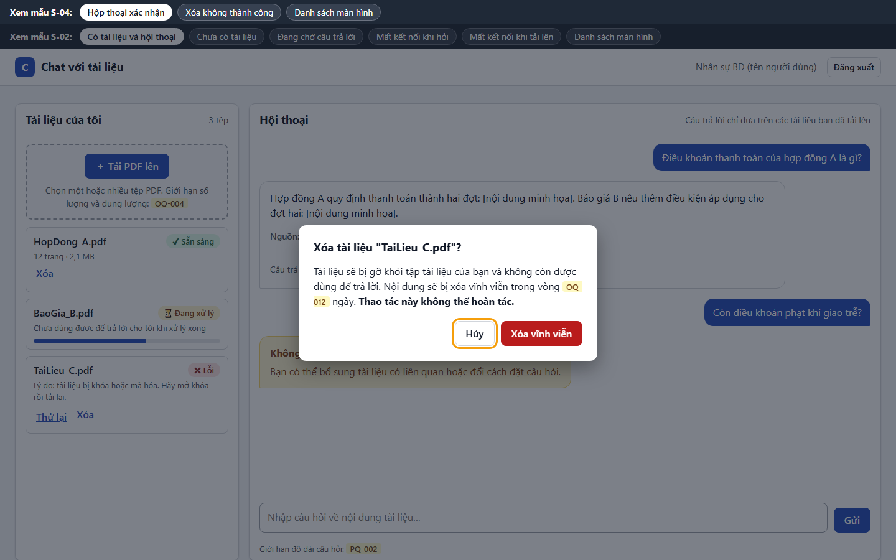
*S-04: hộp thoại xác nhận, tiêu điểm mặc định ở "Hủy"; nút "Xóa vĩnh viễn" màu đỏ.*

### US-007 — Xóa vĩnh viễn nội dung tài liệu (P0)
**BR-024 · AC-024**

> As a **nhân sự BD**, I want to **tài liệu đã xóa bị xóa vĩnh viễn**, so that **nội dung không còn bị lưu giữ**.

**Tiêu chí chấp nhận (PRD)**
- **Given** tôi đã xóa tài liệu X, **When** thời hạn xóa `[TBD: OQ-012]` ngày trôi qua, **Then** nội dung của X không còn trong nơi lưu trữ (xác nhận bằng kiểm tra).
- **Given** tôi đã xóa X, **When** tôi hỏi một câu chỉ có đáp án trong X, **Then** hệ thống trả lời không tìm thấy thông tin.

**Màn hình**

*S-04: nội dung hộp thoại nêu rõ "Thao tác này không thể hoàn tác" và thời hạn xóa vĩnh viễn `[TBD: OQ-012]`.*

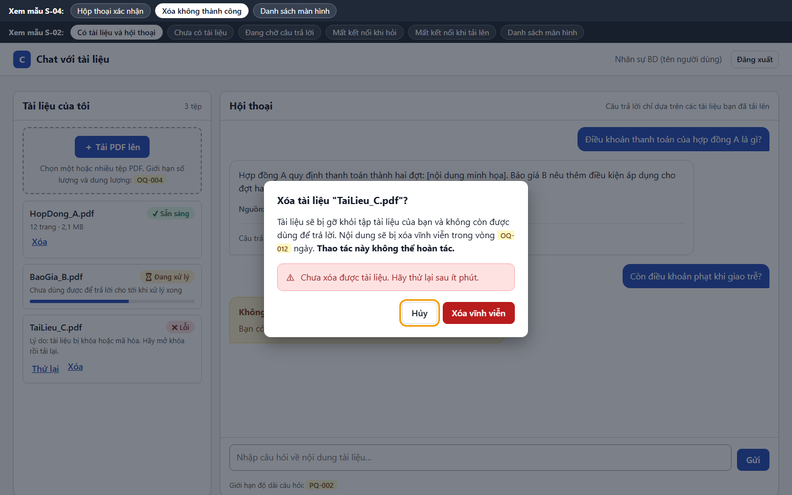
*S-04, xóa không thành công: thông báo lỗi hiển thị ngay trong hộp thoại, người dùng thử lại không cần tải lại trang.*

---

## 3. Epic E2 — Hỏi đáp trên tài liệu

### US-008 — Đặt câu hỏi bằng ngôn ngữ tự nhiên (P0)
**BR-006 · AC-006**

> As a **nhân sự BD**, I want to **đặt câu hỏi bằng ngôn ngữ tự nhiên**, so that **tôi nhận câu trả lời từ nội dung tài liệu thay vì tự tìm**.

**Tiêu chí chấp nhận (PRD)**
- **Given** tập tài liệu của tôi chứa thông tin liên quan, **When** tôi đặt câu hỏi, **Then** tôi nhận câu trả lời dựa trên nội dung các tài liệu đó. Chất lượng được đo trên bộ câu hỏi chuẩn theo ngưỡng của US-016.

**Màn hình**

*S-02: vùng "Hội thoại" với ô nhập câu hỏi ở cuối và nút Gửi.*

*S-02, chưa có tài liệu: ô nhập câu hỏi bị vô hiệu kèm lời giải thích "Hãy tải tài liệu lên trước khi đặt câu hỏi".*

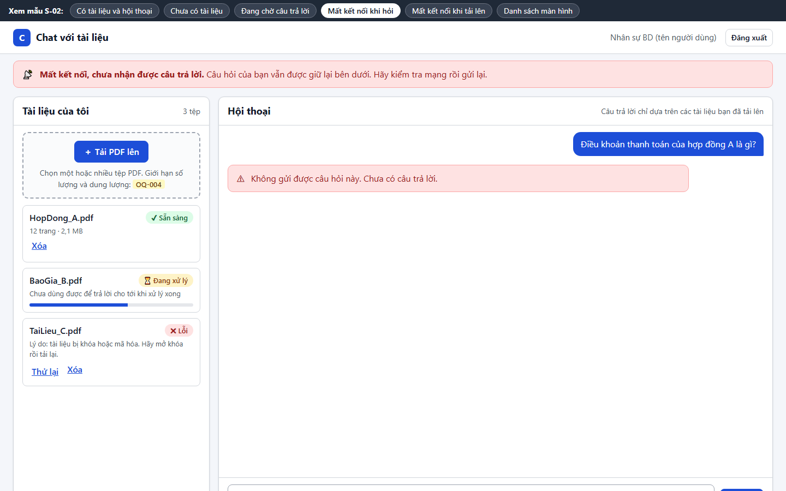
*S-02, mất kết nối khi hỏi: thông báo lỗi, câu hỏi được giữ lại trong ô nhập, nút đổi thành "Gửi lại".*

**Ghi chú:** giới hạn độ dài câu hỏi `[TBD: PQ-002]`.

### US-009 — Câu trả lời tổng hợp từ nhiều tài liệu (P0)
**BR-007 · AC-007**

> As a **nhân sự BD**, I want to **nhận câu trả lời tổng hợp từ nhiều tài liệu**, so that **tôi không phải tự gộp thông tin**.

**Tiêu chí chấp nhận (PRD)**
- **Given** đáp án của một câu hỏi nằm rải ở ít nhất hai tài liệu, **When** tôi đặt câu hỏi đó, **Then** câu trả lời chứa thông tin từ tất cả các tài liệu liên quan.

**Màn hình**

*S-02: một câu trả lời có hai nguồn (HopDong_A.pdf và BaoGia_B.pdf). Chất lượng tổng hợp là hành vi nội dung, không thể hiện được bằng ảnh tĩnh.*

### US-010 — Hỏi tiếp trong cùng hội thoại (P1)
**BR-008 · AC-008**

> As a **nhân sự BD**, I want to **hỏi tiếp mà không nhắc lại ngữ cảnh**, so that **tôi hỏi tự nhiên theo chuỗi**.

**Tiêu chí chấp nhận (suy ra từ AC-008, cần xác nhận)**
- **Given** tôi vừa nhận một câu trả lời, **When** tôi hỏi tiếp bằng câu có đại từ tham chiếu câu trước, **Then** câu trả lời hiểu đúng đối tượng được nhắc.

**Màn hình**

*S-02: lịch sử hội thoại hiển thị các lượt hỏi và trả lời nối tiếp nhau. Việc lưu hội thoại giữa các phiên `[TBD: PQ-004]`.*

### US-011 — Báo rõ khi tài liệu không có thông tin (P0)
**BR-009 · AC-009**

> As a **nhân sự BD**, I want to **được báo rõ khi tài liệu không có thông tin**, so that **tôi không bị đưa thông tin bịa đặt**.

**Tiêu chí chấp nhận (PRD)**
- **Given** câu hỏi nằm ngoài nội dung các tài liệu đã tải, **When** tôi đặt câu hỏi, **Then** hệ thống nêu rõ không tìm thấy thông tin trong tài liệu và không đưa ra câu trả lời không có căn cứ. Trong bộ câu hỏi ngoài phạm vi, tỷ lệ vi phạm ≤ `[TBD: OQ-002]`%.

**Màn hình**

*S-02: khối màu vàng "Không tìm thấy thông tin này trong các tài liệu đã tải lên", kèm gợi ý bổ sung tài liệu hoặc đổi câu hỏi.*

### US-012 — Hỏi đáp bằng ngôn ngữ `[TBD: OQ-007]` (P0)
**BR-010 · AC-010**

> As a **nhân sự BD**, I want to **hỏi và nhận câu trả lời bằng ngôn ngữ `[TBD: OQ-007]`**, so that **tôi dùng được với tài liệu thực tế của mình**.

**Tiêu chí chấp nhận (PRD)**
- **Given** bộ câu hỏi chuẩn theo từng ngôn ngữ đã chốt, **When** chạy bộ câu hỏi, **Then** kết quả đạt ngưỡng của US-016 cho từng ngôn ngữ.

**Màn hình:** không có ảnh. Story này là hành vi nội dung (chất lượng theo ngôn ngữ), không có màn hình hay thành phần giao diện riêng (UIUX_Blueprint mục 4).

### US-013 — Thời gian phản hồi (P1)
**BR-011 · AC-011**

> As a **nhân sự BD**, I want to **nhận câu trả lời trong thời gian không quá `[TBD: OQ-002]` giây**, so that **việc tìm kiếm nhanh hơn làm thủ công**.

**Tiêu chí chấp nhận (suy ra từ AC-011, cần xác nhận)**
- **Given** tải bình thường, **When** tôi gửi câu hỏi, **Then** giao diện hiển thị trạng thái đang xử lý trong `[Đề xuất: ≤ 300 ms]` và câu trả lời xuất hiện trong ≤ `[TBD: OQ-002]` giây ở ít nhất `[TBD: OQ-002]`% số câu.

**Màn hình**

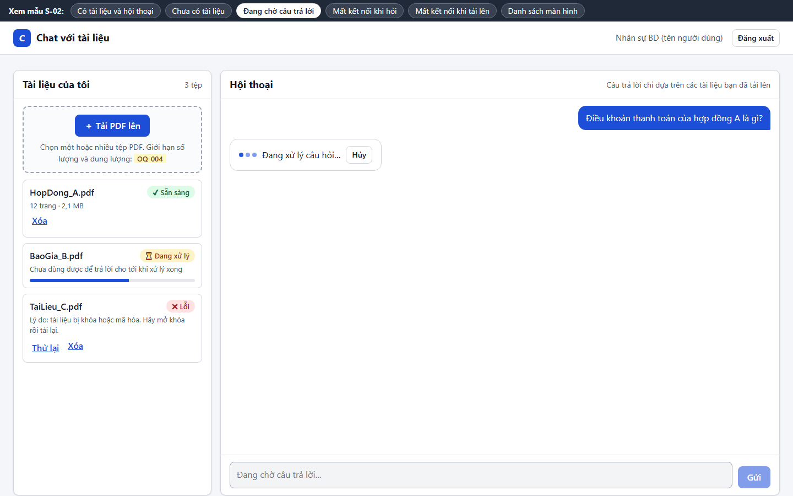
*S-02, đang chờ: chỉ báo "Đang xử lý câu hỏi…" kèm nút Hủy; ô nhập tạm vô hiệu.*

---

## 4. Epic E3 — Nguồn và độ tin cậy

### US-014 — Biết câu trả lời lấy từ tài liệu nào (P0)
**BR-012 · AC-012**

> As a **nhân sự BD**, I want to **biết câu trả lời lấy từ tài liệu nào**, so that **tôi kiểm chứng được**.

**Tiêu chí chấp nhận (PRD)**
- **Given** hệ thống trả lời có nội dung, **When** tôi xem câu trả lời, **Then** câu trả lời nêu tên tài liệu nguồn và thông tin có trong tài liệu đó (100% câu trả lời có nội dung).

**Màn hình**

*S-02: dòng "Nguồn:" với các chip "tên tài liệu, trang"; chọn chip mở trình xem nguồn.*

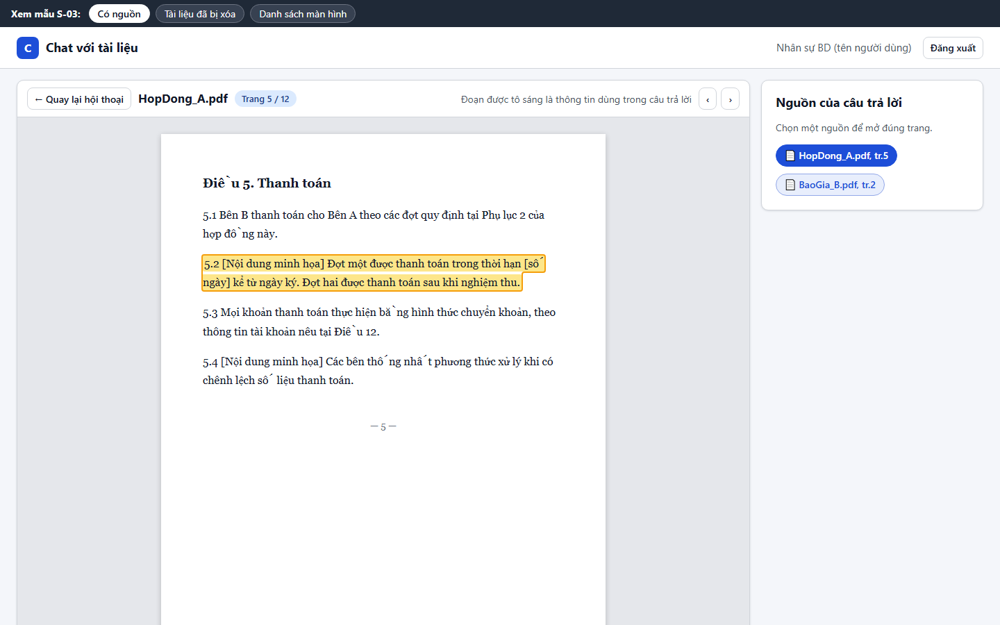
*S-03: tài liệu mở tại đúng trang, đoạn dùng trong câu trả lời được tô sáng; danh sách nguồn ở cột bên phải.*

**Ghi chú:** hiển thị nguồn trong ứng dụng hay mở tab mới: `[TBD: DQ-005]`.

### US-015 — Biết số trang của thông tin (P0)
**BR-019 · AC-019**

> As a **nhân sự BD**, I want to **biết số trang của thông tin**, so that **tôi tìm đúng vị trí để đối chiếu**.

**Tiêu chí chấp nhận (PRD)**
- **Given** câu trả lời nêu tài liệu nguồn, **When** tôi xem số trang được nêu, **Then** trang đó chứa thông tin tương ứng (100% câu trả lời có nội dung).

**Màn hình**

*S-03: thanh công cụ có "Trang 5 / 12" và nút chuyển trang; đoạn được dùng được tô sáng.*

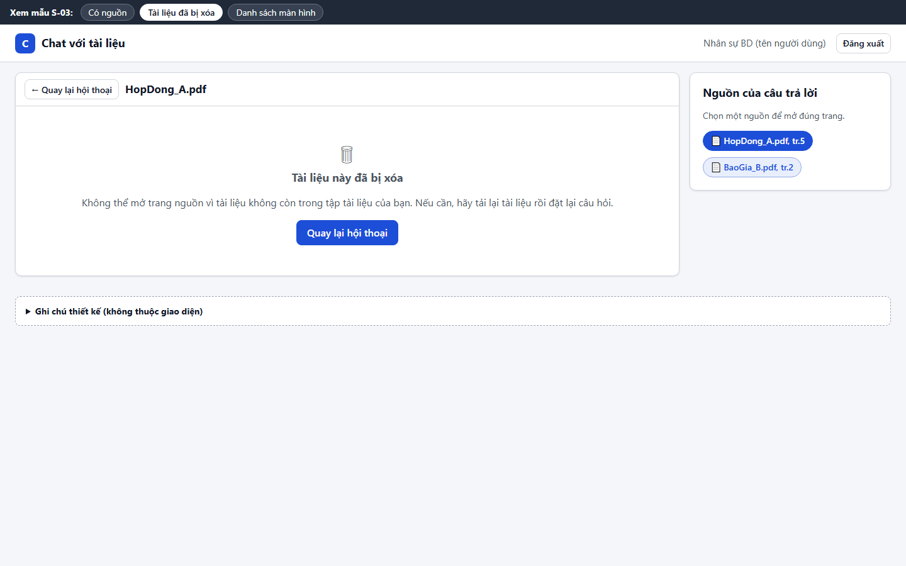
*S-03, tài liệu đã bị xóa: thông báo không thể mở trang nguồn, hướng dẫn tải lại tài liệu rồi hỏi lại.*

### US-016 — Chất lượng câu trả lời đạt ngưỡng (P0)
**BR-013 · AC-013**

> As a **quản lý**, I want to **chất lượng câu trả lời đạt ngưỡng đã thống nhất**, so that **tôi tin cho dùng MVP**.

**Tiêu chí chấp nhận (PRD)**
- **Given** bộ câu hỏi chuẩn do business owner xác nhận, **When** chạy bộ câu hỏi, **Then** tỷ lệ câu trả lời đúng và có nguồn ≥ `[TBD: OQ-002]`%.

**Màn hình:** không có ảnh. Đây là tiêu chí chất lượng đo bằng bộ câu hỏi chuẩn (LG-02), không có màn hình riêng.

---

## 5. Epic E4 — Truy cập, bảo mật, vận hành

### US-017 — Chỉ người được cấp quyền mới dùng được ứng dụng (P0)
**BR-014 · AC-014**

> As a **quản trị bảo mật**, I want to **chỉ người được cấp quyền mới dùng được ứng dụng**, so that **tài liệu kinh doanh không bị truy cập trái phép**.

**Tiêu chí chấp nhận (PRD)**
- **Given** một người chưa được cấp quyền, **When** họ truy cập ứng dụng, **Then** họ không vào được.
- **Given** người được cấp quyền, **When** họ đăng nhập, **Then** họ vào được.

**Màn hình**

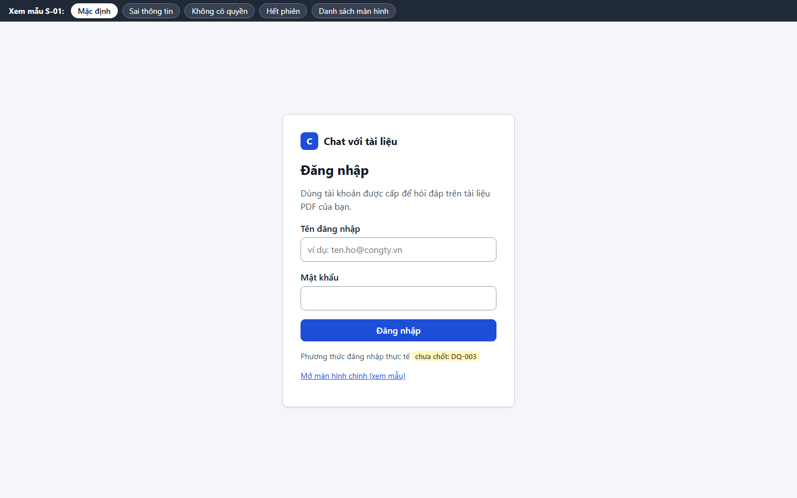
*S-01, mặc định.*

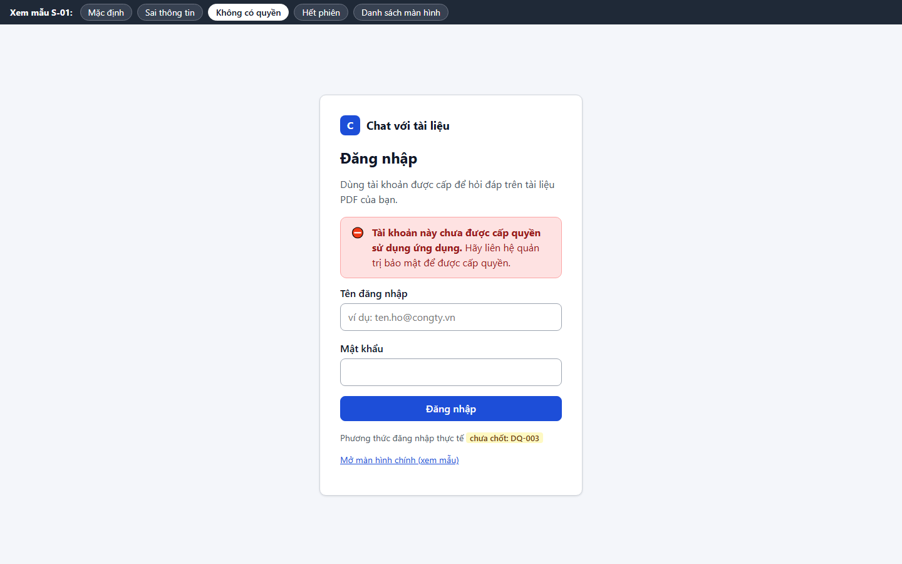
*S-01, không có quyền: thông báo không tiết lộ bất kỳ tài liệu nào, hướng dẫn liên hệ quản trị bảo mật.*

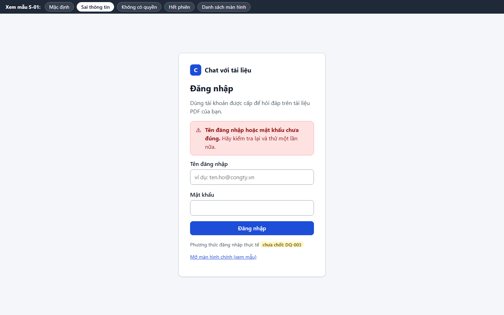
*S-01, sai tên đăng nhập hoặc mật khẩu.*

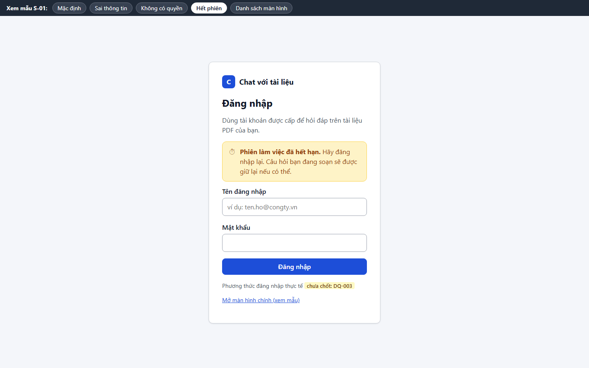
*S-01, hết phiên: yêu cầu đăng nhập lại, câu hỏi đang soạn được giữ lại nếu có thể.*

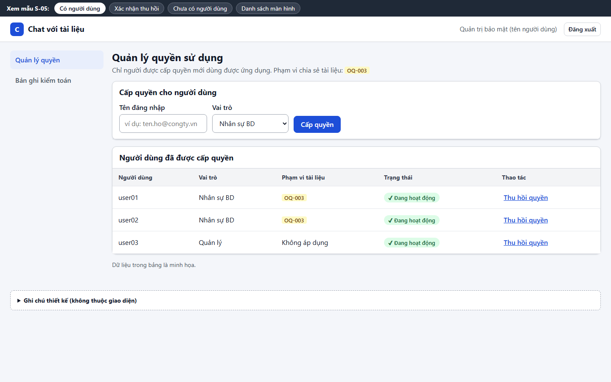
*S-05: quản trị bảo mật cấp quyền theo tên đăng nhập và vai trò, thu hồi quyền.*

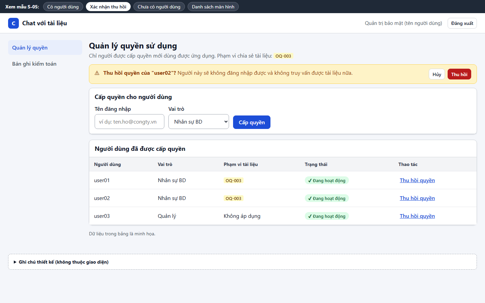
*S-05, xác nhận thu hồi: thông báo xác nhận có nút Hủy và Thu hồi.*

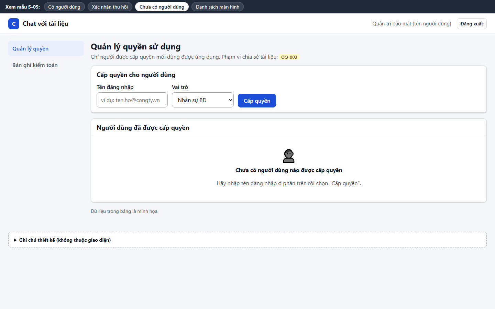
*S-05, chưa có người dùng: trạng thái trống hướng dẫn nhập tên đăng nhập để cấp quyền.*

**Ghi chú:** phương thức đăng nhập `[TBD: DQ-003]`; người dùng nhiều vai trò `[TBD: DQ-002]`.

### US-018 — Chỉ thấy tài liệu trong phạm vi chia sẻ (P0)
**BR-020 · AC-020**

> As a **quản trị bảo mật**, I want to **người dùng chỉ truy vấn trên tài liệu thuộc phạm vi chia sẻ đã quy định**, so that **tài liệu không lộ cho người không được phép**.

**Tiêu chí chấp nhận (PRD)**
- **Given** phạm vi chia sẻ đã chốt tại OQ-003, **When** một người dùng đặt câu hỏi, **Then** câu trả lời chỉ dựa trên tài liệu họ có quyền truy cập.

**Màn hình**

*S-05: cột "Phạm vi tài liệu" đang để `[TBD: OQ-003]`. Hành vi lọc câu trả lời theo quyền là hành vi hệ thống, không có màn hình riêng.*

### US-019 — Tài liệu được xử lý và lưu theo chính sách dữ liệu (P0)
**BR-015 · AC-015**

> As a **quản trị bảo mật**, I want to **tài liệu được xử lý và lưu theo chính sách dữ liệu của tổ chức**, so that **sản phẩm tuân thủ**.

**Tiêu chí chấp nhận (PRD)**
- **Given** chính sách dữ liệu đã chốt (OQ-005, OQ-006), **When** rà soát trước launch, **Then** bộ phận bảo mật xác nhận bằng văn bản việc xử lý và lưu trữ đáp ứng chính sách.

**Màn hình:** không có ảnh. Đây là yêu cầu tuân thủ, kiểm tra bằng rà soát, không có màn hình riêng.

### US-020 — Bản ghi ai hỏi về tài liệu nào, khi nào (P1)
**BR-023 · AC-023**

> As a **quản trị bảo mật**, I want to **có bản ghi ai hỏi về tài liệu nào và khi nào**, so that **có thể kiểm toán**.

**Tiêu chí chấp nhận (suy ra từ AC-023, cần xác nhận)**
- **Given** người dùng đã đặt một câu hỏi, **When** tôi xem bản ghi kiểm toán, **Then** tôi thấy người dùng, tài liệu liên quan và thời điểm; bản ghi lưu tối thiểu `[TBD: OQ-012]` ngày.

**Màn hình**

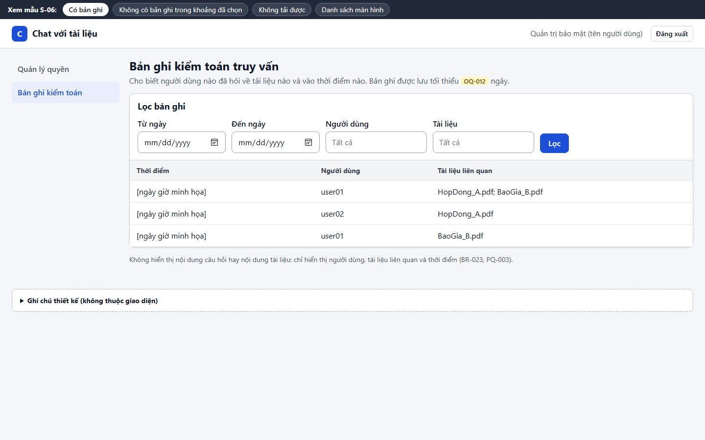
*S-06: bảng bản ghi (thời điểm, người dùng, tài liệu liên quan) và bộ lọc theo ngày, người dùng, tài liệu. Không hiển thị nội dung câu hỏi (PQ-003).*

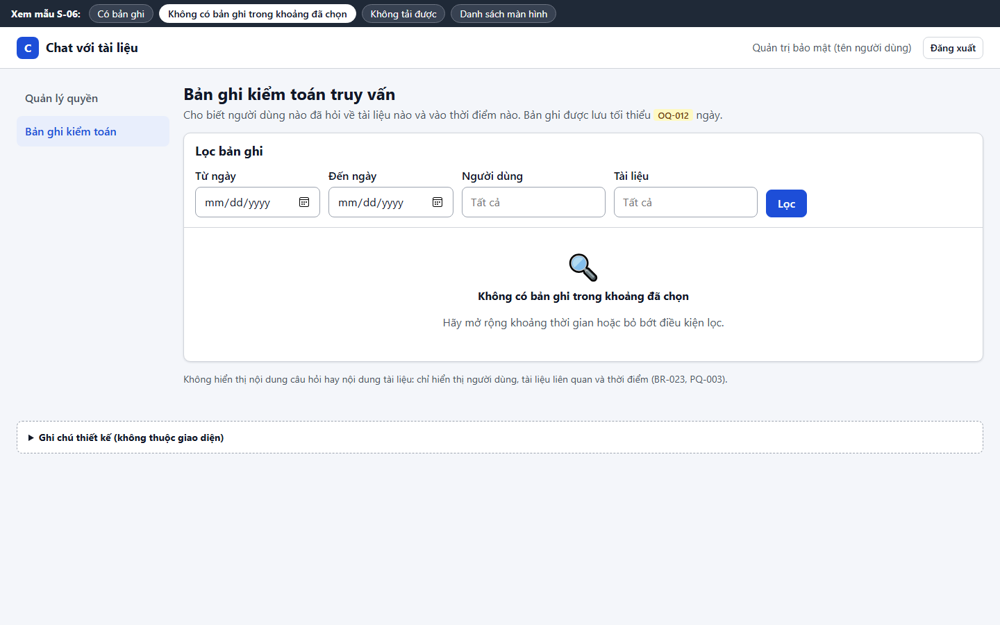
*S-06, trạng thái trống.*

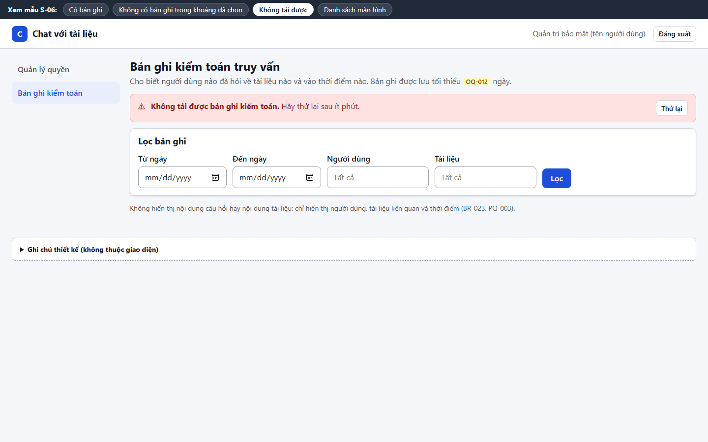
*S-06, lỗi tải: thông báo kèm nút Thử lại.*

### US-021 — Mức sẵn sàng của ứng dụng (P2)
**BR-022 · AC-022**

> As a **nhân sự BD**, I want to **ứng dụng sẵn sàng trong khung giờ làm việc `[TBD: OQ-011]` với mức sẵn sàng ≥ `[TBD: OQ-011]`%**, so that **tôi dùng được khi cần**.

**Tiêu chí chấp nhận (suy ra từ AC-022, cần xác nhận)**
- **Given** khung giờ đã chốt tại OQ-011, **When** đo số liệu giám sát, **Then** mức sẵn sàng đạt ngưỡng đã chốt.

**Màn hình:** không có ảnh. Đây là yêu cầu phi chức năng, không có màn hình riêng.

---

## 6. Epic E5 — Đo lường hiệu quả

### US-022 — Số người dùng hoạt động hằng tuần (P1)
**BR-016 · AC-016**

> As a **quản lý**, I want to **xem số người dùng hoạt động mỗi tuần**, so that **tôi đo mức dùng thực tế**.

**Tiêu chí chấp nhận (suy ra từ AC-016, cần xác nhận)**
- **Given** ứng dụng đang trong giai đoạn thử nghiệm, **When** tôi mở báo cáo, **Then** tôi thấy số người dùng hoạt động theo từng tuần.

**Màn hình**

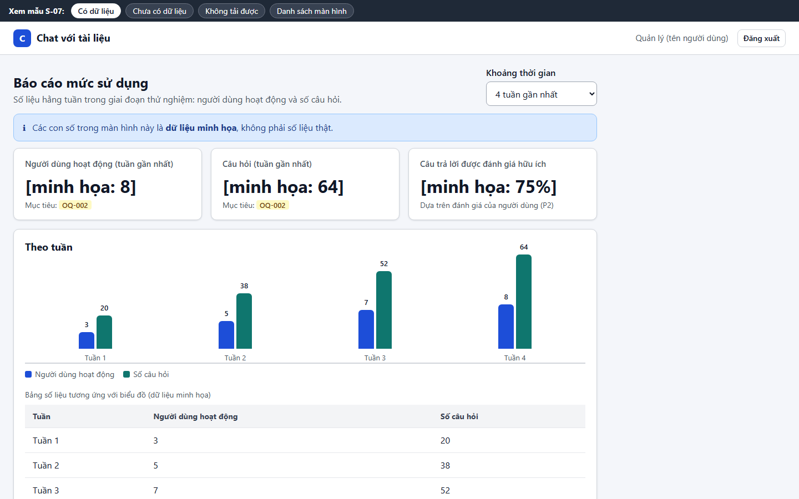
*S-07: thẻ số liệu, biểu đồ theo tuần kèm bảng số liệu tương ứng. Toàn bộ số liệu là minh họa; mục tiêu định lượng `[TBD: OQ-002]`.*

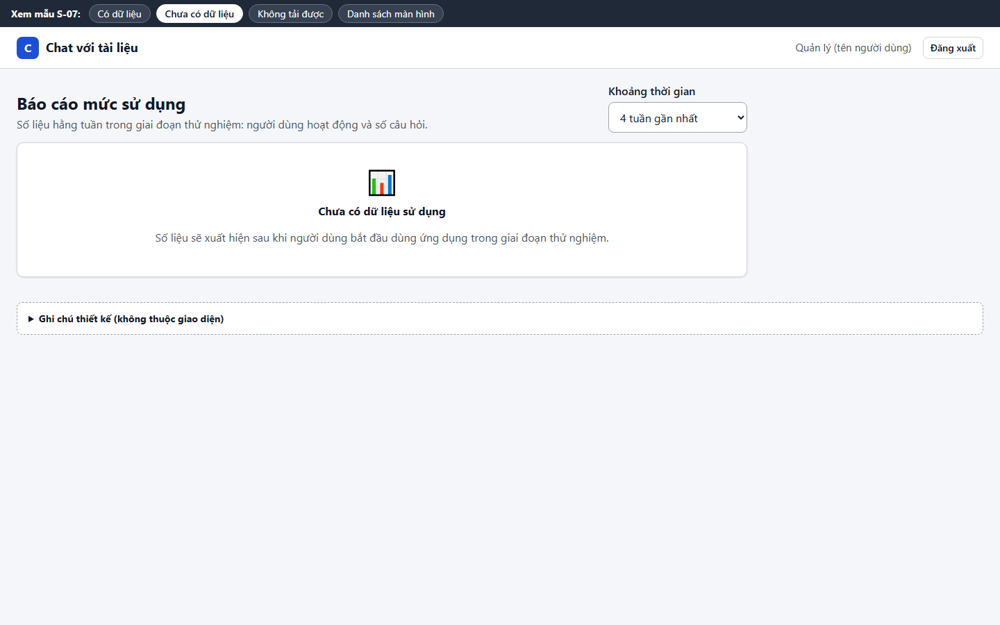
*S-07, trạng thái trống.*

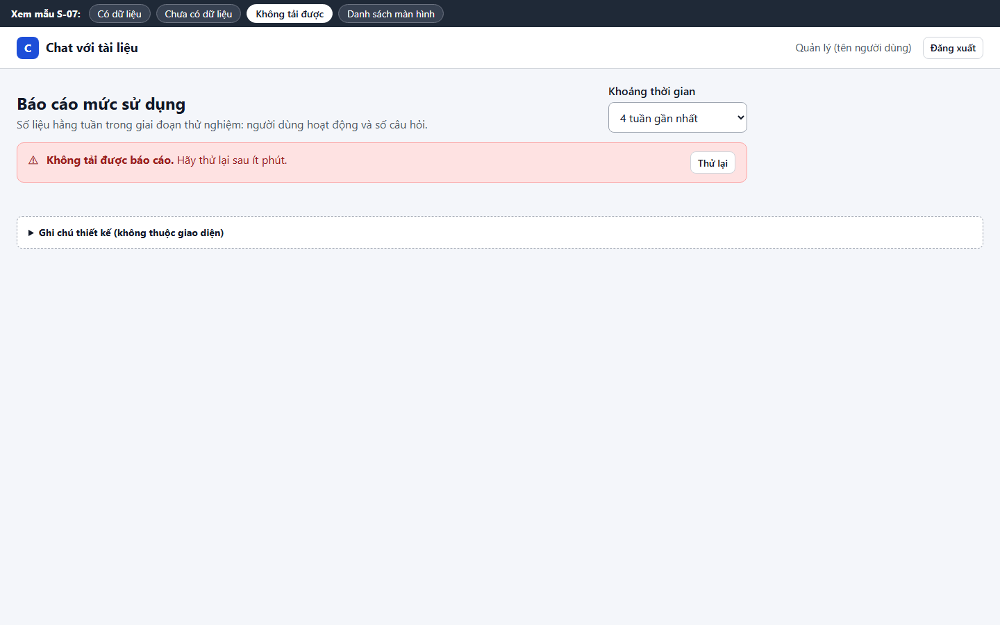
*S-07, lỗi tải: thông báo kèm nút Thử lại.*

### US-023 — Số câu hỏi hằng tuần (P1)
**BR-021 · AC-021**

> As a **quản lý**, I want to **xem số câu hỏi mỗi tuần**, so that **tôi đo mức độ sử dụng**.

**Tiêu chí chấp nhận (suy ra từ AC-021, cần xác nhận)**
- **Given** ứng dụng đang trong giai đoạn thử nghiệm, **When** tôi mở báo cáo, **Then** tôi thấy số câu hỏi theo từng tuần.

**Màn hình**

*S-07: cột "Câu hỏi (tuần gần nhất)" và cột số câu hỏi trong biểu đồ theo tuần.*

### US-024 — Đánh giá câu trả lời (P2)
**BR-017 · AC-017**

> As a **nhân sự BD**, I want to **đánh giá câu trả lời hữu ích hoặc không hữu ích**, so that **sản phẩm được cải thiện**.

**Tiêu chí chấp nhận (suy ra từ AC-017, cần xác nhận)**
- **Given** tôi đang xem một câu trả lời, **When** tôi chọn "Hữu ích" hoặc "Không hữu ích", **Then** đánh giá được ghi nhận và tổng hợp đánh giá xem được.

**Màn hình**

*S-02: dưới mỗi câu trả lời có hai nút "Hữu ích" và "Không hữu ích". Trang tổng hợp đánh giá chưa có trong thiết kế (chỉ có tỷ lệ "hữu ích" trên S-07).*

---

## 7. Độ phủ và điểm cần xác nhận

**Độ phủ ảnh màn hình:** 20 trong 24 story có ít nhất một ảnh. Bốn story không có ảnh là US-012 (ngôn ngữ), US-016 (chất lượng), US-019 (chính sách dữ liệu), US-021 (mức sẵn sàng): đây là hành vi nội dung hoặc phi chức năng, không có giao diện riêng.

**Điểm cần xác nhận**
- Các tiêu chí chấp nhận P1/P2 được suy ra từ BRD, cần chủ sản phẩm xác nhận (PRD chưa viết Given-When-Then cho nhóm này).
- Ảnh là bản mẫu với dữ liệu minh họa; thiết kế hình ảnh cuối cùng phụ thuộc bộ quy chuẩn thiết kế (DQ-004) và trụ cột UX (PQ-001).
- Các câu hỏi mở vẫn là điều kiện cho tài liệu này: OQ-001 đến OQ-012 (BRD), PQ-001 đến PQ-004 (PRD), DQ-001 đến DQ-005 (UIUX_Blueprint).
