# 01 — Ca kiểm thử đơn vị (UT-001..UT-022) — kết quả chi tiết

Lần chạy: [README](README.md) · Đặc tả: [01_unit](../../test_cases/01_unit/README.md)

| Mã | Tên | Ưu tiên | Kết quả | Kiểm thử tự động đạt | Ảnh |
|---|---|---|---|---|---|
| [UT-001](#ut-001) | Trích xuất PDF giữ số trang | Cao | ✅ Đạt | 1/1 | 1 |
| [UT-002](#ut-002) | Chuẩn hóa tiếng Việt về NFC | Cao | ✅ Đạt | 1/1 | 1 |
| [UT-003](#ut-003) | Phân loại lỗi PDF | Cao | ✅ Đạt | 4/4 | 1 |
| [UT-004](#ut-004) | Chunk không vượt ranh giới trang | Cao | ✅ Đạt | 1/1 | 1 |
| [UT-005](#ut-005) | Trang ngắn và trang rỗng | Trung bình | ✅ Đạt | 2/2 | 1 |
| [UT-006](#ut-006) | Giới hạn token, chồng lấp và ghép lại văn bản | Cao | ✅ Đạt | 3/3 | 1 |
| [UT-007](#ut-007) | Lớp từ chối 1: dưới ngưỡng không gọi mô hình | Cao | ✅ Đạt | 2/2 | 1 |
| [UT-008](#ut-008) | Lớp từ chối 2: câu từ chối cố định | Cao | ✅ Đạt | 2/2 | 1 |
| [UT-009](#ut-009) | Lớp từ chối 3: có nội dung nhưng không có nguồn hợp lệ | Cao | ✅ Đạt | 3/3 | 1 |
| [UT-010](#ut-010) | Ánh xạ và gộp citation | Cao | ✅ Đạt | 2/2 | 1 |
| [UT-011](#ut-011) | Ghép câu hỏi trước vào truy vấn | Trung bình | ✅ Đạt | 1/1 | 1 |
| [UT-012](#ut-012) | Adapter Claude: ánh xạ citation | Cao | ✅ Đạt | 1/1 | 1 |
| [UT-013](#ut-013) | Adapter Claude: từ chối và cắt cụt | Cao | ✅ Đạt | 2/2 | 1 |
| [UT-014](#ut-014) | Adapter Claude: hình dạng yêu cầu | Cao | ✅ Đạt | 2/2 | 1 |
| [UT-015](#ut-015) | Adapter OIDC: kiểm tra ID token | Cao | ✅ Đạt | 6/6 | 1 |
| [UT-016](#ut-016) | Định dạng lỗi chung, không lộ chi tiết kỹ thuật | Cao | ✅ Đạt | 3/3 | 1 |
| [UT-017](#ut-017) | Log không chứa nội dung câu hỏi | Cao | ✅ Đạt | 2/2 | 1 |
| [UT-018](#ut-018) | Tiến trình API nạp đủ model | Cao | ✅ Đạt | 1/1 | 1 |
| [UT-019](#ut-019) | Mọi ngưỡng là trường cấu hình | Cao | ✅ Đạt | 1/1 | 1 |
| [UT-020](#ut-020) | Bảng thông báo lỗi tải lên | Trung bình | ✅ Đạt | 16/16 | 1 |
| [UT-021](#ut-021) | Tô sáng đoạn trích trong trang nguồn | Trung bình | ✅ Đạt | 6/6 | 1 |
| [UT-022](#ut-022) | Công thức chỉ số của bộ đánh giá | Cao | ✅ Đạt | 12/12 | 1 |

## UT-001

**Trích xuất PDF giữ số trang** — ✅ **Đạt**

| Mục | Nội dung |
|---|---|
| Mục tiêu | Mô-đun trích xuất trả văn bản theo từng trang, số trang bắt đầu từ 1, đúng thứ tự |
| Truy vết | BR-019, AC-019, US-015, T1-13 |
| Ưu tiên / Loại | Cao / Dương |
| Tự động hóa | `backend/tests/unit/test_extract.py::test_plain_pdf_keeps_page_numbers` |
| Đặc tả | [UT-001.md](../../test_cases/01_unit/UT-001.md) |

**Checklist kết quả mong đợi**

- [x] Trả về 3 phần tử, `page` lần lượt 1, 2, 3.
- [x] Văn bản trang 2 chứa "noi dung B".

**Kiểm thử tự động đã chạy** (1/1 đạt)

| | Tầng | Tệp | Kiểm thử | Thời gian |
|---|---|---|---|---|
| ✅ | Backend | `test_extract.py` | test_plain_pdf_keeps_page_numbers | 0.03 s |

**Ảnh kết quả**

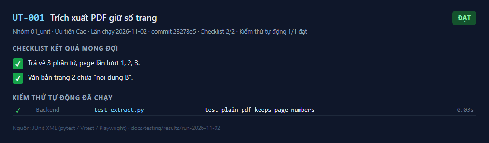
_Kết quả UT-001 — lần chạy 2026-11-02_

---

## UT-002

**Chuẩn hóa tiếng Việt về NFC** — ✅ **Đạt**

| Mục | Nội dung |
|---|---|
| Mục tiêu | Văn bản tiếng Việt ở dạng tổ hợp (NFD) được chuẩn hóa về dạng dựng sẵn (NFC), không mất dấu |
| Truy vết | BR-010, AC-010, US-012, T1-13 |
| Ưu tiên / Loại | Cao / Dương |
| Tự động hóa | `test_extract.py::test_vietnamese_text_is_nfc_and_keeps_diacritics` |
| Đặc tả | [UT-002.md](../../test_cases/01_unit/UT-002.md) |

**Checklist kết quả mong đợi**

- [x] Văn bản trích xuất bằng chính nó sau `unicodedata.normalize("NFC")`.
- [x] Chứa nguyên cụm "Hợp đồng phân phối" và "24 tháng".

**Kiểm thử tự động đã chạy** (1/1 đạt)

| | Tầng | Tệp | Kiểm thử | Thời gian |
|---|---|---|---|---|
| ✅ | Backend | `test_extract.py` | test_vietnamese_text_is_nfc_and_keeps_diacritics | 0.03 s |

**Ảnh kết quả**

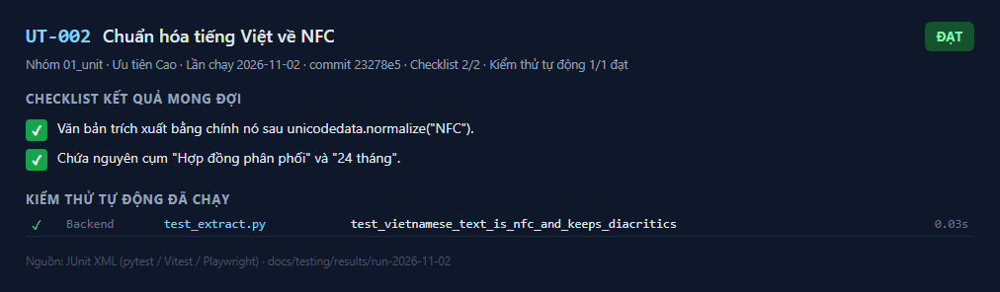
_Kết quả UT-002 — lần chạy 2026-11-02_

---

## UT-003

**Phân loại lỗi PDF** — ✅ **Đạt**

| Mục | Nội dung |
|---|---|
| Mục tiêu | PDF có mật khẩu, PDF hỏng, PDF chỉ có ảnh được phân loại đúng lý do |
| Truy vết | BR-018, AC-018, US-003, US-004, T1-13 |
| Ưu tiên / Loại | Cao / Âm |
| Tự động hóa | `test_extract.py::test_encrypted_pdf`, `test_corrupted_pdf`, `test_random_bytes_are_corrupted`, `test_image_only_pdf_has_no_text` |
| Đặc tả | [UT-003.md](../../test_cases/01_unit/UT-003.md) |

**Checklist kết quả mong đợi**

- [x] (a) ném `ExtractionError` với `reason = "encrypted"`.
- [x] (b) ném `ExtractionError` với `reason = "corrupted"`.
- [x] (c) ném `ExtractionError` với `reason = "no_text"` (tổng ký tự < `MIN_TEXT_CHARS`).

**Kiểm thử tự động đã chạy** (4/4 đạt)

| | Tầng | Tệp | Kiểm thử | Thời gian |
|---|---|---|---|---|
| ✅ | Backend | `test_extract.py` | test_encrypted_pdf | 0.14 s |
| ✅ | Backend | `test_extract.py` | test_corrupted_pdf | 0.01 s |
| ✅ | Backend | `test_extract.py` | test_random_bytes_are_corrupted | 0.01 s |
| ✅ | Backend | `test_extract.py` | test_image_only_pdf_has_no_text | 0.02 s |

**Ảnh kết quả**

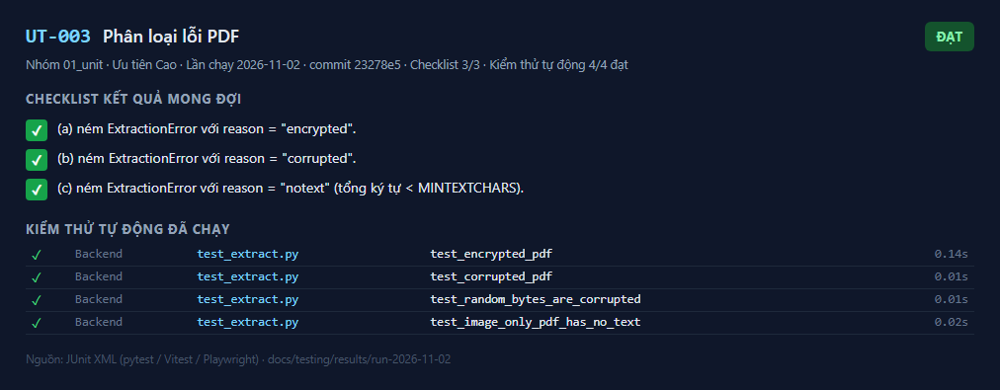
_Kết quả UT-003 — lần chạy 2026-11-02_

---

## UT-004

**Chunk không vượt ranh giới trang** — ✅ **Đạt**

| Mục | Nội dung |
|---|---|
| Mục tiêu | Không chunk nào chứa văn bản của hai trang; ordinal liên tục |
| Truy vết | BR-019, US-015, T1-14 |
| Ưu tiên / Loại | Cao / Dương |
| Tự động hóa | `test_chunking.py::test_no_chunk_spans_two_pages` |
| Đặc tả | [UT-004.md](../../test_cases/01_unit/UT-004.md) |

**Checklist kết quả mong đợi**

- [x] Mỗi chunk chỉ có từ của đúng một trang, khớp `chunk.page`.
- [x] `ordinal` = 0, 1, 2… liên tục.

**Kiểm thử tự động đã chạy** (1/1 đạt)

| | Tầng | Tệp | Kiểm thử | Thời gian |
|---|---|---|---|---|
| ✅ | Backend | `test_chunking.py` | test_no_chunk_spans_two_pages | 0.02 s |

**Ảnh kết quả**

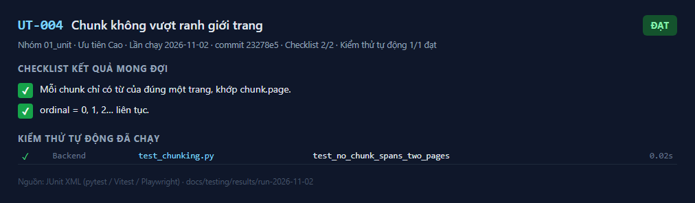
_Kết quả UT-004 — lần chạy 2026-11-02_

---

## UT-005

**Trang ngắn và trang rỗng** — ✅ **Đạt**

| Mục | Nội dung |
|---|---|
| Mục tiêu | Trang ngắn sinh đúng một chunk; trang rỗng không sinh chunk |
| Truy vết | T1-14 |
| Ưu tiên / Loại | Trung bình / Biên |
| Tự động hóa | `test_chunking.py::test_short_page_gives_exactly_one_chunk`, `test_empty_page_gives_no_chunk` |
| Đặc tả | [UT-005.md](../../test_cases/01_unit/UT-005.md) |

**Checklist kết quả mong đợi**

- [x] Trang ngắn: 1 chunk, `page=4`, văn bản nguyên vẹn.
- [x] Trang rỗng / chỉ khoảng trắng: danh sách rỗng.

**Kiểm thử tự động đã chạy** (2/2 đạt)

| | Tầng | Tệp | Kiểm thử | Thời gian |
|---|---|---|---|---|
| ✅ | Backend | `test_chunking.py` | test_short_page_gives_exactly_one_chunk | 0.00 s |
| ✅ | Backend | `test_chunking.py` | test_empty_page_gives_no_chunk | 0.00 s |

**Ảnh kết quả**

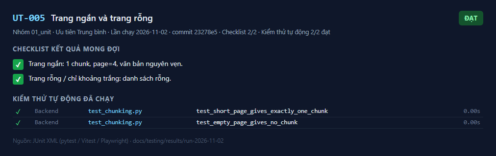
_Kết quả UT-005 — lần chạy 2026-11-02_

---

## UT-006

**Giới hạn token, chồng lấp và ghép lại văn bản** — ✅ **Đạt**

| Mục | Nội dung |
|---|---|
| Mục tiêu | Chunk tôn trọng `CHUNK_TOKENS`, có chồng lấp `CHUNK_OVERLAP`, luôn tiến; ghép phần không chồng lấp bằng đúng văn bản trang; tham số sai bị từ chối |
| Truy vết | NFR-CFG, T1-14 |
| Ưu tiên / Loại | Cao / Dương, biên |
| Tự động hóa | `test_chunking.py::test_chunks_respect_token_limit_and_overlap`, `test_chunks_without_overlap_reconstruct_page_text`, `test_invalid_parameters` |
| Đặc tả | [UT-006.md](../../test_cases/01_unit/UT-006.md) |

**Checklist kết quả mong đợi**

- [x] Mỗi chunk ≤ 40 token; chunk sau bắt đầu trước khi chunk trước kết thúc (chồng lấp) và sau điểm bắt đầu của chunk trước (luôn tiến).
- [x] Văn bản ghép lại bằng đúng văn bản trang; phủ hết mọi mảnh.
- [x] Tham số sai ném `ValueError`.

**Kiểm thử tự động đã chạy** (3/3 đạt)

| | Tầng | Tệp | Kiểm thử | Thời gian |
|---|---|---|---|---|
| ✅ | Backend | `test_chunking.py` | test_chunks_respect_token_limit_and_overlap | 0.01 s |
| ✅ | Backend | `test_chunking.py` | test_chunks_without_overlap_reconstruct_page_text | 0.01 s |
| ✅ | Backend | `test_chunking.py` | test_invalid_parameters | 0.00 s |

**Ảnh kết quả**

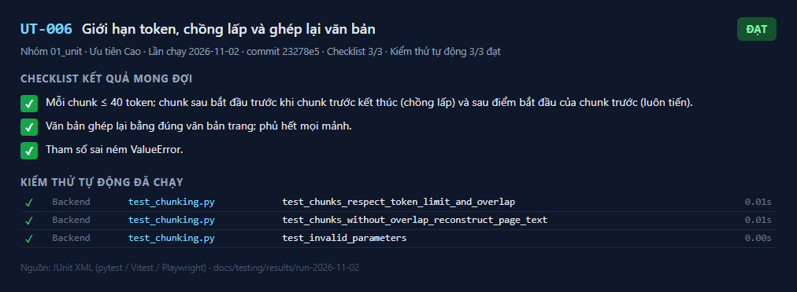
_Kết quả UT-006 — lần chạy 2026-11-02_

---

## UT-007

**Lớp từ chối 1: dưới ngưỡng không gọi mô hình** — ✅ **Đạt**

| Mục | Nội dung |
|---|---|
| Mục tiêu | Không có chunk hoặc điểm cao nhất < `MIN_RELEVANCE_SCORE` → `not_found`, mô hình sinh **không** được gọi |
| Truy vết | BR-009, AC-009, US-011, ADR-011, T2-04 |
| Ưu tiên / Loại | Cao / Âm |
| Tự động hóa | `test_qa_service.py::test_layer1_below_threshold_does_not_call_model`, `test_layer1_no_chunks_does_not_call_model` |
| Đặc tả | [UT-007.md](../../test_cases/01_unit/UT-007.md) |

**Checklist kết quả mong đợi**

- [x] `not_found = True`, `reason = "below_threshold"`, `answer` = câu "Không tìm thấy thông tin này trong các tài liệu đã tải lên."
- [x] Bộ đếm lời gọi của adapter giả lập = 0 ở cả hai lần.

**Kiểm thử tự động đã chạy** (2/2 đạt)

| | Tầng | Tệp | Kiểm thử | Thời gian |
|---|---|---|---|---|
| ✅ | Backend | `test_qa_service.py` | test_layer1_below_threshold_does_not_call_model | 0.01 s |
| ✅ | Backend | `test_qa_service.py` | test_layer1_no_chunks_does_not_call_model | 0.01 s |

**Ảnh kết quả**

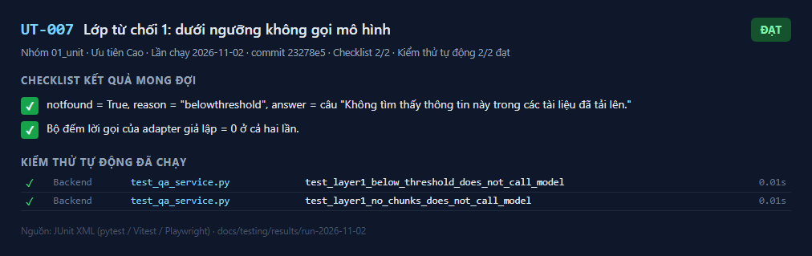
_Kết quả UT-007 — lần chạy 2026-11-02_

---

## UT-008

**Lớp từ chối 2: câu từ chối cố định** — ✅ **Đạt**

| Mục | Nội dung |
|---|---|
| Mục tiêu | Mô hình trả câu từ chối cố định (khác khoảng trắng, có dấu nháy) → `not_found`; câu có thêm nội dung thì không bị coi là từ chối |
| Truy vết | BR-009, ADR-011, T2-04 |
| Ưu tiên / Loại | Cao / Âm |
| Tự động hóa | `test_qa_service.py::test_layer2_fixed_refusal_sentence`, `test_not_found_sentence_matching_is_normalized` |
| Đặc tả | [UT-008.md](../../test_cases/01_unit/UT-008.md) |

**Checklist kết quả mong đợi**

- [x] `not_found = True`, `reason = "model_not_found"`, không có citation.
- [x] Chuỗi 1 → `True`; chuỗi 2 → `False`.

**Kiểm thử tự động đã chạy** (2/2 đạt)

| | Tầng | Tệp | Kiểm thử | Thời gian |
|---|---|---|---|---|
| ✅ | Backend | `test_qa_service.py` | test_layer2_fixed_refusal_sentence | 0.01 s |
| ✅ | Backend | `test_qa_service.py` | test_not_found_sentence_matching_is_normalized | 0.01 s |

**Ảnh kết quả**

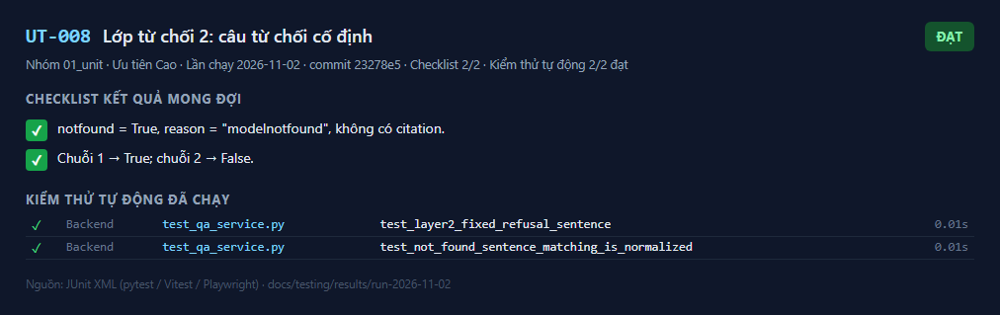
_Kết quả UT-008 — lần chạy 2026-11-02_

---

## UT-009

**Lớp từ chối 3: có nội dung nhưng không có nguồn hợp lệ** — ✅ **Đạt**

| Mục | Nội dung |
|---|---|
| Mục tiêu | Câu trả lời có nội dung mà không có citation, hoặc citation trỏ ngoài danh sách chunk → `not_found` |
| Truy vết | BR-012, AC-012, US-014, ADR-011, T2-04 |
| Ưu tiên / Loại | Cao / Âm |
| Tự động hóa | `test_qa_service.py::test_layer3_content_without_citation`, `test_layer3_citation_index_out_of_range_is_invalid`, `test_answer_with_content_always_has_citation` |
| Đặc tả | [UT-009.md](../../test_cases/01_unit/UT-009.md) |

**Checklist kết quả mong đợi**

- [x] `not_found = True`, `reason = "no_valid_citation"`.
- [x] Bất biến: mọi kết quả hoặc `not_found`, hoặc có ≥ 1 citation.

**Kiểm thử tự động đã chạy** (3/3 đạt)

| | Tầng | Tệp | Kiểm thử | Thời gian |
|---|---|---|---|---|
| ✅ | Backend | `test_qa_service.py` | test_layer3_content_without_citation | 0.01 s |
| ✅ | Backend | `test_qa_service.py` | test_layer3_citation_index_out_of_range_is_invalid | 0.00 s |
| ✅ | Backend | `test_qa_service.py` | test_answer_with_content_always_has_citation | 0.01 s |

**Ảnh kết quả**

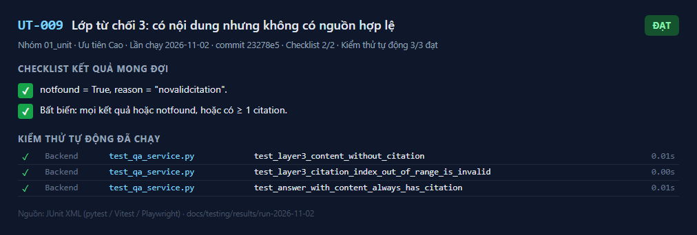
_Kết quả UT-009 — lần chạy 2026-11-02_

---

## UT-010

**Ánh xạ và gộp citation** — ✅ **Đạt**

| Mục | Nội dung |
|---|---|
| Mục tiêu | Citation ánh xạ đúng tài liệu và trang; bỏ chỉ số sai; gộp trùng (cùng tài liệu, cùng trang); giữ thứ tự xuất hiện |
| Truy vết | BR-012, BR-019, US-014, T2-04 |
| Ưu tiên / Loại | Cao / Dương |
| Tự động hóa | `test_qa_service.py::test_map_citations_dedupes_and_keeps_order`, `test_answer_with_citation` |
| Đặc tả | [UT-010.md](../../test_cases/01_unit/UT-010.md) |

**Checklist kết quả mong đợi**

- [x] Kết quả: [(BaoGia_B.pdf, 2), (HopDong_A.pdf, 5)].
- [x] `cited_text` của HopDong_A.pdf tr.5 là "thời hạn" (lần xuất hiện đầu).

**Kiểm thử tự động đã chạy** (2/2 đạt)

| | Tầng | Tệp | Kiểm thử | Thời gian |
|---|---|---|---|---|
| ✅ | Backend | `test_qa_service.py` | test_map_citations_dedupes_and_keeps_order | 0.00 s |
| ✅ | Backend | `test_qa_service.py` | test_answer_with_citation | 0.00 s |

**Ảnh kết quả**

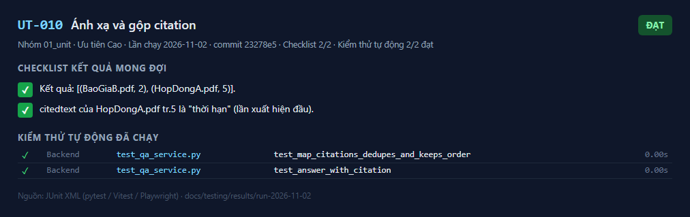
_Kết quả UT-010 — lần chạy 2026-11-02_

---

## UT-011

**Ghép câu hỏi trước vào truy vấn** — ✅ **Đạt**

| Mục | Nội dung |
|---|---|
| Mục tiêu | Truy vấn truy xuất = câu hỏi người dùng ở lượt trước + câu hỏi hiện tại; không có lịch sử thì giữ nguyên |
| Truy vết | BR-008, AC-008, US-010, T3-05 |
| Ưu tiên / Loại | Trung bình / Dương |
| Tự động hóa | `test_qa_service.py::test_retrieval_query_appends_previous_user_question` |
| Đặc tả | [UT-011.md](../../test_cases/01_unit/UT-011.md) |

**Checklist kết quả mong đợi**

- [x] Kết quả 1: "Hợp đồng A có điều khoản phạt không?\nMức phạt là bao nhiêu?".
- [x] Kết quả 2: "Câu đầu".

**Kiểm thử tự động đã chạy** (1/1 đạt)

| | Tầng | Tệp | Kiểm thử | Thời gian |
|---|---|---|---|---|
| ✅ | Backend | `test_qa_service.py` | test_retrieval_query_appends_previous_user_question | 0.00 s |

**Ảnh kết quả**

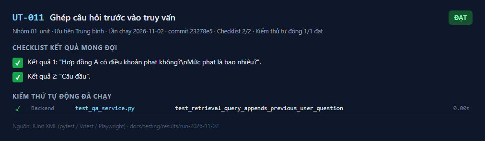
_Kết quả UT-011 — lần chạy 2026-11-02_

---

## UT-012

**Adapter Claude: ánh xạ citation** — ✅ **Đạt**

| Mục | Nội dung |
|---|---|
| Mục tiêu | Phản hồi nhiều khối (thinking, text không citation, text có citation) được đọc đúng; citation mang đúng `document_index` |
| Truy vết | BR-012, T2-03 |
| Ưu tiên / Loại | Cao / Dương |
| Tự động hóa | `test_claude_adapter.py::test_citations_map_to_chunk_index` |
| Đặc tả | [UT-012.md](../../test_cases/01_unit/UT-012.md) |

**Checklist kết quả mong đợi**

- [x] `text` = "Theo hợp đồng, thời hạn là 30 ngày và giá 12 triệu."
- [x] `citations` = [(0, "30 ngày"), (1, "12 triệu")], `refused = False`.

**Kiểm thử tự động đã chạy** (1/1 đạt)

| | Tầng | Tệp | Kiểm thử | Thời gian |
|---|---|---|---|---|
| ✅ | Backend | `test_claude_adapter.py` | test_citations_map_to_chunk_index | 0.00 s |

**Ảnh kết quả**

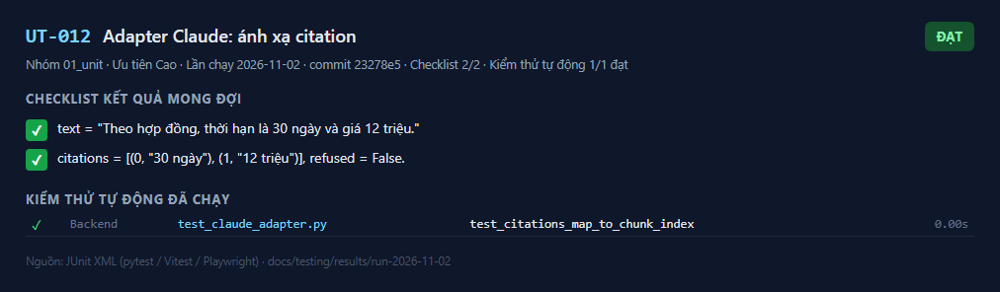
_Kết quả UT-012 — lần chạy 2026-11-02_

---

## UT-013

**Adapter Claude: từ chối và cắt cụt** — ✅ **Đạt**

| Mục | Nội dung |
|---|---|
| Mục tiêu | `stop_reason` được đọc **trước** nội dung: `refusal` → `refused`; `max_tokens` → lỗi |
| Truy vết | implement_plan 6.4, T2-03 |
| Ưu tiên / Loại | Cao / Âm |
| Tự động hóa | `test_claude_adapter.py::test_refusal_is_reported_before_reading_content`, `test_max_tokens_is_an_error` |
| Đặc tả | [UT-013.md](../../test_cases/01_unit/UT-013.md) |

**Checklist kết quả mong đợi**

- [x] `refusal`: `refused = True`, `text = ""`, không citation.
- [x] `max_tokens`: ném `AnswerGenerationError`.

**Kiểm thử tự động đã chạy** (2/2 đạt)

| | Tầng | Tệp | Kiểm thử | Thời gian |
|---|---|---|---|---|
| ✅ | Backend | `test_claude_adapter.py` | test_refusal_is_reported_before_reading_content | 0.00 s |
| ✅ | Backend | `test_claude_adapter.py` | test_max_tokens_is_an_error | 0.00 s |

**Ảnh kết quả**

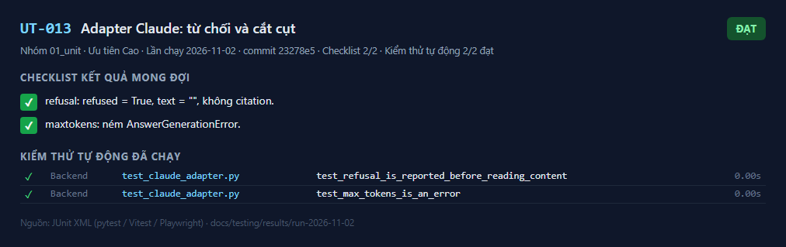
_Kết quả UT-013 — lần chạy 2026-11-02_

---

## UT-014

**Adapter Claude: hình dạng yêu cầu** — ✅ **Đạt**

| Mục | Nội dung |
|---|---|
| Mục tiêu | Yêu cầu gửi Claude đúng đặc tả: mô hình, `output_config.effort`, không `thinking`, không prefill, không `output_config.format`, chỉ dẫn hệ thống có `cache_control`, khối `document` bật citation, beta fallback |
| Truy vết | implement_plan 6.4, T2-03 |
| Ưu tiên / Loại | Cao / Dương |
| Tự động hóa | `test_claude_adapter.py::test_request_shape`, `test_documents_have_title_and_citations_enabled` |
| Đặc tả | [UT-014.md](../../test_cases/01_unit/UT-014.md) |

**Checklist kết quả mong đợi**

- [x] `model = "claude-opus-5-5"`, `output_config = {"effort": "medium"}`, `betas = ["server-side-fallback-2026-07-01"]`, `fallbacks = "default"`.
- [x] Không có khóa `thinking`; `output_config` không có `format`; tin nhắn cuối có `role = "user"`.
- [x] `system[0]` có `cache_control = {"type": "ephemeral"}`.
- [x] Nội dung tin nhắn cuối: 2 khối `document` (tiêu đề "HopDong_A.pdf — trang 5", `citations.enabled = true`) rồi 1 khối `text`.

**Kiểm thử tự động đã chạy** (2/2 đạt)

| | Tầng | Tệp | Kiểm thử | Thời gian |
|---|---|---|---|---|
| ✅ | Backend | `test_claude_adapter.py` | test_request_shape | 0.00 s |
| ✅ | Backend | `test_claude_adapter.py` | test_documents_have_title_and_citations_enabled | 0.00 s |

**Ảnh kết quả**

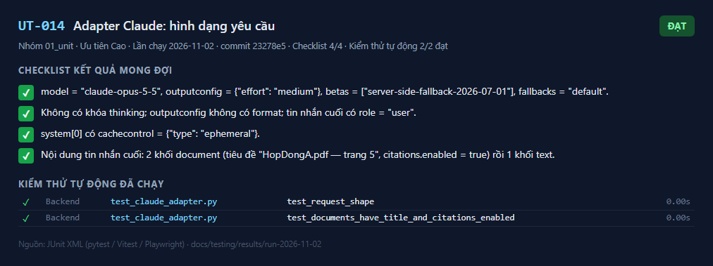
_Kết quả UT-014 — lần chạy 2026-11-02_

---

## UT-015

**Adapter OIDC: kiểm tra ID token** — ✅ **Đạt**

| Mục | Nội dung |
|---|---|
| Mục tiêu | URL ủy quyền dùng PKCE; đổi mã gửi `code_verifier`; ID token sai nonce, aud, iss hoặc hết hạn bị từ chối |
| Truy vết | BR-014, T1-03 |
| Ưu tiên / Loại | Cao / Dương, âm |
| Tự động hóa | `test_oidc_adapter.py::test_authorization_url_uses_pkce`, `test_exchange_returns_identity_and_sends_verifier`, `test_exchange_rejects_invalid_token` |
| Đặc tả | [UT-015.md](../../test_cases/01_unit/UT-015.md) |

**Checklist kết quả mong đợi**

- [x] URL có `code_challenge=challenge`, `code_challenge_method=S256`, `state`, `nonce`.
- [x] Claims hợp lệ → `subject = "user-123"`, email đúng; token endpoint nhận `code_verifier = verifier-1`.
- [x] Mỗi biến thể sai → `OidcError`.

**Kiểm thử tự động đã chạy** (6/6 đạt)

| | Tầng | Tệp | Kiểm thử | Thời gian |
|---|---|---|---|---|
| ✅ | Backend | `test_oidc_adapter.py` | test_authorization_url_uses_pkce | 0.09 s |
| ✅ | Backend | `test_oidc_adapter.py` | test_exchange_returns_identity_and_sends_verifier | 0.04 s |
| ✅ | Backend | `test_oidc_adapter.py` | test_exchange_rejects_invalid_token[override0] | 0.04 s |
| ✅ | Backend | `test_oidc_adapter.py` | test_exchange_rejects_invalid_token[override1] | 0.05 s |
| ✅ | Backend | `test_oidc_adapter.py` | test_exchange_rejects_invalid_token[override2] | 0.04 s |
| ✅ | Backend | `test_oidc_adapter.py` | test_exchange_rejects_invalid_token[override3] | 0.04 s |

**Ảnh kết quả**

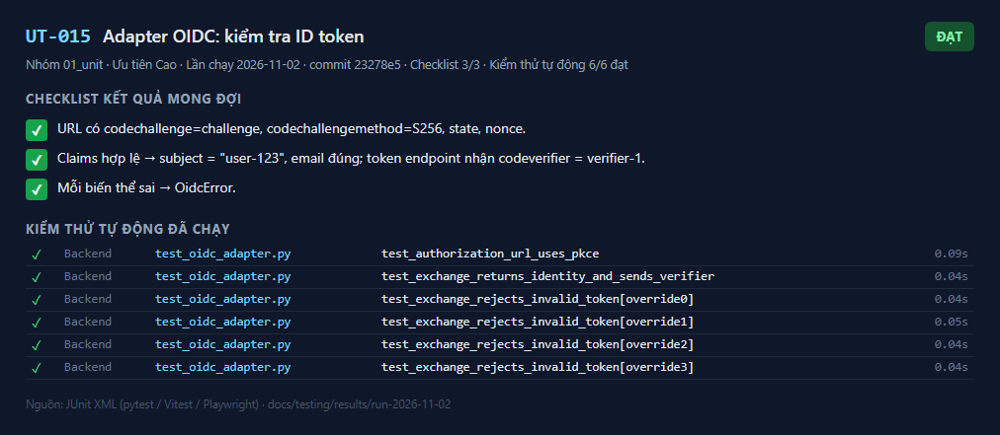
_Kết quả UT-015 — lần chạy 2026-11-02_

---

## UT-016

**Định dạng lỗi chung, không lộ chi tiết kỹ thuật** — ✅ **Đạt**

| Mục | Nội dung |
|---|---|
| Mục tiêu | Lỗi chưa xử lý trả 500 dạng `{"error": {"code", "message"}}`, không có stack trace; 404 và lỗi xác thực dữ liệu cùng định dạng; lỗi xác thực không lặp lại dữ liệu đầu vào |
| Truy vết | implement_plan mục 4, T0-04 |
| Ưu tiên / Loại | Cao / Lỗi |
| Tự động hóa | `test_framework.py::test_unhandled_error_has_standard_format_without_stack_trace`, `test_not_found_uses_error_format`, `test_validation_error_does_not_echo_input` |
| Đặc tả | [UT-016.md](../../test_cases/01_unit/UT-016.md) |

**Checklist kết quả mong đợi**

- [x] 500, `error.code = "internal_error"`; thân không chứa "Traceback", "secret.py", "RuntimeError".
- [x] 404, `error.code = "not_found"`.
- [x] 400, `error.code = "invalid_input"`; thân không chứa "BI-MAT-XYZ".

**Kiểm thử tự động đã chạy** (3/3 đạt)

| | Tầng | Tệp | Kiểm thử | Thời gian |
|---|---|---|---|---|
| ✅ | Backend | `test_framework.py` | test_unhandled_error_has_standard_format_without_stack_trace | 0.12 s |
| ✅ | Backend | `test_framework.py` | test_not_found_uses_error_format | 0.14 s |
| ✅ | Backend | `test_framework.py` | test_validation_error_does_not_echo_input | 0.24 s |

**Ảnh kết quả**

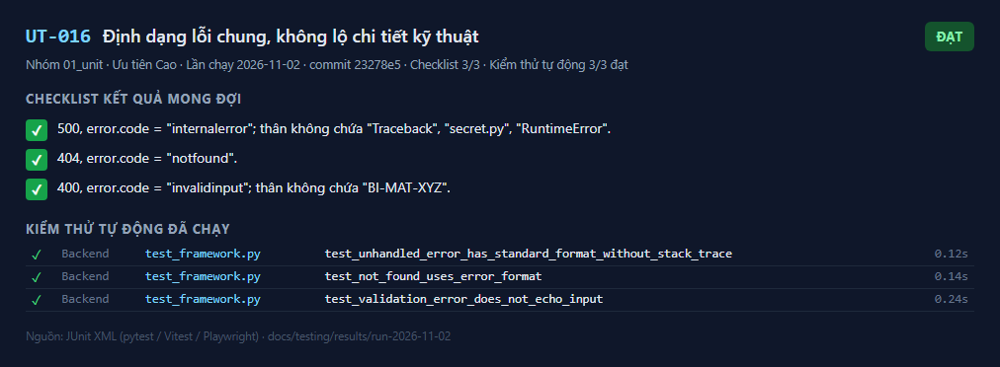
_Kết quả UT-016 — lần chạy 2026-11-02_

---

## UT-017

**Log không chứa nội dung câu hỏi** — ✅ **Đạt**

| Mục | Nội dung |
|---|---|
| Mục tiêu | Log của một yêu cầu có trường `question` không chứa giá trị đó; log truy cập vẫn được ghi; bộ lọc xóa trường nội dung ở mọi độ sâu |
| Truy vết | NFR-LOG, ADR-009, T0-04 |
| Ưu tiên / Loại | Cao / Bảo mật |
| Tự động hóa | `test_framework.py::test_request_log_does_not_contain_question_value`, `test_redact_processor_strips_nested_content_keys` |
| Đặc tả | [UT-017.md](../../test_cases/01_unit/UT-017.md) |

**Checklist kết quả mong đợi**

- [x] Chuỗi canary không có trong log; sự kiện `received` có `size` nhưng không có khóa `question`; có dòng `http_request` với `route = "/echo"`.
- [x] Sự kiện lồng chỉ còn `{"event", "meta": {"ok", "items": [{"n"}]}}`.

**Kiểm thử tự động đã chạy** (2/2 đạt)

| | Tầng | Tệp | Kiểm thử | Thời gian |
|---|---|---|---|---|
| ✅ | Backend | `test_framework.py` | test_request_log_does_not_contain_question_value | 0.10 s |
| ✅ | Backend | `test_framework.py` | test_redact_processor_strips_nested_content_keys | 0.00 s |

**Ảnh kết quả**

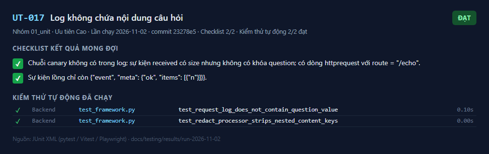
_Kết quả UT-017 — lần chạy 2026-11-02_

---

## UT-018

**Tiến trình API nạp đủ model** — ✅ **Đạt**

| Mục | Nội dung |
|---|---|
| Mục tiêu | Chỉ import `app.main` (như tiến trình API thật) vẫn phân giải được mọi khóa ngoại giữa các bảng |
| Truy vết | TR-05 (lỗi hồi quy: lưu tin nhắn thất bại do thiếu model `Chunk`) |
| Ưu tiên / Loại | Cao / Hồi quy |
| Tự động hóa | `test_smoke.py::test_api_process_loads_every_model` |
| Đặc tả | [UT-018.md](../../test_cases/01_unit/UT-018.md) |

**Checklist kết quả mong đợi**

- [x] Mã thoát 0, không có `NoReferencedTableError`.

**Kiểm thử tự động đã chạy** (1/1 đạt)

| | Tầng | Tệp | Kiểm thử | Thời gian |
|---|---|---|---|---|
| ✅ | Backend | `test_smoke.py` | test_api_process_loads_every_model | 10.94 s |

**Ảnh kết quả**

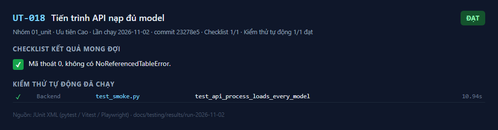
_Kết quả UT-018 — lần chạy 2026-11-02_

---

## UT-019

**Mọi ngưỡng là trường cấu hình** — ✅ **Đạt**

| Mục | Nội dung |
|---|---|
| Mục tiêu | Mọi ngưỡng ở implement_plan.md mục 10.3 là trường của `Settings` (không viết cứng) |
| Truy vết | NFR-CFG, DoD mục 4 |
| Ưu tiên / Loại | Cao / Kiểm tra tĩnh |
| Tự động hóa | `test_framework.py::test_every_threshold_is_configurable` |
| Đặc tả | [UT-019.md](../../test_cases/01_unit/UT-019.md) |

**Checklist kết quả mong đợi**

- [x] Mọi tên đều có trong `Settings`.

**Kiểm thử tự động đã chạy** (1/1 đạt)

| | Tầng | Tệp | Kiểm thử | Thời gian |
|---|---|---|---|---|
| ✅ | Backend | `test_framework.py` | test_every_threshold_is_configurable | 0.00 s |

**Ảnh kết quả**

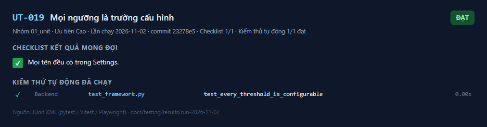
_Kết quả UT-019 — lần chạy 2026-11-02_

---

## UT-020

**Bảng thông báo lỗi tải lên** — ✅ **Đạt**

| Mục | Nội dung |
|---|---|
| Mục tiêu | Mỗi mã lỗi có đúng một câu tiếng Việt kèm cách khắc phục; mã lạ trả câu chung, không lộ mã |
| Truy vết | BR-018, AC-018, US-004, T1-19 |
| Ưu tiên / Loại | Trung bình / Dương, âm |
| Tự động hóa | `frontend/src/features/documents/failureMessages.test.ts` |
| Đặc tả | [UT-020.md](../../test_cases/01_unit/UT-020.md) |

**Checklist kết quả mong đợi**

- [x] Mã đã biết: câu dài > 10 ký tự, khác câu chung, không chứa mã; các câu khác nhau từng đôi.
- [x] `encrypted` → "Tài liệu bị khóa hoặc mã hóa. Hãy mở khóa rồi tải lại."
- [x] Mã lạ → câu chung `GENERIC_FAILURE`.

**Kiểm thử tự động đã chạy** (16/16 đạt)

| | Tầng | Tệp | Kiểm thử | Thời gian |
|---|---|---|---|---|
| ✅ | Frontend | `failureMessages.test.ts` | failureMessage > có câu cho mọi mã bắt buộc | 0.02 s |
| ✅ | Frontend | `failureMessages.test.ts` | failureMessage > corrupted → một câu tiếng Việt không rỗng, khác câu chung, không chứa mã | 0.01 s |
| ✅ | Frontend | `failureMessages.test.ts` | failureMessage > encrypted → một câu tiếng Việt không rỗng, khác câu chung, không chứa mã | 0.00 s |
| ✅ | Frontend | `failureMessages.test.ts` | failureMessage > not_pdf → một câu tiếng Việt không rỗng, khác câu chung, không chứa mã | 0.00 s |
| ✅ | Frontend | `failureMessages.test.ts` | failureMessage > too_large → một câu tiếng Việt không rỗng, khác câu chung, không chứa mã | 0.00 s |
| ✅ | Frontend | `failureMessages.test.ts` | failureMessage > no_text → một câu tiếng Việt không rỗng, khác câu chung, không chứa mã | 0.01 s |
| ✅ | Frontend | `failureMessages.test.ts` | failureMessage > network → một câu tiếng Việt không rỗng, khác câu chung, không chứa mã | 0.00 s |
| ✅ | Frontend | `failureMessages.test.ts` | failureMessage > internal → một câu tiếng Việt không rỗng, khác câu chung, không chứa mã | 0.00 s |
| ✅ | Frontend | `failureMessages.test.ts` | failureMessage > câu mẫu cho tài liệu mã hóa | 0.00 s |
| ✅ | Frontend | `failureMessages.test.ts` | failureMessage > các mã khác nhau cho câu khác nhau | 0.00 s |
| ✅ | Frontend | `failureMessages.test.ts` | failureMessage > mã lạ virus_detected → câu chung | 0.00 s |
| ✅ | Frontend | `failureMessages.test.ts` | failureMessage > mã lạ  → câu chung | 0.00 s |
| ✅ | Frontend | `failureMessages.test.ts` | failureMessage > mã lạ null → câu chung | 0.00 s |
| ✅ | Frontend | `failureMessages.test.ts` | failureMessage > mã lạ undefined → câu chung | 0.00 s |
| ✅ | Frontend | `failureMessages.test.ts` | failureMessage > mã lạ __proto__ → câu chung | 0.00 s |
| ✅ | Frontend | `failureMessages.test.ts` | failureMessage > mã lạ toString → câu chung | 0.00 s |

**Ảnh kết quả**

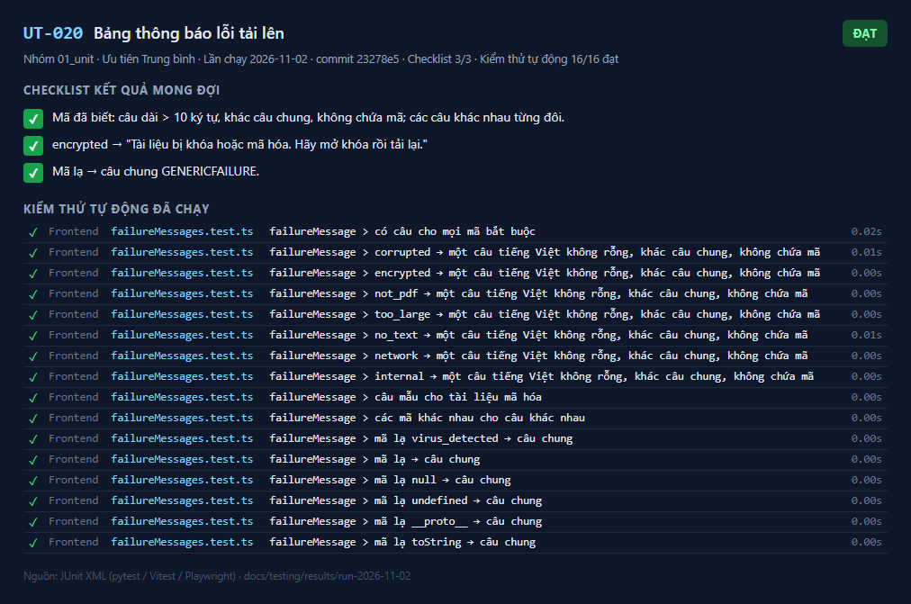
_Kết quả UT-020 — lần chạy 2026-11-02_

---

## UT-021

**Tô sáng đoạn trích trong trang nguồn** — ✅ **Đạt**

| Mục | Nội dung |
|---|---|
| Mục tiêu | Tìm `cited_text` trong văn bản trang, khớp linh hoạt khoảng trắng/xuống dòng, xử lý ký tự đặc biệt; không thấy thì không tô sáng |
| Truy vết | BR-019, US-015, T2-09 |
| Ưu tiên / Loại | Trung bình / Dương, âm |
| Tự động hóa | `frontend/src/features/sources/sources.test.tsx` (khối `findHighlight`) |
| Đặc tả | [UT-021.md](../../test_cases/01_unit/UT-021.md) |

**Checklist kết quả mong đợi**

- [x] Khớp "Đợt một được thanh\ntoán trong 30 ngày"; phần trước = "5.1 Mở đầu.\n".
- [x] Không có trong trang / rỗng → `null`.
- [x] Ký tự ngoặc được thoát đúng, khớp "(đã gồm VAT)".

**Kiểm thử tự động đã chạy** (6/6 đạt)

| | Tầng | Tệp | Kiểm thử | Thời gian |
|---|---|---|---|---|
| ✅ | Frontend | `sources.test.tsx` | findHighlight > khớp linh hoạt khoảng trắng và ngắt dòng | 0.01 s |
| ✅ | Frontend | `sources.test.tsx` | findHighlight > không tìm thấy hoặc rỗng → không tô sáng | 0.00 s |
| ✅ | Frontend | `sources.test.tsx` | S-03 Trình xem nguồn > s03-default: "Trang N / M", tô sáng đoạn trích, cột nguồn, không vi phạm axe | 2.54 s |
| ✅ | Frontend | `sources.test.tsx` | S-03 Trình xem nguồn > đoạn trích không có trong trang: hiển thị trang, không tô sáng, không báo lỗi | 0.22 s |
| ✅ | Frontend | `sources.test.tsx` | S-03 Trình xem nguồn > chuyển trang không tải lại toàn bộ ứng dụng | 0.77 s |
| ✅ | Frontend | `sources.test.tsx` | S-03 Trình xem nguồn > s03-deleted: tài liệu đã bị xóa khi API trả 404 | 0.35 s |

**Ảnh kết quả**

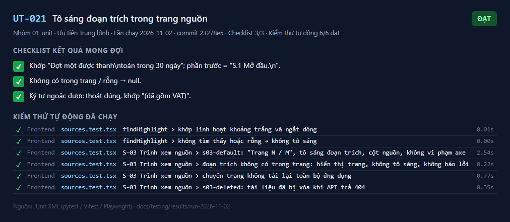
_Kết quả UT-021 — lần chạy 2026-11-02_

---

## UT-022

**Công thức chỉ số của bộ đánh giá** — ✅ **Đạt**

| Mục | Nội dung |
|---|---|
| Mục tiêu | MET-002, tỷ lệ bịa, độ phủ nguồn, đúng trang, phân vị độ trễ, câu có nội dung có nguồn, chấm theo độ phủ từ, kiểm tra dữ liệu đầu vào tính đúng |
| Truy vết | BR-013, AC-013, US-016, T0-09 |
| Ưu tiên / Loại | Cao / Dương |
| Tự động hóa | `evaluation/tests/test_run_eval.py` (12 kiểm thử) |
| Đặc tả | [UT-022.md](../../test_cases/01_unit/UT-022.md) |

**Checklist kết quả mong đợi**

- [x] MET-002 = 0,25; đúng không xét nguồn = 0,5; tỷ lệ bịa = 0,25; độ phủ nguồn = 0,5; đúng trang = 0,5 trên 2 citation kiểm tra được; p50 = 300, p90 = 460, max = 500.
- [x] Bộ gọi giả: mọi chỉ số đạt 100% (tỷ lệ bịa 0%); có tệp `.json`, `.md`, `-review.csv`.
- [x] Dữ liệu sai ném `ValueError`.

**Kiểm thử tự động đã chạy** (12/12 đạt)

| | Tầng | Tệp | Kiểm thử | Thời gian |
|---|---|---|---|---|
| ✅ | Bộ đánh giá | `test_run_eval.py` | test_correct_with_source_requires_both | 0.00 s |
| ✅ | Bộ đánh giá | `test_run_eval.py` | test_hallucination_rate | 0.01 s |
| ✅ | Bộ đánh giá | `test_run_eval.py` | test_source_coverage_needs_all_expected_documents | 0.00 s |
| ✅ | Bộ đánh giá | `test_run_eval.py` | test_correct_page_counts_only_checked_citations | 0.01 s |
| ✅ | Bộ đánh giá | `test_run_eval.py` | test_latency_percentiles | 0.00 s |
| ✅ | Bộ đánh giá | `test_run_eval.py` | test_errors_count_and_are_excluded_from_latency | 0.01 s |
| ✅ | Bộ đánh giá | `test_run_eval.py` | test_answers_with_content_must_have_source | 0.01 s |
| ✅ | Bộ đánh giá | `test_run_eval.py` | test_grader_by_answer_overlap_when_no_keywords | 0.00 s |
| ✅ | Bộ đánh giá | `test_run_eval.py` | test_empty_categories_give_none | 0.01 s |
| ✅ | Bộ đánh giá | `test_run_eval.py` | test_dataset_validation | 0.07 s |
| ✅ | Bộ đánh giá | `test_run_eval.py` | test_end_to_end_with_fake_asker | 0.10 s |
| ✅ | Bộ đánh giá | `test_run_eval.py` | test_fake_asker_wrong_answers_lower_metrics | 0.05 s |

**Ảnh kết quả**

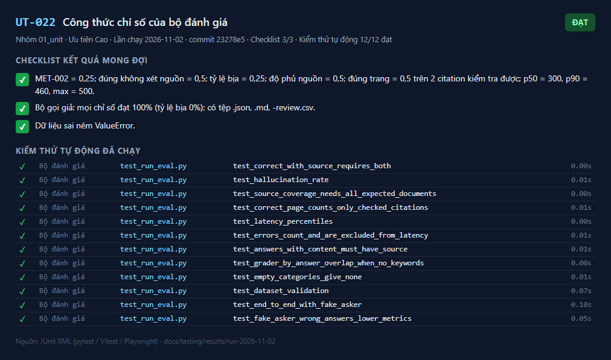
_Kết quả UT-022 — lần chạy 2026-11-02_

---
