# 02 — Ca kiểm thử tích hợp API (INT-API-001..INT-API-040) — kết quả chi tiết

Lần chạy: [README](README.md) · Đặc tả: [02_integration_api](../../test_cases/02_integration_api/README.md)

| Mã | Tên | Ưu tiên | Kết quả | Kiểm thử tự động đạt | Ảnh |
|---|---|---|---|---|---|
| [INT-API-001](#int-api-001) | Đăng nhập thành công | Cao | ✅ Đạt | 1/1 | 1 |
| [INT-API-002](#int-api-002) | Sai thông tin đăng nhập không tiết lộ tài khoản | Cao | ✅ Đạt | 3/3 | 1 |
| [INT-API-003](#int-api-003) | Đăng nhập đúng nhưng chưa được cấp quyền | Cao | ✅ Đạt | 1/1 | 1 |
| [INT-API-004](#int-api-004) | Bảo vệ CSRF theo Origin | Cao | ✅ Đạt | 1/1 | 1 |
| [INT-API-005](#int-api-005) | Phiên hết hạn | Cao | ✅ Đạt | 2/2 | 1 |
| [INT-API-006](#int-api-006) | Người bị thu hồi mất truy cập ngay | Cao | ✅ Đạt | 1/1 | 1 |
| [INT-API-007](#int-api-007) | Tải nhiều tệp, mỗi tệp xét độc lập | Cao | ✅ Đạt | 1/1 | 1 |
| [INT-API-008](#int-api-008) | Giới hạn số tài liệu mỗi người | Trung bình | ✅ Đạt | 1/1 | 1 |
| [INT-API-009](#int-api-009) | Nạp PDF hợp lệ tới trạng thái sẵn sàng | Cao | ✅ Đạt | 3/3 | 1 |
| [INT-API-010](#int-api-010) | Lý do lỗi do worker xác định | Cao | ✅ Đạt | 3/3 | 1 |
| [INT-API-011](#int-api-011) | Lỗi tạm thời được thử lại rồi chuyển failed | Cao | ✅ Đạt | 4/4 | 1 |
| [INT-API-012](#int-api-012) | Tài liệu bị xóa trong lúc đang nạp | Cao | ✅ Đạt | 1/1 | 1 |
| [INT-API-013](#int-api-013) | Nhiều worker không lấy trùng việc | Cao | ✅ Đạt | 2/2 | 1 |
| [INT-API-014](#int-api-014) | Thử lại tài liệu lỗi | Trung bình | ✅ Đạt | 1/1 | 1 |
| [INT-API-015](#int-api-015) | Truy xuất không bao giờ trả tài liệu ngoài phạm vi | Cao | ✅ Đạt | 2/2 | 1 |
| [INT-API-016](#int-api-016) | Chỉ truy xuất tài liệu sẵn sàng | Cao | ✅ Đạt | 4/4 | 1 |
| [INT-API-017](#int-api-017) | Đủ TOP_K khi danh sách được phép nhỏ trong kho lớn | Trung bình | ✅ Đạt | 1/1 | 1 |
| [INT-API-018](#int-api-018) | Giới hạn số chunk mỗi tài liệu | Trung bình | ✅ Đạt | 2/2 | 1 |
| [INT-API-019](#int-api-019) | Câu trả lời có nguồn đúng tài liệu và trang | Cao | ✅ Đạt | 1/1 | 1 |
| [INT-API-020](#int-api-020) | Câu ngoài phạm vi không gọi mô hình | Cao | ✅ Đạt | 4/4 | 1 |
| [INT-API-021](#int-api-021) | Kiểm tra độ dài câu hỏi | Trung bình | ✅ Đạt | 2/2 | 1 |
| [INT-API-022](#int-api-022) | Dịch vụ AI từ chối hoặc quá thời gian | Cao | ✅ Đạt | 3/3 | 1 |
| [INT-API-023](#int-api-023) | Mỗi câu hỏi đúng một bản ghi kiểm toán, không nội dung | Cao | ✅ Đạt | 2/2 | 1 |
| [INT-API-024](#int-api-024) | Lỗi commit không bị nuốt | Cao | ✅ Đạt | 1/1 | 1 |
| [INT-API-025](#int-api-025) | Lịch sử hội thoại và câu hỏi tiếp theo | Trung bình | ✅ Đạt | 3/3 | 1 |
| [INT-API-026](#int-api-026) | Trang nguồn: trang không hợp lệ và quyền | Cao | ✅ Đạt | 1/1 | 1 |
| [INT-API-027](#int-api-027) | Tải tệp gốc qua backend | Trung bình | ✅ Đạt | 1/1 | 1 |
| [INT-API-028](#int-api-028) | Xóa loại tài liệu khỏi truy vấn ngay lập tức | Cao | ✅ Đạt | 1/1 | 1 |
| [INT-API-029](#int-api-029) | Xóa vĩnh viễn | Cao | ✅ Đạt | 1/1 | 1 |
| [INT-API-030](#int-api-030) | Xóa vĩnh viễn chịu lỗi và làm lại được | Cao | ✅ Đạt | 3/3 | 1 |
| [INT-API-031](#int-api-031) | Quyền xóa tài liệu | Cao | ✅ Đạt | 1/1 | 1 |
| [INT-API-032](#int-api-032) | Đánh giá câu trả lời | Thấp | ✅ Đạt | 1/1 | 1 |
| [INT-API-033](#int-api-033) | Bản ghi kiểm toán: lọc và phân trang | Trung bình | ✅ Đạt | 2/2 | 1 |
| [INT-API-034](#int-api-034) | Báo cáo sử dụng theo tuần | Trung bình | ✅ Đạt | 2/2 | 1 |
| [INT-API-035](#int-api-035) | Quản lý quyền truy cập | Cao | ✅ Đạt | 4/4 | 1 |
| [INT-API-036](#int-api-036) | Health báo lỗi khi thành phần dừng | Trung bình | ✅ Đạt | 4/4 | 1 |
| [INT-API-037](#int-api-037) | Đăng nhập OIDC | Cao | ✅ Đạt | 4/4 | 1 |
| [INT-API-038](#int-api-038) | Lệnh tạo quản trị viên đầu tiên | Trung bình | ✅ Đạt | 1/1 | 1 |
| [INT-API-039](#int-api-039) | Migration và ràng buộc lược đồ | Cao | ✅ Đạt | 8/8 | 1 |
| [INT-API-040](#int-api-040) | Dọn dữ liệu định kỳ theo thời hạn lưu | Trung bình | ✅ Đạt | 3/3 | 1 |

## INT-API-001

**Đăng nhập thành công** — ✅ **Đạt**

| Mục | Nội dung |
|---|---|
| Mục tiêu | Đăng nhập đúng trả thông tin người dùng, vai trò, cấu hình giao diện và cookie phiên an toàn |
| Truy vết | BR-014, AC-014, US-017, T1-04 |
| Ưu tiên / Loại | Cao / Dương |
| Tự động hóa | `test_auth.py::test_login_me_logout` |
| Đặc tả | [INT-API-001.md](../../test_cases/02_integration_api/INT-API-001.md) |

**Checklist kết quả mong đợi**

- [x] Bước 1: 200, `role = "bd"`; header `Set-Cookie` có `HttpOnly` và `SameSite=Lax` (và `Secure` khi `COOKIE_SECURE=true`).
- [x] Bước 2: 200, `user.login = "an"`, `config.max_question_chars` > 0.
- [x] Bước 3: 204; sau đó 401.

**Kiểm thử tự động đã chạy** (1/1 đạt)

| | Tầng | Tệp | Kiểm thử | Thời gian |
|---|---|---|---|---|
| ✅ | Backend | `test_auth.py` | test_login_me_logout | 5.82 s |

**Ảnh kết quả**

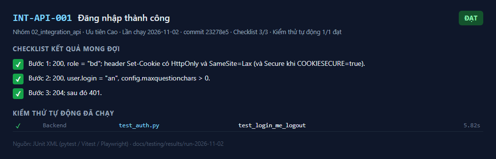
_Kết quả INT-API-001 — lần chạy 2026-11-02_

---

## INT-API-002

**Sai thông tin đăng nhập không tiết lộ tài khoản** — ✅ **Đạt**

| Mục | Nội dung |
|---|---|
| Mục tiêu | Sai mật khẩu và tài khoản không tồn tại cho cùng phản hồi; mật khẩu băm Argon2id |
| Truy vết | BR-014, T1-02 |
| Ưu tiên / Loại | Cao / Âm, bảo mật |
| Tự động hóa | `test_auth.py::test_login_wrong_password_is_generic`, `test_local_identity_right_and_wrong_password`, `test_password_hash_is_argon2id` |
| Đặc tả | [INT-API-002.md](../../test_cases/02_integration_api/INT-API-002.md) |

**Checklist kết quả mong đợi**

- [x] Bước 1 và 2: cùng 401, cùng thân `{"error": {"code": "invalid_credentials", ...}}`.
- [x] Bước 3: bắt đầu bằng `$argon2id$`, không chứa mật khẩu gốc.

**Kiểm thử tự động đã chạy** (3/3 đạt)

| | Tầng | Tệp | Kiểm thử | Thời gian |
|---|---|---|---|---|
| ✅ | Backend | `test_auth.py` | test_login_wrong_password_is_generic | 3.31 s |
| ✅ | Backend | `test_auth.py` | test_local_identity_right_and_wrong_password | 6.03 s |
| ✅ | Backend | `test_auth.py` | test_password_hash_is_argon2id | 1.02 s |

**Ảnh kết quả**

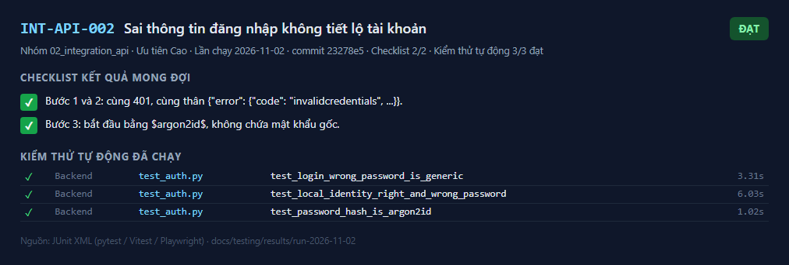
_Kết quả INT-API-002 — lần chạy 2026-11-02_

---

## INT-API-003

**Đăng nhập đúng nhưng chưa được cấp quyền** — ✅ **Đạt**

| Mục | Nội dung |
|---|---|
| Mục tiêu | Người chưa có `access_grants` đang hoạt động bị từ chối, không được cấp phiên |
| Truy vết | BR-014, AC-014, US-017, T1-04 |
| Ưu tiên / Loại | Cao / Âm |
| Tự động hóa | `test_auth.py::test_login_without_grant_is_no_access` |
| Đặc tả | [INT-API-003.md](../../test_cases/02_integration_api/INT-API-003.md) |

**Checklist kết quả mong đợi**

- [x] 403, `error.code = "no_access"`; không có header `Set-Cookie`.

**Kiểm thử tự động đã chạy** (1/1 đạt)

| | Tầng | Tệp | Kiểm thử | Thời gian |
|---|---|---|---|---|
| ✅ | Backend | `test_auth.py` | test_login_without_grant_is_no_access | 1.70 s |

**Ảnh kết quả**

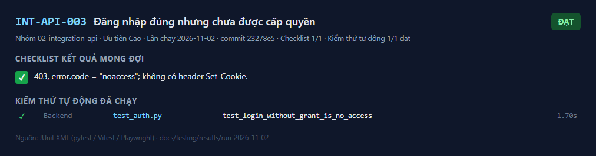
_Kết quả INT-API-003 — lần chạy 2026-11-02_

---

## INT-API-004

**Bảo vệ CSRF theo Origin** — ✅ **Đạt**

| Mục | Nội dung |
|---|---|
| Mục tiêu | Yêu cầu thay đổi dữ liệu không có `Origin` hợp lệ bị từ chối |
| Truy vết | implement_plan 10.5, T1-04 |
| Ưu tiên / Loại | Cao / Bảo mật |
| Tự động hóa | `test_auth.py::test_post_without_valid_origin_is_rejected` |
| Đặc tả | [INT-API-004.md](../../test_cases/02_integration_api/INT-API-004.md) |

**Checklist kết quả mong đợi**

- [x] Bước 1, 2: 403, `error.code = "csrf_rejected"`.
- [x] Bước 3: 200.

**Kiểm thử tự động đã chạy** (1/1 đạt)

| | Tầng | Tệp | Kiểm thử | Thời gian |
|---|---|---|---|---|
| ✅ | Backend | `test_auth.py` | test_post_without_valid_origin_is_rejected | 2.29 s |

**Ảnh kết quả**

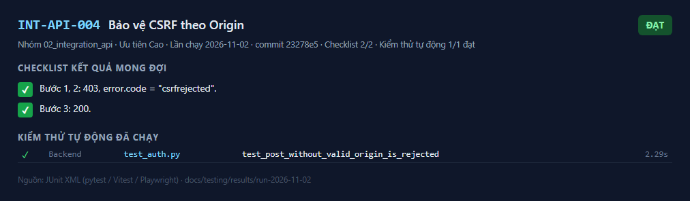
_Kết quả INT-API-004 — lần chạy 2026-11-02_

---

## INT-API-005

**Phiên hết hạn** — ✅ **Đạt**

| Mục | Nội dung |
|---|---|
| Mục tiêu | Phiên không hoạt động quá `SESSION_IDLE_HOURS` trả 401 `session_expired`; không có cookie trả `unauthenticated` |
| Truy vết | BR-014, US-017, T1-04 |
| Ưu tiên / Loại | Cao / Âm |
| Tự động hóa | `test_auth.py::test_expired_session_is_session_expired`, `test_no_session_is_401` |
| Đặc tả | [INT-API-005.md](../../test_cases/02_integration_api/INT-API-005.md) |

**Checklist kết quả mong đợi**

- [x] Bước 3: 401, `error.code = "session_expired"`.
- [x] Bước 4: 401, `error.code = "unauthenticated"`.

**Kiểm thử tự động đã chạy** (2/2 đạt)

| | Tầng | Tệp | Kiểm thử | Thời gian |
|---|---|---|---|---|
| ✅ | Backend | `test_auth.py` | test_expired_session_is_session_expired | 1.61 s |
| ✅ | Backend | `test_auth.py` | test_no_session_is_401 | 0.87 s |

**Ảnh kết quả**

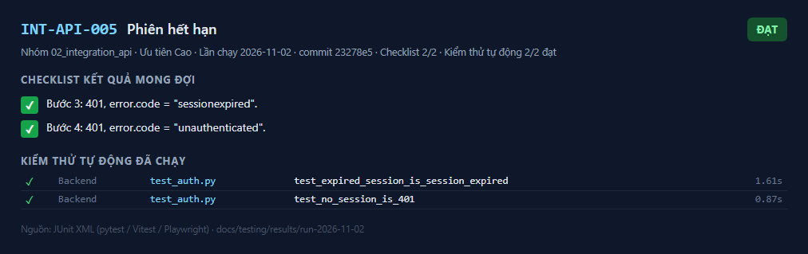
_Kết quả INT-API-005 — lần chạy 2026-11-02_

---

## INT-API-006

**Người bị thu hồi mất truy cập ngay** — ✅ **Đạt**

| Mục | Nội dung |
|---|---|
| Mục tiêu | Sau khi quản trị bảo mật thu hồi quyền, yêu cầu kế tiếp của người đó bị từ chối; đăng nhập lại cũng bị từ chối |
| Truy vết | BR-014, AC-014, LG-07, T1-04, T1-05 |
| Ưu tiên / Loại | Cao / Bảo mật |
| Tự động hóa | `test_auth.py::test_revoked_user_loses_access_on_next_request` |
| Đặc tả | [INT-API-006.md](../../test_cases/02_integration_api/INT-API-006.md) |

**Checklist kết quả mong đợi**

- [x] Bước 2: 204. Bước 3: 401 hoặc 403. Bước 4: 403 `no_access`.

**Kiểm thử tự động đã chạy** (1/1 đạt)

| | Tầng | Tệp | Kiểm thử | Thời gian |
|---|---|---|---|---|
| ✅ | Backend | `test_auth.py` | test_revoked_user_loses_access_on_next_request | 2.71 s |

**Ảnh kết quả**

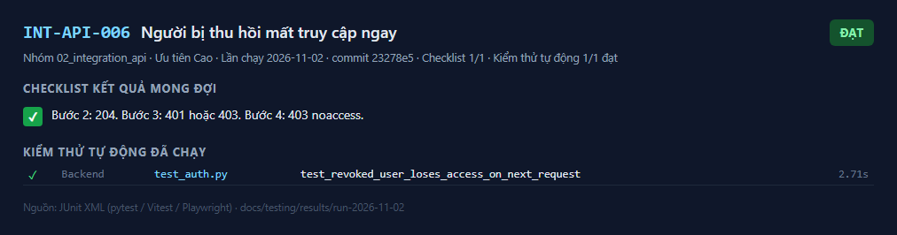
_Kết quả INT-API-006 — lần chạy 2026-11-02_

---

## INT-API-007

**Tải nhiều tệp, mỗi tệp xét độc lập** — ✅ **Đạt**

| Mục | Nội dung |
|---|---|
| Mục tiêu | Một yêu cầu gồm tệp hợp lệ, tệp không phải PDF và tệp quá lớn: mỗi tệp có kết quả riêng, tệp hợp lệ vẫn được nhận |
| Truy vết | BR-002, BR-003, AC-002, AC-003, US-002, US-003, T1-11 |
| Ưu tiên / Loại | Cao / Dương, âm, biên |
| Tự động hóa | `test_ingestion_flow.py::test_mixed_upload_each_file_judged_independently` |
| Đặc tả | [INT-API-007.md](../../test_cases/02_integration_api/INT-API-007.md) |

**Checklist kết quả mong đợi**

- [x] Bước 1: 200, kết quả theo thứ tự: (`hop-le.pdf`, `processing`, null), (`ghi-chu.pdf`, `failed`, `not_pdf`), (`qua-lon.pdf`, `failed`, `too_large`).
- [x] Bước 3: chỉ có `hop-le.pdf` ở trạng thái `ready`.

**Kiểm thử tự động đã chạy** (1/1 đạt)

| | Tầng | Tệp | Kiểm thử | Thời gian |
|---|---|---|---|---|
| ✅ | Backend | `test_ingestion_flow.py` | test_mixed_upload_each_file_judged_independently | 1.73 s |

**Ảnh kết quả**

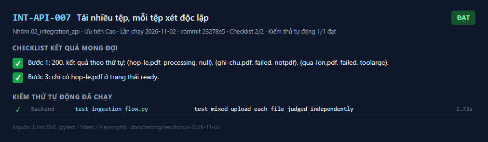
_Kết quả INT-API-007 — lần chạy 2026-11-02_

---

## INT-API-008

**Giới hạn số tài liệu mỗi người** — ✅ **Đạt**

| Mục | Nội dung |
|---|---|
| Mục tiêu | Tệp vượt `MAX_DOCS_PER_USER` bị từ chối với lý do riêng |
| Truy vết | BR-002, US-002, T1-11 |
| Ưu tiên / Loại | Trung bình / Biên |
| Tự động hóa | `test_ingestion_flow.py::test_max_docs_per_user` |
| Đặc tả | [INT-API-008.md](../../test_cases/02_integration_api/INT-API-008.md) |

**Checklist kết quả mong đợi**

- [x] `failure_reason` lần lượt: null, null, `too_many_documents`.

**Kiểm thử tự động đã chạy** (1/1 đạt)

| | Tầng | Tệp | Kiểm thử | Thời gian |
|---|---|---|---|---|
| ✅ | Backend | `test_ingestion_flow.py` | test_max_docs_per_user | 1.70 s |

**Ảnh kết quả**

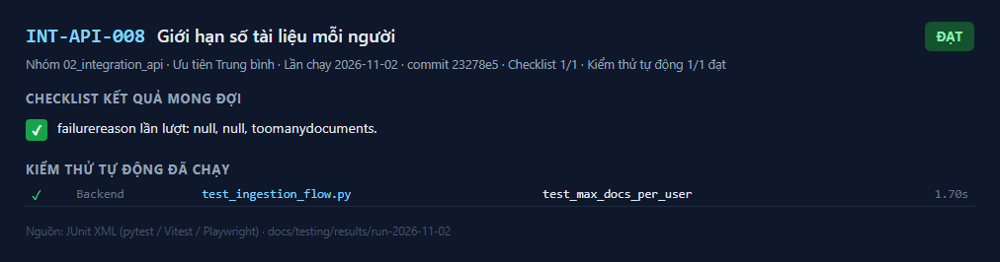
_Kết quả INT-API-008 — lần chạy 2026-11-02_

---

## INT-API-009

**Nạp PDF hợp lệ tới trạng thái sẵn sàng** — ✅ **Đạt**

| Mục | Nội dung |
|---|---|
| Mục tiêu | Worker trích xuất, cắt chunk, nhúng và ghi; tài liệu `ready` có chunk mang số trang và vector đúng số chiều; khóa lưu trữ đúng quy ước |
| Truy vết | BR-001, AC-001, US-001, T1-15, T1-20 |
| Ưu tiên / Loại | Cao / Dương |
| Tự động hóa | `test_ingestion_flow.py::test_valid_pdf_becomes_ready_with_paged_chunks`, `test_lifecycle_invariants`, `test_upload_events_have_no_content` |
| Đặc tả | [INT-API-009.md](../../test_cases/02_integration_api/INT-API-009.md) |

**Checklist kết quả mong đợi**

- [x] `status = "ready"`, `page_count = 3`.
- [x] Chunk có `page` ∈ {1, 2, 3}, mọi vector dài `EMBEDDING_DIM`.
- [x] `storage_key = documents/{owner_id}/{document_id}.pdf`.
- [x] Bất biến: mọi tài liệu `ready` có ≥ 1 chunk; mọi chunk có `page` trong 1..`page_count`.
- [x] Có sự kiện `document_upload_started` và `document_upload_succeeded`.

**Kiểm thử tự động đã chạy** (3/3 đạt)

| | Tầng | Tệp | Kiểm thử | Thời gian |
|---|---|---|---|---|
| ✅ | Backend | `test_ingestion_flow.py` | test_valid_pdf_becomes_ready_with_paged_chunks | 1.64 s |
| ✅ | Backend | `test_ingestion_flow.py` | test_lifecycle_invariants | 6.64 s |
| ✅ | Backend | `test_ingestion_flow.py` | test_upload_events_have_no_content | 1.58 s |

**Ảnh kết quả**

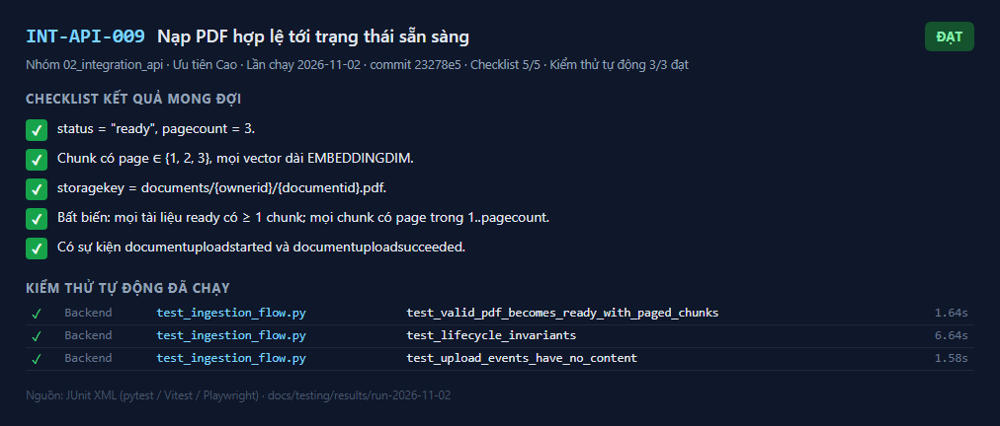
_Kết quả INT-API-009 — lần chạy 2026-11-02_

---

## INT-API-010

**Lý do lỗi do worker xác định** — ✅ **Đạt**

| Mục | Nội dung |
|---|---|
| Mục tiêu | PDF mã hóa, hỏng, chỉ ảnh qua được kiểm tra tải lên nhưng worker đánh dấu `failed` với đúng lý do và không tạo chunk |
| Truy vết | BR-003, BR-018, AC-003, AC-018, US-003, US-004, T1-15 |
| Ưu tiên / Loại | Cao / Âm |
| Tự động hóa | `test_ingestion_flow.py::test_worker_failure_reasons` (3 trường hợp) |
| Đặc tả | [INT-API-010.md](../../test_cases/02_integration_api/INT-API-010.md) |

**Checklist kết quả mong đợi**

- [x] (`failed`, `encrypted`), (`failed`, `corrupted`), (`failed`, `no_text`); số chunk = 0.

**Kiểm thử tự động đã chạy** (3/3 đạt)

| | Tầng | Tệp | Kiểm thử | Thời gian |
|---|---|---|---|---|
| ✅ | Backend | `test_ingestion_flow.py` | test_worker_failure_reasons[mat-khau.pdf-<lambda>-encrypted] | 2.65 s |
| ✅ | Backend | `test_ingestion_flow.py` | test_worker_failure_reasons[hong.pdf-make_corrupted_pdf-corrupted] | 1.94 s |
| ✅ | Backend | `test_ingestion_flow.py` | test_worker_failure_reasons[scan.pdf-<lambda>-no_text] | 2.04 s |

**Ảnh kết quả**

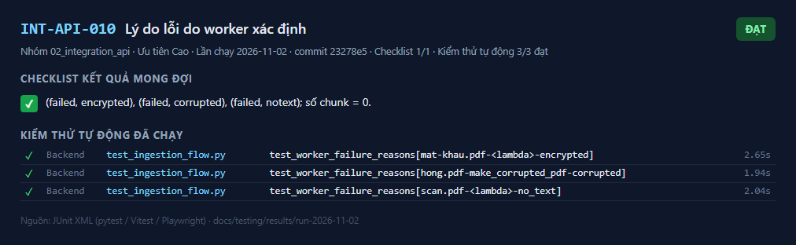
_Kết quả INT-API-010 — lần chạy 2026-11-02_

---

## INT-API-011

**Lỗi tạm thời được thử lại rồi chuyển failed** — ✅ **Đạt**

| Mục | Nội dung |
|---|---|
| Mục tiêu | Lỗi đọc kho tệp được thử lại với giãn cách; hết `JOB_MAX_ATTEMPTS` thì việc `failed`, tài liệu `failed/internal`; lỗi chỉ một lần thì thành công |
| Truy vết | implement_plan 5.1 bước 8, T1-12, T1-15 |
| Ưu tiên / Loại | Cao / Lỗi |
| Tự động hóa | `test_ingestion_flow.py::test_transient_storage_error_retries_then_fails_internal`; `test_storage_and_queue.py::test_transient_error_is_retried_then_succeeds`, `test_job_fails_after_max_attempts_and_calls_give_up`, `test_backoff_delays_next_attempt` |
| Đặc tả | [INT-API-011.md](../../test_cases/02_integration_api/INT-API-011.md) |

**Checklist kết quả mong đợi**

- [x] Bước 1: tài liệu (`failed`, `internal`); việc `failed`, `attempts = JOB_MAX_ATTEMPTS`, `last_error` chứa tên lỗi.
- [x] Bước 2: việc `done`, `attempts = 2`.
- [x] Bước 3: lần lấy thứ hai không có việc; việc ở `queued` chờ tới lượt.

**Kiểm thử tự động đã chạy** (4/4 đạt)

| | Tầng | Tệp | Kiểm thử | Thời gian |
|---|---|---|---|---|
| ✅ | Backend | `test_ingestion_flow.py` | test_transient_storage_error_retries_then_fails_internal | 1.62 s |
| ✅ | Backend | `test_storage_and_queue.py` | test_transient_error_is_retried_then_succeeds | 0.69 s |
| ✅ | Backend | `test_storage_and_queue.py` | test_job_fails_after_max_attempts_and_calls_give_up | 1.34 s |
| ✅ | Backend | `test_storage_and_queue.py` | test_backoff_delays_next_attempt | 0.88 s |

**Ảnh kết quả**

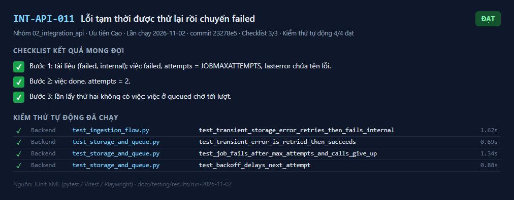
_Kết quả INT-API-011 — lần chạy 2026-11-02_

---

## INT-API-012

**Tài liệu bị xóa trong lúc đang nạp** — ✅ **Đạt**

| Mục | Nội dung |
|---|---|
| Mục tiêu | Nếu tài liệu chuyển `deleting` giữa chừng, worker bỏ kết quả, không ghi chunk |
| Truy vết | BR-005, implement_plan 5.1 bước 7, T1-15 |
| Ưu tiên / Loại | Cao / Đồng thời |
| Tự động hóa | `test_ingestion_flow.py::test_document_moved_to_deleting_during_ingest_is_discarded` |
| Đặc tả | [INT-API-012.md](../../test_cases/02_integration_api/INT-API-012.md) |

**Checklist kết quả mong đợi**

- [x] Tài liệu vẫn `deleting`; số chunk = 0.

**Kiểm thử tự động đã chạy** (1/1 đạt)

| | Tầng | Tệp | Kiểm thử | Thời gian |
|---|---|---|---|---|
| ✅ | Backend | `test_ingestion_flow.py` | test_document_moved_to_deleting_during_ingest_is_discarded | 2.14 s |

**Ảnh kết quả**

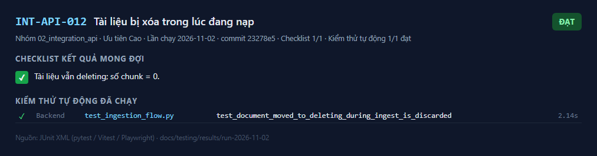
_Kết quả INT-API-012 — lần chạy 2026-11-02_

---

## INT-API-013

**Nhiều worker không lấy trùng việc** — ✅ **Đạt**

| Mục | Nội dung |
|---|---|
| Mục tiêu | `FOR UPDATE SKIP LOCKED` bảo đảm không việc nào bị xử lý hai lần; nhiều tệp được nạp song song đúng |
| Truy vết | ADR-003, T1-12, AC-002 |
| Ưu tiên / Loại | Cao / Đồng thời |
| Tự động hóa | `test_storage_and_queue.py::test_two_workers_never_claim_the_same_job`; `test_ingestion_flow.py::test_many_files_with_two_concurrent_workers` |
| Đặc tả | [INT-API-013.md](../../test_cases/02_integration_api/INT-API-013.md) |

**Checklist kết quả mong đợi**

- [x] Bước 1: tập việc đã xử lý = {0..39}, không trùng; mọi việc `done`.
- [x] Bước 2: 10 tài liệu `ready`, tệp hỏng `failed`.

**Kiểm thử tự động đã chạy** (2/2 đạt)

| | Tầng | Tệp | Kiểm thử | Thời gian |
|---|---|---|---|---|
| ✅ | Backend | `test_storage_and_queue.py` | test_two_workers_never_claim_the_same_job | 1.70 s |
| ✅ | Backend | `test_ingestion_flow.py` | test_many_files_with_two_concurrent_workers | 2.77 s |

**Ảnh kết quả**

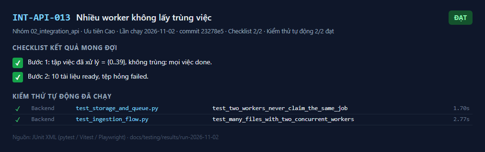
_Kết quả INT-API-013 — lần chạy 2026-11-02_

---

## INT-API-014

**Thử lại tài liệu lỗi** — ✅ **Đạt**

| Mục | Nội dung |
|---|---|
| Mục tiêu | Chỉ thử lại được tài liệu `failed`; thử lại đặt `processing` và thêm việc mới |
| Truy vết | BR-003, US-003, T1-16 |
| Ưu tiên / Loại | Trung bình / Dương, âm |
| Tự động hóa | `test_ingestion_flow.py::test_retry_only_for_failed_and_requeues` |
| Đặc tả | [INT-API-014.md](../../test_cases/02_integration_api/INT-API-014.md) |

**Checklist kết quả mong đợi**

- [x] Bước 2: 409 `not_retryable`.
- [x] Bước 3: 200 `processing`; sau worker → `ready`.

**Kiểm thử tự động đã chạy** (1/1 đạt)

| | Tầng | Tệp | Kiểm thử | Thời gian |
|---|---|---|---|---|
| ✅ | Backend | `test_ingestion_flow.py` | test_retry_only_for_failed_and_requeues | 2.75 s |

**Ảnh kết quả**

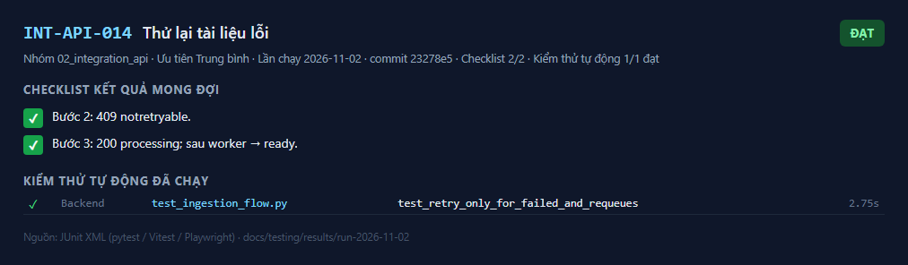
_Kết quả INT-API-014 — lần chạy 2026-11-02_

---

## INT-API-015

**Truy xuất không bao giờ trả tài liệu ngoài phạm vi** — ✅ **Đạt**

| Mục | Nội dung |
|---|---|
| Mục tiêu | Bộ lọc quyền nằm trong câu truy vấn: chunk của tài liệu không thuộc danh sách được phép không xuất hiện, kể cả khi giống câu hỏi hơn |
| Truy vết | BR-020, AC-020, ADR-004, T2-02 |
| Ưu tiên / Loại | Cao / Bảo mật |
| Tự động hóa | `test_retrieval.py::test_chunks_outside_allowed_documents_never_appear`, `test_empty_allowed_set` |
| Đặc tả | [INT-API-015.md](../../test_cases/02_integration_api/INT-API-015.md) |

**Checklist kết quả mong đợi**

- [x] Bước 2: mọi kết quả thuộc "mine". Bước 3: danh sách rỗng.

**Kiểm thử tự động đã chạy** (2/2 đạt)

| | Tầng | Tệp | Kiểm thử | Thời gian |
|---|---|---|---|---|
| ✅ | Backend | `test_retrieval.py` | test_chunks_outside_allowed_documents_never_appear | 0.90 s |
| ✅ | Backend | `test_retrieval.py` | test_empty_allowed_set | 0.83 s |

**Ảnh kết quả**

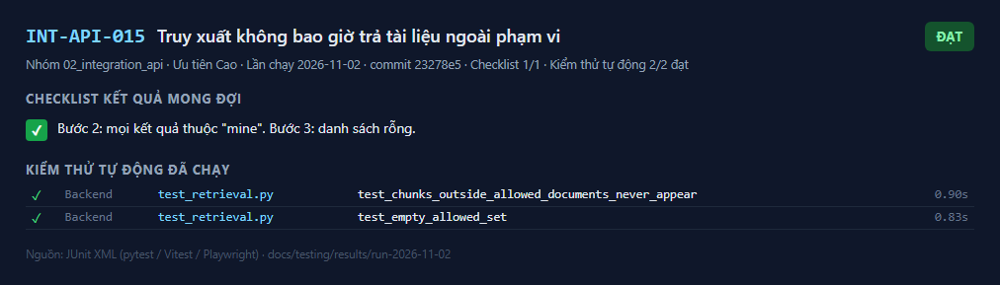
_Kết quả INT-API-015 — lần chạy 2026-11-02_

---

## INT-API-016

**Chỉ truy xuất tài liệu sẵn sàng** — ✅ **Đạt**

| Mục | Nội dung |
|---|---|
| Mục tiêu | Tài liệu `deleting`, `deleted`, `processing`, `failed` không bao giờ được truy xuất |
| Truy vết | BR-005, AC-005, T2-02 |
| Ưu tiên / Loại | Cao / Âm |
| Tự động hóa | `test_retrieval.py::test_only_ready_documents_are_searched` (4 trạng thái) |
| Đặc tả | [INT-API-016.md](../../test_cases/02_integration_api/INT-API-016.md) |

**Checklist kết quả mong đợi**

- [x] Kết quả rỗng ở cả 4 trạng thái.

**Kiểm thử tự động đã chạy** (4/4 đạt)

| | Tầng | Tệp | Kiểm thử | Thời gian |
|---|---|---|---|---|
| ✅ | Backend | `test_retrieval.py` | test_only_ready_documents_are_searched[deleting] | 0.67 s |
| ✅ | Backend | `test_retrieval.py` | test_only_ready_documents_are_searched[deleted] | 0.91 s |
| ✅ | Backend | `test_retrieval.py` | test_only_ready_documents_are_searched[processing] | 0.78 s |
| ✅ | Backend | `test_retrieval.py` | test_only_ready_documents_are_searched[failed] | 1.05 s |

**Ảnh kết quả**

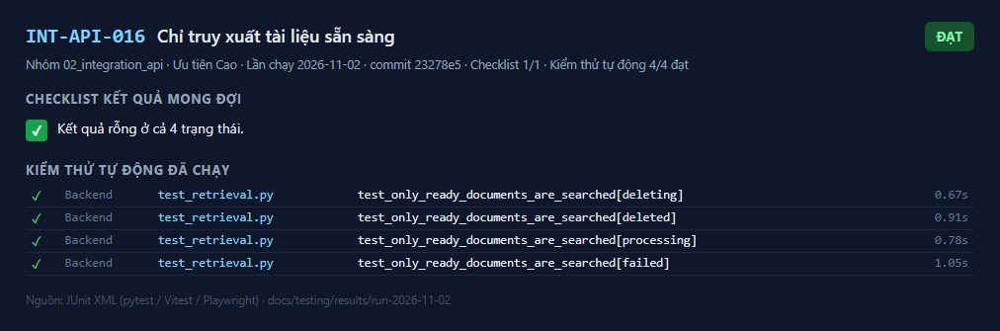
_Kết quả INT-API-016 — lần chạy 2026-11-02_

---

## INT-API-017

**Đủ TOP_K khi danh sách được phép nhỏ trong kho lớn** — ✅ **Đạt**

| Mục | Nội dung |
|---|---|
| Mục tiêu | Với chỉ mục HNSW và `hnsw.iterative_scan`, lọc theo danh sách nhỏ vẫn trả đủ `TOP_K` |
| Truy vết | implement_plan 5.2, T2-02 |
| Ưu tiên / Loại | Trung bình / Biên |
| Tự động hóa | `test_retrieval.py::test_small_allowed_set_in_large_store_still_returns_top_k` |
| Đặc tả | [INT-API-017.md](../../test_cases/02_integration_api/INT-API-017.md) |

**Checklist kết quả mong đợi**

- [x] Đúng 8 kết quả, đều thuộc tài liệu được phép.

**Kiểm thử tự động đã chạy** (1/1 đạt)

| | Tầng | Tệp | Kiểm thử | Thời gian |
|---|---|---|---|---|
| ✅ | Backend | `test_retrieval.py` | test_small_allowed_set_in_large_store_still_returns_top_k | 5.93 s |

**Ảnh kết quả**

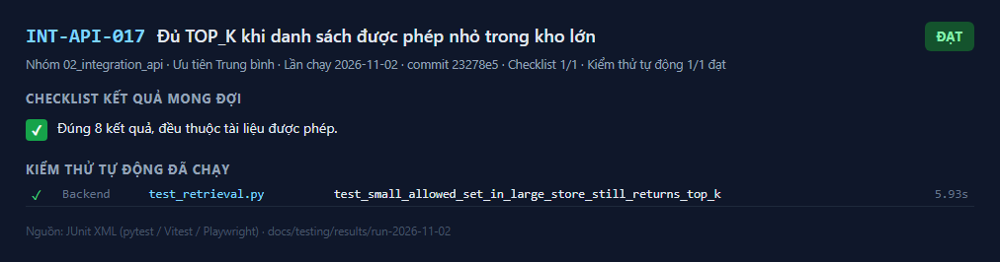
_Kết quả INT-API-017 — lần chạy 2026-11-02_

---

## INT-API-018

**Giới hạn số chunk mỗi tài liệu** — ✅ **Đạt**

| Mục | Nội dung |
|---|---|
| Mục tiêu | `MAX_CHUNKS_PER_DOC` giới hạn số chunk của một tài liệu; kết quả xếp theo điểm giảm dần |
| Truy vết | BR-007, US-009, T2-02 |
| Ưu tiên / Loại | Trung bình / Dương |
| Tự động hóa | `test_retrieval.py::test_max_chunks_per_document`; `test_qa_flow.py::test_question_across_documents_cites_the_right_one` |
| Đặc tả | [INT-API-018.md](../../test_cases/02_integration_api/INT-API-018.md) |

**Checklist kết quả mong đợi**

- [x] Bước 1: A có 4, B có 2; điểm giảm dần.
- [x] Bước 2: citation đầu là BG-2T trang 2.

**Kiểm thử tự động đã chạy** (2/2 đạt)

| | Tầng | Tệp | Kiểm thử | Thời gian |
|---|---|---|---|---|
| ✅ | Backend | `test_retrieval.py` | test_max_chunks_per_document | 0.93 s |
| ✅ | Backend | `test_qa_flow.py` | test_question_across_documents_cites_the_right_one | 2.28 s |

**Ảnh kết quả**

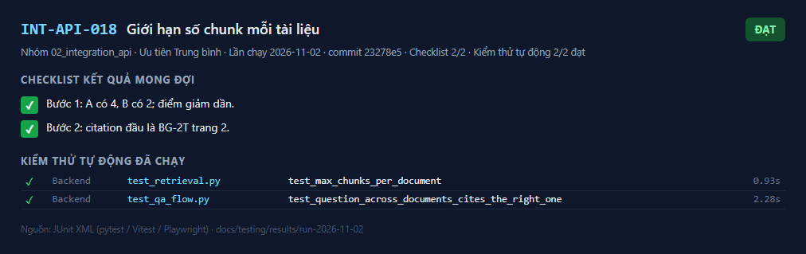
_Kết quả INT-API-018 — lần chạy 2026-11-02_

---

## INT-API-019

**Câu trả lời có nguồn đúng tài liệu và trang** — ✅ **Đạt**

| Mục | Nội dung |
|---|---|
| Mục tiêu | Câu hỏi có đáp án nhận câu trả lời kèm citation đúng tài liệu và trang; đoạn trích có trong trang được nêu |
| Truy vết | BR-006, BR-012, BR-019, AC-006, AC-012, AC-019, T2-05, T2-12 |
| Ưu tiên / Loại | Cao / Dương |
| Tự động hóa | `test_qa_flow.py::test_answer_has_source_document_and_page` |
| Đặc tả | [INT-API-019.md](../../test_cases/02_integration_api/INT-API-019.md) |

**Checklist kết quả mong đợi**

- [x] `not_found = false`; `answer` chứa "30 ngày"; một citation (HĐ-3T, `HopDong_A.pdf`, trang 2); `latency_ms` ≥ 0.
- [x] Văn bản trang 2 chứa `cited_text`; `page_count = 3`.

**Kiểm thử tự động đã chạy** (1/1 đạt)

| | Tầng | Tệp | Kiểm thử | Thời gian |
|---|---|---|---|---|
| ✅ | Backend | `test_qa_flow.py` | test_answer_has_source_document_and_page | 3.09 s |

**Ảnh kết quả**

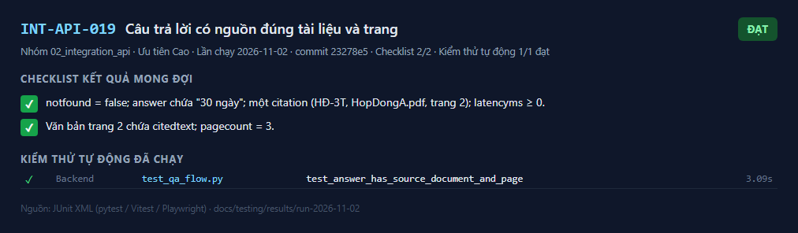
_Kết quả INT-API-019 — lần chạy 2026-11-02_

---

## INT-API-020

**Câu ngoài phạm vi không gọi mô hình** — ✅ **Đạt**

| Mục | Nội dung |
|---|---|
| Mục tiêu | Câu không liên quan nhận "không tìm thấy" mà không gọi dịch vụ AI (không gửi dữ liệu ra ngoài) |
| Truy vết | BR-009, AC-009, US-011, T2-12 |
| Ưu tiên / Loại | Cao / Âm |
| Tự động hóa | `test_qa_flow.py::test_out_of_scope_question_is_not_found_without_calling_model`, `test_model_answers_without_valid_citation_become_not_found` |
| Đặc tả | [INT-API-020.md](../../test_cases/02_integration_api/INT-API-020.md) |

**Checklist kết quả mong đợi**

- [x] Bước 1: `not_found = true`, không citation, `answer` = câu từ chối cố định; số lời gọi adapter = 0.
- [x] Bước 2: `not_found = true` ở cả 3 chế độ; số lời gọi adapter = 1.

**Kiểm thử tự động đã chạy** (4/4 đạt)

| | Tầng | Tệp | Kiểm thử | Thời gian |
|---|---|---|---|---|
| ✅ | Backend | `test_qa_flow.py` | test_out_of_scope_question_is_not_found_without_calling_model | 3.06 s |
| ✅ | Backend | `test_qa_flow.py` | test_model_answers_without_valid_citation_become_not_found[no_citations] | 3.01 s |
| ✅ | Backend | `test_qa_flow.py` | test_model_answers_without_valid_citation_become_not_found[not_found_sentence] | 3.08 s |
| ✅ | Backend | `test_qa_flow.py` | test_model_answers_without_valid_citation_become_not_found[bad_index] | 2.95 s |

**Ảnh kết quả**

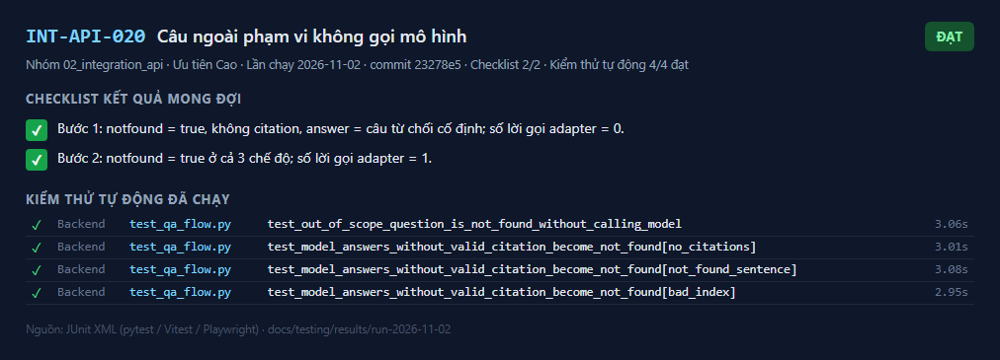
_Kết quả INT-API-020 — lần chạy 2026-11-02_

---

## INT-API-021

**Kiểm tra độ dài câu hỏi** — ✅ **Đạt**

| Mục | Nội dung |
|---|---|
| Mục tiêu | Câu hỏi rỗng hoặc dài hơn `MAX_QUESTION_CHARS` bị từ chối |
| Truy vết | US-008, PRD 4.2, T2-05 |
| Ưu tiên / Loại | Trung bình / Biên |
| Tự động hóa | `test_qa_flow.py::test_question_validation` |
| Đặc tả | [INT-API-021.md](../../test_cases/02_integration_api/INT-API-021.md) |

**Checklist kết quả mong đợi**

- [x] 400 `question_empty`; 400 `question_too_long`.

**Kiểm thử tự động đã chạy** (2/2 đạt)

| | Tầng | Tệp | Kiểm thử | Thời gian |
|---|---|---|---|---|
| ✅ | Backend | `test_qa_flow.py` | test_question_validation[   -question_empty] | 2.79 s |
| ✅ | Backend | `test_qa_flow.py` | test_question_validation[xxxxxxxxxxxxxxxxxxxxxxxxxxxxxxxxxxxxxxxxxxxxxxxxxxxxxxxxxxxxxxxxxxxxxxxxxxxxxxxxxxxxxxxxxxxxxxxxxxxxxxxxxxxxxxxxxxxxxxxxxxxxxxxxxxxxxxxxxxxxxxxxxxxxxxxxxxxxxxxxxxxxxxxxxxxxxxxxxxxxxxxxxxxxxxxxxxxxxxxxxxxxxxxxxxxxxxxxxxxxxxxxxxxxxxxxxxxxxxxxxxxxxxxxxxxxxxxxxxxxxxxxxxxxxxxxxxxxxxxxxxxxxxxxxxxxxxxxxxxxxxxxxxxxxxxxxxxxxxxxxxxxxxxxxxxxxxxxxxxxxxxxxxxxxxxxxxxxxxxxxxxxxxxxxxxxxxxxxxxxxxxxxxxxxxxxxxxxxxxxxxxxxxxxxxxxxxxxxxxxxxxxxxxxxxxxxxxxxxxxxxxxxxxxxxxxxxxxxxxxxxxxxxxxxxxxxxxxxxxxxxxxxxxxxxxxxxxxxxxxxxxxxxxxxxxxxxxxxxxxxxxxxxxxxxxxxxxxxxxxxxxxxxxxxxxxxxxxxxxxxxxxxxxxxxxxxxxxxxxxxxxxxxxxxxxxxxxxxxxxxxxxxxxxxxxxxxxxxxxxxxxxxxxxxxxxxxxxxxxxxxxxxxxxxxxxxxxxxxxxxxxxxxxxxxxxxxxxxxxxxxxxxxxxxxxxxxxxxxxxxxxxxxxxxxxxxxxxxxxxxxxxxxxxxxxxxxxxxxxxxxxxxxxxxxxxxxxxxxxxxxxxxxxxxxxxxxxxxxxxxxxxxxxxxxxxxxxxxxxxxxxxxxxxxxxxxxxxxxxxxxxxxxxxxxxxxxxxxxxxxxxxxxxxxxxxxxxxxxxxxxxxxxxxxxxxxxxxxxxxxxxxxxxxxxxxxxxxxxxxxxxxxxxxxxxxxxxxxxxxxxxxxxxxxxxxxxxxxxxxxxxxxxxxxxxxxxxxxxxxxxxxxxxxxxxxxxxxxxxxxxxxxxxxxxxxxxxxxxxxxxxxxxxxxxxxxxxxxxxxxxxxxxxxxxxxxxxxxxxxxxxxxxxxxxxxxxxxxxxxxxxxxxxxxxxxxxxxxxxxxxxxxxxxxxxxxxxxxxxxxxxxxxxxxxxxxxxxxxxxxxxxxxxxxxxxxxxxxxxxxxxxxxxxxxxxxxxxxxxxxxxxxxxxxxxxxxxxxxxxxxxxxxxxxxxxxxxxxxxxxxxxxxxxxxxxxxxxxxxxxxxxxxxxxxxxxxxxxxxxxxxxxxxxxxxxxxxxxxxxxxxxxxxxxxxxxxxxxxxxxxxxxxxxxxxxxxxxxxxxxxxxxxxxxxxxxxxxxxxxxxxxxxxxxxxxxxxxxxxxxxxxxxxxxxxxxxxxxxxxxxxxxxxxxxxxxxxxxxxxxxxxxxxxxxxxxxxxxxxxxxxxxxxxxxxxxxxxxxxxxxxxxxxxxxxxxxxxxxxxxxxxxxxxxxxxxxxxxxxxxxxxxxxxxxxxxxxxxxxxxxxxxxxxxxxxxxxxxxxxxxxxxxxxxxxxxxxxxxxxxxxxxxxxxxxxxxxxxxxxxxxxxxxxxxxxxxxxxxxxxxxxxxxxxxxxxxxxxxxxxxxxxxxxxxxxxxxxxxxxxxxxxxxxxxxxxxxxxxxxxxxxxxxxxxxxxxxxxxxxxxxxxxxxxxxxxxxxxxxxxxxxxxxxxxxxxxxxxxxxxxxxxxxxxxxxxxxxxxxxxxxxxxxxxxxxxxxxxxxxxxxxxxxxxxxxxxxxxxxxxxxxxxxxxxxxxxxxxxxxxxxxxxxxxxxxxxxxxxxxxxxxxxxxxxxxxxxxxxxxxxxxxxxxxxxxxxxxxxxxxxxxxxxxxxxxxxxxxxxxxxxxxxxxxxxxxxxxxxxxxxxxxxxxxxxxxxxxxxxxxxxxxxxxxxxxxxxxxxxxxxxxxxxxxxxxxxxxxxxxxxxxxxxxxxxxxxxxxxxxxxxxxxxxxxxxxxxxxxxxxxxxxxxxxxxxxxxxxxxxxxxxxxxxxxxxxxxxxxxxx-question_too_long] | 2.53 s |

**Ảnh kết quả**

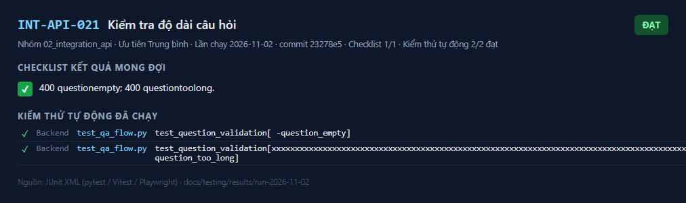
_Kết quả INT-API-021 — lần chạy 2026-11-02_

---

## INT-API-022

**Dịch vụ AI từ chối hoặc quá thời gian** — ✅ **Đạt**

| Mục | Nội dung |
|---|---|
| Mục tiêu | Mô hình từ chối → 502 thông báo chung; quá `ANSWER_TIMEOUT_S` → 504 đúng hạn |
| Truy vết | BR-011, US-013, T2-05, T3-06 |
| Ưu tiên / Loại | Cao / Lỗi |
| Tự động hóa | `test_qa_flow.py::test_model_refusal_returns_generic_error`, `test_timeout_returns_504`, `test_slow_generator_hits_answer_timeout` |
| Đặc tả | [INT-API-022.md](../../test_cases/02_integration_api/INT-API-022.md) |

**Checklist kết quả mong đợi**

- [x] Bước 1: 502 `answer_unavailable`.
- [x] Bước 2: 504 `answer_timeout`.
- [x] Bước 3: 504 trong < 1,4 s.

**Kiểm thử tự động đã chạy** (3/3 đạt)

| | Tầng | Tệp | Kiểm thử | Thời gian |
|---|---|---|---|---|
| ✅ | Backend | `test_qa_flow.py` | test_model_refusal_returns_generic_error | 3.16 s |
| ✅ | Backend | `test_qa_flow.py` | test_timeout_returns_504 | 3.30 s |
| ✅ | Backend | `test_qa_flow.py` | test_slow_generator_hits_answer_timeout | 3.84 s |

**Ảnh kết quả**

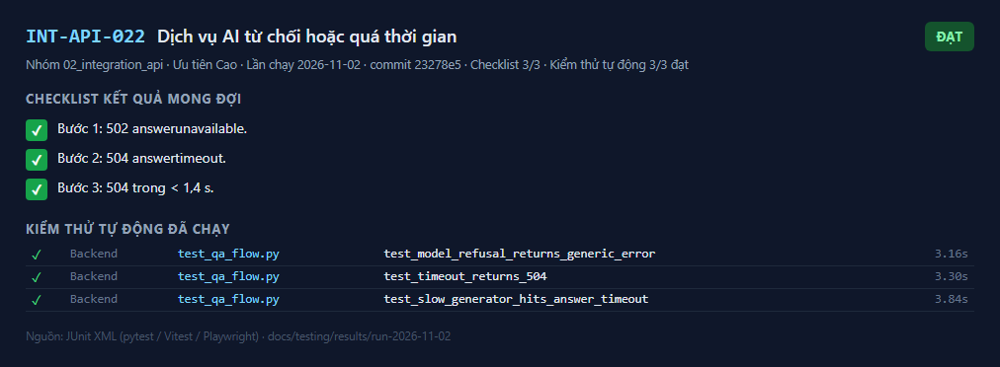
_Kết quả INT-API-022 — lần chạy 2026-11-02_

---

## INT-API-023

**Mỗi câu hỏi đúng một bản ghi kiểm toán, không nội dung** — ✅ **Đạt**

| Mục | Nội dung |
|---|---|
| Mục tiêu | Mỗi câu hỏi (kể cả "không tìm thấy") sinh đúng một `audit_records` liệt kê tài liệu được phép, một `question_submitted`, một `answer_returned`; không có nội dung câu hỏi |
| Truy vết | BR-023, AC-023, US-020, T2-05 |
| Ưu tiên / Loại | Cao / Dương |
| Tự động hóa | `test_qa_flow.py::test_each_question_writes_exactly_one_audit_record_without_content`; `test_migrations.py::test_audit_and_usage_tables_have_no_content_columns` |
| Đặc tả | [INT-API-023.md](../../test_cases/02_integration_api/INT-API-023.md) |

**Checklist kết quả mong đợi**

- [x] 2 bản ghi kiểm toán; `document_ids` = {HĐ-3T, BG-2T}.
- [x] 2 `question_submitted`, 2 `answer_returned`.
- [x] Hai bảng không có cột `question`, `content`, `text`, `answer`, `body`.

**Kiểm thử tự động đã chạy** (2/2 đạt)

| | Tầng | Tệp | Kiểm thử | Thời gian |
|---|---|---|---|---|
| ✅ | Backend | `test_qa_flow.py` | test_each_question_writes_exactly_one_audit_record_without_content | 3.66 s |
| ✅ | Backend | `test_migrations.py` | test_audit_and_usage_tables_have_no_content_columns | 0.94 s |

**Ảnh kết quả**

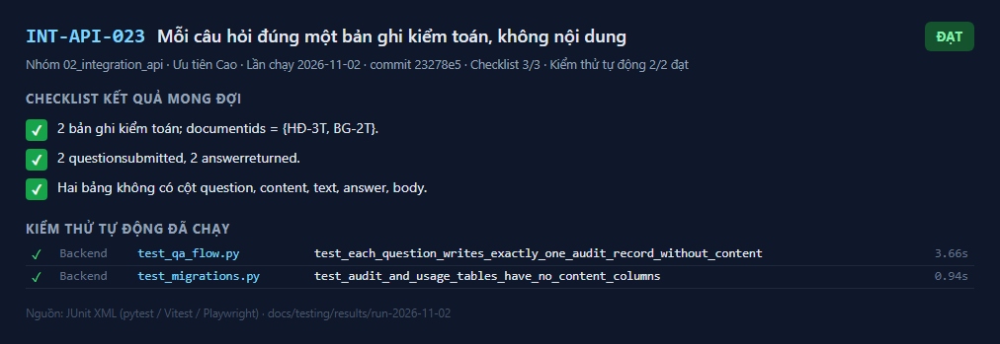
_Kết quả INT-API-023 — lần chạy 2026-11-02_

---

## INT-API-024

**Lỗi commit không bị nuốt** — ✅ **Đạt**

| Mục | Nội dung |
|---|---|
| Mục tiêu | Commit chạy trước khi gửi phản hồi; lỗi commit trả 500 chứ không 200 |
| Truy vết | TR-05 (lỗi hồi quy: API trả 200 dù không lưu được) |
| Ưu tiên / Loại | Cao / Hồi quy |
| Tự động hóa | `test_qa_flow.py::test_commit_failure_is_reported_not_swallowed` |
| Đặc tả | [INT-API-024.md](../../test_cases/02_integration_api/INT-API-024.md) |

**Checklist kết quả mong đợi**

- [x] 500.

**Kiểm thử tự động đã chạy** (1/1 đạt)

| | Tầng | Tệp | Kiểm thử | Thời gian |
|---|---|---|---|---|
| ✅ | Backend | `test_qa_flow.py` | test_commit_failure_is_reported_not_swallowed | 4.40 s |

**Ảnh kết quả**

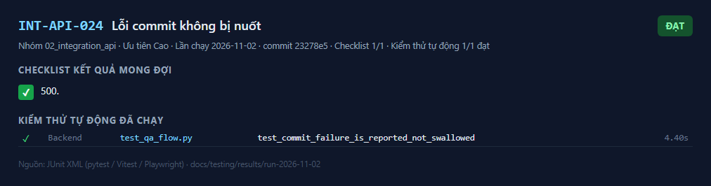
_Kết quả INT-API-024 — lần chạy 2026-11-02_

---

## INT-API-025

**Lịch sử hội thoại và câu hỏi tiếp theo** — ✅ **Đạt**

| Mục | Nội dung |
|---|---|
| Mục tiêu | Câu hỏi tiếp theo dùng đại từ được trả lời đúng nhờ ghép câu trước; lịch sử đúng thứ tự; số lượt gửi mô hình theo `HISTORY_TURNS`; hội thoại mới không mang ngữ cảnh cũ; người khác không xem được |
| Truy vết | BR-008, AC-008, US-010, T3-05 |
| Ưu tiên / Loại | Trung bình / Dương |
| Tự động hóa | `test_qa_flow.py::test_history_and_follow_up_question`, `test_history_is_limited_to_history_turns`, `test_conversation_belongs_to_owner_only` |
| Đặc tả | [INT-API-025.md](../../test_cases/02_integration_api/INT-API-025.md) |

**Checklist kết quả mong đợi**

- [x] Bước 1: câu thứ hai không phải "không tìm thấy", citation trang 3; lịch sử gửi mô hình có 2 tin nhắn, bắt đầu bằng `user`.
- [x] Bước 2: vai trò `user, assistant, user, assistant`; tin nhắn thứ 4 có citation trang 3.
- [x] Bước 3: lịch sử gửi mô hình rỗng. Bước 4: lịch sử gửi mô hình có 2 tin nhắn. Bước 5: 404.

**Kiểm thử tự động đã chạy** (3/3 đạt)

| | Tầng | Tệp | Kiểm thử | Thời gian |
|---|---|---|---|---|
| ✅ | Backend | `test_qa_flow.py` | test_history_and_follow_up_question | 4.24 s |
| ✅ | Backend | `test_qa_flow.py` | test_history_is_limited_to_history_turns | 3.42 s |
| ✅ | Backend | `test_qa_flow.py` | test_conversation_belongs_to_owner_only | 4.81 s |

**Ảnh kết quả**

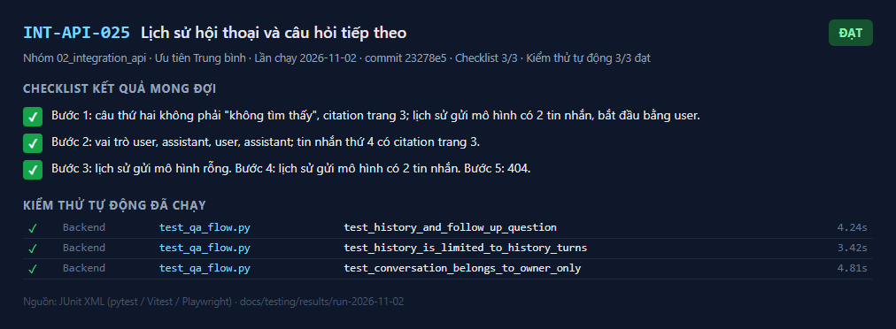
_Kết quả INT-API-025 — lần chạy 2026-11-02_

---

## INT-API-026

**Trang nguồn: trang không hợp lệ và quyền** — ✅ **Đạt**

| Mục | Nội dung |
|---|---|
| Mục tiêu | Trang ngoài khoảng và tài liệu của người khác trả 404 |
| Truy vết | BR-019, BR-020, US-015, T2-06 |
| Ưu tiên / Loại | Cao / Âm |
| Tự động hóa | `test_qa_flow.py::test_source_page_and_file_access` |
| Đặc tả | [INT-API-026.md](../../test_cases/02_integration_api/INT-API-026.md) |

**Checklist kết quả mong đợi**

- [x] Tất cả 404.

**Kiểm thử tự động đã chạy** (1/1 đạt)

| | Tầng | Tệp | Kiểm thử | Thời gian |
|---|---|---|---|---|
| ✅ | Backend | `test_qa_flow.py` | test_source_page_and_file_access | 3.94 s |

**Ảnh kết quả**

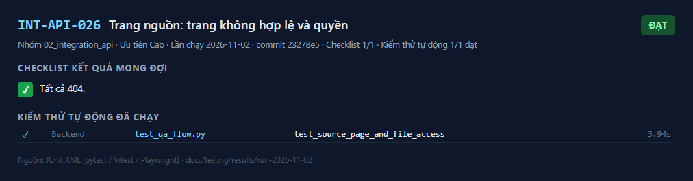
_Kết quả INT-API-026 — lần chạy 2026-11-02_

---

## INT-API-027

**Tải tệp gốc qua backend** — ✅ **Đạt**

| Mục | Nội dung |
|---|---|
| Mục tiêu | Tệp PDF gốc trả qua backend (không lộ đường dẫn kho), không lưu đệm |
| Truy vết | US-015, implement_plan 6.2, T2-06 |
| Ưu tiên / Loại | Trung bình / Dương |
| Tự động hóa | `test_qa_flow.py::test_source_page_and_file_access` |
| Đặc tả | [INT-API-027.md](../../test_cases/02_integration_api/INT-API-027.md) |

**Checklist kết quả mong đợi**

- [x] 200, `Content-Type: application/pdf`, thân bắt đầu `%PDF-`; header `Cache-Control: private, no-store`, `X-Content-Type-Options: nosniff`.

**Kiểm thử tự động đã chạy** (1/1 đạt)

| | Tầng | Tệp | Kiểm thử | Thời gian |
|---|---|---|---|---|
| ✅ | Backend | `test_qa_flow.py` | test_source_page_and_file_access | 3.94 s |

**Ảnh kết quả**

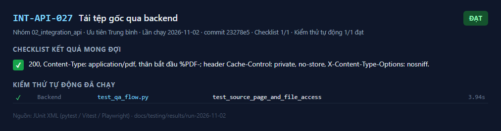
_Kết quả INT-API-027 — lần chạy 2026-11-02_

---

## INT-API-028

**Xóa loại tài liệu khỏi truy vấn ngay lập tức** — ✅ **Đạt**

| Mục | Nội dung |
|---|---|
| Mục tiêu | Sau `DELETE`, câu hỏi chỉ có đáp án trong tài liệu đó nhận "không tìm thấy" **trước khi** worker xóa vĩnh viễn chạy |
| Truy vết | BR-005, AC-005, US-006, T3-01 |
| Ưu tiên / Loại | Cao / Dương |
| Tự động hóa | `test_delete_and_purge.py::test_deleted_document_is_excluded_immediately` |
| Đặc tả | [INT-API-028.md](../../test_cases/02_integration_api/INT-API-028.md) |

**Checklist kết quả mong đợi**

- [x] Bước 2: 202, `status = "deleting"`.
- [x] Bước 3: chunk vẫn còn.
- [x] Bước 4: `not_found = true`; danh sách rỗng; 404; 404.

**Kiểm thử tự động đã chạy** (1/1 đạt)

| | Tầng | Tệp | Kiểm thử | Thời gian |
|---|---|---|---|---|
| ✅ | Backend | `test_delete_and_purge.py` | test_deleted_document_is_excluded_immediately | 2.74 s |

**Ảnh kết quả**

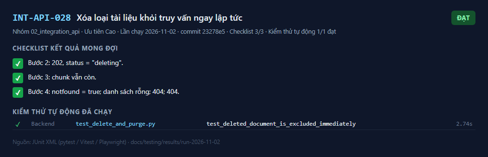
_Kết quả INT-API-028 — lần chạy 2026-11-02_

---

## INT-API-029

**Xóa vĩnh viễn** — ✅ **Đạt**

| Mục | Nội dung |
|---|---|
| Mục tiêu | Worker xóa toàn bộ chunk, tệp trên kho, đoạn trích nguyên văn trong citation; đặt `deleted` và `purged_at` |
| Truy vết | BR-024, AC-024, US-007, T3-02, LG-08 |
| Ưu tiên / Loại | Cao / Dương |
| Tự động hóa | `test_delete_and_purge.py::test_purge_removes_chunks_file_and_sets_purged_at` |
| Đặc tả | [INT-API-029.md](../../test_cases/02_integration_api/INT-API-029.md) |

**Checklist kết quả mong đợi**

- [x] `status = "deleted"`, `purged_at` khác null; 0 chunk; khóa không còn trên kho.
- [x] Citation còn tên tài liệu và số trang nhưng `cited_text = null` (cả trong lịch sử trả về).

**Kiểm thử tự động đã chạy** (1/1 đạt)

| | Tầng | Tệp | Kiểm thử | Thời gian |
|---|---|---|---|---|
| ✅ | Backend | `test_delete_and_purge.py` | test_purge_removes_chunks_file_and_sets_purged_at | 2.12 s |

**Ảnh kết quả**

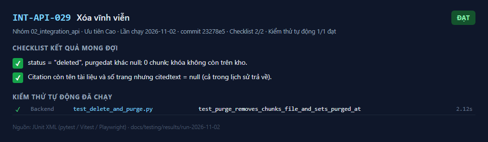
_Kết quả INT-API-029 — lần chạy 2026-11-02_

---

## INT-API-030

**Xóa vĩnh viễn chịu lỗi và làm lại được** — ✅ **Đạt**

| Mục | Nội dung |
|---|---|
| Mục tiêu | Lỗi kho tệp giữa chừng được thử lại tới khi xong; chạy xóa hai lần không lỗi; tài liệu `deleting` quá hạn được đếm |
| Truy vết | BR-024, ADR-008, T3-02 |
| Ưu tiên / Loại | Cao / Lỗi |
| Tự động hóa | `test_delete_and_purge.py::test_storage_error_midway_is_retried_and_completes`, `test_purge_twice_is_harmless`, `test_overdue_deleting_documents_are_counted` |
| Đặc tả | [INT-API-030.md](../../test_cases/02_integration_api/INT-API-030.md) |

**Checklist kết quả mong đợi**

- [x] Bước 1: kho được gọi xóa 2 lần; tài liệu `deleted`; khóa không còn.
- [x] Bước 2: không ngoại lệ; `deleted`.
- [x] Bước 3: trước khi lùi = 0; sau = 1.

**Kiểm thử tự động đã chạy** (3/3 đạt)

| | Tầng | Tệp | Kiểm thử | Thời gian |
|---|---|---|---|---|
| ✅ | Backend | `test_delete_and_purge.py` | test_storage_error_midway_is_retried_and_completes | 1.78 s |
| ✅ | Backend | `test_delete_and_purge.py` | test_purge_twice_is_harmless | 2.42 s |
| ✅ | Backend | `test_delete_and_purge.py` | test_overdue_deleting_documents_are_counted | 2.11 s |

**Ảnh kết quả**

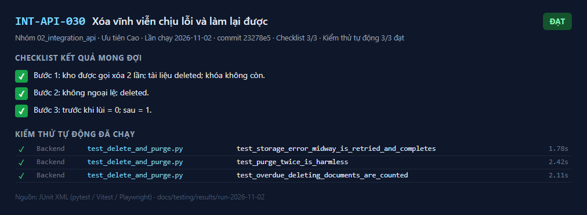
_Kết quả INT-API-030 — lần chạy 2026-11-02_

---

## INT-API-031

**Quyền xóa tài liệu** — ✅ **Đạt**

| Mục | Nội dung |
|---|---|
| Mục tiêu | Người khác không xóa được (404); quản lý không có quyền (403); quản trị bảo mật xóa được mọi tài liệu |
| Truy vết | BR-020, US-006, T3-01 |
| Ưu tiên / Loại | Cao / Bảo mật |
| Tự động hóa | `test_delete_and_purge.py::test_delete_permissions` |
| Đặc tả | [INT-API-031.md](../../test_cases/02_integration_api/INT-API-031.md) |

**Checklist kết quả mong đợi**

- [x] 404; 403; 202 rồi 404.

**Kiểm thử tự động đã chạy** (1/1 đạt)

| | Tầng | Tệp | Kiểm thử | Thời gian |
|---|---|---|---|---|
| ✅ | Backend | `test_delete_and_purge.py` | test_delete_permissions | 5.09 s |

**Ảnh kết quả**

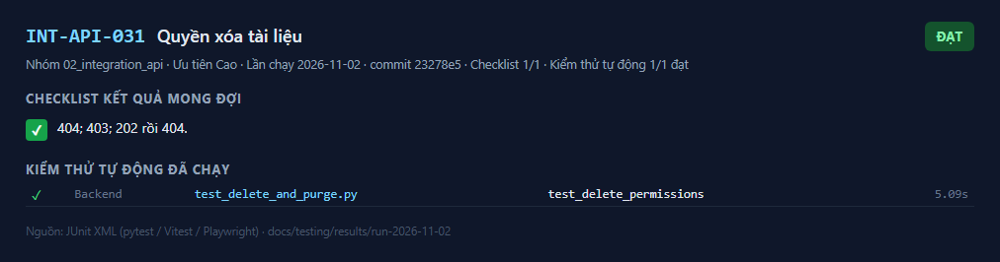
_Kết quả INT-API-031 — lần chạy 2026-11-02_

---

## INT-API-032

**Đánh giá câu trả lời** — ✅ **Đạt**

| Mục | Nội dung |
|---|---|
| Mục tiêu | Lưu đánh giá, ghi đè được, hiện trong lịch sử; giá trị sai bị từ chối; người khác không đánh giá được |
| Truy vết | BR-017, AC-017, US-024, T4-03 |
| Ưu tiên / Loại | Thấp / Dương, âm |
| Tự động hóa | `test_qa_flow.py::test_feedback_is_saved_and_can_be_changed` |
| Đặc tả | [INT-API-032.md](../../test_cases/02_integration_api/INT-API-032.md) |

**Checklist kết quả mong đợi**

- [x] 204, 204; bảng `feedback` có đúng 1 dòng giá trị `not_helpful`.
- [x] Lịch sử: `feedback = "not_helpful"`. Bước 3: 400. Bước 4: 404.

**Kiểm thử tự động đã chạy** (1/1 đạt)

| | Tầng | Tệp | Kiểm thử | Thời gian |
|---|---|---|---|---|
| ✅ | Backend | `test_qa_flow.py` | test_feedback_is_saved_and_can_be_changed | 3.99 s |

**Ảnh kết quả**

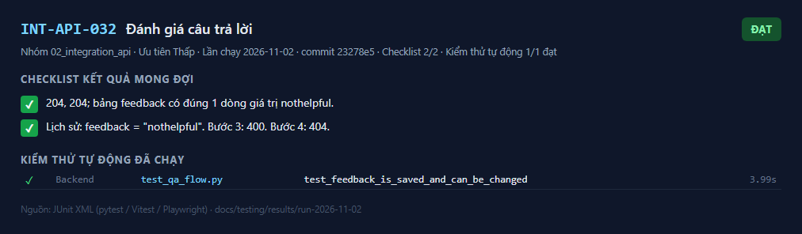
_Kết quả INT-API-032 — lần chạy 2026-11-02_

---

## INT-API-033

**Bản ghi kiểm toán: lọc và phân trang** — ✅ **Đạt**

| Mục | Nội dung |
|---|---|
| Mục tiêu | Danh sách mới nhất trước, trang 50 bản ghi, con trỏ không trùng/không sót; lọc theo người dùng, tài liệu, ngày; không có nội dung câu hỏi |
| Truy vết | BR-023, AC-023, US-020, T3-04 |
| Ưu tiên / Loại | Trung bình / Dương |
| Tự động hóa | `test_admin_reports_health.py::test_audit_lists_one_record_per_question_without_content`, `test_audit_filters_and_cursor` |
| Đặc tả | [INT-API-033.md](../../test_cases/02_integration_api/INT-API-033.md) |

**Checklist kết quả mong đợi**

- [x] Trang 1: 50 + con trỏ; trang 2: 10, con trỏ null; 60 id khác nhau, giảm dần.
- [x] 30; 10; 55; 5; 0.
- [x] Mục có `user.login = "an"`, `documents = [{id, file_name}]`; không chứa câu hỏi hay "30 ngày".

**Kiểm thử tự động đã chạy** (2/2 đạt)

| | Tầng | Tệp | Kiểm thử | Thời gian |
|---|---|---|---|---|
| ✅ | Backend | `test_admin_reports_health.py` | test_audit_lists_one_record_per_question_without_content | 15.09 s |
| ✅ | Backend | `test_admin_reports_health.py` | test_audit_filters_and_cursor | 9.11 s |

**Ảnh kết quả**

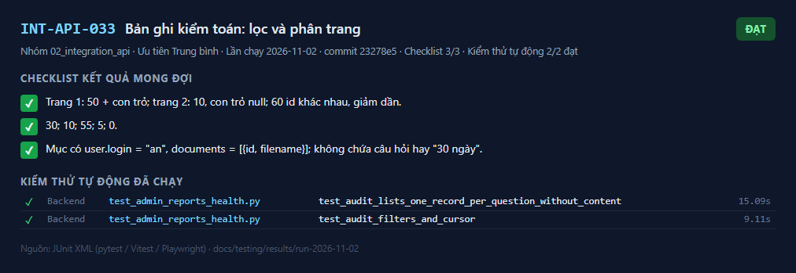
_Kết quả INT-API-033 — lần chạy 2026-11-02_

---

## INT-API-034

**Báo cáo sử dụng theo tuần** — ✅ **Đạt**

| Mục | Nội dung |
|---|---|
| Mục tiêu | Đếm người dùng hoạt động (chỉ BD) và số câu hỏi theo tuần ISO, đúng khoảng; tỷ lệ hữu ích từ đánh giá |
| Truy vết | BR-016, BR-021, BR-017, AC-016, AC-021, US-022..024, T4-02 |
| Ưu tiên / Loại | Trung bình / Dương |
| Tự động hóa | `test_admin_reports_health.py::test_weekly_usage_with_seed_data`, `test_usage_endpoint_includes_helpful_ratio` |
| Đặc tả | [INT-API-034.md](../../test_cases/02_integration_api/INT-API-034.md) |

**Checklist kết quả mong đợi**

- [x] Bước 1: 4 tuần, (hoạt động, câu hỏi) = (0,0), (0,0), (3,1), (2,3); tỷ lệ hữu ích null.
- [x] Bước 2: tuần hiện tại `active_users = 1` (quản lý không được tính), `questions = 3`, `helpful_ratio ≈ 0,667`, `feedback_count = 3`; "an" nhận 403.

**Kiểm thử tự động đã chạy** (2/2 đạt)

| | Tầng | Tệp | Kiểm thử | Thời gian |
|---|---|---|---|---|
| ✅ | Backend | `test_admin_reports_health.py` | test_weekly_usage_with_seed_data | 0.84 s |
| ✅ | Backend | `test_admin_reports_health.py` | test_usage_endpoint_includes_helpful_ratio | 4.38 s |

**Ảnh kết quả**

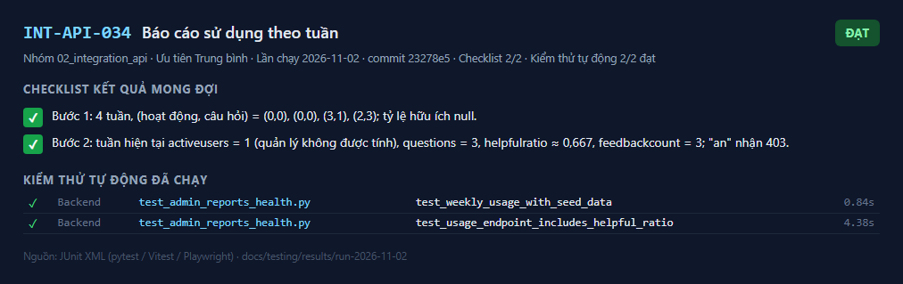
_Kết quả INT-API-034 — lần chạy 2026-11-02_

---

## INT-API-035

**Quản lý quyền truy cập** — ✅ **Đạt**

| Mục | Nội dung |
|---|---|
| Mục tiêu | Cấp quyền (tạo người dùng nếu chưa có), liệt kê, thu hồi (giữ bản ghi); vai trò sai bị từ chối; không tự thu hồi; vai trò khác không gọi được |
| Truy vết | BR-014, US-017, T1-05 |
| Ưu tiên / Loại | Cao / Dương, âm |
| Tự động hóa | `test_auth.py::test_admin_grant_list_revoke`, `test_admin_cannot_revoke_self`, `test_admin_endpoints_forbidden_for_other_roles` |
| Đặc tả | [INT-API-035.md](../../test_cases/02_integration_api/INT-API-035.md) |

**Checklist kết quả mong đợi**

- [x] 201, `status = "active"`; danh sách {admin, moi.nguoi}; sau thu hồi: `revoked`, `revoked_at` có giá trị; 400; 409 `cannot_revoke_self`; 403.

**Kiểm thử tự động đã chạy** (4/4 đạt)

| | Tầng | Tệp | Kiểm thử | Thời gian |
|---|---|---|---|---|
| ✅ | Backend | `test_auth.py` | test_admin_grant_list_revoke | 3.10 s |
| ✅ | Backend | `test_auth.py` | test_admin_cannot_revoke_self | 1.67 s |
| ✅ | Backend | `test_auth.py` | test_admin_endpoints_forbidden_for_other_roles[bd] | 1.84 s |
| ✅ | Backend | `test_auth.py` | test_admin_endpoints_forbidden_for_other_roles[manager] | 2.06 s |

**Ảnh kết quả**

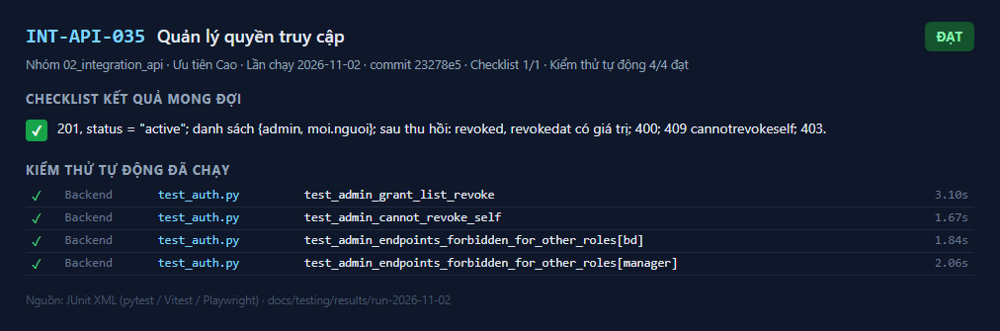
_Kết quả INT-API-035 — lần chạy 2026-11-02_

---

## INT-API-036

**Health báo lỗi khi thành phần dừng** — ✅ **Đạt**

| Mục | Nội dung |
|---|---|
| Mục tiêu | `/health/ready` báo đúng thành phần lỗi: kho tệp, cơ sở dữ liệu, hàng đợi tồn đọng |
| Truy vết | BR-022, AC-022, US-021, T4-04 |
| Ưu tiên / Loại | Trung bình / Lỗi |
| Tự động hóa | `test_admin_reports_health.py::test_ready_ok_when_everything_is_up`, `test_ready_fails_when_storage_is_down`, `test_ready_fails_when_database_is_down`, `test_ready_fails_when_queue_backlog_is_old` |
| Đặc tả | [INT-API-036.md](../../test_cases/02_integration_api/INT-API-036.md) |

**Checklist kết quả mong đợi**

- [x] 200 với thành phần `database`, `storage`, `queue`.
- [x] 503, `storage.ok = false`, `database.ok = true`.
- [x] 503, `database.ok = false`.
- [x] 503, `queue = {"ok": false, "detail": "queue_backlog"}`.

**Kiểm thử tự động đã chạy** (4/4 đạt)

| | Tầng | Tệp | Kiểm thử | Thời gian |
|---|---|---|---|---|
| ✅ | Backend | `test_admin_reports_health.py` | test_ready_ok_when_everything_is_up | 2.17 s |
| ✅ | Backend | `test_admin_reports_health.py` | test_ready_fails_when_storage_is_down | 1.99 s |
| ✅ | Backend | `test_admin_reports_health.py` | test_ready_fails_when_database_is_down | 1.20 s |
| ✅ | Backend | `test_admin_reports_health.py` | test_ready_fails_when_queue_backlog_is_old | 0.86 s |

**Ảnh kết quả**

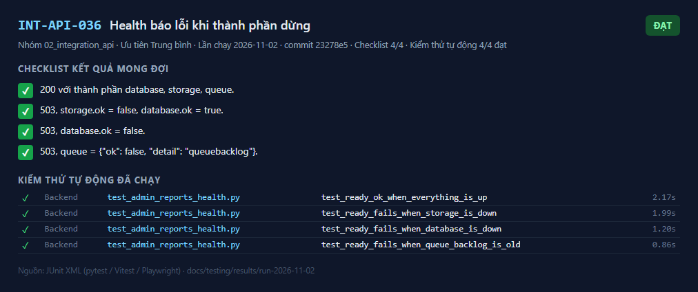
_Kết quả INT-API-036 — lần chạy 2026-11-02_

---

## INT-API-037

**Đăng nhập OIDC** — ✅ **Đạt**

| Mục | Nội dung |
|---|---|
| Mục tiêu | Luồng Authorization Code + PKCE: người có quyền được tạo phiên; người không quyền nhận `no_access`; state sai bị từ chối; đăng nhập nội bộ tắt khi dùng OIDC |
| Truy vết | BR-014, US-017, DQ-003, T1-03 |
| Ưu tiên / Loại | Cao / Dương, âm |
| Tự động hóa | `test_oidc_flow.py` (4 kiểm thử) |
| Đặc tả | [INT-API-037.md](../../test_cases/02_integration_api/INT-API-037.md) |

**Checklist kết quả mong đợi**

- [x] Bước 1: 302 → `/`; SHA-256 của `code_verifier` khớp `code_challenge`; `/auth/me` trả `bd`.
- [x] Bước 2: 302 → `/login?error=no_access`; `/auth/me` 401; người dùng được tạo theo email.
- [x] Bước 3: 400. Bước 4: 404.

**Kiểm thử tự động đã chạy** (4/4 đạt)

| | Tầng | Tệp | Kiểm thử | Thời gian |
|---|---|---|---|---|
| ✅ | Backend | `test_oidc_flow.py` | test_oidc_login_with_grant_creates_session | 2.96 s |
| ✅ | Backend | `test_oidc_flow.py` | test_oidc_login_without_grant_is_no_access | 0.81 s |
| ✅ | Backend | `test_oidc_flow.py` | test_oidc_state_mismatch_rejected | 0.78 s |
| ✅ | Backend | `test_oidc_flow.py` | test_local_login_disabled_in_oidc_mode | 1.25 s |

**Ảnh kết quả**

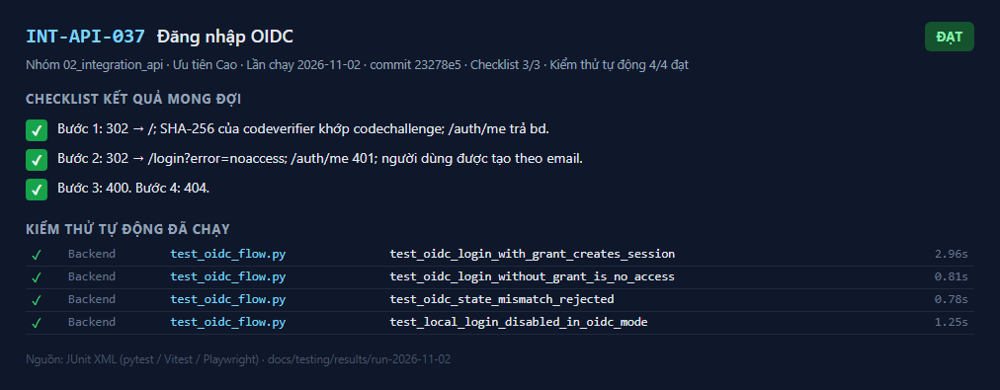
_Kết quả INT-API-037 — lần chạy 2026-11-02_

---

## INT-API-038

**Lệnh tạo quản trị viên đầu tiên** — ✅ **Đạt**

| Mục | Nội dung |
|---|---|
| Mục tiêu | `python -m app.cli create-admin <login>` chạy trên cơ sở dữ liệu trống, tạo tài khoản quản trị bảo mật đăng nhập được |
| Truy vết | US-017, T1-05 |
| Ưu tiên / Loại | Trung bình / Dương |
| Tự động hóa | `test_auth.py::test_cli_create_admin_on_empty_database` |
| Đặc tả | [INT-API-038.md](../../test_cases/02_integration_api/INT-API-038.md) |

**Checklist kết quả mong đợi**

- [x] Xác thực thành công; vai trò `security_admin`.

**Kiểm thử tự động đã chạy** (1/1 đạt)

| | Tầng | Tệp | Kiểm thử | Thời gian |
|---|---|---|---|---|
| ✅ | Backend | `test_auth.py` | test_cli_create_admin_on_empty_database | 2.07 s |

**Ảnh kết quả**

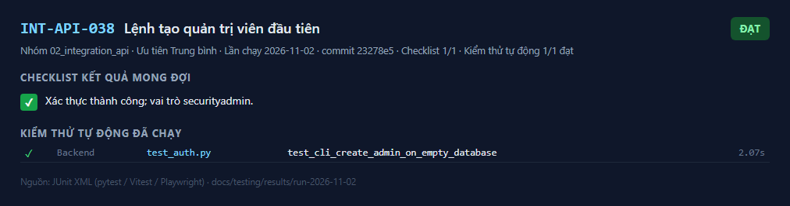
_Kết quả INT-API-038 — lần chạy 2026-11-02_

---

## INT-API-039

**Migration và ràng buộc lược đồ** — ✅ **Đạt**

| Mục | Nội dung |
|---|---|
| Mục tiêu | Migration lên/xuống thành công; ràng buộc CHECK, UNIQUE, NOT NULL, CASCADE hoạt động |
| Truy vết | T0-10, T1-01, T1-09, T2-01, BR-019 |
| Ưu tiên / Loại | Cao / Dương, âm |
| Tự động hóa | `test_migrations.py` (8 kiểm thử) |
| Đặc tả | [INT-API-039.md](../../test_cases/02_integration_api/INT-API-039.md) |

**Checklist kết quả mong đợi**

- [x] Bước 1 thành công. Bước 2–6: `IntegrityError`. Bước 7: citation và đánh giá bị xóa theo (CASCADE).

**Kiểm thử tự động đã chạy** (8/8 đạt)

| | Tầng | Tệp | Kiểm thử | Thời gian |
|---|---|---|---|---|
| ✅ | Backend | `test_migrations.py` | test_upgrade_downgrade_roundtrip | 1.26 s |
| ✅ | Backend | `test_migrations.py` | test_access_grant_check_constraints | 0.93 s |
| ✅ | Backend | `test_migrations.py` | test_login_is_unique | 0.61 s |
| ✅ | Backend | `test_migrations.py` | test_document_status_and_reason_constraints | 0.93 s |
| ✅ | Backend | `test_migrations.py` | test_chunk_requires_page | 0.90 s |
| ✅ | Backend | `test_migrations.py` | test_job_kind_constraint | 2.12 s |
| ✅ | Backend | `test_migrations.py` | test_deleting_message_cascades_to_citations_and_feedback | 1.70 s |
| ✅ | Backend | `test_migrations.py` | test_audit_and_usage_tables_have_no_content_columns | 0.94 s |

**Ảnh kết quả**

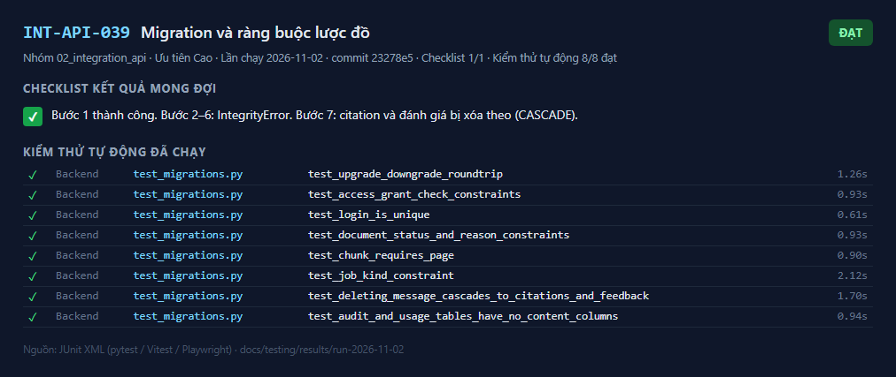
_Kết quả INT-API-039 — lần chạy 2026-11-02_

---

## INT-API-040

**Dọn dữ liệu định kỳ theo thời hạn lưu** — ✅ **Đạt**

| Mục | Nội dung |
|---|---|
| Mục tiêu | Worker xóa bản ghi kiểm toán quá `AUDIT_RETENTION_DAYS` và hội thoại không hoạt động quá `MESSAGE_RETENTION_DAYS` (kèm tin nhắn, trích dẫn, đánh giá); dữ liệu mới giữ nguyên; giá trị 0 tắt việc dọn hội thoại |
| Truy vết | BR-023, PQ-004, OQ-012, T3-04 |
| Ưu tiên / Loại | Trung bình / Dương |
| Tự động hóa | `test_admin_reports_health.py::test_audit_retention_cleanup`; `test_qa_flow.py::test_inactive_conversations_are_cleaned_up`, `test_retention_zero_keeps_everything` |
| Đặc tả | [INT-API-040.md](../../test_cases/02_integration_api/INT-API-040.md) |

**Checklist kết quả mong đợi**

- [x] Bước 1: xóa 1, còn 1.
- [x] Bước 2: hội thoại cũ trả 404, hội thoại mới 200; 0 đánh giá; còn 1 citation; vẫn đủ 2 bản ghi kiểm toán.
- [x] Bước 3: trả 0, không xóa gì.
- [x] Ghi chú: hai kiểm thử của bước 2–3 đã viết nhưng **chưa được chạy** (tại ngày soạn).

**Kiểm thử tự động đã chạy** (3/3 đạt)

| | Tầng | Tệp | Kiểm thử | Thời gian |
|---|---|---|---|---|
| ✅ | Backend | `test_admin_reports_health.py` | test_audit_retention_cleanup | 1.20 s |
| ✅ | Backend | `test_qa_flow.py` | test_inactive_conversations_are_cleaned_up | 4.43 s |
| ✅ | Backend | `test_qa_flow.py` | test_retention_zero_keeps_everything | 2.97 s |

**Ảnh kết quả**

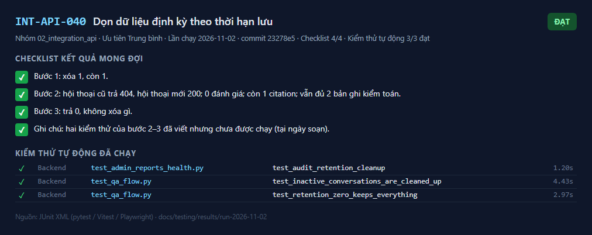
_Kết quả INT-API-040 — lần chạy 2026-11-02_

---
