# 03 — Ca kiểm thử hệ thống / đầu-cuối (E2E-001..E2E-013) — kết quả chi tiết

Lần chạy: [README](README.md) · Đặc tả: [03_e2e_system](../../test_cases/03_e2e_system/README.md)

| Mã | Tên | Ưu tiên | Kết quả | Kiểm thử tự động đạt | Ảnh |
|---|---|---|---|---|---|
| [E2E-001](#e2e-001) | Đăng nhập đúng và sai | Cao | ✅ Đạt | 2/2 | 3 |
| [E2E-002](#e2e-002) | Người bị thu hồi quyền không vào được | Cao | ✅ Đạt | 1/1 | 3 |
| [E2E-003](#e2e-003) | Hết phiên giữ câu hỏi đang soạn | Cao | ✅ Đạt | 11/11 | 2 |
| [E2E-004](#e2e-004) | Trạng thái trống | Trung bình | ✅ Đạt | 1/1 | 2 |
| [E2E-005](#e2e-005) | Tải PDF hợp lệ tới "Sẵn sàng" | Cao | ✅ Đạt | 1/1 | 2 |
| [E2E-006](#e2e-006) | Tệp hỏng và tệp không phải PDF | Cao | ✅ Đạt | 2/2 | 3 |
| [E2E-007](#e2e-007) | Mất mạng khi tải lên | Cao | ✅ Đạt | 1/1 | 2 |
| [E2E-008](#e2e-008) | Hỏi đáp có nguồn và trình xem nguồn | Cao | ✅ Đạt | 1/1 | 2 |
| [E2E-009](#e2e-009) | Mất mạng khi hỏi | Cao | ✅ Đạt | 1/1 | 2 |
| [E2E-010](#e2e-010) | Xóa tài liệu | Cao | ✅ Đạt | 1/1 | 2 |
| [E2E-011](#e2e-011) | Quản trị quyền và bản ghi kiểm toán | Trung bình | ✅ Đạt | 1/1 | 3 |
| [E2E-012](#e2e-012) | Khả năng tiếp cận trên mọi màn hình | Cao | ✅ Đạt | 17/17 | 19 |
| [E2E-013](#e2e-013) | Ảnh màn hình đối chiếu với thiết kế | Trung bình | ✅ Đạt | 1/1 | 2 |

## E2E-001

**Đăng nhập đúng và sai** — ✅ **Đạt**

| Mục | Nội dung |
|---|---|
| Mục tiêu | Đăng nhập đúng vào màn hình theo vai trò; sai mật khẩu thấy thông báo chung, không vi phạm axe |
| Truy vết | BR-014, AC-014, US-017, T1-06 |
| Ưu tiên | Cao |
| Tự động hóa | `auth.spec.ts`: "đăng nhập đúng", "đăng nhập sai" |
| Đặc tả | [E2E-001.md](../../test_cases/03_e2e_system/E2E-001.md) |

**Checklist kết quả mong đợi**

- [x] Bước 1: thấy tiêu đề "Tài liệu của tôi" và "Nhân sự BD" ở header.
- [x] Bước 2: thông báo `role=alert` "Tên đăng nhập hoặc mật khẩu chưa đúng."
- [x] Bước 3: không có vi phạm nghiêm trọng/cao.

**Kiểm thử tự động đã chạy** (2/2 đạt)

| | Tầng | Tệp | Kiểm thử | Thời gian |
|---|---|---|---|---|
| ✅ | E2E | `auth.spec.ts` | đăng nhập đúng: BD vào màn hình chính | 6.32 s |
| ✅ | E2E | `auth.spec.ts` | đăng nhập sai: thông báo chung, axe không vi phạm nghiêm trọng | 8.34 s |

**Ảnh kết quả**

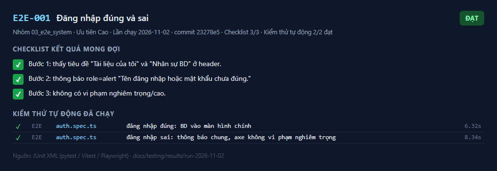
_Kết quả E2E-001 — lần chạy 2026-11-02_

_đăng nhập đúng: BD vào màn hình chính_

_đăng nhập sai: thông báo chung, axe không vi phạm nghiêm trọng_

---

## E2E-002

**Người bị thu hồi quyền không vào được** — ✅ **Đạt**

| Mục | Nội dung |
|---|---|
| Mục tiêu | Quản trị bảo mật thu hồi quyền qua S-05 (có bước xác nhận); người đó đăng nhập thấy trạng thái "không có quyền"; cấp lại được |
| Truy vết | BR-014, AC-014, LG-07, US-017, T1-07 |
| Ưu tiên | Cao |
| Tự động hóa | `auth.spec.ts`: "không có quyền" |
| Đặc tả | [E2E-002.md](../../test_cases/03_e2e_system/E2E-002.md) |

**Checklist kết quả mong đợi**

- [x] Bước 1: hàng hiển thị "Đã thu hồi".
- [x] Bước 2: thông báo "…chưa được cấp quyền sử dụng ứng dụng".
- [x] Bước 3: hàng hiển thị "Đang hoạt động".

**Kiểm thử tự động đã chạy** (1/1 đạt)

| | Tầng | Tệp | Kiểm thử | Thời gian |
|---|---|---|---|---|
| ✅ | E2E | `auth.spec.ts` | không có quyền: tài khoản bị thu hồi nhận trạng thái "không có quyền" | 19.59 s |

**Ảnh kết quả**

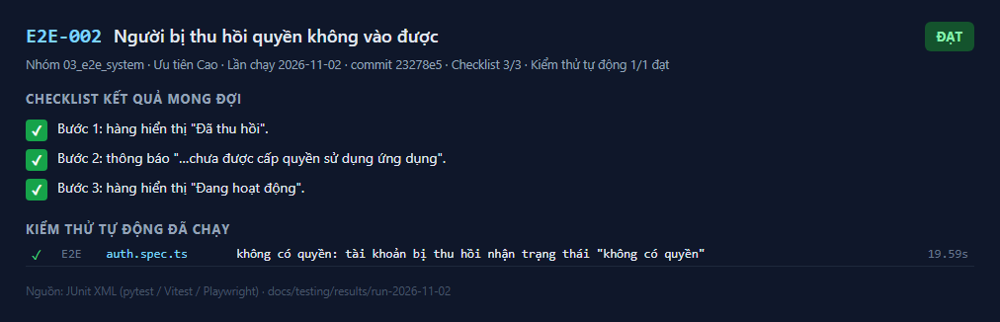
_Kết quả E2E-002 — lần chạy 2026-11-02_

_không có quyền: tài khoản bị thu hồi nhận trạng thái "không có quyền"_

_không có quyền: tài khoản bị thu hồi nhận trạng thái "không có quyền"_

---

## E2E-003

**Hết phiên giữ câu hỏi đang soạn** — ✅ **Đạt**

| Mục | Nội dung |
|---|---|
| Mục tiêu | Khi phiên không còn hợp lệ, yêu cầu kế tiếp đưa về S-01 với thông báo hết phiên; câu hỏi đang soạn vẫn được giữ trong sessionStorage |
| Truy vết | US-017, PRD 4.2, T1-06 |
| Ưu tiên | Cao |
| Tự động hóa | `auth.spec.ts`: "hết phiên"; Vitest `LoginPage.test.tsx` (401 giữa phiên) |
| Đặc tả | [E2E-003.md](../../test_cases/03_e2e_system/E2E-003.md) |

**Checklist kết quả mong đợi**

- [x] Về trang "Đăng nhập" với thông báo "Phiên làm việc đã hết hạn."
- [x] (Vitest) `sessionStorage["cwd.draft"]` = câu hỏi đang soạn.

**Kiểm thử tự động đã chạy** (11/11 đạt)

| | Tầng | Tệp | Kiểm thử | Thời gian |
|---|---|---|---|---|
| ✅ | E2E | `auth.spec.ts` | hết phiên: yêu cầu kế tiếp đưa về S-01 với thông báo hết phiên, giữ câu hỏi đang soạn | 12.70 s |
| ✅ | Frontend | `LoginPage.test.tsx` | S-01 Đăng nhập > mặc định: biểu mẫu, không có thông báo lỗi, không vi phạm axe | 2.14 s |
| ✅ | Frontend | `LoginPage.test.tsx` | S-01 Đăng nhập > sai thông tin: thông báo chung, không phân biệt sai tên hay sai mật khẩu | 1.47 s |
| ✅ | Frontend | `LoginPage.test.tsx` | S-01 Đăng nhập > không có quyền (403 no_access) | 0.92 s |
| ✅ | Frontend | `LoginPage.test.tsx` | S-01 Đăng nhập > hết phiên: thông báo khi bị đưa về từ một yêu cầu 401 | 0.08 s |
| ✅ | Frontend | `LoginPage.test.tsx` | S-01 Đăng nhập > đăng nhập vai trò bd đưa tới đúng màn hình | 1.09 s |
| ✅ | Frontend | `LoginPage.test.tsx` | S-01 Đăng nhập > đăng nhập vai trò security_admin đưa tới đúng màn hình | 1.08 s |
| ✅ | Frontend | `LoginPage.test.tsx` | S-01 Đăng nhập > đăng nhập vai trò manager đưa tới đúng màn hình | 0.89 s |
| ✅ | Frontend | `LoginPage.test.tsx` | AuthGate (C-01) > chưa đăng nhập → về /login | 0.19 s |
| ✅ | Frontend | `LoginPage.test.tsx` | AuthGate (C-01) > 401 giữa phiên → về /login với thông báo hết phiên, câu hỏi đang soạn vẫn được giữ | 1.43 s |
| ✅ | Frontend | `LoginPage.test.tsx` | AuthGate (C-01) > sai vai trò → về trang chủ của vai trò | 0.14 s |

**Ảnh kết quả**

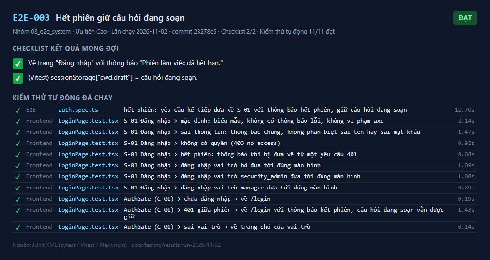
_Kết quả E2E-003 — lần chạy 2026-11-02_

_hết phiên: yêu cầu kế tiếp đưa về S-01 với thông báo hết phiên, giữ câu hỏi đang soạn_

---

## E2E-004

**Trạng thái trống** — ✅ **Đạt**

| Mục | Nội dung |
|---|---|
| Mục tiêu | Người chưa có tài liệu thấy hướng dẫn tải PDF; ô hỏi bị vô hiệu kèm giải thích; khớp ảnh `s02-empty` |
| Truy vết | BR-001, US-001, PRD 4.2, T1-18 |
| Ưu tiên | Trung bình |
| Tự động hóa | `documents.spec.ts`: "trạng thái trống" |
| Đặc tả | [E2E-004.md](../../test_cases/03_e2e_system/E2E-004.md) |

**Checklist kết quả mong đợi**

- [x] Tiêu đề "Chưa có tài liệu nào"; ô "Câu hỏi của bạn" bị vô hiệu, placeholder "Hãy tải tài liệu lên trước khi đặt câu hỏi".
- [x] Không có vi phạm axe nghiêm trọng/cao.

**Kiểm thử tự động đã chạy** (1/1 đạt)

| | Tầng | Tệp | Kiểm thử | Thời gian |
|---|---|---|---|---|
| ✅ | E2E | `documents.spec.ts` | trạng thái trống khi chưa có tài liệu | 11.58 s |

**Ảnh kết quả**

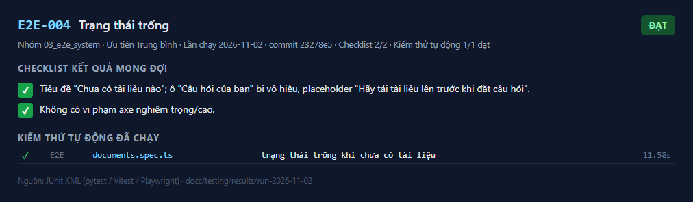
_Kết quả E2E-004 — lần chạy 2026-11-02_

_trạng thái trống khi chưa có tài liệu_

---

## E2E-005

**Tải PDF hợp lệ tới "Sẵn sàng"** — ✅ **Đạt**

| Mục | Nội dung |
|---|---|
| Mục tiêu | Tệp xuất hiện với "Đang xử lý" rồi "Sẵn sàng", số trang đúng, ô hỏi mở |
| Truy vết | BR-001, AC-001, US-001, T1-21 |
| Ưu tiên | Cao |
| Tự động hóa | `documents.spec.ts`: "tải PDF hợp lệ" |
| Đặc tả | [E2E-005.md](../../test_cases/03_e2e_system/E2E-005.md) |

**Checklist kết quả mong đợi**

- [x] Tệp xuất hiện trong "Danh sách tài liệu"; nhãn "Sẵn sàng"; meta "2 trang".
- [x] Ô "Câu hỏi của bạn" được bật; không vi phạm axe.

**Kiểm thử tự động đã chạy** (1/1 đạt)

| | Tầng | Tệp | Kiểm thử | Thời gian |
|---|---|---|---|---|
| ✅ | E2E | `documents.spec.ts` | tải PDF hợp lệ: Đang xử lý rồi Sẵn sàng, hỏi được (AC-001) | 17.52 s |

**Ảnh kết quả**

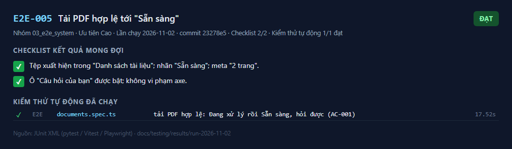
_Kết quả E2E-005 — lần chạy 2026-11-02_

_1.png)
_tải PDF hợp lệ: Đang xử lý rồi Sẵn sàng, hỏi được (AC-001)_

---

## E2E-006

**Tệp hỏng và tệp không phải PDF** — ✅ **Đạt**

| Mục | Nội dung |
|---|---|
| Mục tiêu | Tệp hỏng: nhãn "Lỗi" kèm lý do dễ hiểu, có "Thử lại" và "Xóa"; tệp không phải PDF bị từ chối ngay khi tải lên |
| Truy vết | BR-003, BR-018, AC-003, AC-018, US-003, US-004, T1-19, T1-21 |
| Ưu tiên | Cao |
| Tự động hóa | `documents.spec.ts`: "tải tệp hỏng", "tệp không phải PDF" |
| Đặc tả | [E2E-006.md](../../test_cases/03_e2e_system/E2E-006.md) |

**Checklist kết quả mong đợi**

- [x] Bước 1: mục có "Lỗi", "Tệp bị hỏng hoặc không đọc được", nút "Thử lại <tên>", "Xóa <tên>".
- [x] Bước 2: danh sách "Tệp đang tải lên" có "Tệp không phải PDF".

**Kiểm thử tự động đã chạy** (2/2 đạt)

| | Tầng | Tệp | Kiểm thử | Thời gian |
|---|---|---|---|---|
| ✅ | E2E | `documents.spec.ts` | tải tệp hỏng: nhãn Lỗi cùng lý do, có Thử lại và Xóa (AC-003, AC-018) | 13.05 s |
| ✅ | E2E | `documents.spec.ts` | tệp không phải PDF bị từ chối ngay với lý do | 8.87 s |

**Ảnh kết quả**

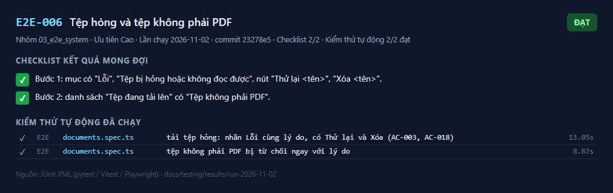
_Kết quả E2E-006 — lần chạy 2026-11-02_

_tải tệp hỏng: nhãn Lỗi cùng lý do, có Thử lại và Xóa (AC-003, AC-018)_

_tệp không phải PDF bị từ chối ngay với lý do_

---

## E2E-007

**Mất mạng khi tải lên** — ✅ **Đạt**

| Mục | Nội dung |
|---|---|
| Mục tiêu | Tệp tải dở hiển thị "Chưa tải xong", **không bao giờ** "Sẵn sàng"; có banner; "Tải lại" thành công khi có mạng; khớp ảnh `s02-offline-upload` |
| Truy vết | BR-003, US-003, PRD 4.2, T1-17 |
| Ưu tiên | Cao |
| Tự động hóa | `documents.spec.ts`: "mất mạng giữa chừng khi tải lên" |
| Đặc tả | [E2E-007.md](../../test_cases/03_e2e_system/E2E-007.md) |

**Checklist kết quả mong đợi**

- [x] Bước 2: mục ở "Tệp đang tải lên" có "Chưa tải xong"; banner "Tệp "<tên>" chưa tải xong"; tệp không có trong "Danh sách tài liệu".
- [x] Bước 3: tệp vào danh sách và đạt "Sẵn sàng".

**Kiểm thử tự động đã chạy** (1/1 đạt)

| | Tầng | Tệp | Kiểm thử | Thời gian |
|---|---|---|---|---|
| ✅ | E2E | `documents.spec.ts` | mất mạng giữa chừng khi tải lên: "Chưa tải xong", không bao giờ "Sẵn sàng" | 12.84 s |

**Ảnh kết quả**

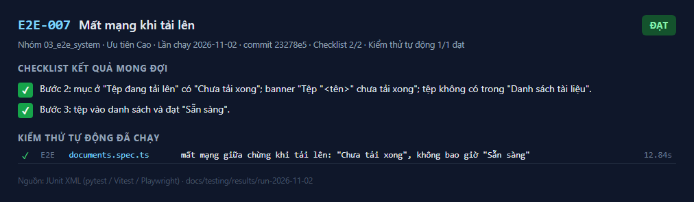
_Kết quả E2E-007 — lần chạy 2026-11-02_

_mất mạng giữa chừng khi tải lên: "Chưa tải xong", không bao giờ "Sẵn sàng"_

---

## E2E-008

**Hỏi đáp có nguồn và trình xem nguồn** — ✅ **Đạt**

| Mục | Nội dung |
|---|---|
| Mục tiêu | Câu trả lời có chip "tên, tr.N"; S-03 mở đúng trang, tô sáng đoạn trích; chuyển trang; quay lại giữ hội thoại; câu ngoài phạm vi (hội thoại mới) nhận "không tìm thấy" |
| Truy vết | BR-006, BR-009, BR-012, BR-019, AC-006, AC-009, AC-012, AC-019, US-008, US-011, US-014, US-015, T2-14 |
| Ưu tiên | Cao |
| Tự động hóa | `qa.spec.ts`: "hỏi đáp có nguồn và trình xem nguồn" |
| Đặc tả | [E2E-008.md](../../test_cases/03_e2e_system/E2E-008.md) |

**Checklist kết quả mong đợi**

- [x] Bước 2: thẻ "Câu trả lời" chứa mã; có liên kết "<tên>, tr.2 – mở trang nguồn"; tiêu điểm quay về ô nhập.
- [x] Bước 3–4: "Trang 2 / 3"; phần tô sáng `mark.hit` chứa mã; rồi "Trang 3 / 3"; không vi phạm axe.
- [x] Bước 5: câu trả lời vẫn hiển thị (khôi phục lịch sử).
- [x] Bước 6: khối `role=status` "Không tìm thấy thông tin này trong các tài liệu đã tải lên."

**Kiểm thử tự động đã chạy** (1/1 đạt)

| | Tầng | Tệp | Kiểm thử | Thời gian |
|---|---|---|---|---|
| ✅ | E2E | `qa.spec.ts` | hỏi đáp có nguồn và trình xem nguồn | 40.87 s |

**Ảnh kết quả**

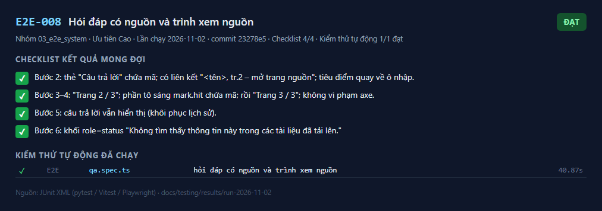
_Kết quả E2E-008 — lần chạy 2026-11-02_

_hỏi đáp có nguồn và trình xem nguồn_

---

## E2E-009

**Mất mạng khi hỏi** — ✅ **Đạt**

| Mục | Nội dung |
|---|---|
| Mục tiêu | Câu hỏi được giữ trong ô nhập, nút đổi thành "Gửi lại", không hiển thị câu trả lời dở dang; gửi lại thành công khi có mạng; khớp ảnh `s02-offline-ask` |
| Truy vết | BR-006, US-008, PRD 4.2, T2-10 |
| Ưu tiên | Cao |
| Tự động hóa | `qa.spec.ts`: "mất mạng khi hỏi" |
| Đặc tả | [E2E-009.md](../../test_cases/03_e2e_system/E2E-009.md) |

**Checklist kết quả mong đợi**

- [x] Bước 2: banner "Mất kết nối, chưa nhận được câu trả lời."; ô nhập giữ nguyên câu hỏi; không có thẻ "Câu trả lời".
- [x] Bước 3: thẻ "Câu trả lời" chứa "14 ngay".

**Kiểm thử tự động đã chạy** (1/1 đạt)

| | Tầng | Tệp | Kiểm thử | Thời gian |
|---|---|---|---|---|
| ✅ | E2E | `qa.spec.ts` | mất mạng khi hỏi: giữ câu hỏi, "Gửi lại" được sau khi có mạng | 24.83 s |

**Ảnh kết quả**

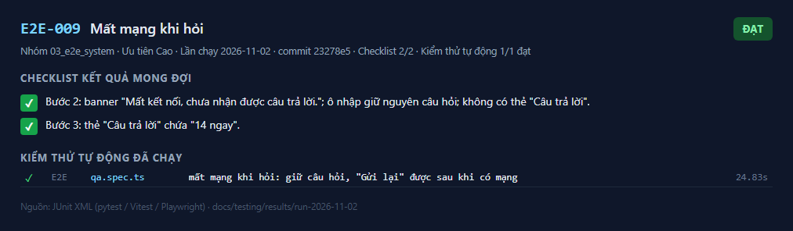
_Kết quả E2E-009 — lần chạy 2026-11-02_

_mất mạng khi hỏi: giữ câu hỏi, "Gửi lại" được sau khi có mạng_

---

## E2E-010

**Xóa tài liệu** — ✅ **Đạt**

| Mục | Nội dung |
|---|---|
| Mục tiêu | Hộp thoại xác nhận (tiêu điểm ở "Hủy", Esc đóng và trả tiêu điểm); xóa xong tài liệu biến khỏi danh sách; câu hỏi chỉ có đáp án trong tài liệu đó nhận "không tìm thấy" |
| Truy vết | BR-005, AC-005, US-006, T3-08 |
| Ưu tiên | Cao |
| Tự động hóa | `delete-audit.spec.ts`: "xóa tài liệu" |
| Đặc tả | [E2E-010.md](../../test_cases/03_e2e_system/E2E-010.md) |

**Checklist kết quả mong đợi**

- [x] Bước 2: hộp thoại "Xóa tài liệu "<tên>"?", tiêu điểm ở "Hủy"; sau Esc hộp thoại đóng, tiêu điểm về nút "Xóa <tên>".
- [x] Bước 3: tệp biến khỏi danh sách.
- [x] Bước 4: "Không tìm thấy thông tin này…".

**Kiểm thử tự động đã chạy** (1/1 đạt)

| | Tầng | Tệp | Kiểm thử | Thời gian |
|---|---|---|---|---|
| ✅ | E2E | `delete-audit.spec.ts` | xóa tài liệu: hộp thoại xác nhận, biến khỏi danh sách, không còn được dùng để trả lời | 23.43 s |

**Ảnh kết quả**

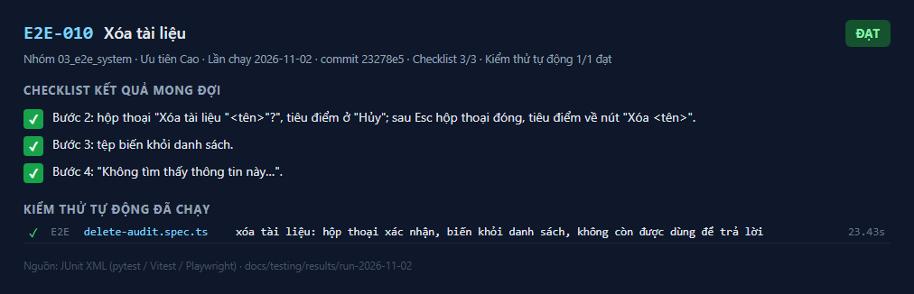
_Kết quả E2E-010 — lần chạy 2026-11-02_

_xóa tài liệu: hộp thoại xác nhận, biến khỏi danh sách, không còn được dùng để trả lời_

---

## E2E-011

**Quản trị quyền và bản ghi kiểm toán** — ✅ **Đạt**

| Mục | Nội dung |
|---|---|
| Mục tiêu | Cấp và thu hồi quyền qua S-05; lọc bản ghi kiểm toán theo người dùng ở S-06; bản ghi có tài liệu liên quan, không có nội dung câu hỏi |
| Truy vết | BR-014, BR-023, AC-014, AC-023, US-017, US-020, T3-08 |
| Ưu tiên | Trung bình |
| Tự động hóa | `delete-audit.spec.ts`: "quản trị bảo mật" |
| Đặc tả | [E2E-011.md](../../test_cases/03_e2e_system/E2E-011.md) |

**Checklist kết quả mong đợi**

- [x] Bước 2: hàng hiển thị "Quản lý", "Đang hoạt động", rồi "Đã thu hồi".
- [x] Bước 3: hàng đầu chứa `e2e.bd2` và tên tệp; trang không chứa nội dung câu hỏi.

**Kiểm thử tự động đã chạy** (1/1 đạt)

| | Tầng | Tệp | Kiểm thử | Thời gian |
|---|---|---|---|---|
| ✅ | E2E | `delete-audit.spec.ts` | quản trị bảo mật: cấp, thu hồi quyền và xem bản ghi kiểm toán | 23.99 s |

**Ảnh kết quả**

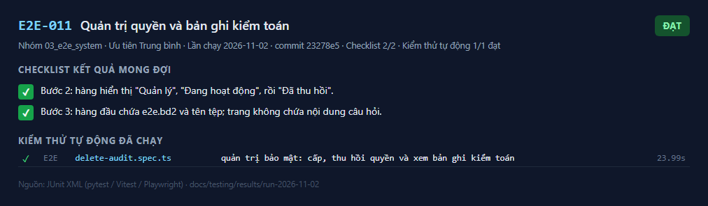
_Kết quả E2E-011 — lần chạy 2026-11-02_

_quản trị bảo mật: cấp, thu hồi quyền và xem bản ghi kiểm toán_

_quản trị bảo mật: cấp, thu hồi quyền và xem bản ghi kiểm toán_

---

## E2E-012

**Khả năng tiếp cận trên mọi màn hình** — ✅ **Đạt**

| Mục | Nội dung |
|---|---|
| Mục tiêu | axe (WCAG 2.1 A/AA) không có vi phạm nghiêm trọng/cao trên S-01..S-07; dùng được chỉ bằng bàn phím; dùng được ở mức thu phóng 200% |
| Truy vết | NFR-ACC, DoD mục 3, T4-08 |
| Ưu tiên | Cao |
| Tự động hóa | `a11y.spec.ts` (6 kiểm thử); axe trong `auth.spec.ts`, `documents.spec.ts`, `qa.spec.ts` |
| Đặc tả | [E2E-012.md](../../test_cases/03_e2e_system/E2E-012.md) |

**Checklist kết quả mong đợi**

- [x] Bước 1: danh sách vi phạm nghiêm trọng/cao rỗng.
- [x] Bước 2: tiêu điểm đúng thứ tự; vào được "Tài liệu của tôi".
- [x] Bước 3: nút "＋ Tải PDF lên" và ô "Câu hỏi của bạn" vẫn hiển thị.

**Kiểm thử tự động đã chạy** (17/17 đạt)

| | Tầng | Tệp | Kiểm thử | Thời gian |
|---|---|---|---|---|
| ✅ | E2E | `a11y.spec.ts` | S-01 Đăng nhập | 9.51 s |
| ✅ | E2E | `a11y.spec.ts` | S-05 và S-06 (quản trị bảo mật) | 17.05 s |
| ✅ | E2E | `a11y.spec.ts` | S-07 Báo cáo mức sử dụng | 17.45 s |
| ✅ | E2E | `a11y.spec.ts` | S-04 hộp thoại xóa | 14.62 s |
| ✅ | E2E | `a11y.spec.ts` | chỉ dùng bàn phím: liên kết bỏ qua và đăng nhập | 6.05 s |
| ✅ | E2E | `a11y.spec.ts` | thu phóng 200%: màn hình chính không mất chức năng | 6.32 s |
| ✅ | E2E | `auth.spec.ts` | đăng nhập đúng: BD vào màn hình chính | 6.32 s |
| ✅ | E2E | `auth.spec.ts` | đăng nhập sai: thông báo chung, axe không vi phạm nghiêm trọng | 8.34 s |
| ✅ | E2E | `auth.spec.ts` | không có quyền: tài khoản bị thu hồi nhận trạng thái "không có quyền" | 19.59 s |
| ✅ | E2E | `auth.spec.ts` | hết phiên: yêu cầu kế tiếp đưa về S-01 với thông báo hết phiên, giữ câu hỏi đang soạn | 12.70 s |
| ✅ | E2E | `documents.spec.ts` | trạng thái trống khi chưa có tài liệu | 11.58 s |
| ✅ | E2E | `documents.spec.ts` | tải PDF hợp lệ: Đang xử lý rồi Sẵn sàng, hỏi được (AC-001) | 17.52 s |
| ✅ | E2E | `documents.spec.ts` | tải tệp hỏng: nhãn Lỗi cùng lý do, có Thử lại và Xóa (AC-003, AC-018) | 13.05 s |
| ✅ | E2E | `documents.spec.ts` | tệp không phải PDF bị từ chối ngay với lý do | 8.87 s |
| ✅ | E2E | `documents.spec.ts` | mất mạng giữa chừng khi tải lên: "Chưa tải xong", không bao giờ "Sẵn sàng" | 12.84 s |
| ✅ | E2E | `qa.spec.ts` | hỏi đáp có nguồn và trình xem nguồn | 40.87 s |
| ✅ | E2E | `qa.spec.ts` | mất mạng khi hỏi: giữ câu hỏi, "Gửi lại" được sau khi có mạng | 24.83 s |

**Ảnh kết quả**

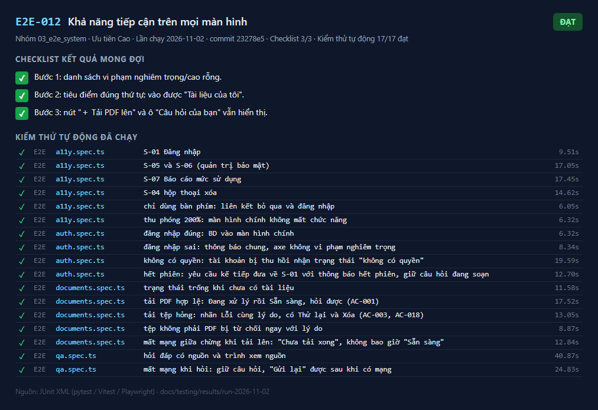
_Kết quả E2E-012 — lần chạy 2026-11-02_

_S-01 Đăng nhập_

_1.png)
_S-05 và S-06 (quản trị bảo mật)_

_S-07 Báo cáo mức sử dụng_

_S-04 hộp thoại xóa_

_chỉ dùng bàn phím: liên kết bỏ qua và đăng nhập_

_thu phóng 200%: màn hình chính không mất chức năng_

_đăng nhập đúng: BD vào màn hình chính_

_đăng nhập sai: thông báo chung, axe không vi phạm nghiêm trọng_

_không có quyền: tài khoản bị thu hồi nhận trạng thái "không có quyền"_

_không có quyền: tài khoản bị thu hồi nhận trạng thái "không có quyền"_

_hết phiên: yêu cầu kế tiếp đưa về S-01 với thông báo hết phiên, giữ câu hỏi đang soạn_

_trạng thái trống khi chưa có tài liệu_

_1.png)
_tải PDF hợp lệ: Đang xử lý rồi Sẵn sàng, hỏi được (AC-001)_

_tải tệp hỏng: nhãn Lỗi cùng lý do, có Thử lại và Xóa (AC-003, AC-018)_

_tệp không phải PDF bị từ chối ngay với lý do_

_mất mạng giữa chừng khi tải lên: "Chưa tải xong", không bao giờ "Sẵn sàng"_

_hỏi đáp có nguồn và trình xem nguồn_

_mất mạng khi hỏi: giữ câu hỏi, "Gửi lại" được sau khi có mạng_

---

## E2E-013

**Ảnh màn hình đối chiếu với thiết kế** — ✅ **Đạt**

| Mục | Nội dung |
|---|---|
| Mục tiêu | Chụp giao diện thật các màn hình để đối chiếu với `docs/design/html_design/screenshots/` |
| Truy vết | OBJ-003, DoD mục 2, T4-06 |
| Ưu tiên | Trung bình |
| Tự động hóa | `screenshots.spec.ts` (ghi vào `docs/implement/evidence/screenshots/`) |
| Đặc tả | [E2E-013.md](../../test_cases/03_e2e_system/E2E-013.md) |

**Checklist kết quả mong đợi**

- [x] Có tệp ảnh cho từng màn hình; bố cục, màu, nhãn khớp ảnh mẫu. Khác biệt có chủ đích được ghi trong `launch_checklist.md`.

**Kiểm thử tự động đã chạy** (1/1 đạt)

| | Tầng | Tệp | Kiểm thử | Thời gian |
|---|---|---|---|---|
| ✅ | E2E | `screenshots.spec.ts` | ảnh màn hình S-01..S-07 | 47.83 s |

**Ảnh kết quả**

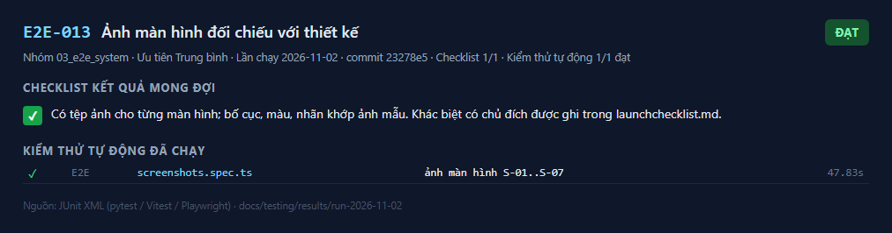
_Kết quả E2E-013 — lần chạy 2026-11-02_

_ảnh màn hình S-01..S-07_

---
