# 04 — Ca kiểm thử chấp nhận (UAT-001..UAT-011) — kết quả chi tiết

Lần chạy: [README](README.md) · Đặc tả: [04_acceptance](../../test_cases/04_acceptance/README.md)

| Mã | Tên | Ưu tiên | Kết quả | Kiểm thử tự động đạt | Ảnh |
|---|---|---|---|---|---|
| [UAT-001](#uat-001) | Tải nhiều PDF thật | — | 📝 Thủ công — chưa ghi nhận | — | 1 |
| [UAT-002](#uat-002) | Tệp lỗi có lý do dễ hiểu | — | 📝 Thủ công — chưa ghi nhận | — | 1 |
| [UAT-003](#uat-003) | Trả lời câu hỏi thường gặp có nguồn | — | 📝 Thủ công — chưa ghi nhận | — | 1 |
| [UAT-004](#uat-004) | Không bịa khi tài liệu không có thông tin | — | 📝 Thủ công — chưa ghi nhận | — | 1 |
| [UAT-005](#uat-005) | Hỏi tiếp bằng đại từ | — | 📝 Thủ công — chưa ghi nhận | — | 1 |
| [UAT-006](#uat-006) | Xóa tài liệu và xác nhận xóa vĩnh viễn | — | 📝 Thủ công — chưa ghi nhận | — | 1 |
| [UAT-007](#uat-007) | Cấp/thu hồi quyền và cô lập tài liệu | — | 📝 Thủ công — chưa ghi nhận | — | 1 |
| [UAT-008](#uat-008) | Tra cứu bản ghi kiểm toán | — | 📝 Thủ công — chưa ghi nhận | — | 1 |
| [UAT-009](#uat-009) | Báo cáo mức sử dụng | — | 📝 Thủ công — chưa ghi nhận | — | 1 |
| [UAT-010](#uat-010) | Nghiệm thu chất lượng theo ngôn ngữ | — | 📝 Thủ công — chưa ghi nhận | — | 1 |
| [UAT-011](#uat-011) | Rà soát chính sách dữ liệu | — | 📝 Thủ công — chưa ghi nhận | — | 1 |

## UAT-001

**Tải nhiều PDF thật** — 📝 **Thủ công — chưa ghi nhận**

| Mục | Nội dung |
|---|---|
| Story / AC | US-001, US-002 / AC-001, AC-002 |
| Tự động hóa | Thủ công |
| Đặc tả | [UAT-001.md](../../test_cases/04_acceptance/UAT-001.md) |

**Checklist kết quả mong đợi**

- [ ] Thấy tiến độ từng tệp; vùng hội thoại không bị khóa trong lúc tải.
- [ ] Mọi tệp đạt "Sẵn sàng" với số trang đúng.
- [ ] Hỏi được về nội dung các tệp.

**Ảnh kết quả**

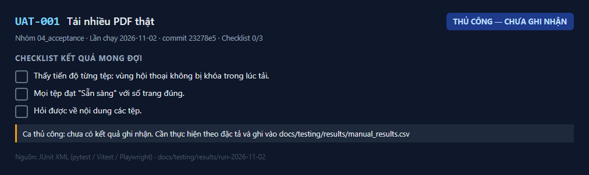
_Kết quả UAT-001 — lần chạy 2026-11-02_

**Cách ghi nhận:** thực hiện theo đặc tả rồi thêm dòng `UAT-001,<Đạt|Không đạt|Bị chặn>,<ngày>,<người>,<ghi chú>` vào `docs/testing/results/manual_results.csv`.

---

## UAT-002

**Tệp lỗi có lý do dễ hiểu** — 📝 **Thủ công — chưa ghi nhận**

| Mục | Nội dung |
|---|---|
| Story / AC | US-003, US-004 / AC-003, AC-018 |
| Tự động hóa | Thủ công |
| Đặc tả | [UAT-002.md](../../test_cases/04_acceptance/UAT-002.md) |

**Checklist kết quả mong đợi**

- [ ] Mỗi thông báo nêu tên tệp và đúng nhóm lý do; người dùng hiểu cần làm gì.
- [ ] Không tệp lỗi nào xuất hiện như "Sẵn sàng" hay được dùng để trả lời.
- [ ] Sau khi khắc phục, tệp tải lại thành công.

**Ảnh kết quả**

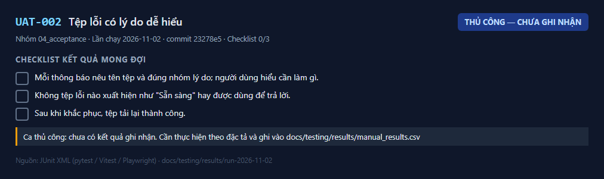
_Kết quả UAT-002 — lần chạy 2026-11-02_

**Cách ghi nhận:** thực hiện theo đặc tả rồi thêm dòng `UAT-002,<Đạt|Không đạt|Bị chặn>,<ngày>,<người>,<ghi chú>` vào `docs/testing/results/manual_results.csv`.

---

## UAT-003

**Trả lời câu hỏi thường gặp có nguồn** — 📝 **Thủ công — chưa ghi nhận**

| Mục | Nội dung |
|---|---|
| Story / AC | US-008, US-009, US-014, US-015 / AC-006, AC-007, AC-012, AC-019 |
| Tự động hóa | Thủ công |
| Đặc tả | [UAT-003.md](../../test_cases/04_acceptance/UAT-003.md) |

**Checklist kết quả mong đợi**

- [ ] Câu trả lời đúng theo xác nhận của business owner.
- [ ] Mọi câu trả lời có nội dung có ít nhất một nguồn; trang nêu ra chứa thông tin tương ứng.
- [ ] Câu hỏi nhiều tài liệu có nguồn từ đủ các tài liệu liên quan.

**Ảnh kết quả**

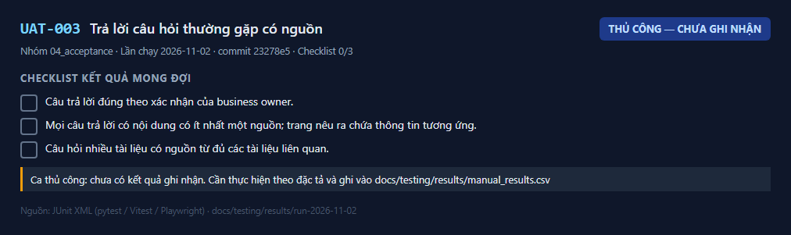
_Kết quả UAT-003 — lần chạy 2026-11-02_

**Cách ghi nhận:** thực hiện theo đặc tả rồi thêm dòng `UAT-003,<Đạt|Không đạt|Bị chặn>,<ngày>,<người>,<ghi chú>` vào `docs/testing/results/manual_results.csv`.

---

## UAT-004

**Không bịa khi tài liệu không có thông tin** — 📝 **Thủ công — chưa ghi nhận**

| Mục | Nội dung |
|---|---|
| Story / AC | US-011 / AC-009 |
| Tự động hóa | Thủ công |
| Đặc tả | [UAT-004.md](../../test_cases/04_acceptance/UAT-004.md) |

**Checklist kết quả mong đợi**

- [ ] Nhận "Không tìm thấy thông tin này trong các tài liệu đã tải lên." kèm gợi ý.
- [ ] Số câu bị trả lời có nội dung không có căn cứ ≤ ngưỡng [TBD: OQ-002]. — _chưa kiểm: ngưỡng/cấu hình còn [TBD]_

**Ảnh kết quả**

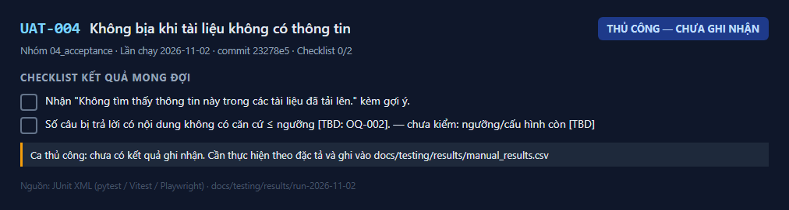
_Kết quả UAT-004 — lần chạy 2026-11-02_

**Cách ghi nhận:** thực hiện theo đặc tả rồi thêm dòng `UAT-004,<Đạt|Không đạt|Bị chặn>,<ngày>,<người>,<ghi chú>` vào `docs/testing/results/manual_results.csv`.

---

## UAT-005

**Hỏi tiếp bằng đại từ** — 📝 **Thủ công — chưa ghi nhận**

| Mục | Nội dung |
|---|---|
| Story / AC | US-010 / AC-008 |
| Tự động hóa | Thủ công |
| Đặc tả | [UAT-005.md](../../test_cases/04_acceptance/UAT-005.md) |

**Checklist kết quả mong đợi**

- [ ] Bước 2: câu trả lời hiểu đúng "đó" là hợp đồng với công ty X.
- [ ] Bước 3: không dùng ngữ cảnh cũ.

**Ảnh kết quả**

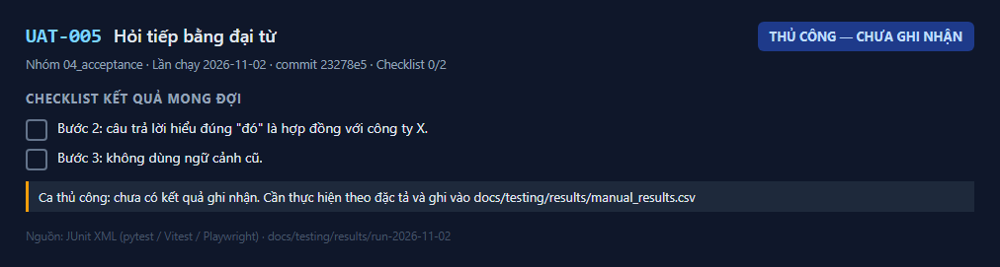
_Kết quả UAT-005 — lần chạy 2026-11-02_

**Cách ghi nhận:** thực hiện theo đặc tả rồi thêm dòng `UAT-005,<Đạt|Không đạt|Bị chặn>,<ngày>,<người>,<ghi chú>` vào `docs/testing/results/manual_results.csv`.

---

## UAT-006

**Xóa tài liệu và xác nhận xóa vĩnh viễn** — 📝 **Thủ công — chưa ghi nhận**

| Mục | Nội dung |
|---|---|
| Story / AC | US-006, US-007 / AC-005, AC-024 |
| Tự động hóa | Thủ công |
| Đặc tả | [UAT-006.md](../../test_cases/04_acceptance/UAT-006.md) |

**Checklist kết quả mong đợi**

- [ ] Bước 2: hộp thoại nêu tên tài liệu, thời hạn, "không thể hoàn tác"; X biến khỏi danh sách.
- [ ] Bước 3: "không tìm thấy" ngay lập tức.
- [ ] Bước 4: không còn chunk, tệp, đoạn trích; `purged_at` có giá trị.

**Ảnh kết quả**

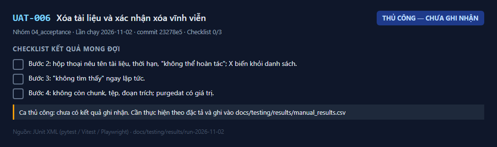
_Kết quả UAT-006 — lần chạy 2026-11-02_

**Cách ghi nhận:** thực hiện theo đặc tả rồi thêm dòng `UAT-006,<Đạt|Không đạt|Bị chặn>,<ngày>,<người>,<ghi chú>` vào `docs/testing/results/manual_results.csv`.

---

## UAT-007

**Cấp/thu hồi quyền và cô lập tài liệu** — 📝 **Thủ công — chưa ghi nhận**

| Mục | Nội dung |
|---|---|
| Story / AC | US-017, US-018 / AC-014, AC-020 |
| Tự động hóa | Thủ công |
| Đặc tả | [UAT-007.md](../../test_cases/04_acceptance/UAT-007.md) |

**Checklist kết quả mong đợi**

- [ ] Bước 3: "không tìm thấy"; A không thấy tài liệu của B trong danh sách.
- [ ] Bước 4: B mất truy cập ngay ở thao tác kế tiếp; đăng nhập lại thấy thông báo không có quyền.

**Ảnh kết quả**

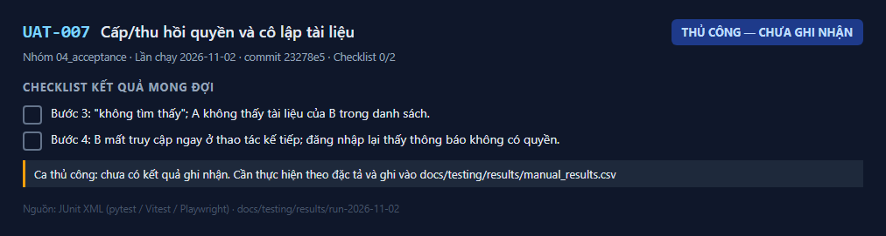
_Kết quả UAT-007 — lần chạy 2026-11-02_

**Cách ghi nhận:** thực hiện theo đặc tả rồi thêm dòng `UAT-007,<Đạt|Không đạt|Bị chặn>,<ngày>,<người>,<ghi chú>` vào `docs/testing/results/manual_results.csv`.

---

## UAT-008

**Tra cứu bản ghi kiểm toán** — 📝 **Thủ công — chưa ghi nhận**

| Mục | Nội dung |
|---|---|
| Story / AC | US-020 / AC-023 |
| Tự động hóa | Thủ công |
| Đặc tả | [UAT-008.md](../../test_cases/04_acceptance/UAT-008.md) |

**Checklist kết quả mong đợi**

- [ ] Mỗi câu hỏi có một bản ghi: người dùng, tài liệu liên quan, thời điểm.
- [ ] Không hiển thị nội dung câu hỏi hay tài liệu.
- [ ] Bộ lọc và phân trang cho kết quả đúng.

**Ảnh kết quả**

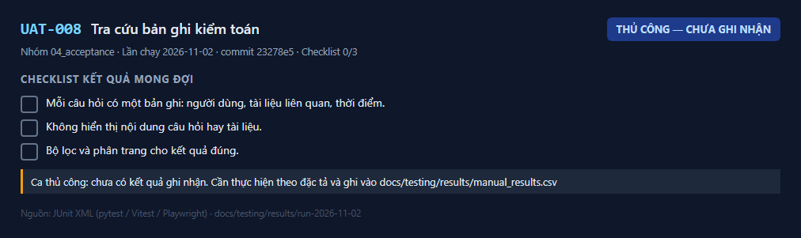
_Kết quả UAT-008 — lần chạy 2026-11-02_

**Cách ghi nhận:** thực hiện theo đặc tả rồi thêm dòng `UAT-008,<Đạt|Không đạt|Bị chặn>,<ngày>,<người>,<ghi chú>` vào `docs/testing/results/manual_results.csv`.

---

## UAT-009

**Báo cáo mức sử dụng** — 📝 **Thủ công — chưa ghi nhận**

| Mục | Nội dung |
|---|---|
| Story / AC | US-022, US-023, US-024 / AC-016, AC-021, AC-017 |
| Tự động hóa | Thủ công |
| Đặc tả | [UAT-009.md](../../test_cases/04_acceptance/UAT-009.md) |

**Checklist kết quả mong đợi**

- [ ] Số người dùng hoạt động, số câu hỏi, tỷ lệ hữu ích khớp số liệu đối chiếu.
- [ ] Biểu đồ có chú giải và bảng số liệu tương ứng.

**Ảnh kết quả**

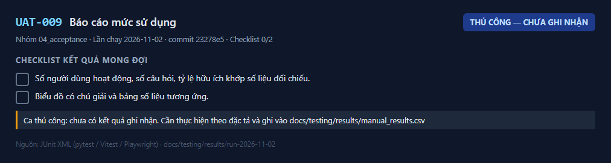
_Kết quả UAT-009 — lần chạy 2026-11-02_

**Cách ghi nhận:** thực hiện theo đặc tả rồi thêm dòng `UAT-009,<Đạt|Không đạt|Bị chặn>,<ngày>,<người>,<ghi chú>` vào `docs/testing/results/manual_results.csv`.

---

## UAT-010

**Nghiệm thu chất lượng theo ngôn ngữ** — 📝 **Thủ công — chưa ghi nhận**

| Mục | Nội dung |
|---|---|
| Story / AC | US-016, US-012 / AC-013, AC-010; LG-02..LG-05 |
| Tự động hóa | Thủ công |
| Đặc tả | [UAT-010.md](../../test_cases/04_acceptance/UAT-010.md) |

**Checklist kết quả mong đợi**

- [ ] MET-002 ≥ [TBD: OQ-002], tỷ lệ bịa ≤ [TBD: OQ-002], đúng trang 100%, độ trễ ≤ [TBD: OQ-002], theo từng ngôn ngữ. — _chưa kiểm: ngưỡng/cấu hình còn [TBD]_
- [ ] Chấm tự động khớp chấm tay ở mức chấp nhận được.
- [ ] Business owner ký xác nhận báo cáo.

**Ảnh kết quả**

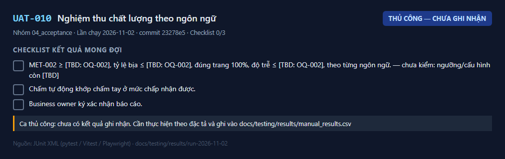
_Kết quả UAT-010 — lần chạy 2026-11-02_

**Cách ghi nhận:** thực hiện theo đặc tả rồi thêm dòng `UAT-010,<Đạt|Không đạt|Bị chặn>,<ngày>,<người>,<ghi chú>` vào `docs/testing/results/manual_results.csv`.

---

## UAT-011

**Rà soát chính sách dữ liệu** — 📝 **Thủ công — chưa ghi nhận**

| Mục | Nội dung |
|---|---|
| Story / AC | US-019 / AC-015; LG-06 |
| Tự động hóa | Thủ công |
| Đặc tả | [UAT-011.md](../../test_cases/04_acceptance/UAT-011.md) |

**Checklist kết quả mong đợi**

- [ ] Có xác nhận bằng văn bản ở mục "Xác nhận" của `data_handling.md`.

**Ảnh kết quả**

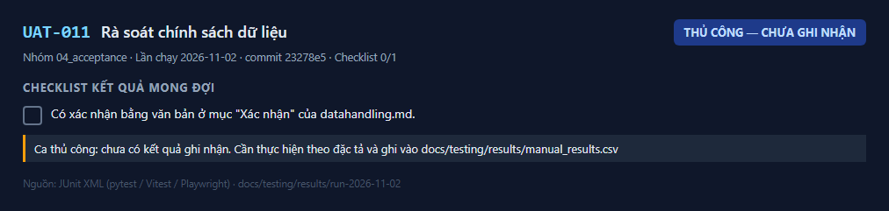
_Kết quả UAT-011 — lần chạy 2026-11-02_

**Cách ghi nhận:** thực hiện theo đặc tả rồi thêm dòng `UAT-011,<Đạt|Không đạt|Bị chặn>,<ngày>,<người>,<ghi chú>` vào `docs/testing/results/manual_results.csv`.

---
