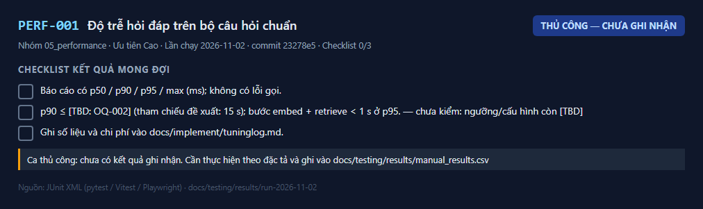
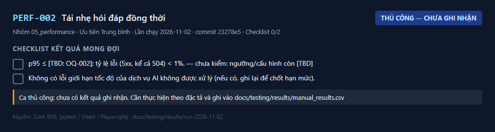
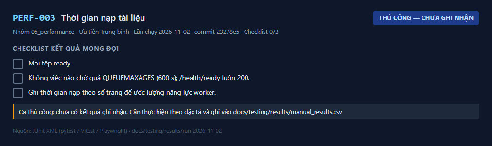
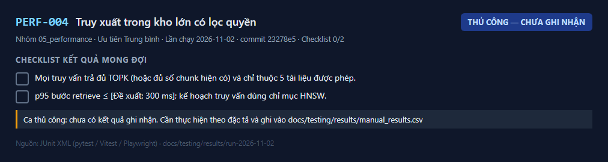
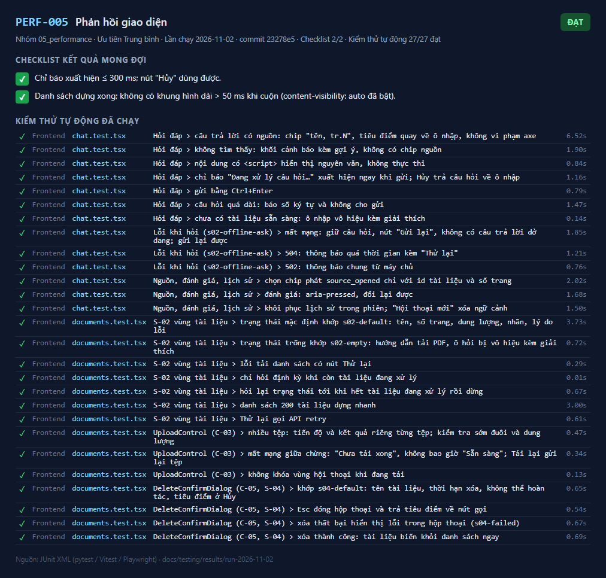
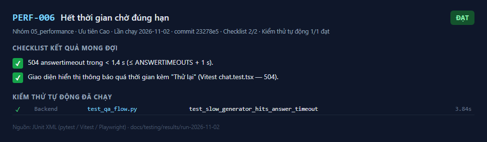

# 05 — Ca kiểm thử hiệu năng (PERF-001..PERF-006) — kết quả chi tiết

Lần chạy: [README](README.md) · Đặc tả: [05_performance](../../test_cases/05_performance/README.md)

| Mã | Tên | Ưu tiên | Kết quả | Kiểm thử tự động đạt | Ảnh |
|---|---|---|---|---|---|
| [PERF-001](#perf-001) | Độ trễ hỏi đáp trên bộ câu hỏi chuẩn | Cao | 📝 Thủ công — chưa ghi nhận | — | 1 |
| [PERF-002](#perf-002) | Tải nhẹ hỏi đáp đồng thời | Trung bình | 📝 Thủ công — chưa ghi nhận | — | 1 |
| [PERF-003](#perf-003) | Thời gian nạp tài liệu | Trung bình | 📝 Thủ công — chưa ghi nhận | — | 1 |
| [PERF-004](#perf-004) | Truy xuất trong kho lớn có lọc quyền | Trung bình | 📝 Thủ công — chưa ghi nhận | — | 1 |
| [PERF-005](#perf-005) | Phản hồi giao diện | Trung bình | ✅ Đạt | 27/27 | 1 |
| [PERF-006](#perf-006) | Hết thời gian chờ đúng hạn | Cao | ✅ Đạt | 1/1 | 1 |

## PERF-001

**Độ trễ hỏi đáp trên bộ câu hỏi chuẩn** — 📝 **Thủ công — chưa ghi nhận**

| Mục | Nội dung |
|---|---|
| Mục tiêu | Đo phân vị thời gian phản hồi và thời gian từng bước khi hỏi tuần tự |
| Truy vết | BR-011, AC-011, US-013, LG-05, T3-06 |
| Ưu tiên | Cao |
| Tự động hóa | Thủ công |
| Đặc tả | [PERF-001.md](../../test_cases/05_performance/PERF-001.md) |

**Checklist kết quả mong đợi**

- [ ] Báo cáo có p50 / p90 / p95 / max (ms); không có lỗi gọi.
- [ ] p90 ≤ [TBD: OQ-002] (tham chiếu đề xuất: 15 s); bước `embed` + `retrieve` < 1 s ở p95. — _chưa kiểm: ngưỡng/cấu hình còn [TBD]_
- [ ] Ghi số liệu và chi phí vào `docs/implement/tuning_log.md`.

**Ảnh kết quả**

_Kết quả PERF-001 — lần chạy 2026-11-02_

**Cách ghi nhận:** thực hiện theo đặc tả rồi thêm dòng `PERF-001,<Đạt|Không đạt|Bị chặn>,<ngày>,<người>,<ghi chú>` vào `docs/testing/results/manual_results.csv`.

---

## PERF-002

**Tải nhẹ hỏi đáp đồng thời** — 📝 **Thủ công — chưa ghi nhận**

| Mục | Nội dung |
|---|---|
| Mục tiêu | Hệ thống giữ được độ trễ và tỷ lệ lỗi khi nhiều người hỏi cùng lúc |
| Truy vết | BR-011, ASM-002 (quy mô nhỏ), OQ-009 |
| Ưu tiên | Trung bình |
| Tự động hóa | Thủ công |
| Đặc tả | [PERF-002.md](../../test_cases/05_performance/PERF-002.md) |

**Checklist kết quả mong đợi**

- [ ] p95 ≤ [TBD: OQ-002]; tỷ lệ lỗi (5xx, kể cả 504) < 1%. — _chưa kiểm: ngưỡng/cấu hình còn [TBD]_
- [ ] Không có lỗi giới hạn tốc độ của dịch vụ AI không được xử lý (nếu có, ghi lại để chốt hạn mức).

**Ảnh kết quả**

_Kết quả PERF-002 — lần chạy 2026-11-02_

**Cách ghi nhận:** thực hiện theo đặc tả rồi thêm dòng `PERF-002,<Đạt|Không đạt|Bị chặn>,<ngày>,<người>,<ghi chú>` vào `docs/testing/results/manual_results.csv`.

---

## PERF-003

**Thời gian nạp tài liệu** — 📝 **Thủ công — chưa ghi nhận**

| Mục | Nội dung |
|---|---|
| Mục tiêu | Đo thời gian nạp và độ dài hàng đợi khi tải nhiều tệp |
| Truy vết | BR-002, AC-002, US-002 |
| Ưu tiên | Trung bình |
| Tự động hóa | Thủ công |
| Đặc tả | [PERF-003.md](../../test_cases/05_performance/PERF-003.md) |

**Checklist kết quả mong đợi**

- [ ] Mọi tệp `ready`.
- [ ] Không việc nào chờ quá `QUEUE_MAX_AGE_S` (600 s); `/health/ready` luôn 200.
- [ ] Ghi thời gian nạp theo số trang để ước lượng năng lực worker.

**Ảnh kết quả**

_Kết quả PERF-003 — lần chạy 2026-11-02_

**Cách ghi nhận:** thực hiện theo đặc tả rồi thêm dòng `PERF-003,<Đạt|Không đạt|Bị chặn>,<ngày>,<người>,<ghi chú>` vào `docs/testing/results/manual_results.csv`.

---

## PERF-004

**Truy xuất trong kho lớn có lọc quyền** — 📝 **Thủ công — chưa ghi nhận**

| Mục | Nội dung |
|---|---|
| Mục tiêu | Truy vấn pgvector có lọc `allowed_document_ids` vẫn nhanh và đủ `TOP_K` khi kho lớn |
| Truy vết | implement_plan 5.2, T2-02 |
| Ưu tiên | Trung bình |
| Tự động hóa | Thủ công |
| Đặc tả | [PERF-004.md](../../test_cases/05_performance/PERF-004.md) |

**Checklist kết quả mong đợi**

- [ ] Mọi truy vấn trả đủ `TOP_K` (hoặc đủ số chunk hiện có) và chỉ thuộc 5 tài liệu được phép.
- [ ] p95 bước `retrieve` ≤ [Đề xuất: 300 ms]; kế hoạch truy vấn dùng chỉ mục HNSW.

**Ảnh kết quả**

_Kết quả PERF-004 — lần chạy 2026-11-02_

**Cách ghi nhận:** thực hiện theo đặc tả rồi thêm dòng `PERF-004,<Đạt|Không đạt|Bị chặn>,<ngày>,<người>,<ghi chú>` vào `docs/testing/results/manual_results.csv`.

---

## PERF-005

**Phản hồi giao diện** — ✅ **Đạt**

| Mục | Nội dung |
|---|---|
| Mục tiêu | Chỉ báo "Đang xử lý câu hỏi…" hiện ≤ 300 ms sau khi gửi; danh sách 200 tài liệu không giật |
| Truy vết | US-013, US-005, T3-06, T1-18 |
| Ưu tiên | Trung bình |
| Tự động hóa | Vitest `chat.test.tsx` (chỉ báo chờ xuất hiện trong 300 ms), `documents.test.tsx` (200 tài liệu) |
| Đặc tả | [PERF-005.md](../../test_cases/05_performance/PERF-005.md) |

**Checklist kết quả mong đợi**

- [x] Chỉ báo xuất hiện ≤ 300 ms; nút "Hủy" dùng được.
- [x] Danh sách dựng xong; không có khung hình dài > 50 ms khi cuộn (`content-visibility: auto` đã bật).

**Kiểm thử tự động đã chạy** (27/27 đạt)

| | Tầng | Tệp | Kiểm thử | Thời gian |
|---|---|---|---|---|
| ✅ | Frontend | `chat.test.tsx` | Hỏi đáp > câu trả lời có nguồn: chip "tên, tr.N", tiêu điểm quay về ô nhập, không vi phạm axe | 6.52 s |
| ✅ | Frontend | `chat.test.tsx` | Hỏi đáp > không tìm thấy: khối cảnh báo kèm gợi ý, không có chip nguồn | 1.90 s |
| ✅ | Frontend | `chat.test.tsx` | Hỏi đáp > nội dung có <script> hiển thị nguyên văn, không thực thi | 0.84 s |
| ✅ | Frontend | `chat.test.tsx` | Hỏi đáp > chỉ báo "Đang xử lý câu hỏi…" xuất hiện ngay khi gửi; Hủy trả câu hỏi về ô nhập | 1.16 s |
| ✅ | Frontend | `chat.test.tsx` | Hỏi đáp > gửi bằng Ctrl+Enter | 0.79 s |
| ✅ | Frontend | `chat.test.tsx` | Hỏi đáp > câu hỏi quá dài: báo số ký tự và không cho gửi | 1.47 s |
| ✅ | Frontend | `chat.test.tsx` | Hỏi đáp > chưa có tài liệu sẵn sàng: ô nhập vô hiệu kèm giải thích | 0.14 s |
| ✅ | Frontend | `chat.test.tsx` | Lỗi khi hỏi (s02-offline-ask) > mất mạng: giữ câu hỏi, nút "Gửi lại", không có câu trả lời dở dang; gửi lại được | 1.85 s |
| ✅ | Frontend | `chat.test.tsx` | Lỗi khi hỏi (s02-offline-ask) > 504: thông báo quá thời gian kèm "Thử lại" | 1.21 s |
| ✅ | Frontend | `chat.test.tsx` | Lỗi khi hỏi (s02-offline-ask) > 502: thông báo chung từ máy chủ | 0.76 s |
| ✅ | Frontend | `chat.test.tsx` | Nguồn, đánh giá, lịch sử > chọn chip phát source_opened chỉ với id tài liệu và số trang | 2.02 s |
| ✅ | Frontend | `chat.test.tsx` | Nguồn, đánh giá, lịch sử > đánh giá: aria-pressed, đổi lại được | 1.68 s |
| ✅ | Frontend | `chat.test.tsx` | Nguồn, đánh giá, lịch sử > khôi phục lịch sử trong phiên; "Hội thoại mới" xóa ngữ cảnh | 1.50 s |
| ✅ | Frontend | `documents.test.tsx` | S-02 vùng tài liệu > trạng thái mặc định khớp s02-default: tên, số trang, dung lượng, nhãn, lý do lỗi | 3.73 s |
| ✅ | Frontend | `documents.test.tsx` | S-02 vùng tài liệu > trạng thái trống khớp s02-empty: hướng dẫn tải PDF, ô hỏi bị vô hiệu kèm giải thích | 0.72 s |
| ✅ | Frontend | `documents.test.tsx` | S-02 vùng tài liệu > lỗi tải danh sách có nút Thử lại | 0.29 s |
| ✅ | Frontend | `documents.test.tsx` | S-02 vùng tài liệu > chỉ hỏi định kỳ khi còn tài liệu đang xử lý | 0.01 s |
| ✅ | Frontend | `documents.test.tsx` | S-02 vùng tài liệu > hỏi lại trạng thái tới khi hết tài liệu đang xử lý rồi dừng | 0.67 s |
| ✅ | Frontend | `documents.test.tsx` | S-02 vùng tài liệu > danh sách 200 tài liệu dựng nhanh | 3.00 s |
| ✅ | Frontend | `documents.test.tsx` | S-02 vùng tài liệu > Thử lại gọi API retry | 0.61 s |
| ✅ | Frontend | `documents.test.tsx` | UploadControl (C-03) > nhiều tệp: tiến độ và kết quả riêng từng tệp; kiểm tra sớm đuôi và dung lượng | 0.47 s |
| ✅ | Frontend | `documents.test.tsx` | UploadControl (C-03) > mất mạng giữa chừng: "Chưa tải xong", không bao giờ "Sẵn sàng"; Tải lại gửi lại tệp | 0.34 s |
| ✅ | Frontend | `documents.test.tsx` | UploadControl (C-03) > không khóa vùng hội thoại khi đang tải | 0.13 s |
| ✅ | Frontend | `documents.test.tsx` | DeleteConfirmDialog (C-05, S-04) > khớp s04-default: tên tài liệu, thời hạn xóa, không thể hoàn tác, tiêu điểm ở Hủy | 0.65 s |
| ✅ | Frontend | `documents.test.tsx` | DeleteConfirmDialog (C-05, S-04) > Esc đóng hộp thoại và trả tiêu điểm về nút gọi | 0.54 s |
| ✅ | Frontend | `documents.test.tsx` | DeleteConfirmDialog (C-05, S-04) > xóa thất bại hiển thị lỗi trong hộp thoại (s04-failed) | 0.67 s |
| ✅ | Frontend | `documents.test.tsx` | DeleteConfirmDialog (C-05, S-04) > xóa thành công: tài liệu biến khỏi danh sách ngay | 0.69 s |

**Ảnh kết quả**

_Kết quả PERF-005 — lần chạy 2026-11-02_

---

## PERF-006

**Hết thời gian chờ đúng hạn** — ✅ **Đạt**

| Mục | Nội dung |
|---|---|
| Mục tiêu | Khi dịch vụ AI chậm, API trả 504 đúng hạn `ANSWER_TIMEOUT_S`, không treo kết nối |
| Truy vết | BR-011, US-013, T3-06 |
| Ưu tiên | Cao |
| Tự động hóa | `test_qa_flow.py::test_slow_generator_hits_answer_timeout` |
| Đặc tả | [PERF-006.md](../../test_cases/05_performance/PERF-006.md) |

**Checklist kết quả mong đợi**

- [x] 504 `answer_timeout` trong < 1,4 s (≤ `ANSWER_TIMEOUT_S` + 1 s).
- [x] Giao diện hiển thị thông báo quá thời gian kèm "Thử lại" (Vitest `chat.test.tsx` — 504).

**Kiểm thử tự động đã chạy** (1/1 đạt)

| | Tầng | Tệp | Kiểm thử | Thời gian |
|---|---|---|---|---|
| ✅ | Backend | `test_qa_flow.py` | test_slow_generator_hits_answer_timeout | 3.84 s |

**Ảnh kết quả**

_Kết quả PERF-006 — lần chạy 2026-11-02_

---
