# 06 — Ca kiểm thử bảo mật (SEC-001..SEC-013) — kết quả chi tiết

Lần chạy: [README](README.md) · Đặc tả: [06_security](../../test_cases/06_security/README.md)

| Mã | Tên | Ưu tiên | Kết quả | Kiểm thử tự động đạt | Ảnh |
|---|---|---|---|---|---|
| [SEC-001](#sec-001) | Mọi route yêu cầu phiên | Cao | ✅ Đạt | 21/21 | 1 |
| [SEC-002](#sec-002) | Phân quyền theo vai trò | Cao | ✅ Đạt | 4/4 | 1 |
| [SEC-003](#sec-003) | Cô lập dữ liệu giữa người dùng | Cao | ✅ Đạt | 8/8 | 1 |
| [SEC-004](#sec-004) | Chính sách mật khẩu và khóa tạm | Cao | ✅ Đạt | 3/3 | 1 |
| [SEC-005](#sec-005) | Quản lý phiên | Cao | ✅ Đạt | 3/3 | 1 |
| [SEC-006](#sec-006) | Chống CSRF | Cao | ✅ Đạt | 1/1 | 1 |
| [SEC-007](#sec-007) | Chống XSS từ nội dung câu trả lời | Cao | ✅ Đạt | 1/1 | 1 |
| [SEC-008](#sec-008) | Tiêu đề bảo mật của frontend production | Trung bình | 📝 Thủ công — chưa ghi nhận | — | 1 |
| [SEC-009](#sec-009) | Không lộ thông tin qua lỗi | Cao | ✅ Đạt | 10/10 | 1 |
| [SEC-010](#sec-010) | Log và sự kiện không chứa nội dung (canary) | Cao | ✅ Đạt | 1/1 | 1 |
| [SEC-011](#sec-011) | Kiểm tra tệp tải lên theo nội dung | Cao | ✅ Đạt | 1/1 | 1 |
| [SEC-012](#sec-012) | Quét lỗ hổng phụ thuộc | Trung bình | 📝 Thủ công — chưa ghi nhận | — | 1 |
| [SEC-013](#sec-013) | Dữ liệu gửi ra dịch vụ AI | Cao | ✅ Đạt | 2/2 | 1 |

## SEC-001

**Mọi route yêu cầu phiên** — ✅ **Đạt**

| Mục | Nội dung |
|---|---|
| Mục tiêu | Mọi route (trừ `/auth/login`, `/auth/oidc/*`, `/health/*`) trả 401 khi không có phiên; thêm route không bảo vệ thì kiểm thử phát hiện |
| Truy vết | BR-014, AC-014, LG-07, T1-08 |
| Ưu tiên | Cao |
| Tự động hóa | `test_auth_matrix.py::test_route_list_is_not_empty`, `test_every_protected_route_requires_session` (tham số hóa theo route), `test_unprotected_route_makes_matrix_fail` |
| Đặc tả | [SEC-001.md](../../test_cases/06_security/SEC-001.md) |

**Checklist kết quả mong đợi**

- [x] Danh sách chứa `/api/v1/documents` và `/api/v1/admin/audit`.
- [x] Mọi route bảo vệ: 401, `error.code = "unauthenticated"`.
- [x] Bước 3: danh sách route không đạt = đúng `["/api/v1/leaky"]`.

**Kiểm thử tự động đã chạy** (21/21 đạt)

| | Tầng | Tệp | Kiểm thử | Thời gian |
|---|---|---|---|---|
| ✅ | Backend | `test_auth_matrix.py` | test_route_list_is_not_empty | 0.02 s |
| ✅ | Backend | `test_auth_matrix.py` | test_every_protected_route_requires_session[POST /api/v1/auth/logout] | 1.10 s |
| ✅ | Backend | `test_auth_matrix.py` | test_every_protected_route_requires_session[GET /api/v1/auth/me] | 1.25 s |
| ✅ | Backend | `test_auth_matrix.py` | test_every_protected_route_requires_session[GET /api/v1/documents] | 0.78 s |
| ✅ | Backend | `test_auth_matrix.py` | test_every_protected_route_requires_session[POST /api/v1/documents] | 0.99 s |
| ✅ | Backend | `test_auth_matrix.py` | test_every_protected_route_requires_session[DELETE /api/v1/documents/{document_id}] | 0.90 s |
| ✅ | Backend | `test_auth_matrix.py` | test_every_protected_route_requires_session[GET /api/v1/documents/{document_id}] | 0.85 s |
| ✅ | Backend | `test_auth_matrix.py` | test_every_protected_route_requires_session[POST /api/v1/documents/{document_id}/retry] | 0.94 s |
| ✅ | Backend | `test_auth_matrix.py` | test_every_protected_route_requires_session[GET /api/v1/documents/{document_id}/pages/{page}] | 0.93 s |
| ✅ | Backend | `test_auth_matrix.py` | test_every_protected_route_requires_session[GET /api/v1/documents/{document_id}/file] | 1.55 s |
| ✅ | Backend | `test_auth_matrix.py` | test_every_protected_route_requires_session[POST /api/v1/events/source-opened] | 1.33 s |
| ✅ | Backend | `test_auth_matrix.py` | test_every_protected_route_requires_session[POST /api/v1/conversations] | 1.71 s |
| ✅ | Backend | `test_auth_matrix.py` | test_every_protected_route_requires_session[GET /api/v1/conversations/{conversation_id}/messages] | 0.79 s |
| ✅ | Backend | `test_auth_matrix.py` | test_every_protected_route_requires_session[POST /api/v1/conversations/{conversation_id}/messages] | 1.05 s |
| ✅ | Backend | `test_auth_matrix.py` | test_every_protected_route_requires_session[PUT /api/v1/messages/{message_id}/feedback] | 2.20 s |
| ✅ | Backend | `test_auth_matrix.py` | test_every_protected_route_requires_session[GET /api/v1/admin/access] | 1.34 s |
| ✅ | Backend | `test_auth_matrix.py` | test_every_protected_route_requires_session[POST /api/v1/admin/access] | 2.38 s |
| ✅ | Backend | `test_auth_matrix.py` | test_every_protected_route_requires_session[DELETE /api/v1/admin/access/{user_id}] | 1.73 s |
| ✅ | Backend | `test_auth_matrix.py` | test_every_protected_route_requires_session[GET /api/v1/admin/audit] | 1.51 s |
| ✅ | Backend | `test_auth_matrix.py` | test_every_protected_route_requires_session[GET /api/v1/reports/usage] | 0.88 s |
| ✅ | Backend | `test_auth_matrix.py` | test_unprotected_route_makes_matrix_fail | 2.22 s |

**Ảnh kết quả**

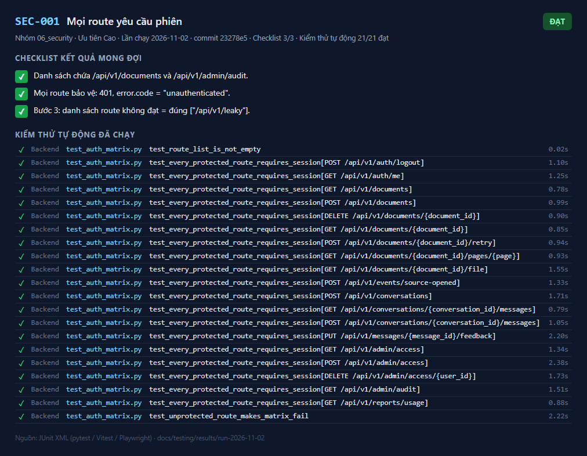
_Kết quả SEC-001 — lần chạy 2026-11-02_

---

## SEC-002

**Phân quyền theo vai trò** — ✅ **Đạt**

| Mục | Nội dung |
|---|---|
| Mục tiêu | Mọi route `/admin/*` trả 403 với `bd` và `manager`; `/reports/*` từ chối `bd`; sự kiện `access_denied` được ghi |
| Truy vết | BR-014, US-017, T1-08 |
| Ưu tiên | Cao |
| Tự động hóa | `test_auth_matrix.py::test_admin_routes_forbidden_for_non_admin` (bd, manager); `test_auth.py::test_wrong_role_is_forbidden_role_and_records_access_denied`; `test_admin_reports_health.py::test_usage_endpoint_includes_helpful_ratio` |
| Đặc tả | [SEC-002.md](../../test_cases/06_security/SEC-002.md) |

**Checklist kết quả mong đợi**

- [x] Bước 1: mọi yêu cầu 403.
- [x] Bước 2: 403 `forbidden_role`; đúng 1 sự kiện `access_denied`.
- [x] Bước 3: 403.

**Kiểm thử tự động đã chạy** (4/4 đạt)

| | Tầng | Tệp | Kiểm thử | Thời gian |
|---|---|---|---|---|
| ✅ | Backend | `test_auth_matrix.py` | test_admin_routes_forbidden_for_non_admin[bd] | 2.94 s |
| ✅ | Backend | `test_auth_matrix.py` | test_admin_routes_forbidden_for_non_admin[manager] | 2.42 s |
| ✅ | Backend | `test_auth.py` | test_wrong_role_is_forbidden_role_and_records_access_denied | 2.88 s |
| ✅ | Backend | `test_admin_reports_health.py` | test_usage_endpoint_includes_helpful_ratio | 4.38 s |

**Ảnh kết quả**

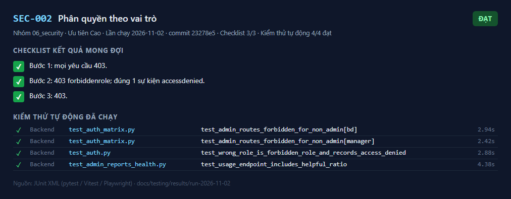
_Kết quả SEC-002 — lần chạy 2026-11-02_

---

## SEC-003

**Cô lập dữ liệu giữa người dùng** — ✅ **Đạt**

| Mục | Nội dung |
|---|---|
| Mục tiêu | Người dùng A không thể đọc, hỏi ra, mở trang/tệp, xóa, thử lại, xem hội thoại, đánh giá câu trả lời hay ghi sự kiện cho tài nguyên của B |
| Truy vết | BR-020, AC-020, AC-004, LG-07, T3-07 |
| Ưu tiên | Cao |
| Tự động hóa | `test_isolation.py` (7 kiểm thử) |
| Đặc tả | [SEC-003.md](../../test_cases/06_security/SEC-003.md) |

**Checklist kết quả mong đợi**

- [x] Bước 2: `not_found = true`; câu trả lời không chứa "BRAVO".
- [x] Bước 3: chỉ có tài liệu của A.
- [x] Bước 4: danh sách route gồm ít nhất GET/DELETE tài liệu, trang, tệp, thử lại, GET/POST tin nhắn hội thoại, PUT đánh giá; **mọi** route trả 404.
- [x] Bước 5: 404; tài liệu B vẫn `ready`.
- [x] Bước 6: mọi bản ghi của A chỉ liệt kê tài liệu của A.
- [x] Bước 7: danh sách rò rỉ = đúng route `/leaky`.

**Kiểm thử tự động đã chạy** (8/8 đạt)

| | Tầng | Tệp | Kiểm thử | Thời gian |
|---|---|---|---|---|
| ✅ | Backend | `test_isolation.py` | test_a_cannot_get_b_content_by_asking | 3.57 s |
| ✅ | Backend | `test_isolation.py` | test_a_list_does_not_contain_b | 4.00 s |
| ✅ | Backend | `test_isolation.py` | test_every_resource_route_hides_b_resources_from_a | 4.97 s |
| ✅ | Backend | `test_isolation.py` | test_source_opened_event_for_b_document_is_rejected | 3.88 s |
| ✅ | Backend | `test_isolation.py` | test_b_document_still_intact_after_a_attempts | 4.81 s |
| ✅ | Backend | `test_isolation.py` | test_a_audit_records_never_list_b_documents | 4.51 s |
| ✅ | Backend | `test_isolation.py` | test_unchecked_resource_route_makes_isolation_fail | 4.86 s |
| ✅ | Backend | `test_isolation.py` | test_uploads_are_scoped_to_uploader | 3.78 s |

**Ảnh kết quả**

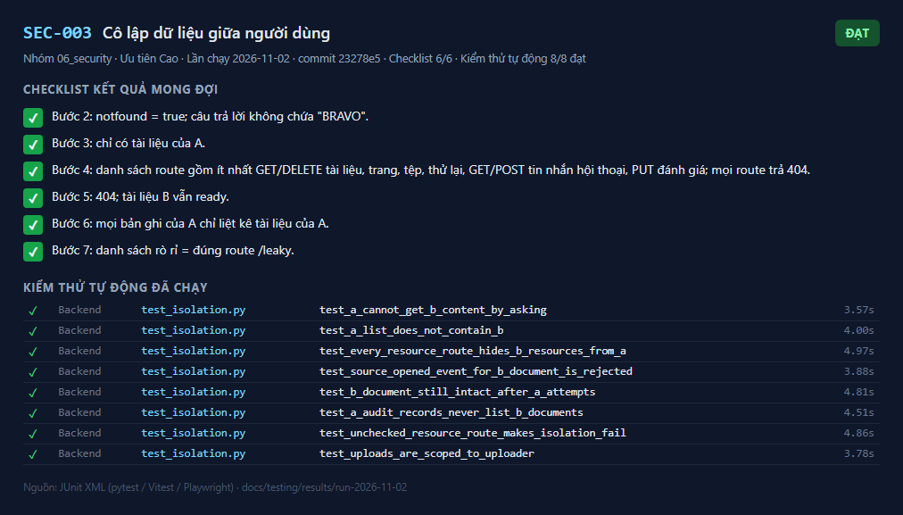
_Kết quả SEC-003 — lần chạy 2026-11-02_

---

## SEC-004

**Chính sách mật khẩu và khóa tạm** — ✅ **Đạt**

| Mục | Nội dung |
|---|---|
| Mục tiêu | Mật khẩu băm Argon2id; quá `LOGIN_MAX_FAILURES` lần sai trong 15 phút thì khóa tạm theo tài khoản; người khác không bị ảnh hưởng; thông báo không phân biệt sai tên/sai mật khẩu |
| Truy vết | BR-014, implement_plan 6.1, T1-02 |
| Ưu tiên | Cao |
| Tự động hóa | `test_auth.py::test_local_identity_locks_after_too_many_failures`, `test_password_hash_is_argon2id`, `test_local_identity_right_and_wrong_password` |
| Đặc tả | [SEC-004.md](../../test_cases/06_security/SEC-004.md) |

**Checklist kết quả mong đợi**

- [x] Bước 1: mỗi lần `invalid_credentials`.
- [x] Bước 2: `locked` (API trả 429 `login_locked`).
- [x] Bước 3: thành công.

**Kiểm thử tự động đã chạy** (3/3 đạt)

| | Tầng | Tệp | Kiểm thử | Thời gian |
|---|---|---|---|---|
| ✅ | Backend | `test_auth.py` | test_local_identity_locks_after_too_many_failures | 5.22 s |
| ✅ | Backend | `test_auth.py` | test_password_hash_is_argon2id | 1.02 s |
| ✅ | Backend | `test_auth.py` | test_local_identity_right_and_wrong_password | 6.03 s |

**Ảnh kết quả**

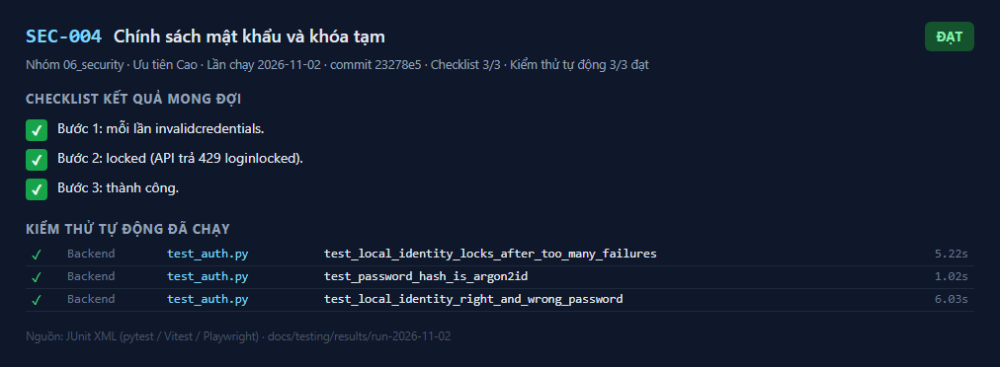
_Kết quả SEC-004 — lần chạy 2026-11-02_

---

## SEC-005

**Quản lý phiên** — ✅ **Đạt**

| Mục | Nội dung |
|---|---|
| Mục tiêu | Cookie `HttpOnly; Secure; SameSite=Lax`; CSDL chỉ lưu băm SHA-256 của mã phiên; hết hạn sau `SESSION_IDLE_HOURS`; đăng xuất và thu hồi quyền xóa phiên |
| Truy vết | BR-014, T1-04 |
| Ưu tiên | Cao |
| Tự động hóa | `test_auth.py::test_login_me_logout`, `test_expired_session_is_session_expired`, `test_revoked_user_loses_access_on_next_request` |
| Đặc tả | [SEC-005.md](../../test_cases/06_security/SEC-005.md) |

**Checklist kết quả mong đợi**

- [x] Bước 1: cờ đầy đủ (môi trường thật có `Secure`); `sessions.token_hash` dài 64 ký tự hex, khác giá trị cookie.
- [x] Bước 2: 401.
- [x] Bước 3: không còn phiên của người bị thu hồi.

**Kiểm thử tự động đã chạy** (3/3 đạt)

| | Tầng | Tệp | Kiểm thử | Thời gian |
|---|---|---|---|---|
| ✅ | Backend | `test_auth.py` | test_login_me_logout | 5.82 s |
| ✅ | Backend | `test_auth.py` | test_expired_session_is_session_expired | 1.61 s |
| ✅ | Backend | `test_auth.py` | test_revoked_user_loses_access_on_next_request | 2.71 s |

**Ảnh kết quả**

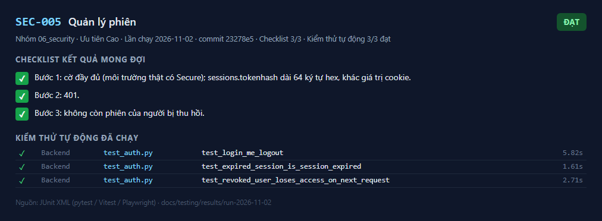
_Kết quả SEC-005 — lần chạy 2026-11-02_

---

## SEC-006

**Chống CSRF** — ✅ **Đạt**

| Mục | Nội dung |
|---|---|
| Mục tiêu | Mọi yêu cầu POST/PUT/DELETE không có `Origin` (hoặc `Referer`) thuộc `ALLOWED_ORIGINS` bị từ chối |
| Truy vết | implement_plan 10.5, T1-04 |
| Ưu tiên | Cao |
| Tự động hóa | `test_auth.py::test_post_without_valid_origin_is_rejected` |
| Đặc tả | [SEC-006.md](../../test_cases/06_security/SEC-006.md) |

**Checklist kết quả mong đợi**

- [x] 403 `csrf_rejected`; 403; 200.
- [x] Bước 2: bị từ chối.

**Kiểm thử tự động đã chạy** (1/1 đạt)

| | Tầng | Tệp | Kiểm thử | Thời gian |
|---|---|---|---|---|
| ✅ | Backend | `test_auth.py` | test_post_without_valid_origin_is_rejected | 2.29 s |

**Ảnh kết quả**

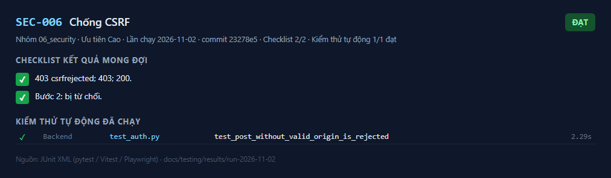
_Kết quả SEC-006 — lần chạy 2026-11-02_

---

## SEC-007

**Chống XSS từ nội dung câu trả lời** — ✅ **Đạt**

| Mục | Nội dung |
|---|---|
| Mục tiêu | Nội dung từ mô hình hiển thị dưới dạng văn bản đã thoát ký tự, không thực thi |
| Truy vết | T2-08 |
| Ưu tiên | Cao |
| Tự động hóa | Vitest `chat.test.tsx`: "nội dung có <script> hiển thị nguyên văn" |
| Đặc tả | [SEC-007.md](../../test_cases/06_security/SEC-007.md) |

**Checklist kết quả mong đợi**

- [x] Văn bản hiển thị nguyên chuỗi; DOM không có phần tử `script` hay `img` trong thẻ; `window.__xss` không được đặt.
- [x] Tên tệp do người dùng đặt (chứa `<b>`) cũng hiển thị dạng văn bản (kiểm thủ công).

**Kiểm thử tự động đã chạy** (1/1 đạt)

| | Tầng | Tệp | Kiểm thử | Thời gian |
|---|---|---|---|---|
| ✅ | Frontend | `chat.test.tsx` | Hỏi đáp > nội dung có <script> hiển thị nguyên văn, không thực thi | 0.84 s |

**Ảnh kết quả**

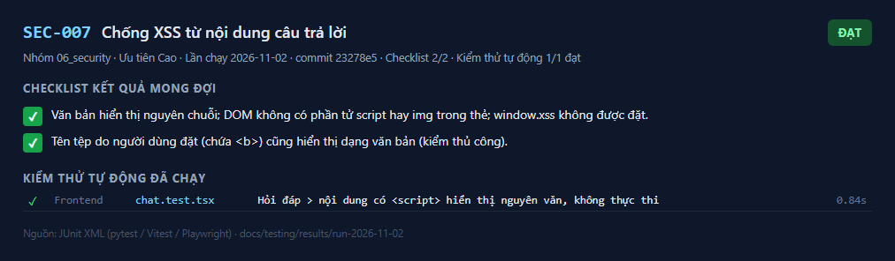
_Kết quả SEC-007 — lần chạy 2026-11-02_

---

## SEC-008

**Tiêu đề bảo mật của frontend production** — 📝 **Thủ công — chưa ghi nhận**

| Mục | Nội dung |
|---|---|
| Mục tiêu | nginx trả CSP và các tiêu đề bảo mật trên **mọi** đường dẫn, kể cả `/assets/*` |
| Truy vết | implement_plan 10.5 |
| Ưu tiên | Trung bình |
| Tự động hóa | Thủ công (`nginx -t` đã kiểm cú pháp) |
| Đặc tả | [SEC-008.md](../../test_cases/06_security/SEC-008.md) |

**Checklist kết quả mong đợi**

- [ ] Mỗi phản hồi có: `Content-Security-Policy: default-src 'self'; script-src 'self'; … frame-ancestors 'none' …`, `X-Content-Type-Options: nosniff`, `Referrer-Policy: same-origin`, `X-Frame-Options: DENY`.
- [ ] Ứng dụng chạy bình thường dưới CSP (không lỗi CSP trong console trình duyệt).

**Ảnh kết quả**

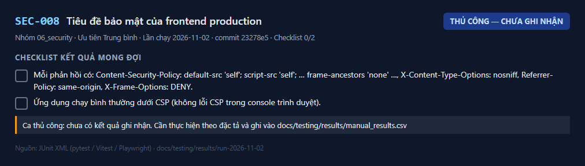
_Kết quả SEC-008 — lần chạy 2026-11-02_

**Cách ghi nhận:** thực hiện theo đặc tả rồi thêm dòng `SEC-008,<Đạt|Không đạt|Bị chặn>,<ngày>,<người>,<ghi chú>` vào `docs/testing/results/manual_results.csv`.

---

## SEC-009

**Không lộ thông tin qua lỗi** — ✅ **Đạt**

| Mục | Nội dung |
|---|---|
| Mục tiêu | Lỗi 500 không chứa stack trace; lỗi xác thực dữ liệu không lặp lại dữ liệu đầu vào; 404 không phân biệt "không tồn tại" và "không có quyền" |
| Truy vết | implement_plan mục 4 |
| Ưu tiên | Cao |
| Tự động hóa | `test_framework.py::test_unhandled_error_has_standard_format_without_stack_trace`, `test_validation_error_does_not_echo_input`; `test_isolation.py` |
| Đặc tả | [SEC-009.md](../../test_cases/06_security/SEC-009.md) |

**Checklist kết quả mong đợi**

- [x] Không có "Traceback", đường dẫn tệp, tên lớp lỗi, chuỗi bí mật.
- [x] Hai phản hồi ở bước 2 giống nhau (404 `document_not_found`).

**Kiểm thử tự động đã chạy** (10/10 đạt)

| | Tầng | Tệp | Kiểm thử | Thời gian |
|---|---|---|---|---|
| ✅ | Backend | `test_framework.py` | test_unhandled_error_has_standard_format_without_stack_trace | 0.12 s |
| ✅ | Backend | `test_framework.py` | test_validation_error_does_not_echo_input | 0.24 s |
| ✅ | Backend | `test_isolation.py` | test_a_cannot_get_b_content_by_asking | 3.57 s |
| ✅ | Backend | `test_isolation.py` | test_a_list_does_not_contain_b | 4.00 s |
| ✅ | Backend | `test_isolation.py` | test_every_resource_route_hides_b_resources_from_a | 4.97 s |
| ✅ | Backend | `test_isolation.py` | test_source_opened_event_for_b_document_is_rejected | 3.88 s |
| ✅ | Backend | `test_isolation.py` | test_b_document_still_intact_after_a_attempts | 4.81 s |
| ✅ | Backend | `test_isolation.py` | test_a_audit_records_never_list_b_documents | 4.51 s |
| ✅ | Backend | `test_isolation.py` | test_unchecked_resource_route_makes_isolation_fail | 4.86 s |
| ✅ | Backend | `test_isolation.py` | test_uploads_are_scoped_to_uploader | 3.78 s |

**Ảnh kết quả**

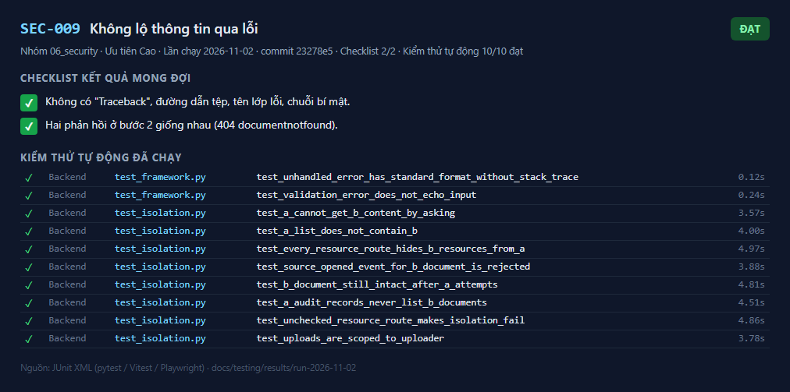
_Kết quả SEC-009 — lần chạy 2026-11-02_

---

## SEC-010

**Log và sự kiện không chứa nội dung (canary)** — ✅ **Đạt**

| Mục | Nội dung |
|---|---|
| Mục tiêu | Chạy trọn luồng với chuỗi đánh dấu duy nhất trong tài liệu và câu hỏi; chuỗi không xuất hiện trong log, `usage_events`, `audit_records`, `jobs` |
| Truy vết | BR-015, AC-015, NFR-LOG, ADR-009, implement_plan 9.3, T4-05 |
| Ưu tiên | Cao |
| Tự động hóa | `test_no_content_in_logs.py::test_canary_never_reaches_logs_events_or_audit` |
| Đặc tả | [SEC-010.md](../../test_cases/06_security/SEC-010.md) |

**Checklist kết quả mong đợi**

- [x] Câu trả lời trả cho người dùng có chứa canary tài liệu (luồng chạy thật).
- [x] Log có `http_request` (log được thu) nhưng không chứa canary nào.
- [x] Ba bảng có dữ liệu và không chứa canary nào; phản hồi 400 không chứa canary câu hỏi.

**Kiểm thử tự động đã chạy** (1/1 đạt)

| | Tầng | Tệp | Kiểm thử | Thời gian |
|---|---|---|---|---|
| ✅ | Backend | `test_no_content_in_logs.py` | test_canary_never_reaches_logs_events_or_audit | 3.21 s |

**Ảnh kết quả**

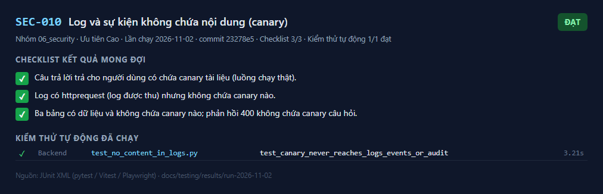
_Kết quả SEC-010 — lần chạy 2026-11-02_

---

## SEC-011

**Kiểm tra tệp tải lên theo nội dung** — ✅ **Đạt**

| Mục | Nội dung |
|---|---|
| Mục tiêu | Loại tệp xác định theo 5 byte đầu `%PDF-`, không theo đuôi hay `Content-Type`; tệp quá lớn bị từ chối mà không đọc hết vào bộ nhớ |
| Truy vết | implement_plan 5.1, T1-11 |
| Ưu tiên | Cao |
| Tự động hóa | `test_ingestion_flow.py::test_mixed_upload_each_file_judged_independently` |
| Đặc tả | [SEC-011.md](../../test_cases/06_security/SEC-011.md) |

**Checklist kết quả mong đợi**

- [x] Bước 1: `not_pdf`. Bước 2: `too_large`. Bước 3: được nhận (giao diện có thể chặn sớm theo đuôi, API vẫn quyết định theo nội dung).

**Kiểm thử tự động đã chạy** (1/1 đạt)

| | Tầng | Tệp | Kiểm thử | Thời gian |
|---|---|---|---|---|
| ✅ | Backend | `test_ingestion_flow.py` | test_mixed_upload_each_file_judged_independently | 1.73 s |

**Ảnh kết quả**

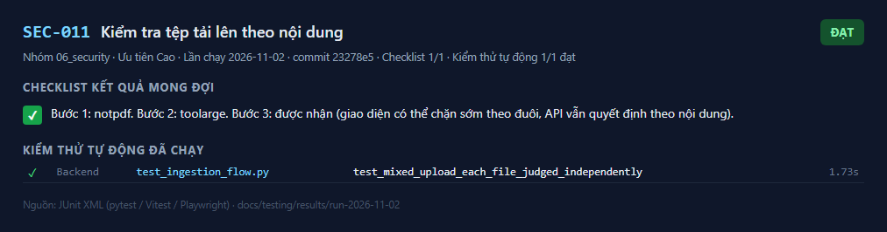
_Kết quả SEC-011 — lần chạy 2026-11-02_

---

## SEC-012

**Quét lỗ hổng phụ thuộc** — 📝 **Thủ công — chưa ghi nhận**

| Mục | Nội dung |
|---|---|
| Mục tiêu | Không có thư viện có lỗ hổng mức cao/nghiêm trọng |
| Truy vết | implement_plan 10.5 |
| Ưu tiên | Trung bình |
| Tự động hóa | Job CI `dependency-audit` (`pip-audit --skip-editable`, `npm audit --audit-level=high`) |
| Đặc tả | [SEC-012.md](../../test_cases/06_security/SEC-012.md) |

**Checklist kết quả mong đợi**

- [ ] Mã thoát 0. Lỗ hổng mức cao được nâng phiên bản hoặc có ghi nhận chấp nhận rủi ro.

**Ảnh kết quả**

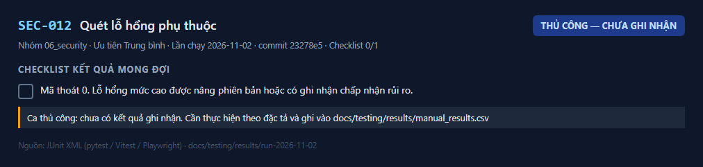
_Kết quả SEC-012 — lần chạy 2026-11-02_

**Cách ghi nhận:** thực hiện theo đặc tả rồi thêm dòng `SEC-012,<Đạt|Không đạt|Bị chặn>,<ngày>,<người>,<ghi chú>` vào `docs/testing/results/manual_results.csv`.

---

## SEC-013

**Dữ liệu gửi ra dịch vụ AI** — ✅ **Đạt**

| Mục | Nội dung |
|---|---|
| Mục tiêu | Chỉ các chunk được truy xuất (trong phạm vi người hỏi), câu hỏi và lịch sử được gửi; câu dưới ngưỡng không gửi gì; khóa API không nằm trong mã |
| Truy vết | BR-015, OQ-006, data_handling.md mục 2 |
| Ưu tiên | Cao |
| Tự động hóa | `test_claude_adapter.py::test_request_shape`; `test_qa_flow.py::test_out_of_scope_question_is_not_found_without_calling_model`; tìm kiếm mã thủ công |
| Đặc tả | [SEC-013.md](../../test_cases/06_security/SEC-013.md) |

**Checklist kết quả mong đợi**

- [x] Yêu cầu chỉ gồm chỉ dẫn hệ thống, lịch sử, các khối `document` của chunk được truy xuất, câu hỏi.
- [x] Bước 2: 0 lời gọi.
- [x] Bước 3: không có khóa trong kho mã (chỉ trong `deploy/.env` bị git bỏ qua hoặc kho bí mật).

**Kiểm thử tự động đã chạy** (2/2 đạt)

| | Tầng | Tệp | Kiểm thử | Thời gian |
|---|---|---|---|---|
| ✅ | Backend | `test_claude_adapter.py` | test_request_shape | 0.00 s |
| ✅ | Backend | `test_qa_flow.py` | test_out_of_scope_question_is_not_found_without_calling_model | 3.06 s |

**Kết quả thủ công đã ghi nhận:** Thủ công: 2026-11-02 · Claude Code (hỗ trợ QA) · Phần thủ công bước 3: git grep sk-ant-… trên mã đã theo dõi: 0 kết quả; deploy/.env bị .gitignore bỏ qua. Phần tự động (test_request_shape, test_out_of_scope…) đạt trong run-2026-11-02

**Ảnh kết quả**

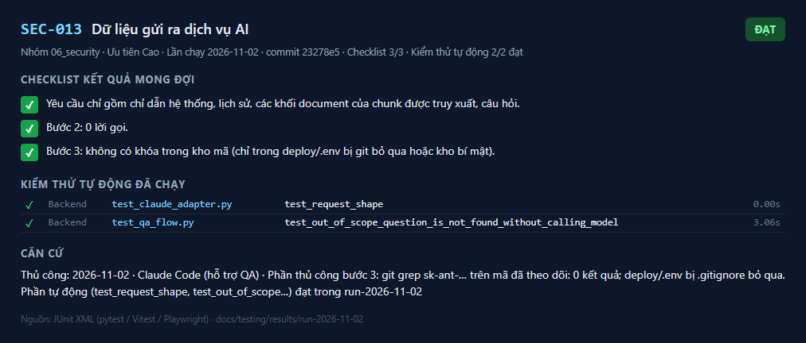
_Kết quả SEC-013 — lần chạy 2026-11-02_

---
