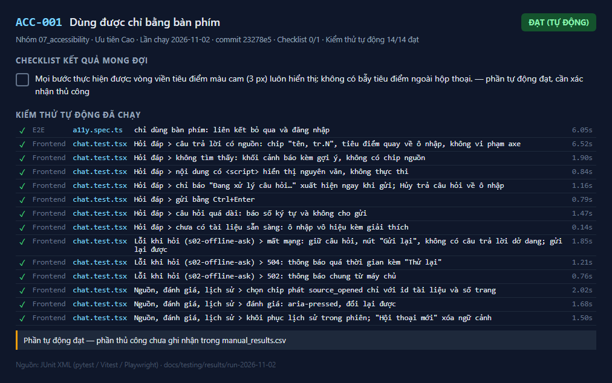
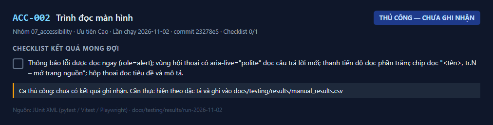
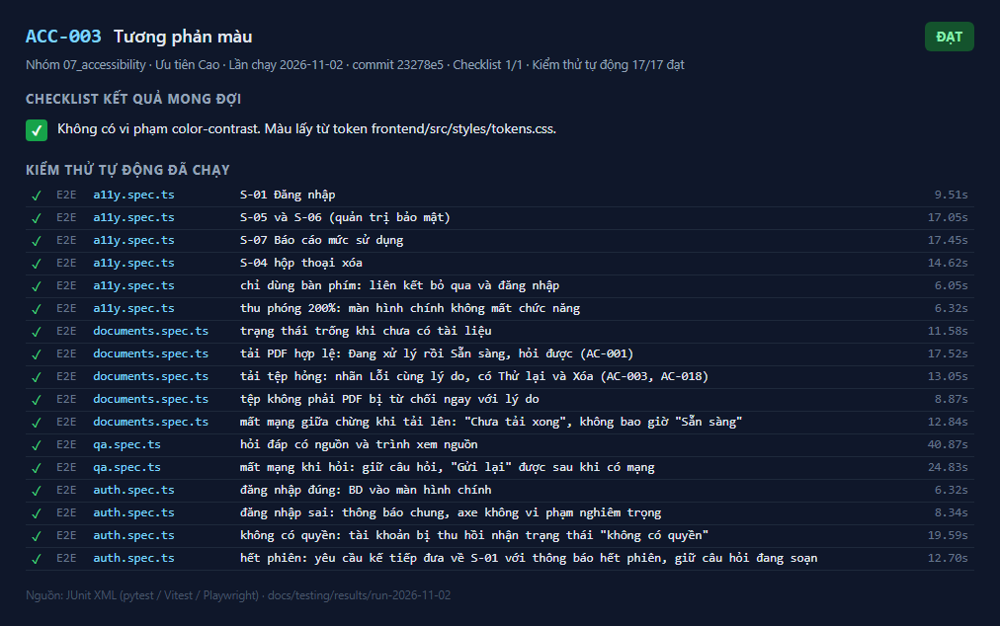
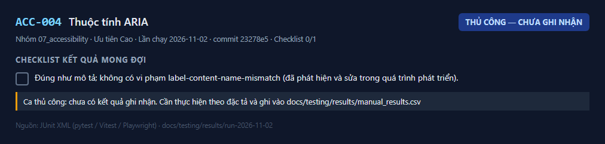
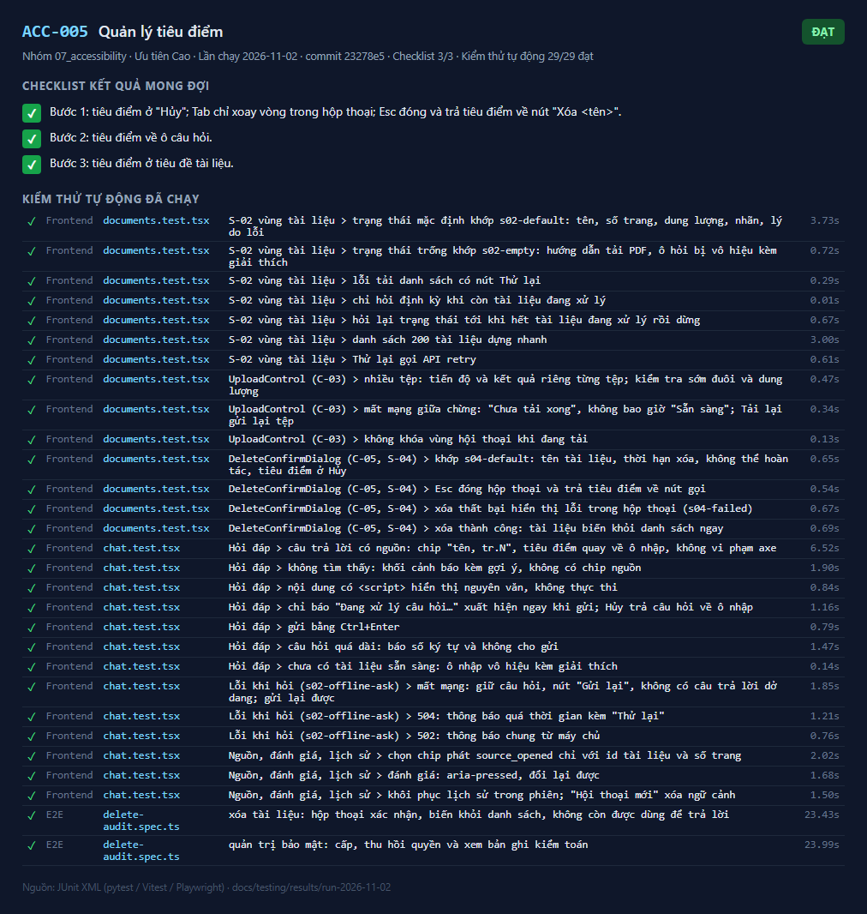
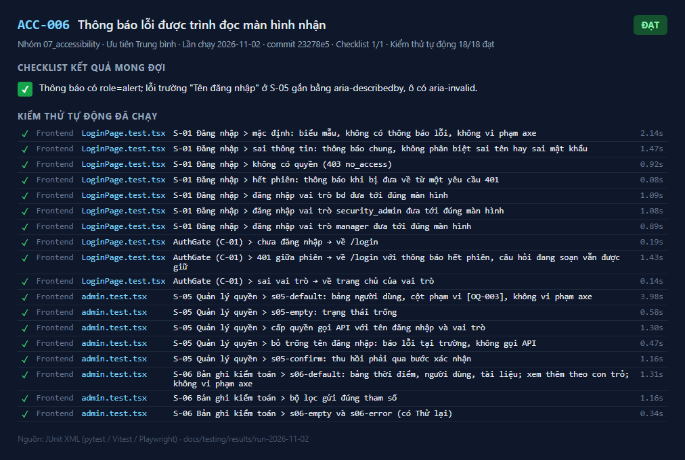
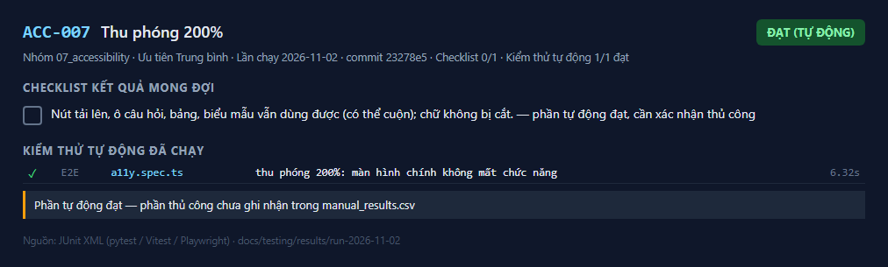
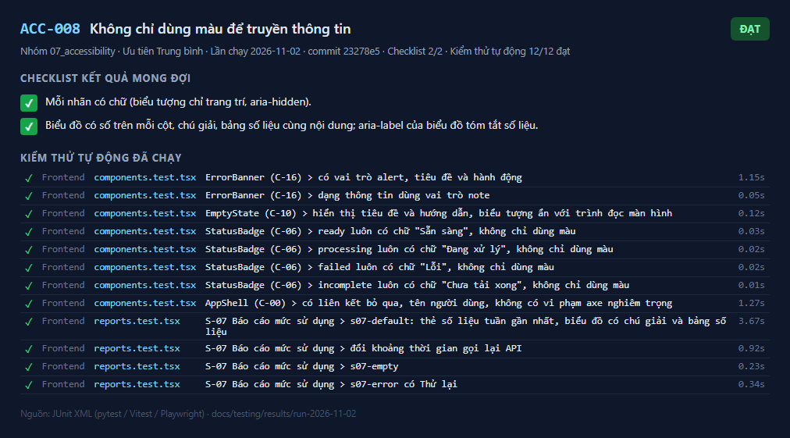

# 07 — Ca kiểm thử khả năng tiếp cận (ACC-001..ACC-008) — kết quả chi tiết

Lần chạy: [README](README.md) · Đặc tả: [07_accessibility](../../test_cases/07_accessibility/README.md)

| Mã | Tên | Ưu tiên | Kết quả | Kiểm thử tự động đạt | Ảnh |
|---|---|---|---|---|---|
| [ACC-001](#acc-001) | Dùng được chỉ bằng bàn phím | Cao | ✅ Đạt (tự động) — thủ công chưa ghi nhận | 14/14 | 2 |
| [ACC-002](#acc-002) | Trình đọc màn hình | Cao | 📝 Thủ công — chưa ghi nhận | — | 1 |
| [ACC-003](#acc-003) | Tương phản màu | Cao | ✅ Đạt | 17/17 | 19 |
| [ACC-004](#acc-004) | Thuộc tính ARIA | Cao | 📝 Thủ công — chưa ghi nhận | — | 1 |
| [ACC-005](#acc-005) | Quản lý tiêu điểm | Cao | ✅ Đạt | 29/29 | 4 |
| [ACC-006](#acc-006) | Thông báo lỗi được trình đọc màn hình nhận | Trung bình | ✅ Đạt | 18/18 | 1 |
| [ACC-007](#acc-007) | Thu phóng 200% | Trung bình | ✅ Đạt (tự động) — thủ công chưa ghi nhận | 1/1 | 2 |
| [ACC-008](#acc-008) | Không chỉ dùng màu để truyền thông tin | Trung bình | ✅ Đạt | 12/12 | 1 |

## ACC-001

**Dùng được chỉ bằng bàn phím** — ✅ **Đạt** phần tự động — _phần thủ công chưa ghi nhận_

| Mục | Nội dung |
|---|---|
| Mục tiêu | Mọi chức năng chính thao tác được bằng bàn phím, thứ tự tiêu điểm hợp lý, tiêu điểm luôn nhìn thấy (`:focus-visible`) |
| Truy vết | NFR-ACC, WCAG 2.1.1, 2.4.3, 2.4.7 |
| Ưu tiên | Cao |
| Tự động hóa | `a11y.spec.ts`: "chỉ dùng bàn phím" (đăng nhập); Vitest `chat.test.tsx` (Ctrl+Enter); phần còn lại thủ công |
| Đặc tả | [ACC-001.md](../../test_cases/07_accessibility/ACC-001.md) |

> Phần tự động đạt; phần thủ công chưa ghi nhận

**Checklist kết quả mong đợi**

- [ ] Mọi bước thực hiện được; vòng viền tiêu điểm màu cam (3 px) luôn hiển thị; không có bẫy tiêu điểm ngoài hộp thoại. — _phần tự động đạt, cần xác nhận thủ công_

**Kiểm thử tự động đã chạy** (14/14 đạt)

| | Tầng | Tệp | Kiểm thử | Thời gian |
|---|---|---|---|---|
| ✅ | E2E | `a11y.spec.ts` | chỉ dùng bàn phím: liên kết bỏ qua và đăng nhập | 6.05 s |
| ✅ | Frontend | `chat.test.tsx` | Hỏi đáp > câu trả lời có nguồn: chip "tên, tr.N", tiêu điểm quay về ô nhập, không vi phạm axe | 6.52 s |
| ✅ | Frontend | `chat.test.tsx` | Hỏi đáp > không tìm thấy: khối cảnh báo kèm gợi ý, không có chip nguồn | 1.90 s |
| ✅ | Frontend | `chat.test.tsx` | Hỏi đáp > nội dung có <script> hiển thị nguyên văn, không thực thi | 0.84 s |
| ✅ | Frontend | `chat.test.tsx` | Hỏi đáp > chỉ báo "Đang xử lý câu hỏi…" xuất hiện ngay khi gửi; Hủy trả câu hỏi về ô nhập | 1.16 s |
| ✅ | Frontend | `chat.test.tsx` | Hỏi đáp > gửi bằng Ctrl+Enter | 0.79 s |
| ✅ | Frontend | `chat.test.tsx` | Hỏi đáp > câu hỏi quá dài: báo số ký tự và không cho gửi | 1.47 s |
| ✅ | Frontend | `chat.test.tsx` | Hỏi đáp > chưa có tài liệu sẵn sàng: ô nhập vô hiệu kèm giải thích | 0.14 s |
| ✅ | Frontend | `chat.test.tsx` | Lỗi khi hỏi (s02-offline-ask) > mất mạng: giữ câu hỏi, nút "Gửi lại", không có câu trả lời dở dang; gửi lại được | 1.85 s |
| ✅ | Frontend | `chat.test.tsx` | Lỗi khi hỏi (s02-offline-ask) > 504: thông báo quá thời gian kèm "Thử lại" | 1.21 s |
| ✅ | Frontend | `chat.test.tsx` | Lỗi khi hỏi (s02-offline-ask) > 502: thông báo chung từ máy chủ | 0.76 s |
| ✅ | Frontend | `chat.test.tsx` | Nguồn, đánh giá, lịch sử > chọn chip phát source_opened chỉ với id tài liệu và số trang | 2.02 s |
| ✅ | Frontend | `chat.test.tsx` | Nguồn, đánh giá, lịch sử > đánh giá: aria-pressed, đổi lại được | 1.68 s |
| ✅ | Frontend | `chat.test.tsx` | Nguồn, đánh giá, lịch sử > khôi phục lịch sử trong phiên; "Hội thoại mới" xóa ngữ cảnh | 1.50 s |

**Ảnh kết quả**

_Kết quả ACC-001 — lần chạy 2026-11-02_

_chỉ dùng bàn phím: liên kết bỏ qua và đăng nhập_

---

## ACC-002

**Trình đọc màn hình** — 📝 **Thủ công — chưa ghi nhận**

| Mục | Nội dung |
|---|---|
| Mục tiêu | Nhãn, vai trò, trạng thái, thông báo động được đọc đúng |
| Truy vết | NFR-ACC, WCAG 1.3.1, 4.1.2, 4.1.3 |
| Ưu tiên | Cao |
| Tự động hóa | Thủ công |
| Đặc tả | [ACC-002.md](../../test_cases/07_accessibility/ACC-002.md) |

**Checklist kết quả mong đợi**

- [ ] Thông báo lỗi được đọc ngay (`role=alert`); vùng hội thoại có `aria-live="polite"` đọc câu trả lời mới; thanh tiến độ đọc phần trăm; chip đọc "<tên>, tr.N – mở trang nguồn"; hộp thoại đọc tiêu đề và mô tả.

**Ảnh kết quả**

_Kết quả ACC-002 — lần chạy 2026-11-02_

**Cách ghi nhận:** thực hiện theo đặc tả rồi thêm dòng `ACC-002,<Đạt|Không đạt|Bị chặn>,<ngày>,<người>,<ghi chú>` vào `docs/testing/results/manual_results.csv`.

---

## ACC-003

**Tương phản màu** — ✅ **Đạt**

| Mục | Nội dung |
|---|---|
| Mục tiêu | Chữ thường ≥ 4,5:1, chữ lớn và thành phần giao diện ≥ 3:1 |
| Truy vết | NFR-ACC, WCAG 1.4.3, 1.4.11 |
| Ưu tiên | Cao |
| Tự động hóa | @axe-core/playwright trong `a11y.spec.ts`, `documents.spec.ts`, `qa.spec.ts`, `auth.spec.ts` |
| Đặc tả | [ACC-003.md](../../test_cases/07_accessibility/ACC-003.md) |

**Checklist kết quả mong đợi**

- [x] Không có vi phạm `color-contrast`. Màu lấy từ token `frontend/src/styles/tokens.css`.

**Kiểm thử tự động đã chạy** (17/17 đạt)

| | Tầng | Tệp | Kiểm thử | Thời gian |
|---|---|---|---|---|
| ✅ | E2E | `a11y.spec.ts` | S-01 Đăng nhập | 9.51 s |
| ✅ | E2E | `a11y.spec.ts` | S-05 và S-06 (quản trị bảo mật) | 17.05 s |
| ✅ | E2E | `a11y.spec.ts` | S-07 Báo cáo mức sử dụng | 17.45 s |
| ✅ | E2E | `a11y.spec.ts` | S-04 hộp thoại xóa | 14.62 s |
| ✅ | E2E | `a11y.spec.ts` | chỉ dùng bàn phím: liên kết bỏ qua và đăng nhập | 6.05 s |
| ✅ | E2E | `a11y.spec.ts` | thu phóng 200%: màn hình chính không mất chức năng | 6.32 s |
| ✅ | E2E | `documents.spec.ts` | trạng thái trống khi chưa có tài liệu | 11.58 s |
| ✅ | E2E | `documents.spec.ts` | tải PDF hợp lệ: Đang xử lý rồi Sẵn sàng, hỏi được (AC-001) | 17.52 s |
| ✅ | E2E | `documents.spec.ts` | tải tệp hỏng: nhãn Lỗi cùng lý do, có Thử lại và Xóa (AC-003, AC-018) | 13.05 s |
| ✅ | E2E | `documents.spec.ts` | tệp không phải PDF bị từ chối ngay với lý do | 8.87 s |
| ✅ | E2E | `documents.spec.ts` | mất mạng giữa chừng khi tải lên: "Chưa tải xong", không bao giờ "Sẵn sàng" | 12.84 s |
| ✅ | E2E | `qa.spec.ts` | hỏi đáp có nguồn và trình xem nguồn | 40.87 s |
| ✅ | E2E | `qa.spec.ts` | mất mạng khi hỏi: giữ câu hỏi, "Gửi lại" được sau khi có mạng | 24.83 s |
| ✅ | E2E | `auth.spec.ts` | đăng nhập đúng: BD vào màn hình chính | 6.32 s |
| ✅ | E2E | `auth.spec.ts` | đăng nhập sai: thông báo chung, axe không vi phạm nghiêm trọng | 8.34 s |
| ✅ | E2E | `auth.spec.ts` | không có quyền: tài khoản bị thu hồi nhận trạng thái "không có quyền" | 19.59 s |
| ✅ | E2E | `auth.spec.ts` | hết phiên: yêu cầu kế tiếp đưa về S-01 với thông báo hết phiên, giữ câu hỏi đang soạn | 12.70 s |

**Ảnh kết quả**

_Kết quả ACC-003 — lần chạy 2026-11-02_

_S-01 Đăng nhập_

_1.png)
_S-05 và S-06 (quản trị bảo mật)_

_S-07 Báo cáo mức sử dụng_

_S-04 hộp thoại xóa_

_chỉ dùng bàn phím: liên kết bỏ qua và đăng nhập_

_thu phóng 200%: màn hình chính không mất chức năng_

_trạng thái trống khi chưa có tài liệu_

_1.png)
_tải PDF hợp lệ: Đang xử lý rồi Sẵn sàng, hỏi được (AC-001)_

_tải tệp hỏng: nhãn Lỗi cùng lý do, có Thử lại và Xóa (AC-003, AC-018)_

_tệp không phải PDF bị từ chối ngay với lý do_

_mất mạng giữa chừng khi tải lên: "Chưa tải xong", không bao giờ "Sẵn sàng"_

_hỏi đáp có nguồn và trình xem nguồn_

_mất mạng khi hỏi: giữ câu hỏi, "Gửi lại" được sau khi có mạng_

_đăng nhập đúng: BD vào màn hình chính_

_đăng nhập sai: thông báo chung, axe không vi phạm nghiêm trọng_

_không có quyền: tài khoản bị thu hồi nhận trạng thái "không có quyền"_

_không có quyền: tài khoản bị thu hồi nhận trạng thái "không có quyền"_

_hết phiên: yêu cầu kế tiếp đưa về S-01 với thông báo hết phiên, giữ câu hỏi đang soạn_

---

## ACC-004

**Thuộc tính ARIA** — 📝 **Thủ công — chưa ghi nhận**

| Mục | Nội dung |
|---|---|
| Mục tiêu | Vai trò và thuộc tính ARIA đúng; tên truy cập chứa chữ hiển thị |
| Truy vết | WCAG 2.5.3, 4.1.2 |
| Ưu tiên | Cao |
| Tự động hóa | Vitest (truy vấn theo vai trò trong mọi tệp `*.test.tsx`), axe |
| Đặc tả | [ACC-004.md](../../test_cases/07_accessibility/ACC-004.md) |

**Checklist kết quả mong đợi**

- [ ] Đúng như mô tả; không có vi phạm `label-content-name-mismatch` (đã phát hiện và sửa trong quá trình phát triển).

**Ảnh kết quả**

_Kết quả ACC-004 — lần chạy 2026-11-02_

**Cách ghi nhận:** thực hiện theo đặc tả rồi thêm dòng `ACC-004,<Đạt|Không đạt|Bị chặn>,<ngày>,<người>,<ghi chú>` vào `docs/testing/results/manual_results.csv`.

---

## ACC-005

**Quản lý tiêu điểm** — ✅ **Đạt**

| Mục | Nội dung |
|---|---|
| Mục tiêu | Tiêu điểm được đặt và trả lại đúng chỗ |
| Truy vết | WCAG 2.4.3, T3-01, T2-07 |
| Ưu tiên | Cao |
| Tự động hóa | Vitest `documents.test.tsx` (hộp thoại), `chat.test.tsx` (về ô nhập); E2E `delete-audit.spec.ts` |
| Đặc tả | [ACC-005.md](../../test_cases/07_accessibility/ACC-005.md) |

**Checklist kết quả mong đợi**

- [x] Bước 1: tiêu điểm ở "Hủy"; Tab chỉ xoay vòng trong hộp thoại; Esc đóng và trả tiêu điểm về nút "Xóa <tên>".
- [x] Bước 2: tiêu điểm về ô câu hỏi.
- [x] Bước 3: tiêu điểm ở tiêu đề tài liệu.

**Kiểm thử tự động đã chạy** (29/29 đạt)

| | Tầng | Tệp | Kiểm thử | Thời gian |
|---|---|---|---|---|
| ✅ | Frontend | `documents.test.tsx` | S-02 vùng tài liệu > trạng thái mặc định khớp s02-default: tên, số trang, dung lượng, nhãn, lý do lỗi | 3.73 s |
| ✅ | Frontend | `documents.test.tsx` | S-02 vùng tài liệu > trạng thái trống khớp s02-empty: hướng dẫn tải PDF, ô hỏi bị vô hiệu kèm giải thích | 0.72 s |
| ✅ | Frontend | `documents.test.tsx` | S-02 vùng tài liệu > lỗi tải danh sách có nút Thử lại | 0.29 s |
| ✅ | Frontend | `documents.test.tsx` | S-02 vùng tài liệu > chỉ hỏi định kỳ khi còn tài liệu đang xử lý | 0.01 s |
| ✅ | Frontend | `documents.test.tsx` | S-02 vùng tài liệu > hỏi lại trạng thái tới khi hết tài liệu đang xử lý rồi dừng | 0.67 s |
| ✅ | Frontend | `documents.test.tsx` | S-02 vùng tài liệu > danh sách 200 tài liệu dựng nhanh | 3.00 s |
| ✅ | Frontend | `documents.test.tsx` | S-02 vùng tài liệu > Thử lại gọi API retry | 0.61 s |
| ✅ | Frontend | `documents.test.tsx` | UploadControl (C-03) > nhiều tệp: tiến độ và kết quả riêng từng tệp; kiểm tra sớm đuôi và dung lượng | 0.47 s |
| ✅ | Frontend | `documents.test.tsx` | UploadControl (C-03) > mất mạng giữa chừng: "Chưa tải xong", không bao giờ "Sẵn sàng"; Tải lại gửi lại tệp | 0.34 s |
| ✅ | Frontend | `documents.test.tsx` | UploadControl (C-03) > không khóa vùng hội thoại khi đang tải | 0.13 s |
| ✅ | Frontend | `documents.test.tsx` | DeleteConfirmDialog (C-05, S-04) > khớp s04-default: tên tài liệu, thời hạn xóa, không thể hoàn tác, tiêu điểm ở Hủy | 0.65 s |
| ✅ | Frontend | `documents.test.tsx` | DeleteConfirmDialog (C-05, S-04) > Esc đóng hộp thoại và trả tiêu điểm về nút gọi | 0.54 s |
| ✅ | Frontend | `documents.test.tsx` | DeleteConfirmDialog (C-05, S-04) > xóa thất bại hiển thị lỗi trong hộp thoại (s04-failed) | 0.67 s |
| ✅ | Frontend | `documents.test.tsx` | DeleteConfirmDialog (C-05, S-04) > xóa thành công: tài liệu biến khỏi danh sách ngay | 0.69 s |
| ✅ | Frontend | `chat.test.tsx` | Hỏi đáp > câu trả lời có nguồn: chip "tên, tr.N", tiêu điểm quay về ô nhập, không vi phạm axe | 6.52 s |
| ✅ | Frontend | `chat.test.tsx` | Hỏi đáp > không tìm thấy: khối cảnh báo kèm gợi ý, không có chip nguồn | 1.90 s |
| ✅ | Frontend | `chat.test.tsx` | Hỏi đáp > nội dung có <script> hiển thị nguyên văn, không thực thi | 0.84 s |
| ✅ | Frontend | `chat.test.tsx` | Hỏi đáp > chỉ báo "Đang xử lý câu hỏi…" xuất hiện ngay khi gửi; Hủy trả câu hỏi về ô nhập | 1.16 s |
| ✅ | Frontend | `chat.test.tsx` | Hỏi đáp > gửi bằng Ctrl+Enter | 0.79 s |
| ✅ | Frontend | `chat.test.tsx` | Hỏi đáp > câu hỏi quá dài: báo số ký tự và không cho gửi | 1.47 s |
| ✅ | Frontend | `chat.test.tsx` | Hỏi đáp > chưa có tài liệu sẵn sàng: ô nhập vô hiệu kèm giải thích | 0.14 s |
| ✅ | Frontend | `chat.test.tsx` | Lỗi khi hỏi (s02-offline-ask) > mất mạng: giữ câu hỏi, nút "Gửi lại", không có câu trả lời dở dang; gửi lại được | 1.85 s |
| ✅ | Frontend | `chat.test.tsx` | Lỗi khi hỏi (s02-offline-ask) > 504: thông báo quá thời gian kèm "Thử lại" | 1.21 s |
| ✅ | Frontend | `chat.test.tsx` | Lỗi khi hỏi (s02-offline-ask) > 502: thông báo chung từ máy chủ | 0.76 s |
| ✅ | Frontend | `chat.test.tsx` | Nguồn, đánh giá, lịch sử > chọn chip phát source_opened chỉ với id tài liệu và số trang | 2.02 s |
| ✅ | Frontend | `chat.test.tsx` | Nguồn, đánh giá, lịch sử > đánh giá: aria-pressed, đổi lại được | 1.68 s |
| ✅ | Frontend | `chat.test.tsx` | Nguồn, đánh giá, lịch sử > khôi phục lịch sử trong phiên; "Hội thoại mới" xóa ngữ cảnh | 1.50 s |
| ✅ | E2E | `delete-audit.spec.ts` | xóa tài liệu: hộp thoại xác nhận, biến khỏi danh sách, không còn được dùng để trả lời | 23.43 s |
| ✅ | E2E | `delete-audit.spec.ts` | quản trị bảo mật: cấp, thu hồi quyền và xem bản ghi kiểm toán | 23.99 s |

**Ảnh kết quả**

_Kết quả ACC-005 — lần chạy 2026-11-02_

_xóa tài liệu: hộp thoại xác nhận, biến khỏi danh sách, không còn được dùng để trả lời_

_quản trị bảo mật: cấp, thu hồi quyền và xem bản ghi kiểm toán_

_quản trị bảo mật: cấp, thu hồi quyền và xem bản ghi kiểm toán_

---

## ACC-006

**Thông báo lỗi được trình đọc màn hình nhận** — ✅ **Đạt**

| Mục | Nội dung |
|---|---|
| Mục tiêu | Lỗi đăng nhập, tải lên, hỏi, cấp quyền được thông báo và gắn với trường liên quan |
| Truy vết | WCAG 3.3.1, 4.1.3 |
| Ưu tiên | Trung bình |
| Tự động hóa | Vitest `LoginPage.test.tsx`, `admin.test.tsx` (`role=alert`) |
| Đặc tả | [ACC-006.md](../../test_cases/07_accessibility/ACC-006.md) |

**Checklist kết quả mong đợi**

- [x] Thông báo có `role=alert`; lỗi trường "Tên đăng nhập" ở S-05 gắn bằng `aria-describedby`, ô có `aria-invalid`.

**Kiểm thử tự động đã chạy** (18/18 đạt)

| | Tầng | Tệp | Kiểm thử | Thời gian |
|---|---|---|---|---|
| ✅ | Frontend | `LoginPage.test.tsx` | S-01 Đăng nhập > mặc định: biểu mẫu, không có thông báo lỗi, không vi phạm axe | 2.14 s |
| ✅ | Frontend | `LoginPage.test.tsx` | S-01 Đăng nhập > sai thông tin: thông báo chung, không phân biệt sai tên hay sai mật khẩu | 1.47 s |
| ✅ | Frontend | `LoginPage.test.tsx` | S-01 Đăng nhập > không có quyền (403 no_access) | 0.92 s |
| ✅ | Frontend | `LoginPage.test.tsx` | S-01 Đăng nhập > hết phiên: thông báo khi bị đưa về từ một yêu cầu 401 | 0.08 s |
| ✅ | Frontend | `LoginPage.test.tsx` | S-01 Đăng nhập > đăng nhập vai trò bd đưa tới đúng màn hình | 1.09 s |
| ✅ | Frontend | `LoginPage.test.tsx` | S-01 Đăng nhập > đăng nhập vai trò security_admin đưa tới đúng màn hình | 1.08 s |
| ✅ | Frontend | `LoginPage.test.tsx` | S-01 Đăng nhập > đăng nhập vai trò manager đưa tới đúng màn hình | 0.89 s |
| ✅ | Frontend | `LoginPage.test.tsx` | AuthGate (C-01) > chưa đăng nhập → về /login | 0.19 s |
| ✅ | Frontend | `LoginPage.test.tsx` | AuthGate (C-01) > 401 giữa phiên → về /login với thông báo hết phiên, câu hỏi đang soạn vẫn được giữ | 1.43 s |
| ✅ | Frontend | `LoginPage.test.tsx` | AuthGate (C-01) > sai vai trò → về trang chủ của vai trò | 0.14 s |
| ✅ | Frontend | `admin.test.tsx` | S-05 Quản lý quyền > s05-default: bảng người dùng, cột phạm vi [OQ-003], không vi phạm axe | 3.98 s |
| ✅ | Frontend | `admin.test.tsx` | S-05 Quản lý quyền > s05-empty: trạng thái trống | 0.58 s |
| ✅ | Frontend | `admin.test.tsx` | S-05 Quản lý quyền > cấp quyền gọi API với tên đăng nhập và vai trò | 1.30 s |
| ✅ | Frontend | `admin.test.tsx` | S-05 Quản lý quyền > bỏ trống tên đăng nhập: báo lỗi tại trường, không gọi API | 0.47 s |
| ✅ | Frontend | `admin.test.tsx` | S-05 Quản lý quyền > s05-confirm: thu hồi phải qua bước xác nhận | 1.16 s |
| ✅ | Frontend | `admin.test.tsx` | S-06 Bản ghi kiểm toán > s06-default: bảng thời điểm, người dùng, tài liệu; xem thêm theo con trỏ; không vi phạm axe | 1.31 s |
| ✅ | Frontend | `admin.test.tsx` | S-06 Bản ghi kiểm toán > bộ lọc gửi đúng tham số | 1.16 s |
| ✅ | Frontend | `admin.test.tsx` | S-06 Bản ghi kiểm toán > s06-empty và s06-error (có Thử lại) | 0.34 s |

**Ảnh kết quả**

_Kết quả ACC-006 — lần chạy 2026-11-02_

---

## ACC-007

**Thu phóng 200%** — ✅ **Đạt** phần tự động — _phần thủ công chưa ghi nhận_

| Mục | Nội dung |
|---|---|
| Mục tiêu | Ở mức thu phóng 200%, nội dung và chức năng không bị mất |
| Truy vết | WCAG 1.4.4 |
| Ưu tiên | Trung bình |
| Tự động hóa | `a11y.spec.ts`: "thu phóng 200%" (S-02); thủ công cho màn hình khác |
| Đặc tả | [ACC-007.md](../../test_cases/07_accessibility/ACC-007.md) |

> Phần tự động đạt; phần thủ công chưa ghi nhận

**Checklist kết quả mong đợi**

- [ ] Nút tải lên, ô câu hỏi, bảng, biểu mẫu vẫn dùng được (có thể cuộn); chữ không bị cắt. — _phần tự động đạt, cần xác nhận thủ công_

**Kiểm thử tự động đã chạy** (1/1 đạt)

| | Tầng | Tệp | Kiểm thử | Thời gian |
|---|---|---|---|---|
| ✅ | E2E | `a11y.spec.ts` | thu phóng 200%: màn hình chính không mất chức năng | 6.32 s |

**Ảnh kết quả**

_Kết quả ACC-007 — lần chạy 2026-11-02_

_thu phóng 200%: màn hình chính không mất chức năng_

---

## ACC-008

**Không chỉ dùng màu để truyền thông tin** — ✅ **Đạt**

| Mục | Nội dung |
|---|---|
| Mục tiêu | Trạng thái tài liệu, quyền có chữ; biểu đồ S-07 có chú giải và bảng số liệu tương ứng |
| Truy vết | WCAG 1.4.1, T4-02 |
| Ưu tiên | Trung bình |
| Tự động hóa | Vitest `components.test.tsx` (StatusBadge có chữ), `reports.test.tsx` (chú giải, bảng, nhãn biểu đồ) |
| Đặc tả | [ACC-008.md](../../test_cases/07_accessibility/ACC-008.md) |

**Checklist kết quả mong đợi**

- [x] Mỗi nhãn có chữ (biểu tượng chỉ trang trí, `aria-hidden`).
- [x] Biểu đồ có số trên mỗi cột, chú giải, bảng số liệu cùng nội dung; `aria-label` của biểu đồ tóm tắt số liệu.

**Kiểm thử tự động đã chạy** (12/12 đạt)

| | Tầng | Tệp | Kiểm thử | Thời gian |
|---|---|---|---|---|
| ✅ | Frontend | `components.test.tsx` | ErrorBanner (C-16) > có vai trò alert, tiêu đề và hành động | 1.15 s |
| ✅ | Frontend | `components.test.tsx` | ErrorBanner (C-16) > dạng thông tin dùng vai trò note | 0.05 s |
| ✅ | Frontend | `components.test.tsx` | EmptyState (C-10) > hiển thị tiêu đề và hướng dẫn, biểu tượng ẩn với trình đọc màn hình | 0.12 s |
| ✅ | Frontend | `components.test.tsx` | StatusBadge (C-06) > ready luôn có chữ "Sẵn sàng", không chỉ dùng màu | 0.03 s |
| ✅ | Frontend | `components.test.tsx` | StatusBadge (C-06) > processing luôn có chữ "Đang xử lý", không chỉ dùng màu | 0.02 s |
| ✅ | Frontend | `components.test.tsx` | StatusBadge (C-06) > failed luôn có chữ "Lỗi", không chỉ dùng màu | 0.02 s |
| ✅ | Frontend | `components.test.tsx` | StatusBadge (C-06) > incomplete luôn có chữ "Chưa tải xong", không chỉ dùng màu | 0.01 s |
| ✅ | Frontend | `components.test.tsx` | AppShell (C-00) > có liên kết bỏ qua, tên người dùng, không có vi phạm axe nghiêm trọng | 1.27 s |
| ✅ | Frontend | `reports.test.tsx` | S-07 Báo cáo mức sử dụng > s07-default: thẻ số liệu tuần gần nhất, biểu đồ có chú giải và bảng số liệu | 3.67 s |
| ✅ | Frontend | `reports.test.tsx` | S-07 Báo cáo mức sử dụng > đổi khoảng thời gian gọi lại API | 0.92 s |
| ✅ | Frontend | `reports.test.tsx` | S-07 Báo cáo mức sử dụng > s07-empty | 0.23 s |
| ✅ | Frontend | `reports.test.tsx` | S-07 Báo cáo mức sử dụng > s07-error có Thử lại | 0.34 s |

**Ảnh kết quả**

_Kết quả ACC-008 — lần chạy 2026-11-02_

---
