# 08 — Ca kiểm thử giao diện (UI-001..UI-008) — kết quả chi tiết

Lần chạy: [README](README.md) · Đặc tả: [08_ui](../../test_cases/08_ui/README.md)

| Mã | Tên | Ưu tiên | Kết quả | Kiểm thử tự động đạt | Ảnh |
|---|---|---|---|---|---|
| [UI-001](#ui-001) | Đối chiếu ảnh mẫu theo từng trạng thái | Cao | ✅ Đạt (tự động) — thủ công chưa ghi nhận | 1/1 | 10 |
| [UI-002](#ui-002) | Độ rộng màn hình | Thấp | 📝 Thủ công — chưa ghi nhận | — | 3 |
| [UI-003](#ui-003) | Trạng thái của thành phần | Trung bình | ✅ Đạt | 53/53 | 1 |
| [UI-004](#ui-004) | Tương tác | Trung bình | 📝 Thủ công — chưa ghi nhận | — | 1 |
| [UI-005](#ui-005) | Trạng thái lỗi | Cao | 📝 Thủ công — chưa ghi nhận | — | 1 |
| [UI-006](#ui-006) | Trạng thái chờ | Trung bình | ✅ Đạt | 27/27 | 1 |
| [UI-007](#ui-007) | Thông báo | Thấp | ✅ Đạt | 16/16 | 1 |
| [UI-008](#ui-008) | Điều hướng | Cao | ✅ Đạt | 20/20 | 3 |

## UI-001

**Đối chiếu ảnh mẫu theo từng trạng thái** — ✅ **Đạt** phần tự động — _phần thủ công chưa ghi nhận_

| Mục | Nội dung |
|---|---|
| Mục tiêu | Mỗi trạng thái trong ảnh mẫu có giao diện thật tương ứng, khớp bố cục, màu, chữ |
| Truy vết | OBJ-003, DoD mục 2, T4-06 |
| Ưu tiên | Cao |
| Tự động hóa | `e2e/tests/screenshots.spec.ts` (chụp); đối chiếu thủ công |
| Đặc tả | [UI-001.md](../../test_cases/08_ui/UI-001.md) |

> Phần tự động đạt; phần thủ công chưa ghi nhận

**Checklist kết quả mong đợi**

- [ ] Bố cục, vị trí thành phần, màu (token từ `styles.css`), nhãn khớp ảnh mẫu. — _phần tự động đạt, cần xác nhận thủ công_
- [ ] Khác biệt có chủ đích được chấp nhận và ghi lại: thanh "Xem mẫu" của bản thiết kế không có trong ứng dụng; nhãn `[TBD]` giới hạn tải lên thay bằng giới hạn thật từ cấu hình; ô nhập có bộ đếm ký tự; dữ liệu là dữ liệu thật thay cho "[minh họa]". — _chưa kiểm: ngưỡng/cấu hình còn [TBD]_

**Kiểm thử tự động đã chạy** (1/1 đạt)

| | Tầng | Tệp | Kiểm thử | Thời gian |
|---|---|---|---|---|
| ✅ | E2E | `screenshots.spec.ts` | ảnh màn hình S-01..S-07 | 47.83 s |

**Ảnh kết quả**

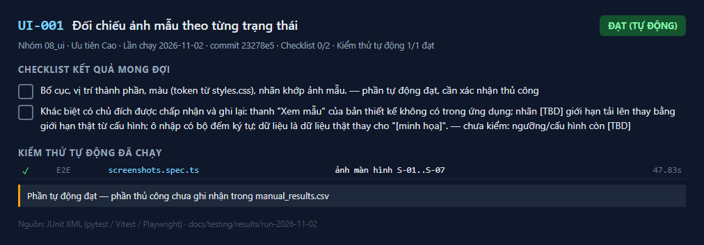
_Kết quả UI-001 — lần chạy 2026-11-02_

_ảnh màn hình S-01..S-07_

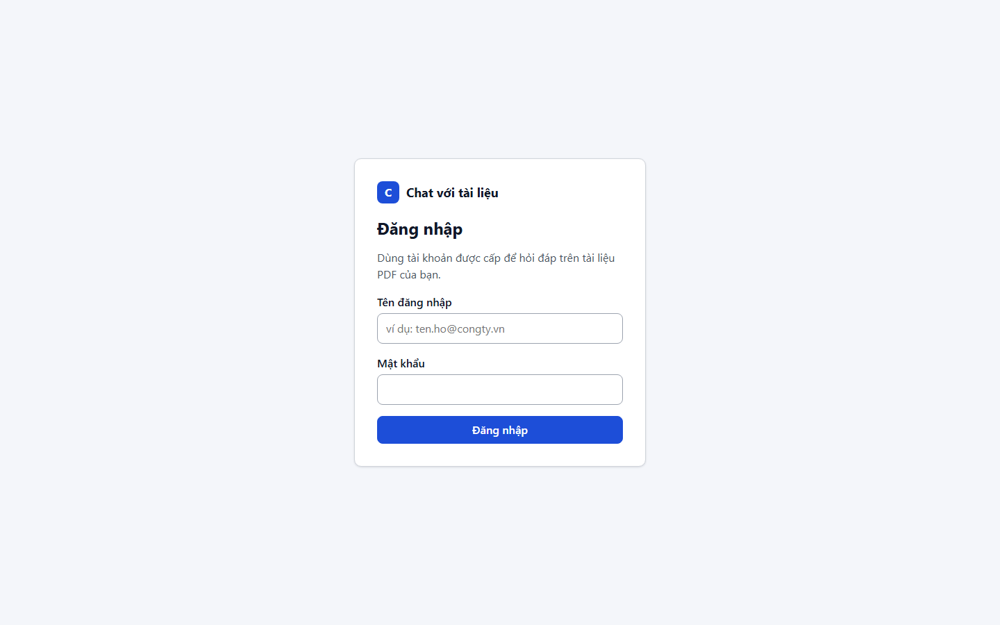
_S-01 mặc định_

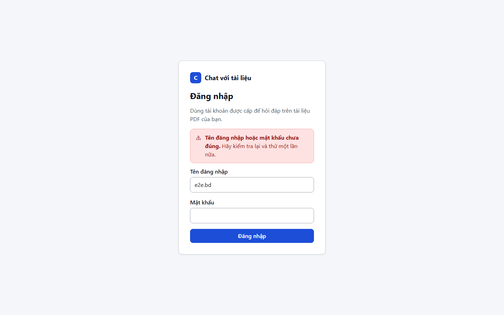
_S-01 sai thông tin_

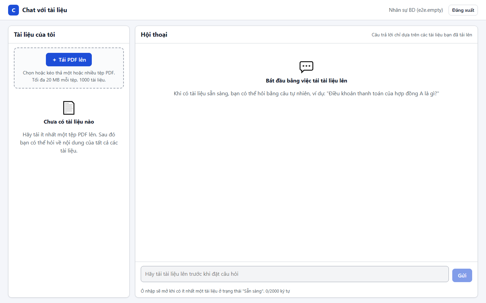
_S-02 chưa có tài liệu_

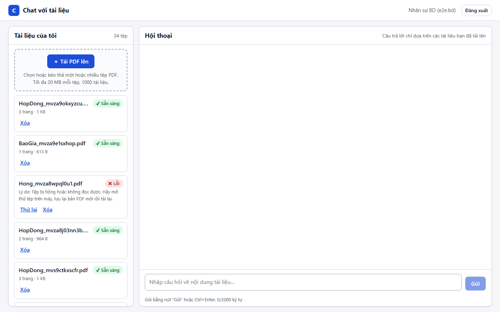
_S-02 có tài liệu_

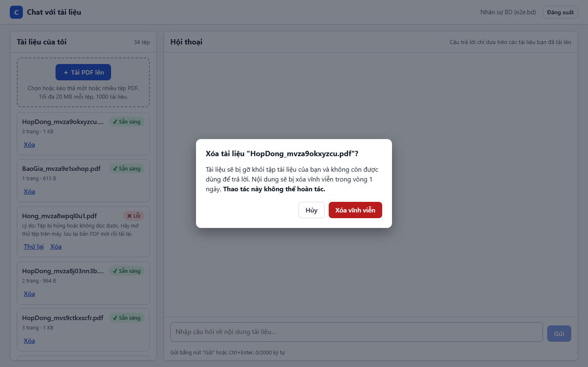
_S-04 xác nhận xóa_

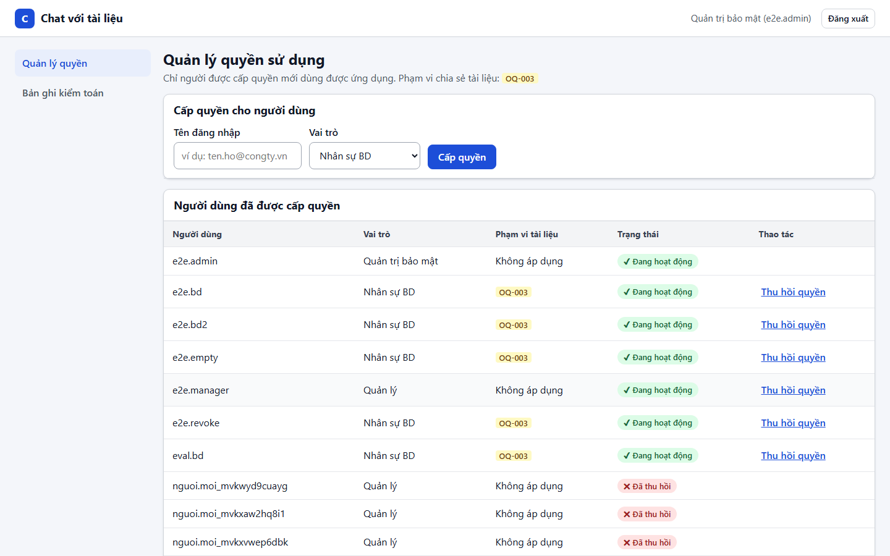
_S-05 quản trị_

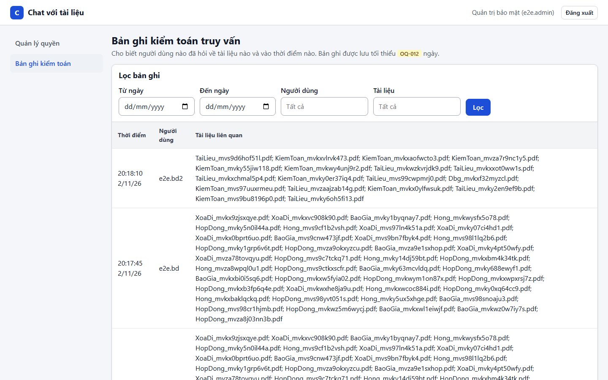
_S-06 nhật ký kiểm toán_

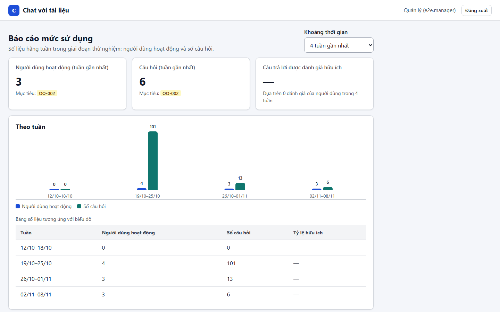
_S-07 báo cáo_

---

## UI-002

**Độ rộng màn hình** — 📝 **Thủ công — chưa ghi nhận**

| Mục | Nội dung |
|---|---|
| Mục tiêu | Giao diện dùng được ở độ rộng desktop (thiết kế đặt `min-width: 1024px`) |
| Truy vết | UIUX_Blueprint |
| Ưu tiên | Thấp |
| Tự động hóa | Thủ công |
| Đặc tả | [UI-002.md](../../test_cases/08_ui/UI-002.md) |

**Checklist kết quả mong đợi**

- [ ] Không cuộn ngang ở ≥ 1024 px; hai cột của S-02 và S-03 hiển thị đầy đủ; tên tệp dài bị cắt bằng "…" kèm `title`.

**Ảnh kết quả**

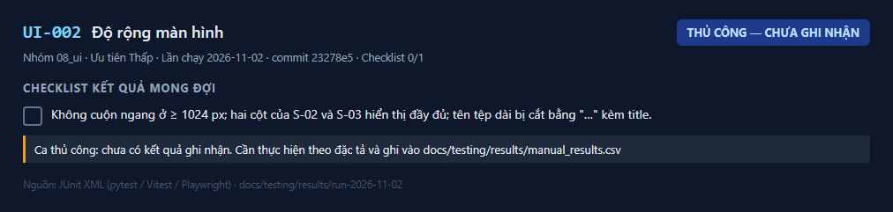
_Kết quả UI-002 — lần chạy 2026-11-02_

_S-01 mặc định_

_S-02 có tài liệu_

**Cách ghi nhận:** thực hiện theo đặc tả rồi thêm dòng `UI-002,<Đạt|Không đạt|Bị chặn>,<ngày>,<người>,<ghi chú>` vào `docs/testing/results/manual_results.csv`.

---

## UI-003

**Trạng thái của thành phần** — ✅ **Đạt**

| Mục | Nội dung |
|---|---|
| Mục tiêu | Mỗi thành phần có đủ trạng thái mặc định, vô hiệu, đang tải, lỗi, trống |
| Truy vết | UIUX_Blueprint C-00..C-20, T0-05 |
| Ưu tiên | Trung bình |
| Tự động hóa | Vitest: `components.test.tsx`, `documents.test.tsx`, `chat.test.tsx`, `sources.test.tsx`, `admin.test.tsx`, `reports.test.tsx` |
| Đặc tả | [UI-003.md](../../test_cases/08_ui/UI-003.md) |

**Checklist kết quả mong đợi**

- [x] Mỗi trạng thái hiển thị đúng chữ và kiểu; nút vô hiệu không nhận thao tác.

**Kiểm thử tự động đã chạy** (53/53 đạt)

| | Tầng | Tệp | Kiểm thử | Thời gian |
|---|---|---|---|---|
| ✅ | Frontend | `components.test.tsx` | ErrorBanner (C-16) > có vai trò alert, tiêu đề và hành động | 1.15 s |
| ✅ | Frontend | `components.test.tsx` | ErrorBanner (C-16) > dạng thông tin dùng vai trò note | 0.05 s |
| ✅ | Frontend | `components.test.tsx` | EmptyState (C-10) > hiển thị tiêu đề và hướng dẫn, biểu tượng ẩn với trình đọc màn hình | 0.12 s |
| ✅ | Frontend | `components.test.tsx` | StatusBadge (C-06) > ready luôn có chữ "Sẵn sàng", không chỉ dùng màu | 0.03 s |
| ✅ | Frontend | `components.test.tsx` | StatusBadge (C-06) > processing luôn có chữ "Đang xử lý", không chỉ dùng màu | 0.02 s |
| ✅ | Frontend | `components.test.tsx` | StatusBadge (C-06) > failed luôn có chữ "Lỗi", không chỉ dùng màu | 0.02 s |
| ✅ | Frontend | `components.test.tsx` | StatusBadge (C-06) > incomplete luôn có chữ "Chưa tải xong", không chỉ dùng màu | 0.01 s |
| ✅ | Frontend | `components.test.tsx` | AppShell (C-00) > có liên kết bỏ qua, tên người dùng, không có vi phạm axe nghiêm trọng | 1.27 s |
| ✅ | Frontend | `documents.test.tsx` | S-02 vùng tài liệu > trạng thái mặc định khớp s02-default: tên, số trang, dung lượng, nhãn, lý do lỗi | 3.73 s |
| ✅ | Frontend | `documents.test.tsx` | S-02 vùng tài liệu > trạng thái trống khớp s02-empty: hướng dẫn tải PDF, ô hỏi bị vô hiệu kèm giải thích | 0.72 s |
| ✅ | Frontend | `documents.test.tsx` | S-02 vùng tài liệu > lỗi tải danh sách có nút Thử lại | 0.29 s |
| ✅ | Frontend | `documents.test.tsx` | S-02 vùng tài liệu > chỉ hỏi định kỳ khi còn tài liệu đang xử lý | 0.01 s |
| ✅ | Frontend | `documents.test.tsx` | S-02 vùng tài liệu > hỏi lại trạng thái tới khi hết tài liệu đang xử lý rồi dừng | 0.67 s |
| ✅ | Frontend | `documents.test.tsx` | S-02 vùng tài liệu > danh sách 200 tài liệu dựng nhanh | 3.00 s |
| ✅ | Frontend | `documents.test.tsx` | S-02 vùng tài liệu > Thử lại gọi API retry | 0.61 s |
| ✅ | Frontend | `documents.test.tsx` | UploadControl (C-03) > nhiều tệp: tiến độ và kết quả riêng từng tệp; kiểm tra sớm đuôi và dung lượng | 0.47 s |
| ✅ | Frontend | `documents.test.tsx` | UploadControl (C-03) > mất mạng giữa chừng: "Chưa tải xong", không bao giờ "Sẵn sàng"; Tải lại gửi lại tệp | 0.34 s |
| ✅ | Frontend | `documents.test.tsx` | UploadControl (C-03) > không khóa vùng hội thoại khi đang tải | 0.13 s |
| ✅ | Frontend | `documents.test.tsx` | DeleteConfirmDialog (C-05, S-04) > khớp s04-default: tên tài liệu, thời hạn xóa, không thể hoàn tác, tiêu điểm ở Hủy | 0.65 s |
| ✅ | Frontend | `documents.test.tsx` | DeleteConfirmDialog (C-05, S-04) > Esc đóng hộp thoại và trả tiêu điểm về nút gọi | 0.54 s |
| ✅ | Frontend | `documents.test.tsx` | DeleteConfirmDialog (C-05, S-04) > xóa thất bại hiển thị lỗi trong hộp thoại (s04-failed) | 0.67 s |
| ✅ | Frontend | `documents.test.tsx` | DeleteConfirmDialog (C-05, S-04) > xóa thành công: tài liệu biến khỏi danh sách ngay | 0.69 s |
| ✅ | Frontend | `chat.test.tsx` | Hỏi đáp > câu trả lời có nguồn: chip "tên, tr.N", tiêu điểm quay về ô nhập, không vi phạm axe | 6.52 s |
| ✅ | Frontend | `chat.test.tsx` | Hỏi đáp > không tìm thấy: khối cảnh báo kèm gợi ý, không có chip nguồn | 1.90 s |
| ✅ | Frontend | `chat.test.tsx` | Hỏi đáp > nội dung có <script> hiển thị nguyên văn, không thực thi | 0.84 s |
| ✅ | Frontend | `chat.test.tsx` | Hỏi đáp > chỉ báo "Đang xử lý câu hỏi…" xuất hiện ngay khi gửi; Hủy trả câu hỏi về ô nhập | 1.16 s |
| ✅ | Frontend | `chat.test.tsx` | Hỏi đáp > gửi bằng Ctrl+Enter | 0.79 s |
| ✅ | Frontend | `chat.test.tsx` | Hỏi đáp > câu hỏi quá dài: báo số ký tự và không cho gửi | 1.47 s |
| ✅ | Frontend | `chat.test.tsx` | Hỏi đáp > chưa có tài liệu sẵn sàng: ô nhập vô hiệu kèm giải thích | 0.14 s |
| ✅ | Frontend | `chat.test.tsx` | Lỗi khi hỏi (s02-offline-ask) > mất mạng: giữ câu hỏi, nút "Gửi lại", không có câu trả lời dở dang; gửi lại được | 1.85 s |
| ✅ | Frontend | `chat.test.tsx` | Lỗi khi hỏi (s02-offline-ask) > 504: thông báo quá thời gian kèm "Thử lại" | 1.21 s |
| ✅ | Frontend | `chat.test.tsx` | Lỗi khi hỏi (s02-offline-ask) > 502: thông báo chung từ máy chủ | 0.76 s |
| ✅ | Frontend | `chat.test.tsx` | Nguồn, đánh giá, lịch sử > chọn chip phát source_opened chỉ với id tài liệu và số trang | 2.02 s |
| ✅ | Frontend | `chat.test.tsx` | Nguồn, đánh giá, lịch sử > đánh giá: aria-pressed, đổi lại được | 1.68 s |
| ✅ | Frontend | `chat.test.tsx` | Nguồn, đánh giá, lịch sử > khôi phục lịch sử trong phiên; "Hội thoại mới" xóa ngữ cảnh | 1.50 s |
| ✅ | Frontend | `sources.test.tsx` | findHighlight > khớp linh hoạt khoảng trắng và ngắt dòng | 0.01 s |
| ✅ | Frontend | `sources.test.tsx` | findHighlight > không tìm thấy hoặc rỗng → không tô sáng | 0.00 s |
| ✅ | Frontend | `sources.test.tsx` | S-03 Trình xem nguồn > s03-default: "Trang N / M", tô sáng đoạn trích, cột nguồn, không vi phạm axe | 2.54 s |
| ✅ | Frontend | `sources.test.tsx` | S-03 Trình xem nguồn > đoạn trích không có trong trang: hiển thị trang, không tô sáng, không báo lỗi | 0.22 s |
| ✅ | Frontend | `sources.test.tsx` | S-03 Trình xem nguồn > chuyển trang không tải lại toàn bộ ứng dụng | 0.77 s |
| ✅ | Frontend | `sources.test.tsx` | S-03 Trình xem nguồn > s03-deleted: tài liệu đã bị xóa khi API trả 404 | 0.35 s |
| ✅ | Frontend | `admin.test.tsx` | S-05 Quản lý quyền > s05-default: bảng người dùng, cột phạm vi [OQ-003], không vi phạm axe | 3.98 s |
| ✅ | Frontend | `admin.test.tsx` | S-05 Quản lý quyền > s05-empty: trạng thái trống | 0.58 s |
| ✅ | Frontend | `admin.test.tsx` | S-05 Quản lý quyền > cấp quyền gọi API với tên đăng nhập và vai trò | 1.30 s |
| ✅ | Frontend | `admin.test.tsx` | S-05 Quản lý quyền > bỏ trống tên đăng nhập: báo lỗi tại trường, không gọi API | 0.47 s |
| ✅ | Frontend | `admin.test.tsx` | S-05 Quản lý quyền > s05-confirm: thu hồi phải qua bước xác nhận | 1.16 s |
| ✅ | Frontend | `admin.test.tsx` | S-06 Bản ghi kiểm toán > s06-default: bảng thời điểm, người dùng, tài liệu; xem thêm theo con trỏ; không vi phạm axe | 1.31 s |
| ✅ | Frontend | `admin.test.tsx` | S-06 Bản ghi kiểm toán > bộ lọc gửi đúng tham số | 1.16 s |
| ✅ | Frontend | `admin.test.tsx` | S-06 Bản ghi kiểm toán > s06-empty và s06-error (có Thử lại) | 0.34 s |
| ✅ | Frontend | `reports.test.tsx` | S-07 Báo cáo mức sử dụng > s07-default: thẻ số liệu tuần gần nhất, biểu đồ có chú giải và bảng số liệu | 3.67 s |
| ✅ | Frontend | `reports.test.tsx` | S-07 Báo cáo mức sử dụng > đổi khoảng thời gian gọi lại API | 0.92 s |
| ✅ | Frontend | `reports.test.tsx` | S-07 Báo cáo mức sử dụng > s07-empty | 0.23 s |
| ✅ | Frontend | `reports.test.tsx` | S-07 Báo cáo mức sử dụng > s07-error có Thử lại | 0.34 s |

**Ảnh kết quả**

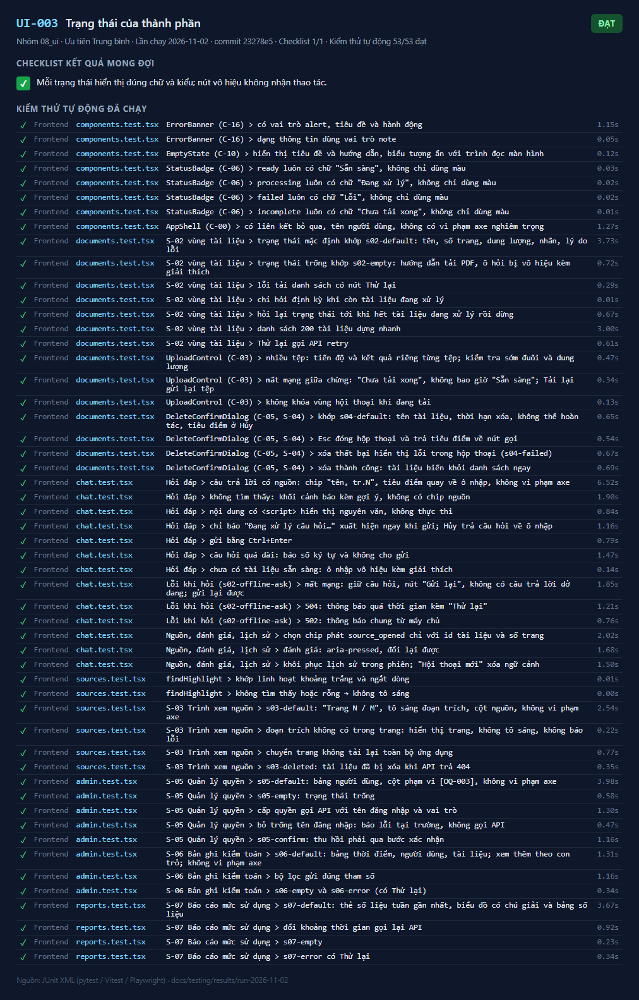
_Kết quả UI-003 — lần chạy 2026-11-02_

---

## UI-004

**Tương tác** — 📝 **Thủ công — chưa ghi nhận**

| Mục | Nội dung |
|---|---|
| Mục tiêu | Các tương tác hoạt động đúng |
| Truy vết | US-001, US-010, US-013, US-015 |
| Ưu tiên | Trung bình |
| Tự động hóa | Vitest và E2E (xem cột ghi chú) |
| Đặc tả | [UI-004.md](../../test_cases/08_ui/UI-004.md) |

**Checklist kết quả mong đợi**

- [ ] Kéo thả tệp vào vùng tải lên → Vùng đổi màu khi kéo qua; thả thì tải lên _(Thủ công)_ — _cần xác nhận thủ công_
- [x] Chọn nhiều tệp → Mỗi tệp có tiến độ riêng _(`documents.test.tsx`)_ — tệp kiểm thử đạt toàn bộ
- [x] Nhấn "Hủy" khi đang chờ → Chỉ báo biến mất, câu hỏi trở lại ô nhập _(`chat.test.tsx`)_ — tệp kiểm thử đạt toàn bộ
- [x] Nhấn "Hội thoại mới" → Lịch sử xóa, hội thoại mới không mang ngữ cảnh _(`chat.test.tsx`, `qa.spec.ts`)_ — tệp kiểm thử đạt toàn bộ
- [x] Trang trước/sau ở S-03 → Đổi trang không tải lại ứng dụng; nút vô hiệu ở trang đầu/cuối _(`sources.test.tsx`)_ — tệp kiểm thử đạt toàn bộ
- [x] Đổi "Khoảng thời gian" ở S-07 → Gọi lại API với `weeks=8` _(`reports.test.tsx`)_ — tệp kiểm thử đạt toàn bộ
- [x] "Xem thêm bản ghi" ở S-06 → Thêm trang kế tiếp, nút biến mất khi hết _(`admin.test.tsx`)_ — tệp kiểm thử đạt toàn bộ
- [x] Đánh giá Hữu ích/Không hữu ích → Nút được chọn đổi trạng thái; chọn lại đổi được _(`chat.test.tsx`)_ — tệp kiểm thử đạt toàn bộ

**Ảnh kết quả**

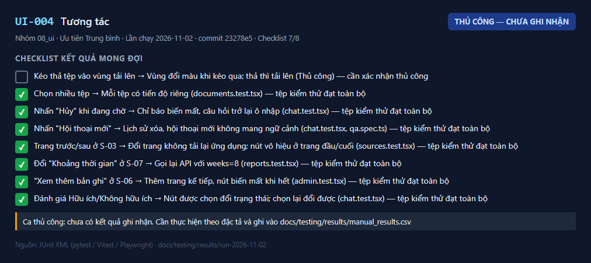
_Kết quả UI-004 — lần chạy 2026-11-02_

**Cách ghi nhận:** thực hiện theo đặc tả rồi thêm dòng `UI-004,<Đạt|Không đạt|Bị chặn>,<ngày>,<người>,<ghi chú>` vào `docs/testing/results/manual_results.csv`.

---

## UI-005

**Trạng thái lỗi** — 📝 **Thủ công — chưa ghi nhận**

| Mục | Nội dung |
|---|---|
| Mục tiêu | Mỗi trạng thái lỗi hiển thị thông điệp dễ hiểu và hành động khắc phục |
| Truy vết | PRD 4.2 |
| Ưu tiên | Cao |
| Tự động hóa | Vitest (xem bảng) |
| Đặc tả | [UI-005.md](../../test_cases/08_ui/UI-005.md) |

**Checklist kết quả mong đợi**

- [ ] Tình huống → Hiển thị _(Kiểm thử)_
- [x] Mất mạng khi hỏi → Banner đầu trang + banner trong hội thoại, nút "Gửi lại" _(`chat.test.tsx`)_ — tệp kiểm thử đạt toàn bộ
- [x] Quá thời gian (504) → "Hệ thống trả lời quá lâu…" + "Thử lại" _(`chat.test.tsx`)_ — tệp kiểm thử đạt toàn bộ
- [x] Dịch vụ AI không trả lời (502) → Thông điệp chung từ máy chủ _(`chat.test.tsx`)_ — tệp kiểm thử đạt toàn bộ
- [x] Mất mạng khi tải lên → "Chưa tải xong", "Tải lại", "Bỏ qua" + banner _(`documents.test.tsx`)_ — tệp kiểm thử đạt toàn bộ
- [x] Tài liệu đã xóa ở S-03 → "Tài liệu này đã bị xóa" + "Quay lại hội thoại" _(`sources.test.tsx`)_ — tệp kiểm thử đạt toàn bộ
- [x] Xóa thất bại → Lỗi trong hộp thoại, hộp thoại không đóng _(`documents.test.tsx`)_ — tệp kiểm thử đạt toàn bộ
- [x] Không tải được danh sách / bản ghi / báo cáo → Banner lỗi + "Thử lại" _(`documents.test.tsx`, `admin.test.tsx`, `reports.test.tsx`)_ — tệp kiểm thử đạt toàn bộ

**Ảnh kết quả**

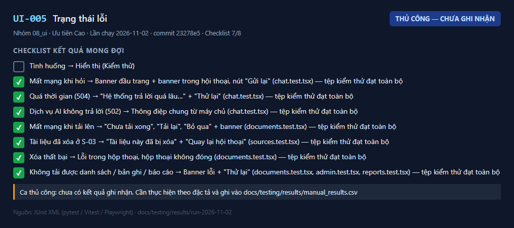
_Kết quả UI-005 — lần chạy 2026-11-02_

**Cách ghi nhận:** thực hiện theo đặc tả rồi thêm dòng `UI-005,<Đạt|Không đạt|Bị chặn>,<ngày>,<người>,<ghi chú>` vào `docs/testing/results/manual_results.csv`.

---

## UI-006

**Trạng thái chờ** — ✅ **Đạt**

| Mục | Nội dung |
|---|---|
| Mục tiêu | Người dùng luôn biết hệ thống đang làm gì |
| Truy vết | US-001, US-013 |
| Ưu tiên | Trung bình |
| Tự động hóa | `chat.test.tsx`, `documents.test.tsx` |
| Đặc tả | [UI-006.md](../../test_cases/08_ui/UI-006.md) |

**Checklist kết quả mong đợi**

- [x] Mỗi trạng thái hiển thị ngay; với người bật "giảm chuyển động" (`prefers-reduced-motion`), ba chấm không nhấp nháy.

**Kiểm thử tự động đã chạy** (27/27 đạt)

| | Tầng | Tệp | Kiểm thử | Thời gian |
|---|---|---|---|---|
| ✅ | Frontend | `chat.test.tsx` | Hỏi đáp > câu trả lời có nguồn: chip "tên, tr.N", tiêu điểm quay về ô nhập, không vi phạm axe | 6.52 s |
| ✅ | Frontend | `chat.test.tsx` | Hỏi đáp > không tìm thấy: khối cảnh báo kèm gợi ý, không có chip nguồn | 1.90 s |
| ✅ | Frontend | `chat.test.tsx` | Hỏi đáp > nội dung có <script> hiển thị nguyên văn, không thực thi | 0.84 s |
| ✅ | Frontend | `chat.test.tsx` | Hỏi đáp > chỉ báo "Đang xử lý câu hỏi…" xuất hiện ngay khi gửi; Hủy trả câu hỏi về ô nhập | 1.16 s |
| ✅ | Frontend | `chat.test.tsx` | Hỏi đáp > gửi bằng Ctrl+Enter | 0.79 s |
| ✅ | Frontend | `chat.test.tsx` | Hỏi đáp > câu hỏi quá dài: báo số ký tự và không cho gửi | 1.47 s |
| ✅ | Frontend | `chat.test.tsx` | Hỏi đáp > chưa có tài liệu sẵn sàng: ô nhập vô hiệu kèm giải thích | 0.14 s |
| ✅ | Frontend | `chat.test.tsx` | Lỗi khi hỏi (s02-offline-ask) > mất mạng: giữ câu hỏi, nút "Gửi lại", không có câu trả lời dở dang; gửi lại được | 1.85 s |
| ✅ | Frontend | `chat.test.tsx` | Lỗi khi hỏi (s02-offline-ask) > 504: thông báo quá thời gian kèm "Thử lại" | 1.21 s |
| ✅ | Frontend | `chat.test.tsx` | Lỗi khi hỏi (s02-offline-ask) > 502: thông báo chung từ máy chủ | 0.76 s |
| ✅ | Frontend | `chat.test.tsx` | Nguồn, đánh giá, lịch sử > chọn chip phát source_opened chỉ với id tài liệu và số trang | 2.02 s |
| ✅ | Frontend | `chat.test.tsx` | Nguồn, đánh giá, lịch sử > đánh giá: aria-pressed, đổi lại được | 1.68 s |
| ✅ | Frontend | `chat.test.tsx` | Nguồn, đánh giá, lịch sử > khôi phục lịch sử trong phiên; "Hội thoại mới" xóa ngữ cảnh | 1.50 s |
| ✅ | Frontend | `documents.test.tsx` | S-02 vùng tài liệu > trạng thái mặc định khớp s02-default: tên, số trang, dung lượng, nhãn, lý do lỗi | 3.73 s |
| ✅ | Frontend | `documents.test.tsx` | S-02 vùng tài liệu > trạng thái trống khớp s02-empty: hướng dẫn tải PDF, ô hỏi bị vô hiệu kèm giải thích | 0.72 s |
| ✅ | Frontend | `documents.test.tsx` | S-02 vùng tài liệu > lỗi tải danh sách có nút Thử lại | 0.29 s |
| ✅ | Frontend | `documents.test.tsx` | S-02 vùng tài liệu > chỉ hỏi định kỳ khi còn tài liệu đang xử lý | 0.01 s |
| ✅ | Frontend | `documents.test.tsx` | S-02 vùng tài liệu > hỏi lại trạng thái tới khi hết tài liệu đang xử lý rồi dừng | 0.67 s |
| ✅ | Frontend | `documents.test.tsx` | S-02 vùng tài liệu > danh sách 200 tài liệu dựng nhanh | 3.00 s |
| ✅ | Frontend | `documents.test.tsx` | S-02 vùng tài liệu > Thử lại gọi API retry | 0.61 s |
| ✅ | Frontend | `documents.test.tsx` | UploadControl (C-03) > nhiều tệp: tiến độ và kết quả riêng từng tệp; kiểm tra sớm đuôi và dung lượng | 0.47 s |
| ✅ | Frontend | `documents.test.tsx` | UploadControl (C-03) > mất mạng giữa chừng: "Chưa tải xong", không bao giờ "Sẵn sàng"; Tải lại gửi lại tệp | 0.34 s |
| ✅ | Frontend | `documents.test.tsx` | UploadControl (C-03) > không khóa vùng hội thoại khi đang tải | 0.13 s |
| ✅ | Frontend | `documents.test.tsx` | DeleteConfirmDialog (C-05, S-04) > khớp s04-default: tên tài liệu, thời hạn xóa, không thể hoàn tác, tiêu điểm ở Hủy | 0.65 s |
| ✅ | Frontend | `documents.test.tsx` | DeleteConfirmDialog (C-05, S-04) > Esc đóng hộp thoại và trả tiêu điểm về nút gọi | 0.54 s |
| ✅ | Frontend | `documents.test.tsx` | DeleteConfirmDialog (C-05, S-04) > xóa thất bại hiển thị lỗi trong hộp thoại (s04-failed) | 0.67 s |
| ✅ | Frontend | `documents.test.tsx` | DeleteConfirmDialog (C-05, S-04) > xóa thành công: tài liệu biến khỏi danh sách ngay | 0.69 s |

**Ảnh kết quả**

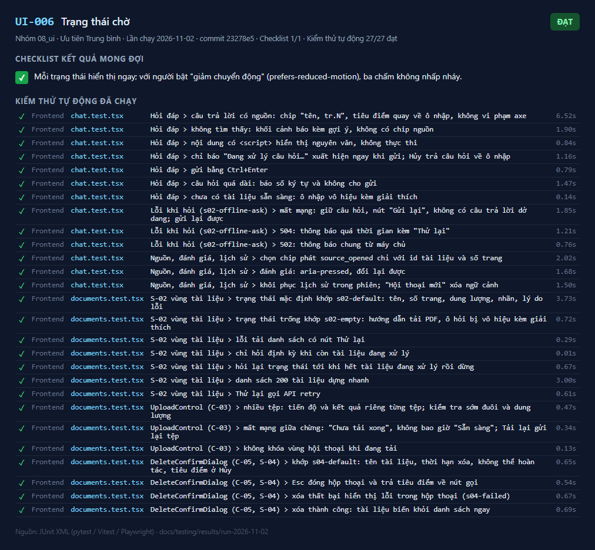
_Kết quả UI-006 — lần chạy 2026-11-02_

---

## UI-007

**Thông báo** — ✅ **Đạt**

| Mục | Nội dung |
|---|---|
| Mục tiêu | Thông báo tại chỗ đúng loại và đúng vị trí |
| Truy vết | C-16 ErrorBanner |
| Ưu tiên | Thấp |
| Tự động hóa | `components.test.tsx`, `admin.test.tsx` |
| Đặc tả | [UI-007.md](../../test_cases/08_ui/UI-007.md) |

**Checklist kết quả mong đợi**

- _(đặc tả không có danh sách kết quả mong đợi)_

**Kiểm thử tự động đã chạy** (16/16 đạt)

| | Tầng | Tệp | Kiểm thử | Thời gian |
|---|---|---|---|---|
| ✅ | Frontend | `components.test.tsx` | ErrorBanner (C-16) > có vai trò alert, tiêu đề và hành động | 1.15 s |
| ✅ | Frontend | `components.test.tsx` | ErrorBanner (C-16) > dạng thông tin dùng vai trò note | 0.05 s |
| ✅ | Frontend | `components.test.tsx` | EmptyState (C-10) > hiển thị tiêu đề và hướng dẫn, biểu tượng ẩn với trình đọc màn hình | 0.12 s |
| ✅ | Frontend | `components.test.tsx` | StatusBadge (C-06) > ready luôn có chữ "Sẵn sàng", không chỉ dùng màu | 0.03 s |
| ✅ | Frontend | `components.test.tsx` | StatusBadge (C-06) > processing luôn có chữ "Đang xử lý", không chỉ dùng màu | 0.02 s |
| ✅ | Frontend | `components.test.tsx` | StatusBadge (C-06) > failed luôn có chữ "Lỗi", không chỉ dùng màu | 0.02 s |
| ✅ | Frontend | `components.test.tsx` | StatusBadge (C-06) > incomplete luôn có chữ "Chưa tải xong", không chỉ dùng màu | 0.01 s |
| ✅ | Frontend | `components.test.tsx` | AppShell (C-00) > có liên kết bỏ qua, tên người dùng, không có vi phạm axe nghiêm trọng | 1.27 s |
| ✅ | Frontend | `admin.test.tsx` | S-05 Quản lý quyền > s05-default: bảng người dùng, cột phạm vi [OQ-003], không vi phạm axe | 3.98 s |
| ✅ | Frontend | `admin.test.tsx` | S-05 Quản lý quyền > s05-empty: trạng thái trống | 0.58 s |
| ✅ | Frontend | `admin.test.tsx` | S-05 Quản lý quyền > cấp quyền gọi API với tên đăng nhập và vai trò | 1.30 s |
| ✅ | Frontend | `admin.test.tsx` | S-05 Quản lý quyền > bỏ trống tên đăng nhập: báo lỗi tại trường, không gọi API | 0.47 s |
| ✅ | Frontend | `admin.test.tsx` | S-05 Quản lý quyền > s05-confirm: thu hồi phải qua bước xác nhận | 1.16 s |
| ✅ | Frontend | `admin.test.tsx` | S-06 Bản ghi kiểm toán > s06-default: bảng thời điểm, người dùng, tài liệu; xem thêm theo con trỏ; không vi phạm axe | 1.31 s |
| ✅ | Frontend | `admin.test.tsx` | S-06 Bản ghi kiểm toán > bộ lọc gửi đúng tham số | 1.16 s |
| ✅ | Frontend | `admin.test.tsx` | S-06 Bản ghi kiểm toán > s06-empty và s06-error (có Thử lại) | 0.34 s |

**Ảnh kết quả**

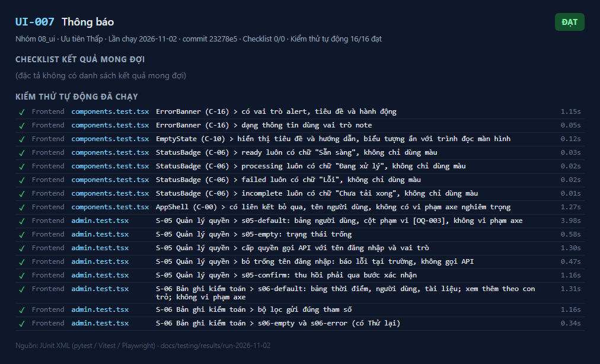
_Kết quả UI-007 — lần chạy 2026-11-02_

---

## UI-008

**Điều hướng** — ✅ **Đạt**

| Mục | Nội dung |
|---|---|
| Mục tiêu | Điều hướng theo vai trò và giữa các màn hình đúng |
| Truy vết | US-017, T1-06 |
| Ưu tiên | Cao |
| Tự động hóa | `LoginPage.test.tsx` (theo vai trò, sai vai trò), `admin.test.tsx` (`aria-current`), `qa.spec.ts` |
| Đặc tả | [UI-008.md](../../test_cases/08_ui/UI-008.md) |

**Checklist kết quả mong đợi**

- _(đặc tả không có danh sách kết quả mong đợi)_

**Kiểm thử tự động đã chạy** (20/20 đạt)

| | Tầng | Tệp | Kiểm thử | Thời gian |
|---|---|---|---|---|
| ✅ | Frontend | `LoginPage.test.tsx` | S-01 Đăng nhập > mặc định: biểu mẫu, không có thông báo lỗi, không vi phạm axe | 2.14 s |
| ✅ | Frontend | `LoginPage.test.tsx` | S-01 Đăng nhập > sai thông tin: thông báo chung, không phân biệt sai tên hay sai mật khẩu | 1.47 s |
| ✅ | Frontend | `LoginPage.test.tsx` | S-01 Đăng nhập > không có quyền (403 no_access) | 0.92 s |
| ✅ | Frontend | `LoginPage.test.tsx` | S-01 Đăng nhập > hết phiên: thông báo khi bị đưa về từ một yêu cầu 401 | 0.08 s |
| ✅ | Frontend | `LoginPage.test.tsx` | S-01 Đăng nhập > đăng nhập vai trò bd đưa tới đúng màn hình | 1.09 s |
| ✅ | Frontend | `LoginPage.test.tsx` | S-01 Đăng nhập > đăng nhập vai trò security_admin đưa tới đúng màn hình | 1.08 s |
| ✅ | Frontend | `LoginPage.test.tsx` | S-01 Đăng nhập > đăng nhập vai trò manager đưa tới đúng màn hình | 0.89 s |
| ✅ | Frontend | `LoginPage.test.tsx` | AuthGate (C-01) > chưa đăng nhập → về /login | 0.19 s |
| ✅ | Frontend | `LoginPage.test.tsx` | AuthGate (C-01) > 401 giữa phiên → về /login với thông báo hết phiên, câu hỏi đang soạn vẫn được giữ | 1.43 s |
| ✅ | Frontend | `LoginPage.test.tsx` | AuthGate (C-01) > sai vai trò → về trang chủ của vai trò | 0.14 s |
| ✅ | Frontend | `admin.test.tsx` | S-05 Quản lý quyền > s05-default: bảng người dùng, cột phạm vi [OQ-003], không vi phạm axe | 3.98 s |
| ✅ | Frontend | `admin.test.tsx` | S-05 Quản lý quyền > s05-empty: trạng thái trống | 0.58 s |
| ✅ | Frontend | `admin.test.tsx` | S-05 Quản lý quyền > cấp quyền gọi API với tên đăng nhập và vai trò | 1.30 s |
| ✅ | Frontend | `admin.test.tsx` | S-05 Quản lý quyền > bỏ trống tên đăng nhập: báo lỗi tại trường, không gọi API | 0.47 s |
| ✅ | Frontend | `admin.test.tsx` | S-05 Quản lý quyền > s05-confirm: thu hồi phải qua bước xác nhận | 1.16 s |
| ✅ | Frontend | `admin.test.tsx` | S-06 Bản ghi kiểm toán > s06-default: bảng thời điểm, người dùng, tài liệu; xem thêm theo con trỏ; không vi phạm axe | 1.31 s |
| ✅ | Frontend | `admin.test.tsx` | S-06 Bản ghi kiểm toán > bộ lọc gửi đúng tham số | 1.16 s |
| ✅ | Frontend | `admin.test.tsx` | S-06 Bản ghi kiểm toán > s06-empty và s06-error (có Thử lại) | 0.34 s |
| ✅ | E2E | `qa.spec.ts` | hỏi đáp có nguồn và trình xem nguồn | 40.87 s |
| ✅ | E2E | `qa.spec.ts` | mất mạng khi hỏi: giữ câu hỏi, "Gửi lại" được sau khi có mạng | 24.83 s |

**Ảnh kết quả**

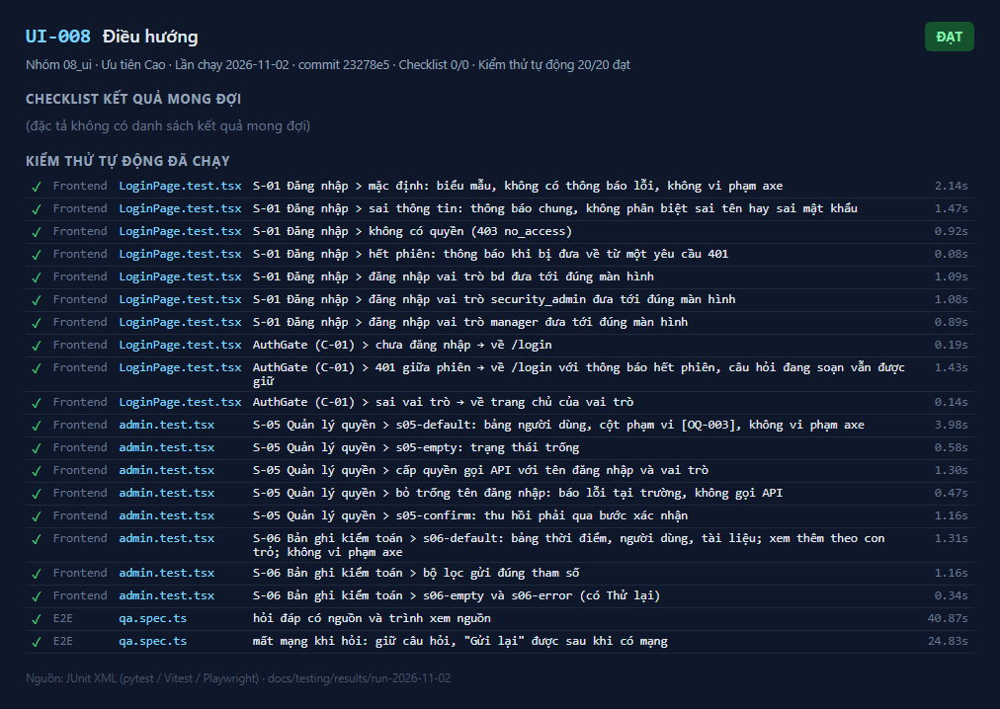
_Kết quả UI-008 — lần chạy 2026-11-02_

_hỏi đáp có nguồn và trình xem nguồn_

_mất mạng khi hỏi: giữ câu hỏi, "Gửi lại" được sau khi có mạng_

---
