# 09 — Ca kiểm thử API theo hợp đồng (API-001..API-015) — kết quả chi tiết

Lần chạy: [README](README.md) · Đặc tả: [09_api](../../test_cases/09_api/README.md)

| Mã | Tên | Ưu tiên | Kết quả | Kiểm thử tự động đạt | Ảnh |
|---|---|---|---|---|---|
| [API-001](#api-001) | `POST /auth/login` | — | ✅ Đạt | — | 1 |
| [API-002](#api-002) | `GET /auth/me`, `POST /auth/logout` | — | ✅ Đạt | — | 1 |
| [API-003](#api-003) | `GET /auth/oidc/login`, `GET /auth/oidc/callback` | — | ✅ Đạt | — | 1 |
| [API-004](#api-004) | `POST /documents` | — | ✅ Đạt | — | 1 |
| [API-005](#api-005) | `GET /documents`, `GET /documents/{id}` | — | ✅ Đạt | — | 1 |
| [API-006](#api-006) | `POST /documents/{id}/retry` | — | ✅ Đạt | — | 1 |
| [API-007](#api-007) | `DELETE /documents/{id}` | — | ✅ Đạt | — | 1 |
| [API-008](#api-008) | `GET /documents/{id}/pages/{page}`, `GET /documents/{id}/file` | — | ✅ Đạt | — | 1 |
| [API-009](#api-009) | `POST /events/source-opened` | — | ✅ Đạt | — | 1 |
| [API-010](#api-010) | `POST /conversations`, `POST\|GET /conversations/{id}/messages` | — | ✅ Đạt | — | 1 |
| [API-011](#api-011) | `PUT /messages/{id}/feedback` | — | ✅ Đạt | — | 1 |
| [API-012](#api-012) | `GET\|POST /admin/access`, `DELETE /admin/access/{user_id}` | — | ✅ Đạt | — | 1 |
| [API-013](#api-013) | `GET /admin/audit` | — | ✅ Đạt | — | 1 |
| [API-014](#api-014) | `GET /reports/usage` | — | ✅ Đạt | — | 1 |
| [API-015](#api-015) | `GET /health/live`, `GET /health/ready`, `GET /metrics` | — | ✅ Đạt | — | 1 |

## API-001

**`POST /auth/login`** — ✅ **Đạt**

| Mục | Nội dung |
|---|---|
| Tự động hóa | Theo INT-API-001..004, SEC-004, INT-API-037 (bước 4) |
| Đặc tả | [API-001.md](../../test_cases/09_api/API-001.md) |

**Checklist kết quả mong đợi**

- [x] Ra 200: `{"user": {"id", "login", "display_name"}, "role": "bd"\|"manager"\|"security_admin", "config": {"max_file_bytes", "max_docs_per_user", "max_question_chars", "poll_interval_s", "purge_sla_hours", "auth_mode"}}` + cookie phiên
- [x] Lỗi: 400 `invalid_input`; 401 `invalid_credentials`; 403 `no_access`; 403 `csrf_rejected`; 429 `login_locked`; 404 khi `AUTH_MODE=oidc`

**Căn cứ:** Theo INT-API-001: Đạt, INT-API-002: Đạt, INT-API-003: Đạt, INT-API-004: Đạt, SEC-004: Đạt, INT-API-037: Đạt

**Ảnh kết quả**

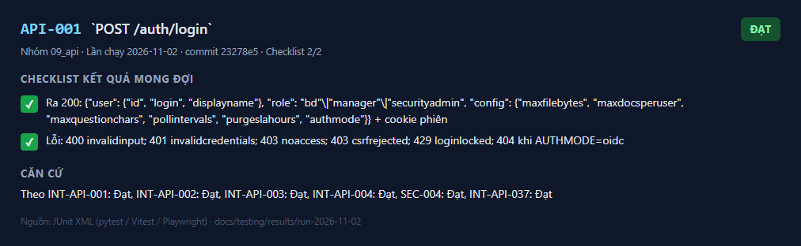
_Kết quả API-001 — lần chạy 2026-11-02_

---

## API-002

**`GET /auth/me`, `POST /auth/logout`** — ✅ **Đạt**

| Mục | Nội dung |
|---|---|
| Tự động hóa | Theo INT-API-001, INT-API-005, INT-API-006, SEC-005 |
| Đặc tả | [API-002.md](../../test_cases/09_api/API-002.md) |

**Checklist kết quả mong đợi**

- [x] Ra: `/auth/me` 200 như API-001; `/auth/logout` 204 và xóa cookie
- [x] Lỗi: 401 `unauthenticated`; 401 `session_expired`; 403 `no_access` (quyền bị thu hồi)

**Căn cứ:** Theo INT-API-001: Đạt, INT-API-005: Đạt, INT-API-006: Đạt, SEC-005: Đạt

**Ảnh kết quả**

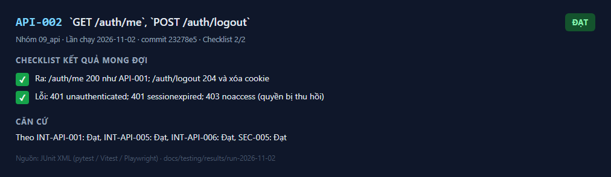
_Kết quả API-002 — lần chạy 2026-11-02_

---

## API-003

**`GET /auth/oidc/login`, `GET /auth/oidc/callback`** — ✅ **Đạt**

| Mục | Nội dung |
|---|---|
| Tự động hóa | Theo INT-API-037, UT-015 |
| Đặc tả | [API-003.md](../../test_cases/09_api/API-003.md) |

**Checklist kết quả mong đợi**

- [x] Ra: 302 tới IdP (có `code_challenge`, `S256`, `state`, `nonce`); callback 302 tới `OIDC_POST_LOGIN_REDIRECT` hoặc `/login?error=no_access`
- [x] Lỗi: 400 `oidc_state_mismatch`; 401 `oidc_failed`; 404 khi `AUTH_MODE=local`

**Căn cứ:** Theo INT-API-037: Đạt, UT-015: Đạt

**Ảnh kết quả**

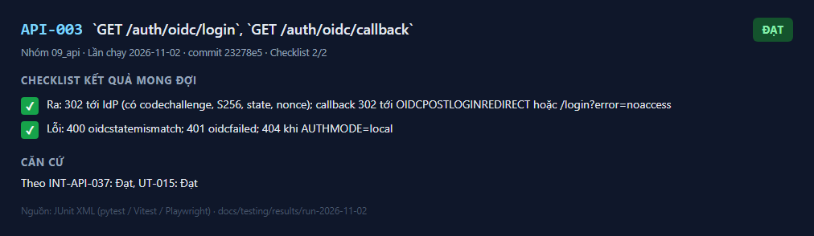
_Kết quả API-003 — lần chạy 2026-11-02_

---

## API-004

**`POST /documents`** — ✅ **Đạt**

| Mục | Nội dung |
|---|---|
| Tự động hóa | Theo INT-API-007, INT-API-008, INT-API-009, SEC-011 |
| Đặc tả | [API-004.md](../../test_cases/09_api/API-004.md) |

**Checklist kết quả mong đợi**

- [x] Ra 200: Mảng, mỗi phần tử `{"id": uuid\|null, "file_name", "status": "processing"\|"failed", "failure_reason": null\|"not_pdf"\|"too_large"\|"too_many_documents"\|"internal"}`, cùng thứ tự với tệp gửi lên
- [x] Lỗi: 400 khi không có tệp; 401; 403 `forbidden_role` (không phải bd)

**Căn cứ:** Theo INT-API-007: Đạt, INT-API-008: Đạt, INT-API-009: Đạt, SEC-011: Đạt

**Ảnh kết quả**

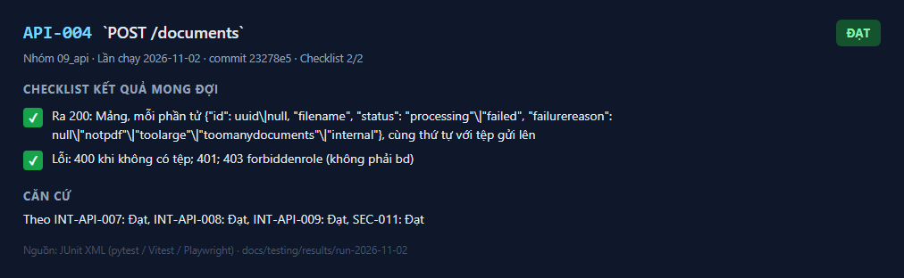
_Kết quả API-004 — lần chạy 2026-11-02_

---

## API-005

**`GET /documents`, `GET /documents/{id}`** — ✅ **Đạt**

| Mục | Nội dung |
|---|---|
| Tự động hóa | Theo INT-API-009, INT-API-028, SEC-003 |
| Đặc tả | [API-005.md](../../test_cases/09_api/API-005.md) |

**Checklist kết quả mong đợi**

- [x] Ra 200: Phần tử `{"id", "file_name", "size_bytes", "page_count": int\|null, "status": "processing"\|"ready"\|"failed", "failure_reason", "uploaded_at"}`; danh sách mới nhất trước; không bao giờ có `deleting`/`deleted`
- [x] Lỗi: 404 `document_not_found` (không tồn tại, của người khác, hoặc đã xóa); 400 khi `id` không phải UUID

**Căn cứ:** Theo INT-API-009: Đạt, INT-API-028: Đạt, SEC-003: Đạt

**Ảnh kết quả**

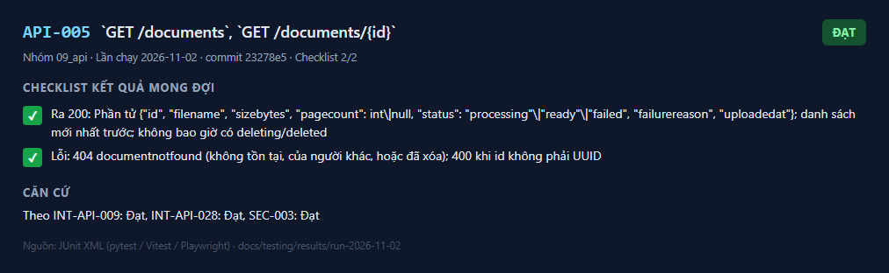
_Kết quả API-005 — lần chạy 2026-11-02_

---

## API-006

**`POST /documents/{id}/retry`** — ✅ **Đạt**

| Mục | Nội dung |
|---|---|
| Tự động hóa | Theo INT-API-014 |
| Đặc tả | [API-006.md](../../test_cases/09_api/API-006.md) |

**Checklist kết quả mong đợi**

- [x] Ra 200: Tài liệu với `status = "processing"`, `failure_reason = null`
- [x] Lỗi: 404; 409 `not_retryable` (trạng thái khác `failed`)

**Căn cứ:** Theo INT-API-014: Đạt

**Ảnh kết quả**

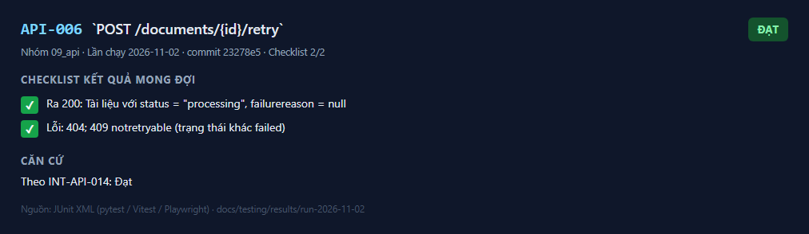
_Kết quả API-006 — lần chạy 2026-11-02_

---

## API-007

**`DELETE /documents/{id}`** — ✅ **Đạt**

| Mục | Nội dung |
|---|---|
| Tự động hóa | Theo INT-API-028..031 |
| Đặc tả | [API-007.md](../../test_cases/09_api/API-007.md) |

**Checklist kết quả mong đợi**

- [x] Ra 202: `{"id", "status": "deleting"}`
- [x] Lỗi: 404 (không tồn tại / ngoài phạm vi / đã xóa); 403 `not_owner` (được chia sẻ nhưng không phải chủ — khi OQ-003 cho phép); 403 `forbidden_role` (manager)

**Căn cứ:** Theo INT-API-028: Đạt, INT-API-029: Đạt, INT-API-030: Đạt, INT-API-031: Đạt

**Ảnh kết quả**

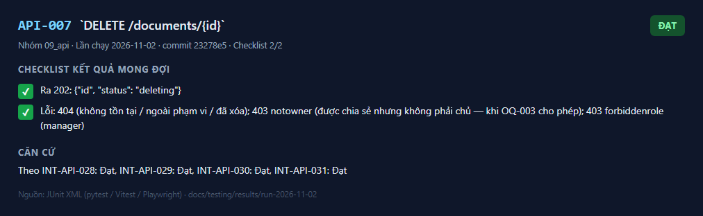
_Kết quả API-007 — lần chạy 2026-11-02_

---

## API-008

**`GET /documents/{id}/pages/{page}`, `GET /documents/{id}/file`** — ✅ **Đạt**

| Mục | Nội dung |
|---|---|
| Tự động hóa | Theo INT-API-019, INT-API-026, INT-API-027 |
| Đặc tả | [API-008.md](../../test_cases/09_api/API-008.md) |

**Checklist kết quả mong đợi**

- [x] Ra 200: Trang: `{"page", "page_count", "text", "document_name"}`. Tệp: `application/pdf`, `Content-Disposition: inline; filename*=UTF-8''…`, `Cache-Control: private, no-store`, `X-Content-Type-Options: nosniff`
- [x] Lỗi: 404 `document_not_found` (không `ready` hoặc ngoài phạm vi); 404 `page_not_found` (trang < 1 hoặc > `page_count`)

**Căn cứ:** Theo INT-API-019: Đạt, INT-API-026: Đạt, INT-API-027: Đạt

**Ảnh kết quả**

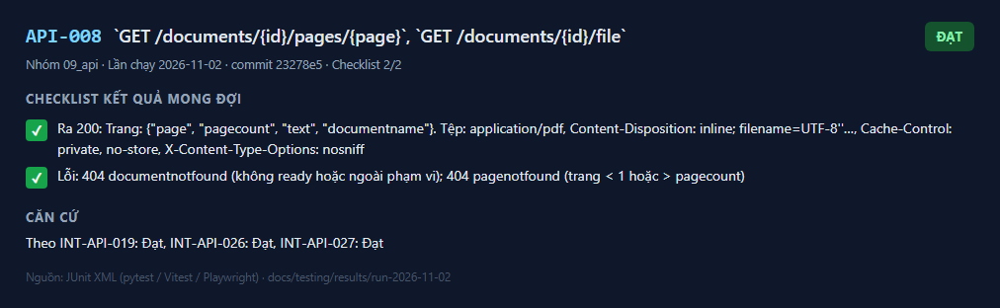
_Kết quả API-008 — lần chạy 2026-11-02_

---

## API-009

**`POST /events/source-opened`** — ✅ **Đạt**

| Mục | Nội dung |
|---|---|
| Tự động hóa | Theo `test_qa_flow.py::test_source_opened_event`; SEC-003 bước 5 |
| Đặc tả | [API-009.md](../../test_cases/09_api/API-009.md) |

**Checklist kết quả mong đợi**

- [x] Ra: 204; ghi đúng một `usage_events(kind="source_opened")`
- [x] Lỗi: 404 (tài liệu ngoài phạm vi hoặc không `ready`); 400 (`page` < 1)

**Căn cứ:** Theo SEC-003: Đạt

**Ảnh kết quả**

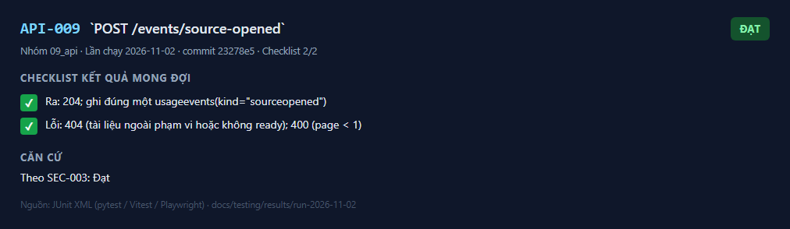
_Kết quả API-009 — lần chạy 2026-11-02_

---

## API-010

**`POST /conversations`, `POST\|GET /conversations/{id}/messages`** — ✅ **Đạt**

| Mục | Nội dung |
|---|---|
| Tự động hóa | Theo INT-API-019..025 |
| Đặc tả | [API-010.md](../../test_cases/09_api/API-010.md) |

**Checklist kết quả mong đợi**

- [x] Ra: Tạo 201 `{"id"}`. Hỏi 200 `{"message_id", "answer", "not_found": bool, "citations": [{"document_id", "document_name", "page", "cited_text"}], "latency_ms"}`. Lịch sử 200: mảng `{"id", "role", "content", "not_found", "latency_ms", "created_at", "citations", "feedback"}` theo thứ tự thời gian
- [x] Lỗi: 400 `question_empty`, `question_too_long`; 404 `conversation_not_found` (của người khác); 502 `answer_unavailable`; 504 `answer_timeout`

**Căn cứ:** Theo INT-API-019: Đạt, INT-API-020: Đạt, INT-API-021: Đạt, INT-API-022: Đạt, INT-API-023: Đạt, INT-API-024: Đạt, INT-API-025: Đạt

**Ảnh kết quả**

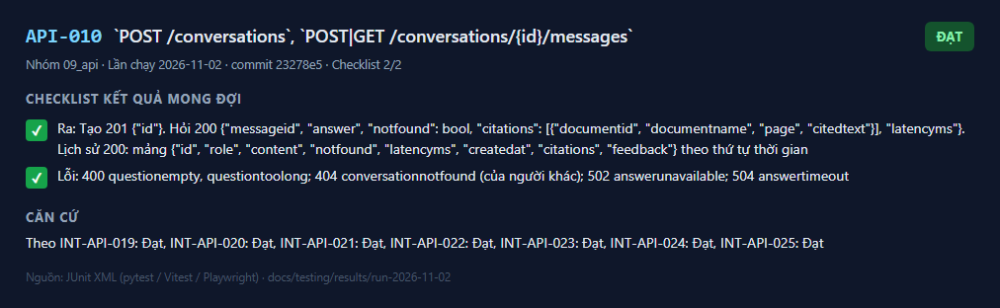
_Kết quả API-010 — lần chạy 2026-11-02_

---

## API-011

**`PUT /messages/{id}/feedback`** — ✅ **Đạt**

| Mục | Nội dung |
|---|---|
| Tự động hóa | Theo INT-API-032 |
| Đặc tả | [API-011.md](../../test_cases/09_api/API-011.md) |

**Checklist kết quả mong đợi**

- [x] Ra: 204; ghi đè giá trị cũ
- [x] Lỗi: 400 (giá trị khác); 404 `message_not_found` (của người khác hoặc tin nhắn của người dùng)

**Căn cứ:** Theo INT-API-032: Đạt

**Ảnh kết quả**

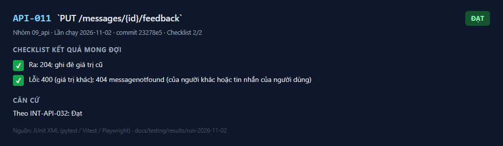
_Kết quả API-011 — lần chạy 2026-11-02_

---

## API-012

**`GET\|POST /admin/access`, `DELETE /admin/access/{user_id}`** — ✅ **Đạt**

| Mục | Nội dung |
|---|---|
| Tự động hóa | Theo INT-API-035, SEC-002 |
| Đặc tả | [API-012.md](../../test_cases/09_api/API-012.md) |

**Checklist kết quả mong đợi**

- [x] Ra: GET 200 mảng `{"user_id", "login", "display_name", "role", "status": "active"\|"revoked", "granted_at", "revoked_at"}`; POST 201 một phần tử; DELETE 204
- [x] Lỗi: 400 `invalid_role`, `invalid_login`; 404 `grant_not_found`; 409 `cannot_revoke_self`; 403 với vai trò khác

**Căn cứ:** Theo INT-API-035: Đạt, SEC-002: Đạt

**Ảnh kết quả**

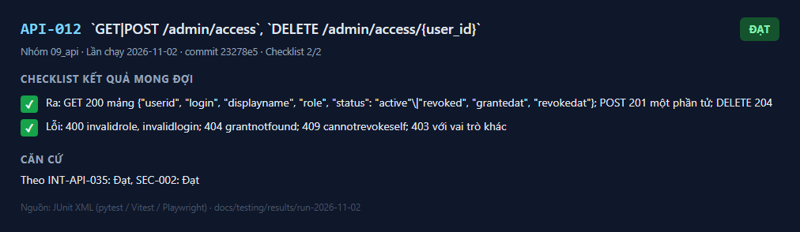
_Kết quả API-012 — lần chạy 2026-11-02_

---

## API-013

**`GET /admin/audit`** — ✅ **Đạt**

| Mục | Nội dung |
|---|---|
| Tự động hóa | Theo INT-API-033 |
| Đặc tả | [API-013.md](../../test_cases/09_api/API-013.md) |

**Checklist kết quả mong đợi**

- [x] Ra 200: `{"items": [{"id", "at", "user": {"id", "login"}, "documents": [{"id", "file_name": string\|null}]}], "next_cursor": string\|null}`; 50 mục/trang, mới nhất trước; không có nội dung câu hỏi
- [x] Lỗi: 400 (ngày sai định dạng, `cursor` < 1); 403 với vai trò khác

**Căn cứ:** Theo INT-API-033: Đạt

**Ảnh kết quả**

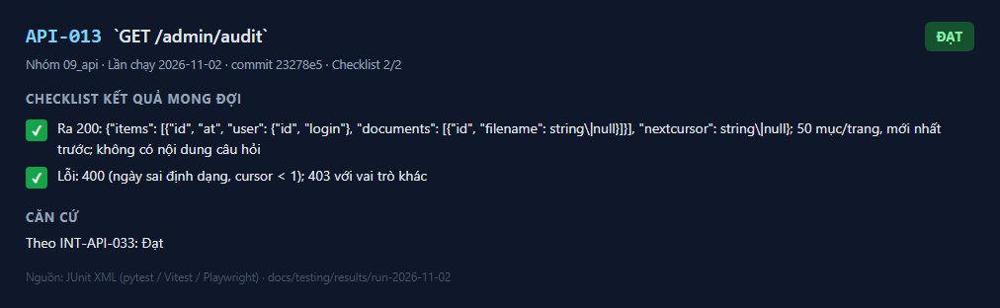
_Kết quả API-013 — lần chạy 2026-11-02_

---

## API-014

**`GET /reports/usage`** — ✅ **Đạt**

| Mục | Nội dung |
|---|---|
| Tự động hóa | Theo INT-API-034 |
| Đặc tả | [API-014.md](../../test_cases/09_api/API-014.md) |

**Checklist kết quả mong đợi**

- [x] Ra 200: `{"weeks": [{"week": ngày thứ Hai, "active_users", "questions", "helpful_ratio": số\|null, "feedback_count"}]}`, cũ trước, đủ `weeks` phần tử
- [x] Lỗi: 400 (`weeks` ngoài khoảng); 403 với vai trò khác `manager`

**Căn cứ:** Theo INT-API-034: Đạt

**Ảnh kết quả**

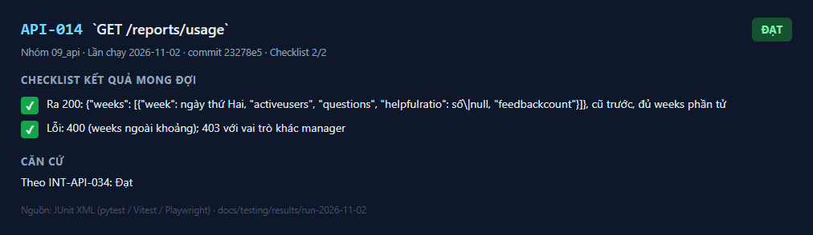
_Kết quả API-014 — lần chạy 2026-11-02_

---

## API-015

**`GET /health/live`, `GET /health/ready`, `GET /metrics`** — ✅ **Đạt**

| Mục | Nội dung |
|---|---|
| Tự động hóa | Theo INT-API-036, OPS-001 |
| Đặc tả | [API-015.md](../../test_cases/09_api/API-015.md) |

**Checklist kết quả mong đợi**

- [x] Ra: `live`: 200 `{"status": "ok"}`. `ready`: 200/503 `{"status": "ok"\|"unavailable", "components": {"database", "storage", "queue": {"ok": bool, "detail"?}}}` — không lộ chi tiết lỗi. `metrics`: văn bản Prometheus

**Căn cứ:** Theo INT-API-036: Đạt, OPS-001: Đạt

**Ảnh kết quả**

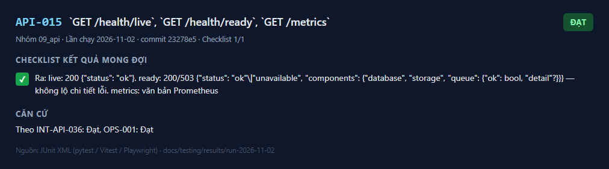
_Kết quả API-015 — lần chạy 2026-11-02_

---
