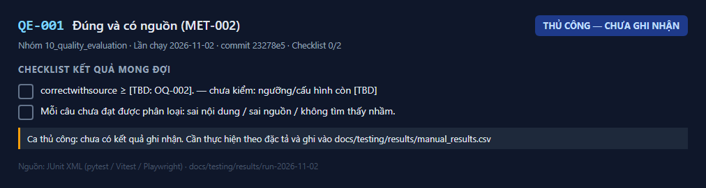
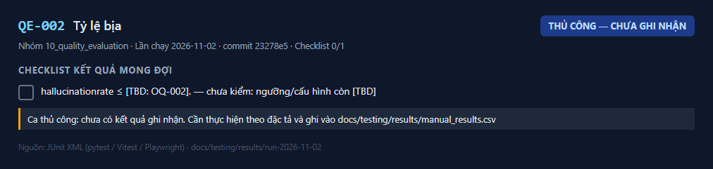
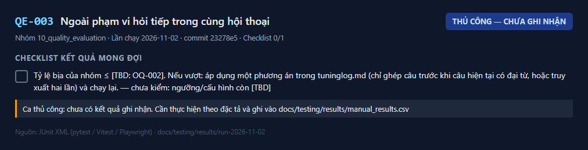
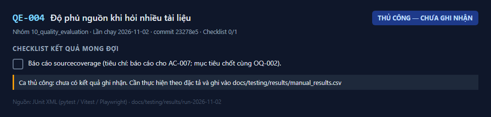
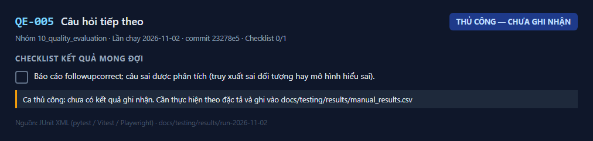
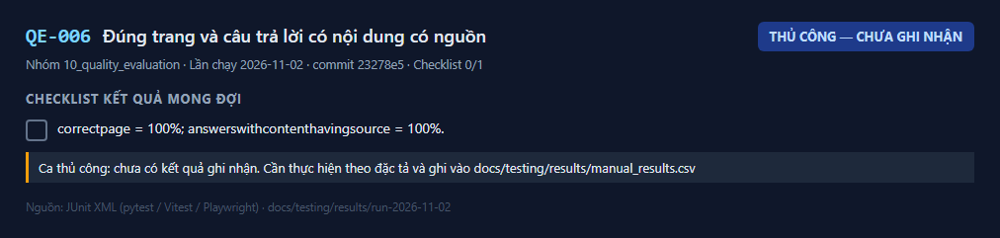
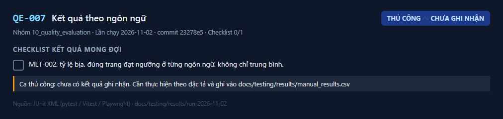
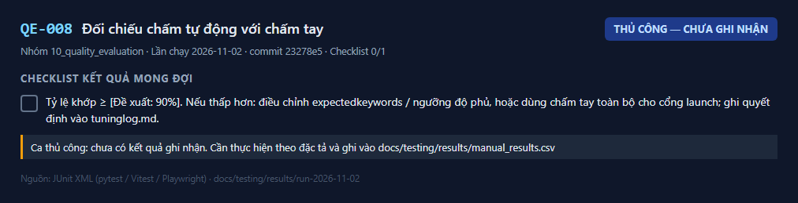

# 10 — Ca kiểm thử chất lượng câu trả lời (QE-001..QE-008) — kết quả chi tiết

Lần chạy: [README](README.md) · Đặc tả: [10_quality_evaluation](../../test_cases/10_quality_evaluation/README.md)

| Mã | Tên | Ưu tiên | Kết quả | Kiểm thử tự động đạt | Ảnh |
|---|---|---|---|---|---|
| [QE-001](#qe-001) | Đúng và có nguồn (MET-002) | — | 📝 Thủ công — chưa ghi nhận | — | 1 |
| [QE-002](#qe-002) | Tỷ lệ bịa | — | 📝 Thủ công — chưa ghi nhận | — | 1 |
| [QE-003](#qe-003) | Ngoài phạm vi hỏi tiếp trong cùng hội thoại | — | 📝 Thủ công — chưa ghi nhận | — | 1 |
| [QE-004](#qe-004) | Độ phủ nguồn khi hỏi nhiều tài liệu | — | 📝 Thủ công — chưa ghi nhận | — | 1 |
| [QE-005](#qe-005) | Câu hỏi tiếp theo | — | 📝 Thủ công — chưa ghi nhận | — | 1 |
| [QE-006](#qe-006) | Đúng trang và câu trả lời có nội dung có nguồn | — | 📝 Thủ công — chưa ghi nhận | — | 1 |
| [QE-007](#qe-007) | Kết quả theo ngôn ngữ | — | 📝 Thủ công — chưa ghi nhận | — | 1 |
| [QE-008](#qe-008) | Đối chiếu chấm tự động với chấm tay | — | 📝 Thủ công — chưa ghi nhận | — | 1 |

## QE-001

**Đúng và có nguồn (MET-002)** — 📝 **Thủ công — chưa ghi nhận**

| Mục | Nội dung |
|---|---|
| Mục tiêu | Tỷ lệ câu `in_scope` trả lời đúng **và** có ít nhất một nguồn khớp tài liệu + trang mong đợi đạt ngưỡng |
| Truy vết | BR-006, BR-013, AC-006, AC-013, US-008, US-016, LG-02 |
| Tự động hóa | Thủ công |
| Đặc tả | [QE-001.md](../../test_cases/10_quality_evaluation/QE-001.md) |

**Checklist kết quả mong đợi**

- [ ] `correct_with_source` ≥ [TBD: OQ-002]. — _chưa kiểm: ngưỡng/cấu hình còn [TBD]_
- [ ] Mỗi câu chưa đạt được phân loại: sai nội dung / sai nguồn / không tìm thấy nhầm.

**Ảnh kết quả**

_Kết quả QE-001 — lần chạy 2026-11-02_

**Cách ghi nhận:** thực hiện theo đặc tả rồi thêm dòng `QE-001,<Đạt|Không đạt|Bị chặn>,<ngày>,<người>,<ghi chú>` vào `docs/testing/results/manual_results.csv`.

---

## QE-002

**Tỷ lệ bịa** — 📝 **Thủ công — chưa ghi nhận**

| Mục | Nội dung |
|---|---|
| Mục tiêu | Câu ngoài phạm vi nhận "không tìm thấy" thay vì câu trả lời không có căn cứ |
| Truy vết | BR-009, AC-009, US-011, LG-03, RSK-001 |
| Tự động hóa | Thủ công |
| Đặc tả | [QE-002.md](../../test_cases/10_quality_evaluation/QE-002.md) |

**Checklist kết quả mong đợi**

- [ ] `hallucination_rate` ≤ [TBD: OQ-002]. — _chưa kiểm: ngưỡng/cấu hình còn [TBD]_

**Ảnh kết quả**

_Kết quả QE-002 — lần chạy 2026-11-02_

**Cách ghi nhận:** thực hiện theo đặc tả rồi thêm dòng `QE-002,<Đạt|Không đạt|Bị chặn>,<ngày>,<người>,<ghi chú>` vào `docs/testing/results/manual_results.csv`.

---

## QE-003

**Ngoài phạm vi hỏi tiếp trong cùng hội thoại** — 📝 **Thủ công — chưa ghi nhận**

| Mục | Nội dung |
|---|---|
| Mục tiêu | Câu ngoài phạm vi hỏi ngay sau một câu có đáp án (truy vấn bị ghép với câu trước) vẫn nhận "không tìm thấy" |
| Truy vết | BR-009, TR-01, `tuning_log.md` mục "Ghi nhận" |
| Tự động hóa | Thủ công |
| Đặc tả | [QE-003.md](../../test_cases/10_quality_evaluation/QE-003.md) |

**Checklist kết quả mong đợi**

- [ ] Tỷ lệ bịa của nhóm ≤ [TBD: OQ-002]. Nếu vượt: áp dụng một phương án trong `tuning_log.md` (chỉ ghép câu trước khi câu hiện tại có đại từ, hoặc truy xuất hai lần) và chạy lại. — _chưa kiểm: ngưỡng/cấu hình còn [TBD]_

**Ảnh kết quả**

_Kết quả QE-003 — lần chạy 2026-11-02_

**Cách ghi nhận:** thực hiện theo đặc tả rồi thêm dòng `QE-003,<Đạt|Không đạt|Bị chặn>,<ngày>,<người>,<ghi chú>` vào `docs/testing/results/manual_results.csv`.

---

## QE-004

**Độ phủ nguồn khi hỏi nhiều tài liệu** — 📝 **Thủ công — chưa ghi nhận**

| Mục | Nội dung |
|---|---|
| Mục tiêu | Câu có đáp án nằm ở ≥ 2 tài liệu nhận nguồn từ tất cả các tài liệu đó |
| Truy vết | BR-007, AC-007, US-009 |
| Tự động hóa | Thủ công |
| Đặc tả | [QE-004.md](../../test_cases/10_quality_evaluation/QE-004.md) |

**Checklist kết quả mong đợi**

- [ ] Báo cáo `source_coverage` (tiêu chí: báo cáo cho AC-007; mục tiêu chốt cùng OQ-002).

**Ảnh kết quả**

_Kết quả QE-004 — lần chạy 2026-11-02_

**Cách ghi nhận:** thực hiện theo đặc tả rồi thêm dòng `QE-004,<Đạt|Không đạt|Bị chặn>,<ngày>,<người>,<ghi chú>` vào `docs/testing/results/manual_results.csv`.

---

## QE-005

**Câu hỏi tiếp theo** — 📝 **Thủ công — chưa ghi nhận**

| Mục | Nội dung |
|---|---|
| Mục tiêu | Câu hỏi tiếp theo dùng đại từ được trả lời đúng |
| Truy vết | BR-008, AC-008, US-010 |
| Tự động hóa | Thủ công |
| Đặc tả | [QE-005.md](../../test_cases/10_quality_evaluation/QE-005.md) |

**Checklist kết quả mong đợi**

- [ ] Báo cáo `follow_up_correct`; câu sai được phân tích (truy xuất sai đối tượng hay mô hình hiểu sai).

**Ảnh kết quả**

_Kết quả QE-005 — lần chạy 2026-11-02_

**Cách ghi nhận:** thực hiện theo đặc tả rồi thêm dòng `QE-005,<Đạt|Không đạt|Bị chặn>,<ngày>,<người>,<ghi chú>` vào `docs/testing/results/manual_results.csv`.

---

## QE-006

**Đúng trang và câu trả lời có nội dung có nguồn** — 📝 **Thủ công — chưa ghi nhận**

| Mục | Nội dung |
|---|---|
| Mục tiêu | Mọi citation có `cited_text` nằm trong văn bản trang được nêu; mọi câu trả lời có nội dung có nguồn |
| Truy vết | BR-012, BR-019, AC-012, AC-019, LG-04 |
| Tự động hóa | Thủ công |
| Đặc tả | [QE-006.md](../../test_cases/10_quality_evaluation/QE-006.md) |

**Checklist kết quả mong đợi**

- [ ] `correct_page` = 100%; `answers_with_content_having_source` = 100%.

**Ảnh kết quả**

_Kết quả QE-006 — lần chạy 2026-11-02_

**Cách ghi nhận:** thực hiện theo đặc tả rồi thêm dòng `QE-006,<Đạt|Không đạt|Bị chặn>,<ngày>,<người>,<ghi chú>` vào `docs/testing/results/manual_results.csv`.

---

## QE-007

**Kết quả theo ngôn ngữ** — 📝 **Thủ công — chưa ghi nhận**

| Mục | Nội dung |
|---|---|
| Mục tiêu | Mỗi ngôn ngữ đã chốt đạt ngưỡng chất lượng riêng |
| Truy vết | BR-010, AC-010, US-012, OQ-007 |
| Tự động hóa | Thủ công |
| Đặc tả | [QE-007.md](../../test_cases/10_quality_evaluation/QE-007.md) |

**Checklist kết quả mong đợi**

- [ ] MET-002, tỷ lệ bịa, đúng trang đạt ngưỡng ở **từng** ngôn ngữ, không chỉ trung bình.

**Ảnh kết quả**

_Kết quả QE-007 — lần chạy 2026-11-02_

**Cách ghi nhận:** thực hiện theo đặc tả rồi thêm dòng `QE-007,<Đạt|Không đạt|Bị chặn>,<ngày>,<người>,<ghi chú>` vào `docs/testing/results/manual_results.csv`.

---

## QE-008

**Đối chiếu chấm tự động với chấm tay** — 📝 **Thủ công — chưa ghi nhận**

| Mục | Nội dung |
|---|---|
| Mục tiêu | Chấm tự động (từ khóa / độ phủ từ) đáng tin trước khi dùng cho cổng launch |
| Truy vết | implement_plan 9.4, T4-01 |
| Tự động hóa | Thủ công |
| Đặc tả | [QE-008.md](../../test_cases/10_quality_evaluation/QE-008.md) |

**Checklist kết quả mong đợi**

- [ ] Tỷ lệ khớp ≥ [Đề xuất: 90%]. Nếu thấp hơn: điều chỉnh `expected_keywords` / ngưỡng độ phủ, hoặc dùng chấm tay toàn bộ cho cổng launch; ghi quyết định vào `tuning_log.md`.

**Ảnh kết quả**

_Kết quả QE-008 — lần chạy 2026-11-02_

**Cách ghi nhận:** thực hiện theo đặc tả rồi thêm dòng `QE-008,<Đạt|Không đạt|Bị chặn>,<ngày>,<người>,<ghi chú>` vào `docs/testing/results/manual_results.csv`.

---
