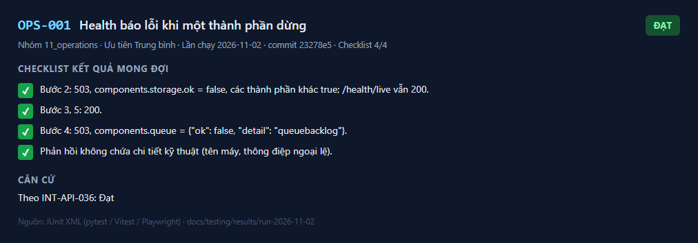
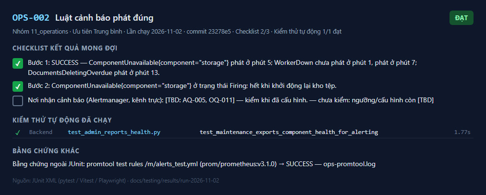
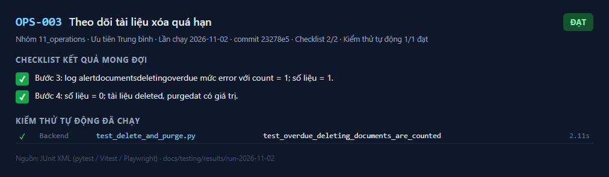
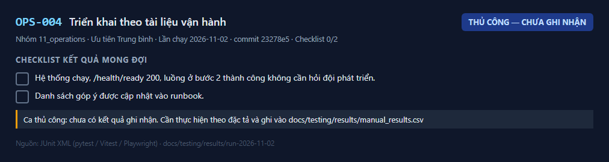
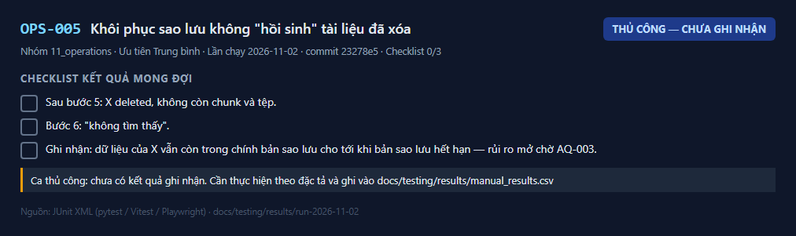

# 11 — Ca kiểm thử vận hành và sẵn sàng (OPS-001..OPS-005) — kết quả chi tiết

Lần chạy: [README](README.md) · Đặc tả: [11_operations](../../test_cases/11_operations/README.md)

| Mã | Tên | Ưu tiên | Kết quả | Kiểm thử tự động đạt | Ảnh |
|---|---|---|---|---|---|
| [OPS-001](#ops-001) | Health báo lỗi khi một thành phần dừng | Trung bình | ✅ Đạt | — | 1 |
| [OPS-002](#ops-002) | Luật cảnh báo phát đúng | Trung bình | ✅ Đạt | 1/1 | 1 |
| [OPS-003](#ops-003) | Theo dõi tài liệu xóa quá hạn | Trung bình | ✅ Đạt | 1/1 | 1 |
| [OPS-004](#ops-004) | Triển khai theo tài liệu vận hành | Trung bình | 📝 Thủ công — chưa ghi nhận | — | 1 |
| [OPS-005](#ops-005) | Khôi phục sao lưu không "hồi sinh" tài liệu đã xóa | Trung bình | 📝 Thủ công — chưa ghi nhận | — | 1 |

## OPS-001

**Health báo lỗi khi một thành phần dừng** — ✅ **Đạt**

| Mục | Nội dung |
|---|---|
| Mục tiêu | Dừng thật từng thành phần thì `/health/ready` báo lỗi đúng thành phần; khởi động lại thì trở về bình thường |
| Truy vết | BR-022, AC-022, US-021, T4-04 |
| Ưu tiên | Trung bình |
| Tự động hóa | Tích hợp: INT-API-036 (giả lập lỗi); ca này là kiểm thử thủ công trên hệ thống thật |
| Đặc tả | [OPS-001.md](../../test_cases/11_operations/OPS-001.md) |

**Checklist kết quả mong đợi**

- [x] Bước 2: 503, `components.storage.ok = false`, các thành phần khác `true`; `/health/live` vẫn 200.
- [x] Bước 3, 5: 200.
- [x] Bước 4: 503, `components.queue = {"ok": false, "detail": "queue_backlog"}`.
- [x] Phản hồi không chứa chi tiết kỹ thuật (tên máy, thông điệp ngoại lệ).

**Căn cứ:** Theo INT-API-036: Đạt

**Ảnh kết quả**

_Kết quả OPS-001 — lần chạy 2026-11-02_

---

## OPS-002

**Luật cảnh báo phát đúng** — ✅ **Đạt**

| Mục | Nội dung |
|---|---|
| Mục tiêu | Luật Prometheus phát cảnh báo khi thành phần dừng, worker dừng, tài liệu xóa quá hạn |
| Truy vết | AC-022, US-021, T4-04 |
| Ưu tiên | Trung bình |
| Tự động hóa | `deploy/monitoring/alerts_test.yml` (promtool); `test_admin_reports_health.py::test_maintenance_exports_component_health_for_alerting` |
| Đặc tả | [OPS-002.md](../../test_cases/11_operations/OPS-002.md) |

**Checklist kết quả mong đợi**

- [x] Bước 1: `SUCCESS` — `ComponentUnavailable{component="storage"}` phát ở phút 5; `WorkerDown` chưa phát ở phút 1, phát ở phút 7; `DocumentsDeletingOverdue` phát ở phút 13.
- [x] Bước 2: `ComponentUnavailable{component="storage"}` ở trạng thái Firing; hết khi khởi động lại kho tệp.
- [ ] Nơi nhận cảnh báo (Alertmanager, kênh trực): [TBD: AQ-005, OQ-011] — kiểm khi đã cấu hình. — _chưa kiểm: ngưỡng/cấu hình còn [TBD]_

**Kiểm thử tự động đã chạy** (1/1 đạt)

| | Tầng | Tệp | Kiểm thử | Thời gian |
|---|---|---|---|---|
| ✅ | Backend | `test_admin_reports_health.py` | test_maintenance_exports_component_health_for_alerting | 1.77 s |

**Bằng chứng ngoài JUnit:** `promtool test rules /m/alerts_test.yml` (prom/prometheus:v3.1.0) → `SUCCESS` — [ops-promtool.log](ops-promtool.log)

**Ảnh kết quả**

_Kết quả OPS-002 — lần chạy 2026-11-02_

---

## OPS-003

**Theo dõi tài liệu xóa quá hạn** — ✅ **Đạt**

| Mục | Nội dung |
|---|---|
| Mục tiêu | Tài liệu ở `deleting` quá `PURGE_SLA_HOURS` được đếm, ghi log cảnh báo và xuất số liệu |
| Truy vết | BR-024, US-007, T3-02 |
| Ưu tiên | Trung bình |
| Tự động hóa | `test_delete_and_purge.py::test_overdue_deleting_documents_are_counted` |
| Đặc tả | [OPS-003.md](../../test_cases/11_operations/OPS-003.md) |

**Checklist kết quả mong đợi**

- [x] Bước 3: log `alert_documents_deleting_overdue` mức error với `count = 1`; số liệu = 1.
- [x] Bước 4: số liệu = 0; tài liệu `deleted`, `purged_at` có giá trị.

**Kiểm thử tự động đã chạy** (1/1 đạt)

| | Tầng | Tệp | Kiểm thử | Thời gian |
|---|---|---|---|---|
| ✅ | Backend | `test_delete_and_purge.py` | test_overdue_deleting_documents_are_counted | 2.11 s |

**Ảnh kết quả**

_Kết quả OPS-003 — lần chạy 2026-11-02_

---

## OPS-004

**Triển khai theo tài liệu vận hành** — 📝 **Thủ công — chưa ghi nhận**

| Mục | Nội dung |
|---|---|
| Mục tiêu | Một người ngoài đội làm theo `ops_runbook.md` triển khai được lên môi trường kiểm thử |
| Truy vết | T4-07 |
| Ưu tiên | Trung bình |
| Tự động hóa | Thủ công |
| Đặc tả | [OPS-004.md](../../test_cases/11_operations/OPS-004.md) |

**Checklist kết quả mong đợi**

- [ ] Hệ thống chạy, `/health/ready` 200, luồng ở bước 2 thành công không cần hỏi đội phát triển.
- [ ] Danh sách góp ý được cập nhật vào runbook.

**Ảnh kết quả**

_Kết quả OPS-004 — lần chạy 2026-11-02_

**Cách ghi nhận:** thực hiện theo đặc tả rồi thêm dòng `OPS-004,<Đạt|Không đạt|Bị chặn>,<ngày>,<người>,<ghi chú>` vào `docs/testing/results/manual_results.csv`.

---

## OPS-005

**Khôi phục sao lưu không "hồi sinh" tài liệu đã xóa** — 📝 **Thủ công — chưa ghi nhận**

| Mục | Nội dung |
|---|---|
| Mục tiêu | Sau khi khôi phục từ bản sao lưu cũ, quy trình ở runbook mục 6 xóa lại các tài liệu đã bị xóa sau thời điểm sao lưu |
| Truy vết | BR-024, AQ-003, LG-08 |
| Ưu tiên | Trung bình |
| Tự động hóa | Thủ công |
| Đặc tả | [OPS-005.md](../../test_cases/11_operations/OPS-005.md) |

**Checklist kết quả mong đợi**

- [ ] Sau bước 5: X `deleted`, không còn chunk và tệp.
- [ ] Bước 6: "không tìm thấy".
- [ ] Ghi nhận: dữ liệu của X vẫn còn trong chính bản sao lưu cho tới khi bản sao lưu hết hạn — rủi ro mở chờ AQ-003.

**Ảnh kết quả**

_Kết quả OPS-005 — lần chạy 2026-11-02_

**Cách ghi nhận:** thực hiện theo đặc tả rồi thêm dòng `OPS-005,<Đạt|Không đạt|Bị chặn>,<ngày>,<người>,<ghi chú>` vào `docs/testing/results/manual_results.csv`.

---
