# Kết quả kiểm thử — 2026-11-02

| Mục | Nội dung |
|---|---|
| Phiên bản mã | `23278e5` trên `main` (mã ứng dụng không đổi kể từ 2026-10-24; ảnh Docker build 2026-10-28) |
| Môi trường | Windows 10, Docker Desktop 29.5.3 (2 CPU, 3,8 GB). Docker Compose `deploy/docker-compose.yml` + `deploy/docker-compose.e2e.yml` |
| Cấu hình AI | Adapter AI giả lập (`ANSWER_PROVIDER=fake`), embedding giả lập (`hash`). Không gọi Claude thật |
| Người chạy | Claude Code (hỗ trợ QA), theo yêu cầu của thucnv |
| Đặc tả ca | [docs/testing/test_cases/](../../test_cases/README.md) — 149 ca |

## 1. Tóm tắt

**Toàn bộ 297 kiểm thử tự động đạt, 0 lỗi, 1 bỏ qua** (cần `ANTHROPIC_API_KEY`).
Gắn vào 149 ca: **117 ca Đạt**, **0 ca Không đạt**, **32 ca thủ công chưa ghi nhận**
(UAT, hiệu năng thật, chất lượng câu trả lời với Claude thật, trình đọc màn hình, triển khai/khôi phục).
Trong 117 ca Đạt có 3 ca mới đạt phần tự động, phần thủ công còn chờ: ACC-001, ACC-007, UI-001.

| Tầng | Công cụ | Tổng | Đạt | Lỗi | Bỏ qua | Thời gian | Tệp |
|---|---|---|---|---|---|---|---|
| Backend (unit, tích hợp, bảo mật) | pytest, PostgreSQL + pgvector, S3 | 186 | **185** | 0 | 1 | 6m12s | [xml](backend-pytest.xml), [log](backend-pytest.log) |
| Frontend | Vitest + axe | 79 | **79** | 0 | 0 | 1m26s | [xml](frontend-vitest.xml), [log](frontend-vitest.log) |
| Đầu-cuối (giao diện thật, Chromium) | Playwright + axe | 20 | **20** | 0 | 0 | 6m00s | [xml](e2e-playwright.xml), [log](e2e-playwright.log) |
| Bộ đánh giá (công thức chỉ số) | pytest | 12 | **12** | 0 | 0 | 3s | [xml](evaluation-pytest.xml), [log](evaluation-pytest.log) |
| Luật cảnh báo | promtool | 1 tệp | **SUCCESS** | — | — | <1s | [log](ops-promtool.log) |
| **Tổng** | | **297** | **296** | **0** | **1** | | |

Ca bỏ qua: `tests/unit/test_claude_adapter.py:107` (`test_real_api_cites_correct_chunk`) gọi Claude thật, cần `ANTHROPIC_API_KEY`.

## 2. Kết quả theo nhóm ca

Bấm vào nhóm để xem **từng ca**: checklist kết quả mong đợi, kiểm thử tự động đã chạy (kèm thời gian), ảnh kết quả.

| Nhóm | Tổng | ✅ Đạt | ❌ Không đạt | 📝 Thủ công chưa ghi nhận | Chi tiết |
|---|---|---|---|---|---|
| 01 Đơn vị (UT) | 22 | 22 | 0 | 0 | [01_unit.md](01_unit.md) |
| 02 Tích hợp API (INT-API) | 40 | 40 | 0 | 0 | [02_integration_api.md](02_integration_api.md) |
| 03 Hệ thống / đầu-cuối (E2E) | 13 | 13 | 0 | 0 | [03_e2e_system.md](03_e2e_system.md) |
| 04 Chấp nhận (UAT) | 11 | 0 | 0 | 11 | [04_acceptance.md](04_acceptance.md) |
| 05 Hiệu năng (PERF) | 6 | 2 | 0 | 4 | [05_performance.md](05_performance.md) |
| 06 Bảo mật (SEC) | 13 | 11 | 0 | 2 | [06_security.md](06_security.md) |
| 07 Khả năng tiếp cận (ACC) | 8 | 6 | 0 | 2 | [07_accessibility.md](07_accessibility.md) |
| 08 Giao diện (UI) | 8 | 5 | 0 | 3 | [08_ui.md](08_ui.md) |
| 09 API hợp đồng (API) | 15 | 15 | 0 | 0 | [09_api.md](09_api.md) |
| 10 Chất lượng câu trả lời (QE) | 8 | 0 | 0 | 8 | [10_quality_evaluation.md](10_quality_evaluation.md) |
| 11 Vận hành (OPS) | 5 | 3 | 0 | 2 | [11_operations.md](11_operations.md) |
| **Tổng** | **149** | **117** | **0** | **32** | [tong-hop-summary.md](tong-hop-summary.md) |

Checklist trong các tệp chi tiết: **257 mục đã đánh dấu**, **64 mục để trống** (thuộc ca thủ công, mục còn `[TBD]`, hoặc phần cần xác nhận thủ công).

### Cách đọc checklist

| Ký hiệu | Nghĩa |
|---|---|
| `[x]` | Kết quả mong đợi được chứng minh bởi kiểm thử tự động đạt trong lần chạy này (hoặc kết quả thủ công đã ghi trong `manual_results.csv`) |
| `[ ]` … _cần xác nhận thủ công_ | Không có kiểm thử tự động bao phủ, người kiểm thử phải làm và ghi nhận |
| `[ ]` … _chưa kiểm: … [TBD]_ | Ngưỡng hoặc cấu hình chưa chốt (OQ/AQ), chưa thể kết luận |

## 3. Checklist chung của lần chạy

**Chuẩn bị môi trường**
- [x] Docker Desktop chạy; `postgres`, `objectstore` healthy
- [x] Stack E2E (`backend`, `worker`, `frontend`, `seed`, `migrate`) lên đủ; `http://localhost:5173` trả 200
- [x] Tài khoản mẫu `e2e.*` được tạo bởi dịch vụ `seed`
- [x] Ảnh Docker mới hơn commit mã ứng dụng cuối cùng (kết quả phản ánh mã hiện tại)

**Kiểm thử tự động**
- [x] Backend pytest: 185 đạt, 0 lỗi
- [ ] Backend pytest: ca gọi Claude thật (`test_real_api_cites_correct_chunk`) — bỏ qua, cần `ANTHROPIC_API_KEY`
- [x] Frontend Vitest: 79/79, gồm kiểm tra axe trên từng màn hình
- [x] E2E Playwright: 20/20, ảnh chụp mọi ca
- [x] Ảnh màn hình S-01..S-07 cập nhật (`screenshots.spec.ts`)
- [x] Bộ đánh giá — công thức chỉ số: 12/12
- [x] promtool: luật cảnh báo `SUCCESS`

**Truy vết**
- [x] Mọi ca có kiểm thử tự động đều tìm thấy kết quả (0 ca "Chưa có kết quả")
- [ ] 26 kiểm thử chạy nhưng chưa gắn với ca nào (xem mục 6)

**Còn phải làm thủ công** (32 ca + 3 phần thủ công) — xem mục 5.

## 4. Ảnh kết quả

### 4.0 Ảnh kết quả từng ca

Mỗi ca trong 149 ca có một ảnh kết quả riêng, đặt ở [screenshots/ca/](screenshots/ca/) với tên `<Mã ca>.png`.
Ảnh được nhúng đầu tiên trong mục **Ảnh kết quả** của ca đó trong tệp chi tiết của nhóm. Mỗi ảnh gồm:
- trạng thái ca;
- checklist kết quả mong đợi, có đánh dấu từng mục;
- các kiểm thử tự động đã chạy, kèm ✓/✗ và thời gian;
- căn cứ hoặc bằng chứng khác, nếu có.

Ảnh được dựng từ JUnit của lần chạy này. Với ca E2E/ACC/UI, ảnh giao diện thật (mục 4.2) đặt ngay sau ảnh kết quả.

| Ca tự động (INT-API-010) | Ca nửa tự động (ACC-001) | Ca thủ công (UAT-003) |
|---|---|---|
| 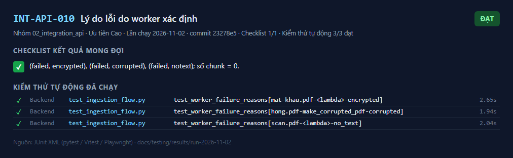 | 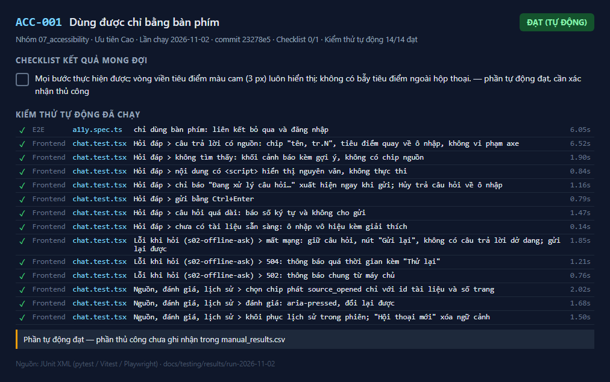 | 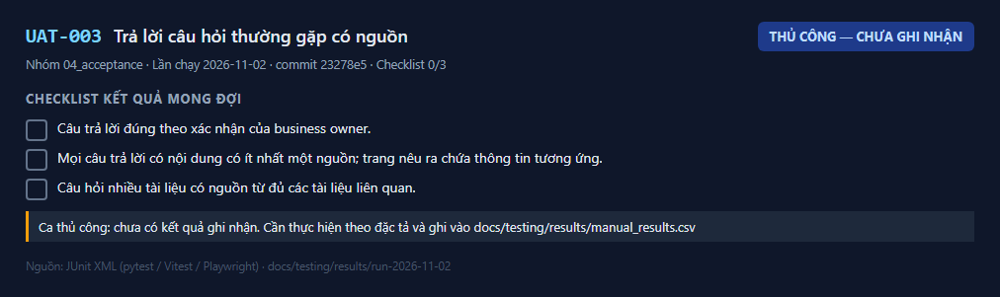 |

### 4.1 Kết quả từng tầng

Kết xuất từ tệp JUnit của lần chạy này.

| Backend — pytest | Frontend — Vitest |
|---|---|
| [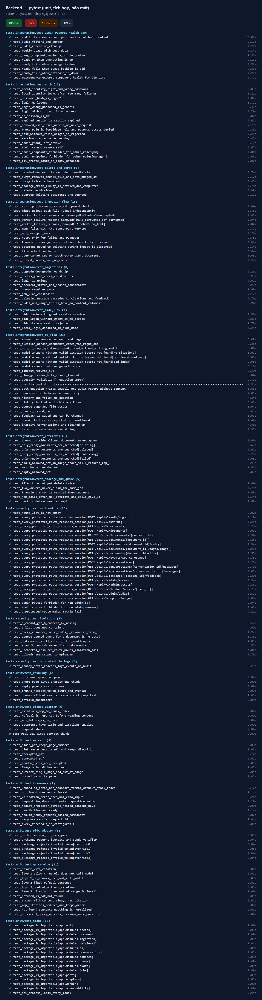](screenshots/ket-qua/backend-pytest.png) | [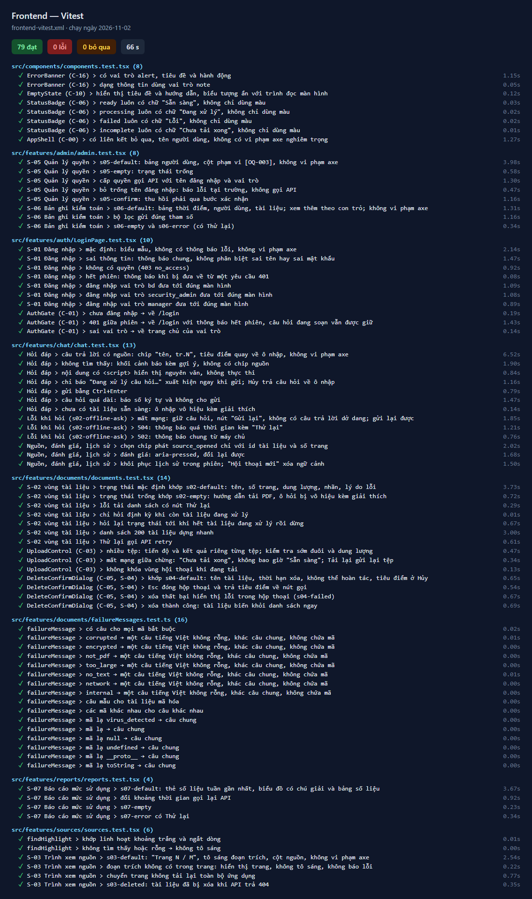](screenshots/ket-qua/frontend-vitest.png) |

| E2E — Playwright | Bộ đánh giá — pytest |
|---|---|
| [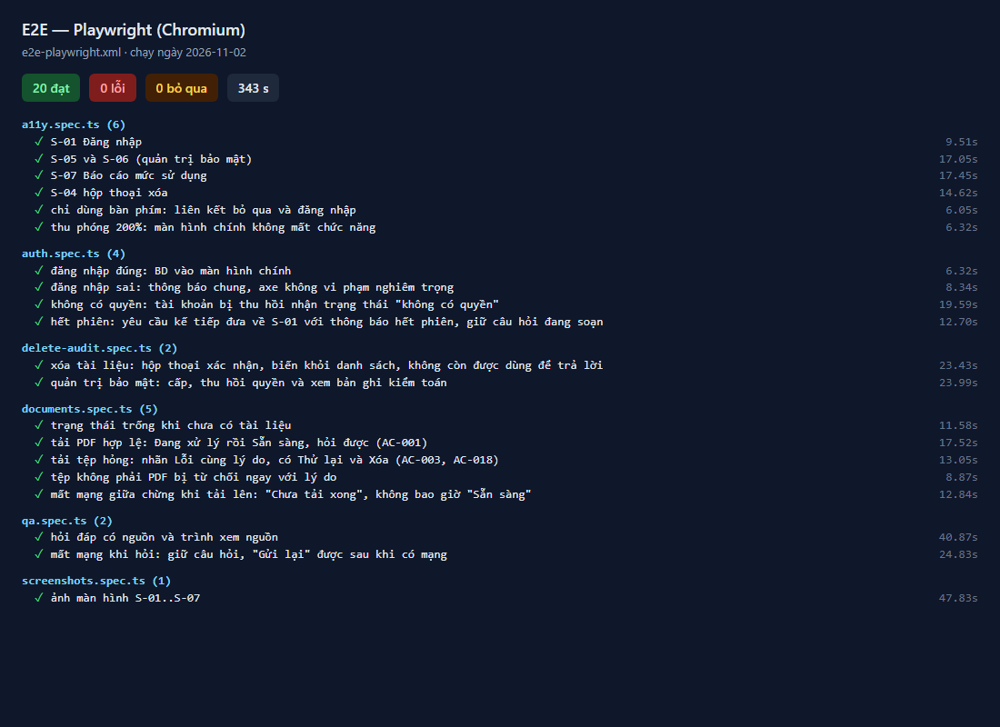](screenshots/ket-qua/e2e-playwright.png) | [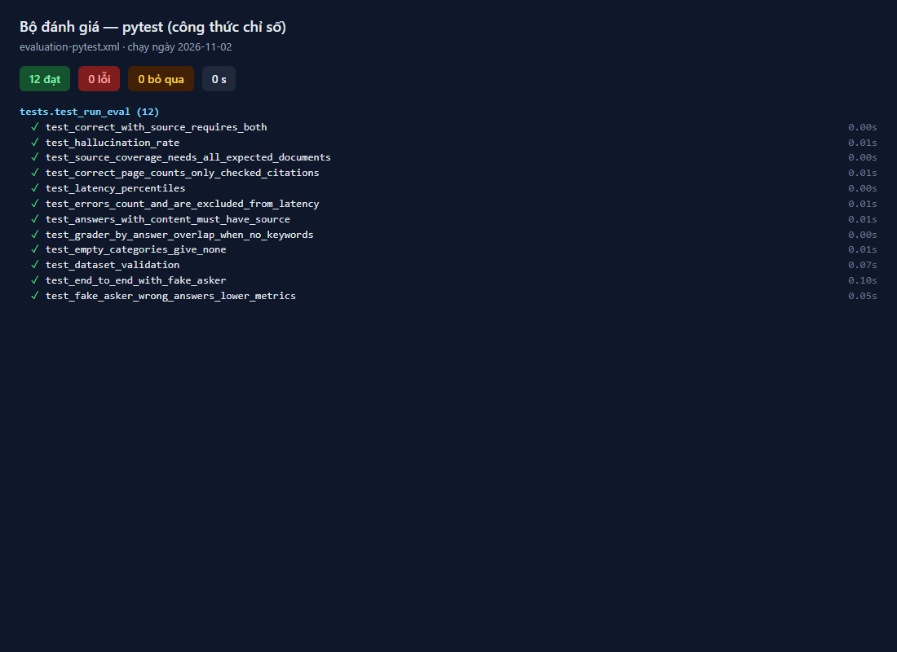](screenshots/ket-qua/evaluation-pytest.png) |

### 4.2 Ảnh giao diện thật

- [screenshots/e2e/](screenshots/e2e/): ảnh trạng thái cuối của 20 ca E2E (22 ảnh), tên `<số ca>_<tệp spec>_<tên ca>_<n>.png`.
  Ca 09 và 12 mở thêm một trang (tài khoản bị thu hồi / quản trị) nên có 2 ảnh. Các trang mở bằng `browser.newPage()`
  không đóng bị Playwright chụp lại ở những ca sau; ảnh trùng đó đã được loại.
- [screenshots/man-hinh/](screenshots/man-hinh/): màn hình S-01..S-07 do `screenshots.spec.ts` chụp.
- Mỗi ca E2E/ACC/UI trong tệp chi tiết nhúng ảnh giao diện tương ứng, sau ảnh kết quả của ca.

| S-01 Đăng nhập | S-01 Sai thông tin | S-02 Trống | S-02 Có tài liệu |
|---|---|---|---|
| 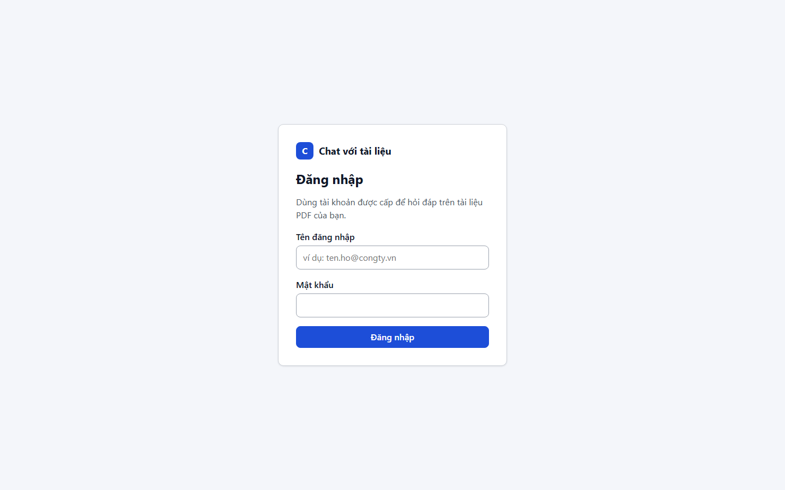 | 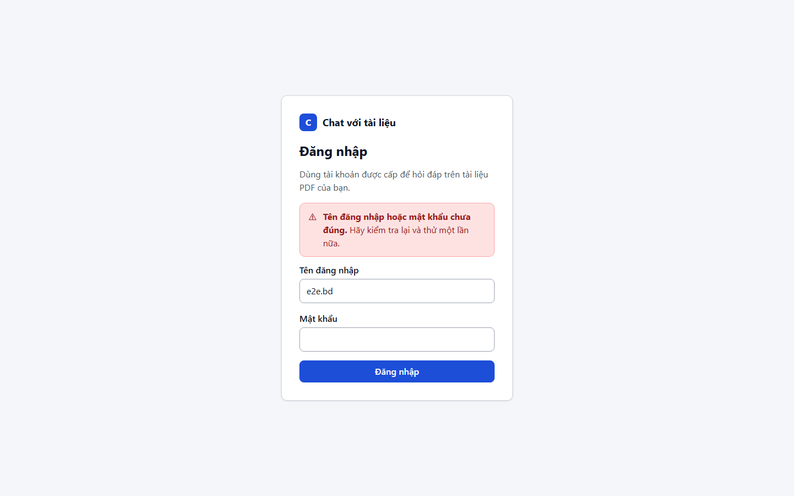 | 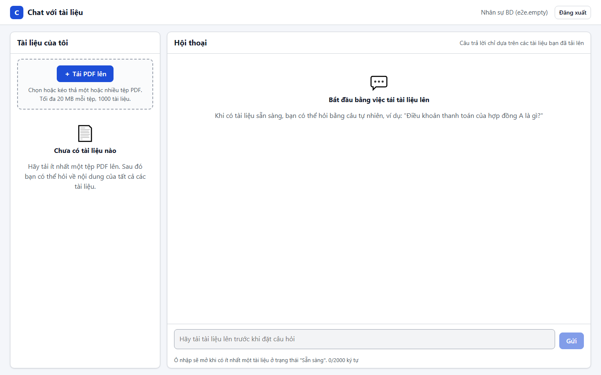 | 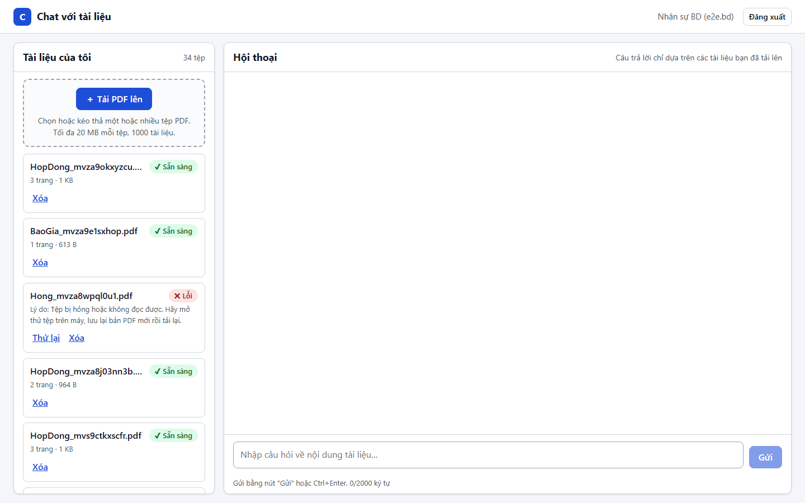 |

| S-04 Xác nhận xóa | S-05 Quản trị quyền | S-06 Nhật ký kiểm toán | S-07 Báo cáo sử dụng |
|---|---|---|---|
| 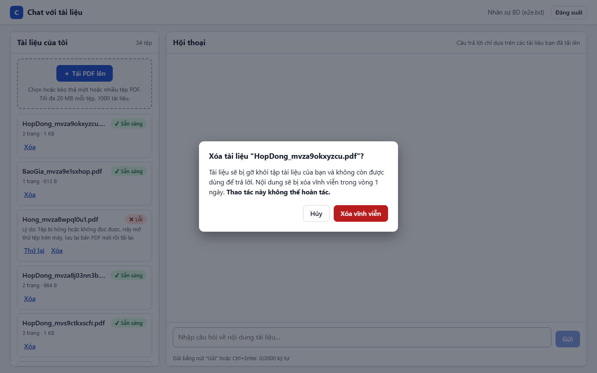 | 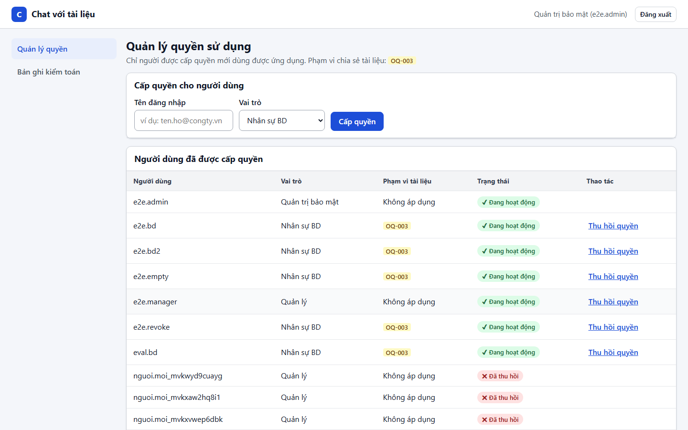 | 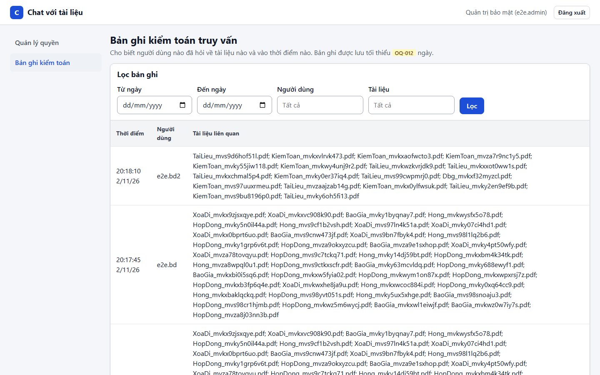 | 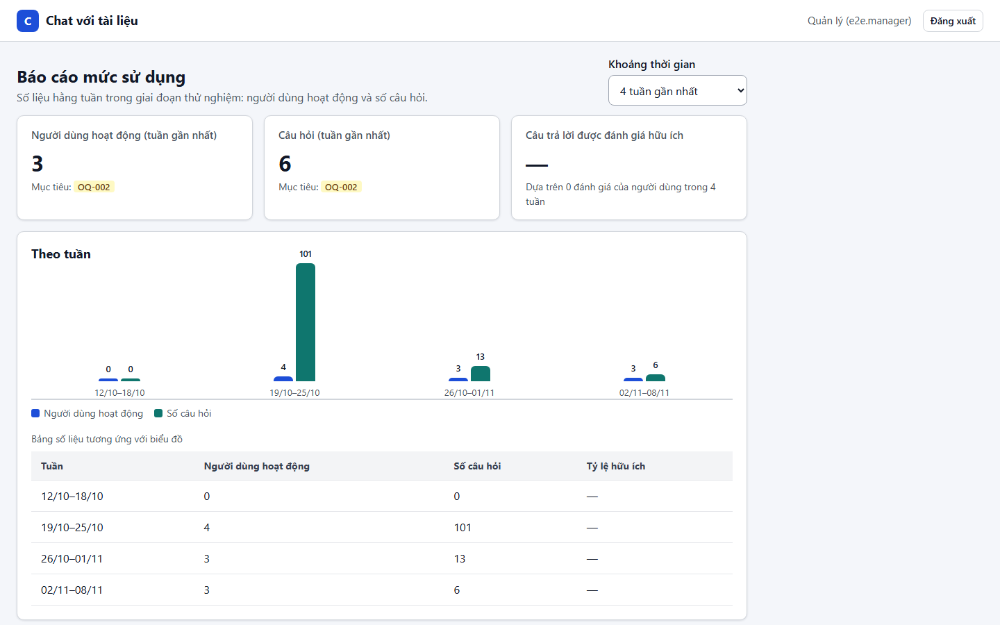 |

## 5. Ca còn chờ kiểm thử thủ công

Kiểm thử tự động không thay được các ca này: chúng cần người dùng thật, PDF thật, Claude thật hoặc môi trường staging.
Khi làm xong, ghi một dòng vào [manual_results.csv](../manual_results.csv) (`id,status,date,tester,note`).

| Nhóm | Ca | Cần gì |
|---|---|---|
| Chấp nhận | UAT-001..UAT-011 | Nhân sự BD, quản trị bảo mật, quản lý dùng PDF thật; cổng G3 (OQ-002) |
| Hiệu năng | PERF-001..PERF-004 | Môi trường ≥ 16 GB, `bge-m3` + Claude; ngưỡng `[TBD: OQ-002]` |
| Chất lượng câu trả lời | QE-001..QE-008 | Bộ câu hỏi đã duyệt + PDF thật, `bge-m3` + Claude (tốn phí). Báo cáo đánh giá hiện có (`v1-20261023`) dùng `hash`/`fake` — chỉ kiểm chứng luồng, **không** phải số liệu chất lượng |
| Bảo mật | SEC-008, SEC-012 | Tiêu đề bảo mật trên frontend production; job CI `dependency-audit` |
| Khả năng tiếp cận | ACC-002, ACC-004; phần thủ công ACC-001, ACC-007 | Trình đọc màn hình (NVDA/VoiceOver); kiểm tra bàn phím và thu phóng ở các màn hình còn lại |
| Giao diện | UI-002, UI-004 (kéo thả), UI-005; phần thủ công UI-001 | Độ rộng màn hình; kéo thả tệp; đối chiếu ảnh với thiết kế |
| Vận hành | OPS-004, OPS-005 | Triển khai theo runbook; khôi phục sao lưu |

## 6. Kiểm thử chưa gắn với ca nào (26)

Chạy và đạt, nhưng không ca nào trong `docs/testing/test_cases` tham chiếu tới. Không ảnh hưởng kết quả; nên bổ sung truy vết.

- `test_smoke.py::test_package_is_importable[...]` — 15 kiểm thử khói import mô-đun
- `test_framework.py`: `test_health_live_and_ready`, `test_health_ready_reports_failed_component`, `test_response_carries_request_id`
- `test_extract.py`: `test_extract_single_page_and_out_of_range`, `test_normalize_whitespace`
- `test_auth.py::test_session_started_once_per_day`, `test_ingestion_flow.py::test_user_cannot_see_or_touch_other_users_documents`,
  `test_qa_flow.py::test_source_opened_event`, `test_storage_and_queue.py::test_file_store_put_get_delete_twice`,
  `test_qa_service.py::test_refused_is_not_not_found`, `test_claude_adapter.py::test_real_api_cites_correct_chunk` (bỏ qua)

## 7. Cách chạy lại

```bash
# Frontend (không cần Docker)
cd frontend && npx vitest run --reporter=default --reporter=junit --outputFile.junit=../test-results/frontend-vitest.xml
# Backend
docker compose -f deploy/docker-compose.yml up -d postgres objectstore
scripts/backend-docker.sh pytest -q -p no:cacheprovider -rs --junitxml=test-results/backend.xml
# E2E (chụp ảnh mọi ca: thêm screenshot: 'on' vào cấu hình Playwright)
docker compose -f deploy/docker-compose.yml -f deploy/docker-compose.e2e.yml up -d
cd e2e && PLAYWRIGHT_JUNIT_OUTPUT_NAME=../test-results/e2e-playwright.xml npx playwright test --reporter=list,junit
# Bộ đánh giá (công thức) — trong ảnh backend dev, không cần Python cục bộ
docker run --rm -v "$PWD/evaluation:/ev" -w /ev cwd-backend-dev pytest -q --junitxml=/ev/evaluation.xml
# Luật cảnh báo
docker run --rm -v "$PWD/deploy/monitoring:/m" --entrypoint promtool prom/prometheus:v3.1.0 test rules /m/alerts_test.yml
# Tổng hợp theo ca
node .claude/skills/test-report/scripts/collect_results.mjs --results test-results,backend/test-results \
  --eval evaluation/reports --manual docs/testing/results/manual_results.csv --out test-results/summary
```
